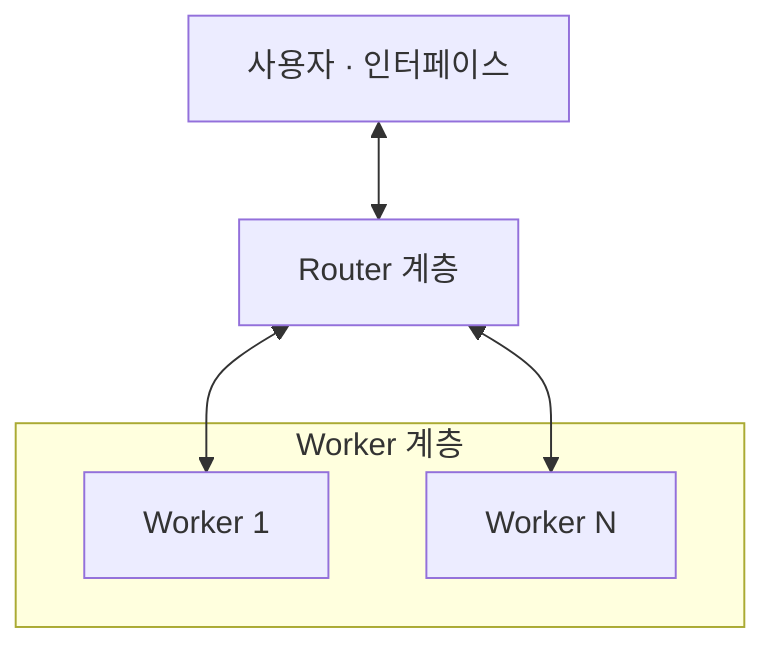
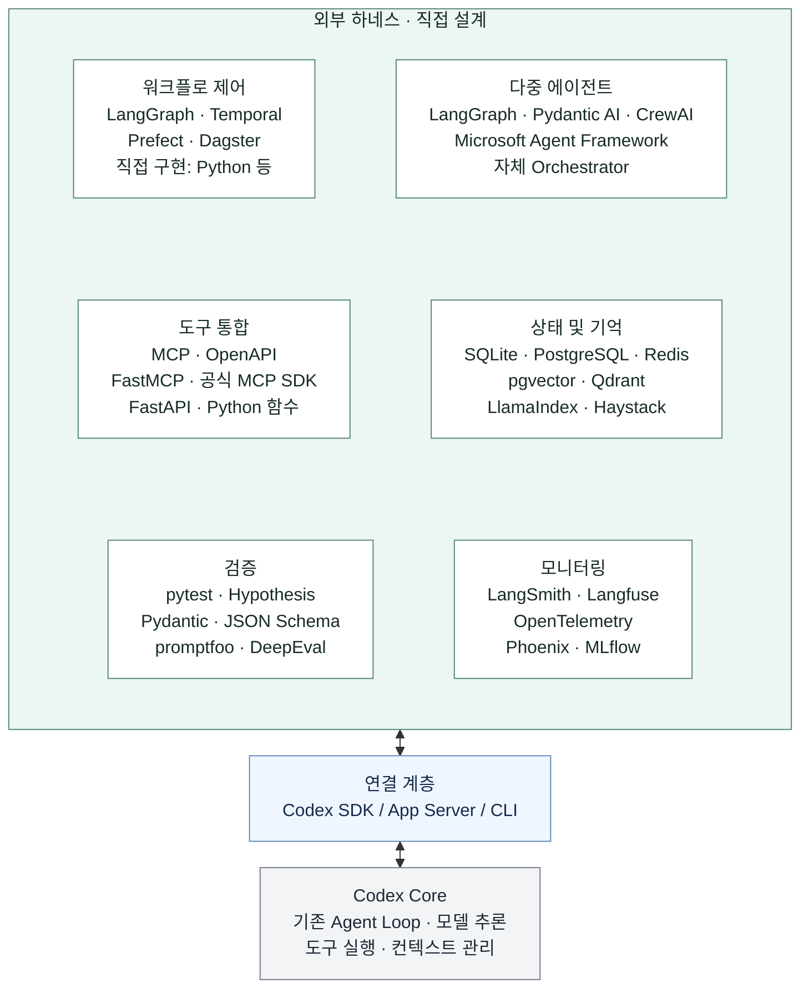
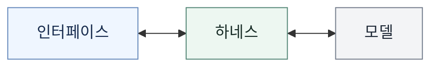
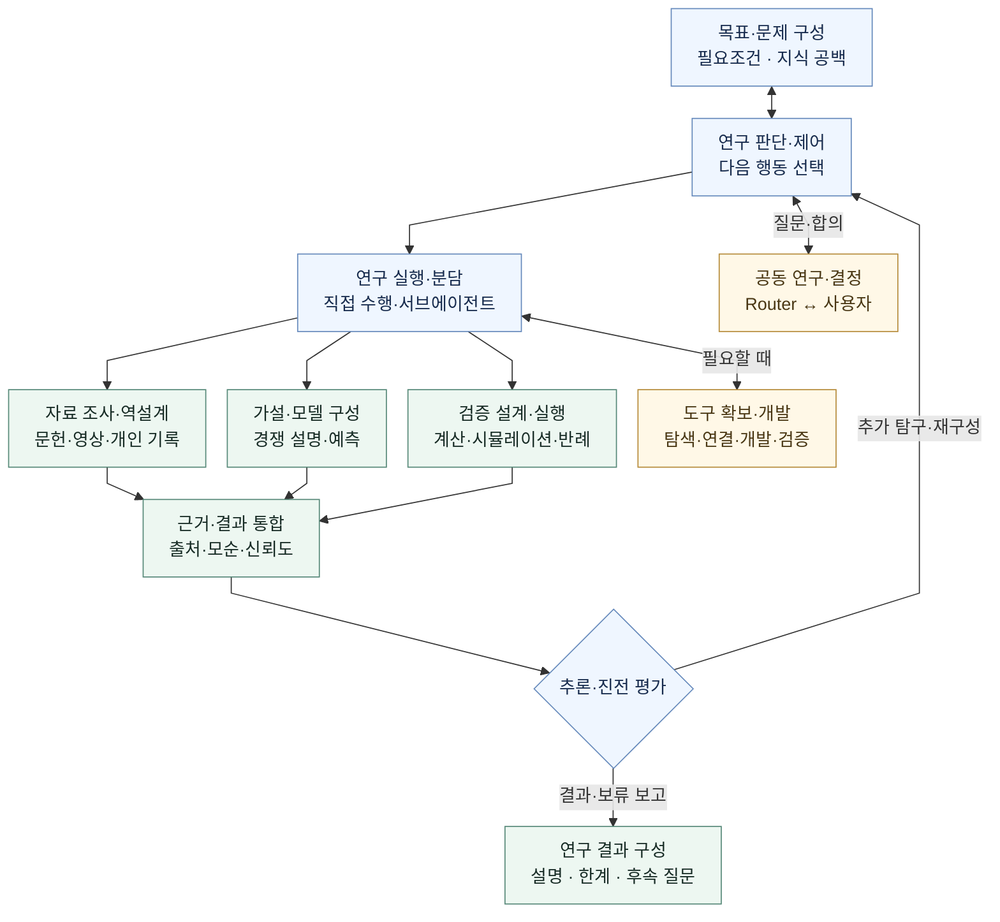
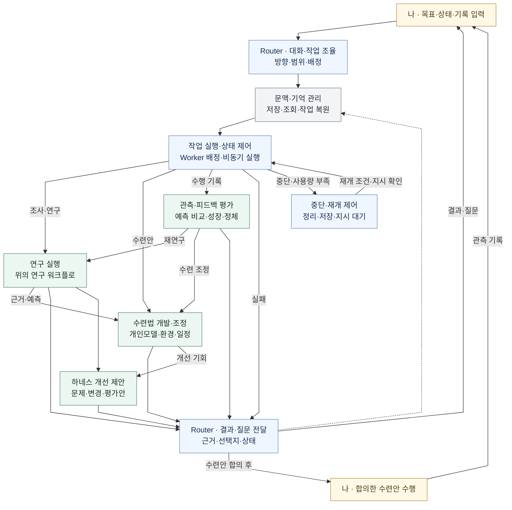

# 시스템 아키텍처

2026-11-06 (Asia/Seoul) · 정한 기술 구현 방향을 바탕으로 시스템 전체 운영 구조와 모듈 경계를 설계한다.

**기술 구현 방향:** 외부 하네스 ↔ Codex SDK / App Server / CLI ↔ Codex Core.

**시스템 운영 구조:** Router–Worker 기반 멀티에이전트 방식으로 모듈화한다.
선택의 기준은 [요구사항의 시스템 전체 운영 구조](SPECIFICATION.md#시스템-전체-운영-구조)다.

**기술 후보:** 각 영역의 제품·라이브러리는 비교할 후보이며, 모두 도입하거나 특정 조합을 확정한 것은 아니다.

## 시스템 운영 구조

이 그래프는 선택한 운영 구조의 두 계층을 나타낸다. Worker의 수·전문 역할과
계층 내부의 세부 구성은 모듈화 설계에서 정한다.

설계 참고: DeepSeek Harness 팀,
[Super-agent 设计探索：迈向更自主的 Agent 系统](https://mp.weixin.qq.com/s/zoS7GlReWPhfCjENGxXCdg)
(2026-10-31).

참고 글은 Router가 사람과의 상호작용·작업 간 조율을 맡고, Worker가 분리된 문맥에서
구체적인 작업을 수행하는 논리적 이중 구조를 설명한다. 복잡한 단일 작업에서는
Worker 내부에 서브에이전트나 팀을 둘 수 있다. 글은 아키텍처 탐구와 일부 구현된
프로토타입을 다루며, 제품의 현재 기능을 설명하는 문서와 구분한다.

현재 설계에서는 Router·Worker의 책임, 작업 분담·전달·통합과 문맥·상태·실행·복구의
모듈 경계를 구체화한다. 글의 이벤트 처리, 문맥 관리, 비동기 실행, 계산·상태·환경 분리,
Watchdog은 우리 요구사항에 맞춰 채택 범위를 정할 참고 기법이다.

## 하네스 구성도

외부 하네스의 여섯 영역에 적힌 기술은 비교 후보이며, 영역 사이의 실행 순서를 뜻하지 않는다.

**워크플로 제어 상세:** [연구 워크플로](#연구-워크플로) · [전체 실행 워크플로](#전체-실행-워크플로) · [모듈과 요구사항의 연결](#모듈과-요구사항의-연결)

## 사용 구조

여기서 하네스는 위의 외부 하네스, Codex 연결 계층과 Codex Core를 포함한다.

## 워크플로 제어 설계

요구사항의 연구·수련·피드백 흐름을 Router–Worker의 기능 모듈로 옮긴 **아키텍처 초안**이다.
상자는 논리적 기능 모듈을 나타내며, 여러 모듈을 한 Worker가 수행하거나 필요한 작업을
서브에이전트에 나눌 수 있다. 모듈마다 별도 에이전트나 고정된 전문 역할을 배치한 것은 아니다.

하네스의 실행 제어는 작업 배정·상태·중단·재개를 관리한다. 연구의 다음 행동과 근거의
의미는 담당 Worker가 판단한다. 아래 분기는 필요한 행동을 선택·반복하는 경로다.

### 연구 워크플로

전체 실행 워크플로의 **연구 실행** 모듈을 펼친 그림이다. 배정받은 문제와 문맥,
새 자료·관측 피드백을 입력받아 설명·근거·예측·한계·후속 질문을 돌려준다.

자료 조사·가설 구성·검증 중 필요한 행동을 선택하고, 독립적인 조사가 유용하면 병렬로
분담한다. 결과 통합과 진전 평가에서 질문·전제·전략을 다시 바꿀 수 있다.
의미 있는 결과를 보고한 뒤에도 합의 범위와 자원 안에서 후속 연구를 계속할 수 있다.
관측 사실·추정 기전·새 설계를 구분하고, 예측 일치는 가설의 잠정적 지지로 다룬다.
사용자 답변이 필요한 작업은 기다리되, 합의 범위 안의 독립적인 연구는 계속할 수 있다.
도구의 실행 실패나 부족한 결과도 통합·평가에 전달해 대안을 판단한다.
새 비용·권한이 필요한 도구는 해당 실행을 보류하고 연구 판단·제어에서 Router를 통해 함께 결정한다.

### 전체 실행 워크플로

**나의 목표 → 연구 → 수련법 개발 → 실제 수련 → 관측·성장 평가 → 다음 연구·수련**을
모듈로 연결한다. 두 Router 상자는 같은 Router 계층의 입력 조율과 출력 전달 기능이다.
실선은 작업·결과의 전달, 점선은 결과·결정의 기억 반영을 나타낸다.

- **Worker 기능:** 초록색 모듈은 배정된 Worker가 수행한다. 연구·수련·관측·개선 작업의
  결과 통합은 담당 Worker가 맡고, Router가 사용자에게 전달한다. 초록색 상자의 수가 Worker 수는 아니다.
- **연구와 수련의 병행:** 초기 상태와 근거가 확보되면 잠정 수련안을 제안한다.
  새로운 공법 연구나 개인 모델의 완성을 기다리지 않고 관측으로 계속 개선한다.
- **지속과 재개:** 작업 상태와 중간 근거도 보존한다. 사용량이 부족하면 정리해 멈추고,
  회복 후에도 사용자 재개 지시를 기다린다. 재개 시 문맥·기억 관리에서 작업을 복원한 뒤 배정한다.
  실패한 작업은 원인·대안을 판단해 보고하며
  재시도·보류 여부를 합의 범위 안에서 정한다. 실행 중 사용자 입력은 Router가 계속 받는다.
- **하네스 재귀개선:** 개선 제안을 사용자와 검토한다. 반영하기로 한 변경은 작업으로
  배정해 검증하고, 실제 변경 후 결과를 기억에 남겨 다음 개선 제안에 활용한다.
- **관측 공백:** 기록이 없으면 미확인으로 남기고 사용자가 다시 말할 때 확인한다.
  상태 확인을 위한 선제 연락 없이 합의 범위의 연구와 의미 있는 결과 보고를 이어간다.

### 모듈과 요구사항의 연결

| 모듈 | 담당과 동작 | 요구사항 근거 |
| --- | --- | --- |
| Router 대화·작업 조율 / 결과·질문 전달 | 사용자와 방향·범위를 정하고, 작업을 배정하며 결과·질문·실패를 전달 | [공동 결정](SPECIFICATION.md#4-함께-결정하고-자율성을-발전시키는-방식) · [운영 구조](SPECIFICATION.md#시스템-전체-운영-구조) |
| 문맥·기억 관리 | 현재 작업에 필요한 근거·합의를 조회하고 원자료·결정·개인모델·중간 상태·다음 작업을 보존 | [장기 기억](SPECIFICATION.md#자료-보존과-장기-기억) · [운영 기능](SPECIFICATION.md#에이전트-운영-기능의-명시적-포함) |
| 작업 실행·상태 / 중단·재개 제어 | 비동기 작업의 진행·대기·실패·완료와 사용량 부족 시 중단, 지시 후 재개를 관리 | [비용·사용량·재개](SPECIFICATION.md#8-비용사용량재개) · [운영 기능](SPECIFICATION.md#에이전트-운영-기능의-명시적-포함) |
| 목표·문제 구성 / 연구 판단·제어 | 목표의 필요조건, 지식 공백·모순을 찾고 대안과 정보가치·자원을 비교해 다음 행동과 질문을 선택 | [목표 지향 추론](SPECIFICATION.md#목표-지향-추론-워크플로-첨부-자료) · [지능적·프론티어 연구](SPECIFICATION.md#연구-추론-워크플로-설계-참고) |
| 연구 실행·분담 / 근거·결과 통합 | 필요한 작업을 직접 수행하거나 서브에이전트에 배정하고 근거·실패·모순을 통합 | [깊이 있는 연구](SPECIFICATION.md#깊이-있고-연쇄적으로-이어지는-연구-루프) · [운영 기능](SPECIFICATION.md#에이전트-운영-기능의-명시적-포함) |
| 자료 조사·역설계 | 문헌·선수 기록·영상을 폭넓게 확인하고 수행·훈련을 원리와 연결. 확인한 사실과 추정은 구분 | [과학적 역설계](SPECIFICATION.md#선수의-퍼포먼스훈련을-과학적으로-역설계) · [자료의 폭과 신뢰성](SPECIFICATION.md#자료-검토의-폭과-신뢰성) |
| 가설·모델 구성 / 검증 설계·실행 / 추론·진전 평가 | 경쟁 설명과 검증 가능한 예측을 만들고 계산·시뮬레이션·증명·관측·반례로 검토. 문제·전제·방법을 재구성 | [과학적·프론티어·지능적 연구](SPECIFICATION.md#연구-추론-워크플로-설계-참고) |
| 도구 확보·개발 | 기존 도구를 찾아 연결하거나 분석 코드를 개발·검증하고 유용한 작업법을 재사용 | [도구 확보·개발](SPECIFICATION.md#필요한-도구의-확보개발재사용) |
| 연구 결과 구성 / 수련법 개발·조정 | 근거·원리·예측·한계를 설명하고, 개인 상태·환경에 맞는 구성·세트·반복·빈도와 이유를 제안 | [과학적 역설계](SPECIFICATION.md#선수의-퍼포먼스훈련을-과학적으로-역설계) · [첫 수련안](SPECIFICATION.md#연구가-진행-중일-때의-첫-수련안) |
| 관측·피드백 평가 | 계획·추정과 실제 기록을 구분하고 예측 차이·성장·정체를 분석해 개인모델·연구·다음 수련에 반영 | [개인 모델](SPECIFICATION.md#5-개인-이해모델과-설명) · [기록 입력](SPECIFICATION.md#기록-입력-방식) · [최대 성장](SPECIFICATION.md#큰-철학-과학에-기반한-최대-성장) |
| 하네스 개선 제안 | 연구 중 관측한 문제와 개선안을 제시하고, 합의한 변경의 실제 평가 결과를 다음 제안에 연결 | [하네스 개선·재귀개선](SPECIFICATION.md#하네스-개선-제안과-재귀개선) |

Router·Worker·서브에이전트의 모델 실행은 기존 Codex 구독 사용량 경로로 연결한다.
새 비용·권한, 새로운 외부 서비스로의 개인 자료 제공, 개인 적용의 범위는 요구사항의
공동 결정 원칙을 따른다. 알고리즘·저장소·프레임워크와 개별 모듈의 배포 방식은 후속 설계에서 정한다.

## 영역별 도구·프레임워크 후보

Python은 프로그래밍 언어, MCP·OpenAPI는 연결·API 규격이다. 프레임워크, SDK, 저장소와 역할을 구분해 비교한다.
아래 링크는 각 프로젝트의 공식 문서·저장소다.

### 워크플로 제어

위의 [워크플로 제어 설계](#워크플로-제어-설계)를 구현할 기술 후보를 비교한다.

| 종류 | 후보 | 역할 |
| --- | --- | --- |
| 상태·그래프 실행 | [LangGraph](https://docs.langchain.com/oss/python/langgraph/overview) | 분기·반복·상태 보존과 사용자 개입을 포함하는 실행 흐름 |
| 지속 실행 | [Temporal](https://docs.temporal.io/workflows) | 장시간 작업·대기·실패 후 복구를 관리하는 실행 기반 |
| 작업 흐름 관리 | [Prefect](https://docs.prefect.io/v3/get-started) | Python 작업의 실행·상태·스케줄·실패 처리 |
| 데이터 작업 관리 | [Dagster](https://docs.dagster.io/) | 데이터 자산과 분석 파이프라인의 의존 관계·생성 이력 관리 |
| 직접 구현 | Python 등으로 작성한 제어 코드 | 프로젝트에 필요한 실행 규칙을 직접 구성 |

### 다중 에이전트

| 종류 | 후보 | 역할 |
| --- | --- | --- |
| 그래프 기반 구성 | [LangGraph](https://docs.langchain.com/oss/python/langgraph/overview) | 에이전트 작업과 일반 함수를 연결하는 흐름 구성 |
| 타입 기반 에이전트 SDK | [Pydantic AI](https://ai.pydantic.dev/) | 타입·구조화 결과를 활용하는 에이전트와 하위 에이전트 구성 |
| 팀·작업 흐름 | [CrewAI](https://docs.crewai.com/en/introduction) | 협력하는 에이전트 팀과 상태를 가진 작업 흐름 구성 |
| 에이전트·워크플로 프레임워크 | [Microsoft Agent Framework](https://learn.microsoft.com/en-us/agent-framework/overview/) | 에이전트와 함수를 연결하는 다중 에이전트 실행 구성 |
| 직접 구현 | 자체 Orchestrator | Codex 실행들을 프로젝트에 맞게 배정·조정 |

### 도구 통합

| 종류 | 후보 | 역할 |
| --- | --- | --- |
| 연결 규격 | [MCP](https://modelcontextprotocol.io/), [OpenAPI](https://spec.openapis.org/oas/latest.html) | 각각 모델용 도구 연결과 HTTP API 명세 |
| MCP 프레임워크 | [FastMCP](https://gofastmcp.com/getting-started/welcome) | 함수·데이터를 MCP 도구로 제공하고 서버·클라이언트 구성 |
| 프로토콜 SDK | [공식 MCP SDK](https://github.com/modelcontextprotocol/python-sdk) | MCP 서버·클라이언트와 도구 연결을 직접 구현 |
| API 프레임워크 | [FastAPI](https://fastapi.tiangolo.com/) | 분석·계산 기능을 HTTP API로 제공 |
| 직접 연결 | Python 함수 등 | 같은 실행 환경의 기능을 직접 호출 |

### 상태 및 기억

| 종류 | 후보 | 역할 |
| --- | --- | --- |
| 상태 저장 | [SQLite](https://www.sqlite.org/docs.html), [PostgreSQL](https://www.postgresql.org/docs/), [Redis](https://redis.io/docs/latest/) | 각각 내장 관계형 DB, 서버형 관계형 DB, 메모리 중심 데이터 저장소 |
| 벡터 저장·검색 | [pgvector](https://github.com/pgvector/pgvector), [Qdrant](https://qdrant.tech/documentation/) | 각각 PostgreSQL의 벡터 검색 확장과 벡터 검색 엔진 |
| 자료 연결·검색 프레임워크 | [LlamaIndex](https://developers.llamaindex.ai/python/framework/), [Haystack](https://docs.haystack.deepset.ai/docs/intro) | 문서·자료를 연결하고 검색·문맥 제공 파이프라인 구성 |

저장소와 검색 프레임워크는 서로 다른 역할이다. 저장소를 선택하는 것만으로 에이전트의 장기 기억이 완성되지는 않는다.

### 검증

| 종류 | 후보 | 역할 |
| --- | --- | --- |
| 코드·실행 검사 | [pytest](https://docs.pytest.org/), [Hypothesis](https://hypothesis.readthedocs.io/en/latest/) | 테스트 실행과 다양한 입력·경계 조건에 대한 속성 검사 |
| 데이터 형식 검사 | [Pydantic](https://docs.pydantic.dev/), [JSON Schema](https://json-schema.org/) | 입력·출력의 타입과 구조 검사 |
| 응답·에이전트 평가(Evals) | [promptfoo](https://www.promptfoo.dev/docs/intro/), [DeepEval](https://deepeval.com/docs/getting-started) | 사례별 결과 비교, 응답·에이전트 동작의 평가와 회귀 확인 |

형식 검사, 실행 성공, 연구 결과의 과학적 타당성은 서로 다른 검증 대상이다.

### 모니터링

| 종류 | 후보 | 역할 |
| --- | --- | --- |
| 에이전트 실행 관찰 | [LangSmith](https://docs.langchain.com/langsmith/observability), [Langfuse](https://langfuse.com/docs) | 실행 추적·디버깅·평가 결과 확인 |
| 계측 표준·도구 | [OpenTelemetry](https://opentelemetry.io/docs/what-is-opentelemetry/) | 추적·메트릭·로그의 생성·수집·전달 |
| 추적·평가 도구 | [Phoenix](https://arize.com/docs/phoenix) | 도구·검색·모델 호출 추적과 평가·실험 비교 |
| 추적·실험 관리 | [MLflow](https://mlflow.org/docs/latest/genai/tracing/) | 에이전트 실행 단계 추적과 실험·평가 관리 |

OpenTelemetry는 계측 기반이며 관찰 화면을 제공하는 제품과 함께 사용할 수 있다.

## Codex 연결과 선택 범위

- 연결 계층은 [Codex SDK](https://learn.chatgpt.com/docs/codex-sdk), [app-server](https://learn.chatgpt.com/docs/app-server), [CLI](https://learn.chatgpt.com/docs/cli)다. 언어·워크플로 프레임워크와 다른 선택이다.
- 모델 추론은 기존 Codex 계정의 사용량을 쓰는 실행 경로로 연결한다. 외부 에이전트 프레임워크의 기본 모델 API 연결이 Codex 구독 연동을 뜻하지는 않는다.
- 각 프레임워크와 Codex를 연결하는 방식은 아직 실행 검증하지 않았다. 모델 기반 평가와 임베딩을 사용하는 경우도 해당 모델·인증·비용 경로를 별도로 정한다.
- 이번에는 영역별 후보를 확장했다. 구체적인 채택 조합·배포 환경·서비스 비용은 후속 설계에서 정한다.

## 그래프 편집

그래프는 이 문서의 `mermaid` 코드 블록으로 작성되어 GitHub에서 직접 렌더링된다.
노드·연결·문구는 해당 코드 블록에서 수정한다.
