# 연구용 하네스 아키텍처

버전: 0.5 · 기준일: 2026-11-03 (Asia/Seoul)
상태: 합의한 논리 구조를 문서화함. Cloud 연결·배치와 실행 검증은 남아 있음.
근거: [요구사항 v0.20](SPECIFICATION.md), [기능 설계](FUNCTIONAL_DESIGN.md).

## 1. 목적과 범위

Codex SDK로 Codex를 제어하고 Codex Cloud·기존 구독 사용량으로 사용하는 연구용 하네스다.
Router / Worker 이중 계층을 사용한다. 별도의 메인 연구 에이전트를 추가하지 않는다.
연구 판단·설명·검증은 담당 Worker의 작업이며, Router는 사용자 소통·전역 조정·작업 분배를 맡는다.

[DeepSeek Super-agent 설계 글](https://mp.weixin.qq.com/s/zoS7GlReWPhfCjENGxXCdg)의
이중 계층·문맥 관리·인간 중심 상호작용·비동기 실행·연산과 상태 및 실행 환경의 분리·Watchdog을 기준으로 한다.
다중 채널 연동, 외부 채널 이벤트 수집·필터링, Thread 구독·직통 전달, 외부 사건을 감지한
선행 작업, 채널별 응답 규칙은 제외한다. 사용자 입력과 우리가 시작한 작업의 결과 전달은 유지한다.

그림은 이 합의를 한국어 Mermaid로 표현한 설계이며 원문 그림의 복제나 구현 완료 기록이 아니다.
원문의 긴 배경·중복 설명·실험 소개는 생략했다. 공개 프로토타입은 참고 자료이며
원문 설계 전체가 구현돼 있다는 근거로 취급하지 않는다.

### 1.1 컴퓨터 시스템 설계에서 가져온 원리

원문은 모델 하나의 프롬프트를 강화하는 데서 나아가, 연속성·동시 실행·응답성·복구를
시스템 구조로 해결한다. 아래 원리를 구분해야 기술 선택의 이유와 절충을 이해할 수 있다.

| 원리 | 원문의 설계 이유 | 우리 하네스에 적용하는 방식과 경계 |
| --- | --- | --- |
| 연속성과 처리량의 절충 | 한 세션은 문맥이 이어지지만 직렬 실행이 병목이고, 모두 독립 세션이면 맥락이 단절됨 | Router가 전역 결정과 작업 관계를 유지하고 Worker가 격리된 문맥에서 병렬 수행. 다중 세션의 사용량·전달 비용은 증가함 |
| 순서점·배치 처리 | 전역 결정을 한곳에 모으고 추론 중 쌓인 입력을 다음 호출에 함께 처리 | Router가 사용자 결정의 순서를 유지하고 관련 보고를 묶어 처리할 수 있음. 중단 지시를 일반 보고 뒤에서 무한 대기시키지 않음. 배치 기준·상한은 미정 |
| Fast Path / Slow Path | 확실한 처리는 코드로, 의미 판단은 모델로 수행 | 작업 ID가 있는 완료 결과는 코드로 해당 작업에 연결하고 모호한 새 요청은 Router가 판단. 삭제한 외부 채널 필터·구독 직통을 복원하는 것이 아님 |
| 캐시·지역성, Inline / Spill | 제한된 문맥에는 곧 필요한 내용만 넣고 긴 내용은 밖으로 옮김 | 최근 결정·근거 요약을 직접 제공하고 ID를 따라 원문 조회. 연쇄 검색은 관련 기록 탐색 방식이며 장기 기억의 완전성을 보장하지 않음 |
| 비동기 I/O | 긴 도구 실행 때문에 전체 대화가 막히지 않도록 시작과 완료를 분리 | 시작 요청은 작업 ID를 반환하고 결과는 나중에 전달. 단일 모델의 한 추론 호출 자체를 병렬화한다는 뜻은 아님 |
| 연산·상태 분리 | 계산 프로세스를 교체해도 지속 상태로 작업을 이어감 | 세션 이력·작업·전달 상태를 프로세스 밖에 보존하고 재개 때 복원. 실제 Codex 세션 복구에 필요한 파일·상태 범위는 확인 필요 |
| 연산·실행 환경 분리 | 실제 환경을 복제·이전하지 않고 필요한 명령과 결과만 교환 | 도구 실행 인터페이스 뒤에 Cloud 환경을 연결하고 필요할 때 별도 기기를 검토. 환경은 자체 파일·산출물을 보유할 수 있음 |
| 외부 제어 루프 | 실행 주체 내부의 오류 처리만으로 장기 이상을 잡기 어려움 | Watchdog이 프로세스 생존과 연구의 실질적 진전을 구분해 감시. 고정 자율 수정 권한은 부여하지 않음 |

영구 대기열·트랜잭션·단일 갱신 주체는 공개 프로토타입의 구현에서 추가로 참고한다.
아래 기술 책임은 우리 설계의 설명이며 원본 구현을 그대로 설치했거나 성능을 재현했다는 뜻이 아니다.

## 2. 전체 아키텍처

실선은 입력·요청·결과 또는 상태 접근 관계, 점선은 감시·운영 관계다.
노드는 논리적 책임이며 반드시 독립 프로세스·서버를 의미하지 않는다.
상위 그림의 직접 연결은 협력 관계를 요약한다. 실제 세션 입력·도구 요청·결과 전달은
실행 운영의 기록·SDK 연결 경로를 거치며, §8.1에서 그 중간 경로를 펼쳐 보인다.

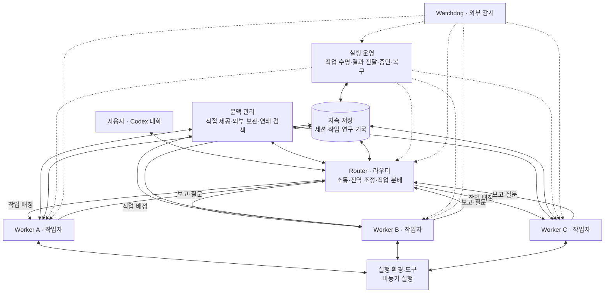

A·B·C는 표시용이며 고정된 인원·전문 역할이 아니다. 한 중심 연구 문제의 관련 조사는 병렬로 수행할 수 있다.
Router의 전역 조정은 작업 상태·관련 작업·사용자 결정을 연결하는 책임이다.
연구 가설·공법·과학적 해석을 대신 판정하는 역할이 아니다.

## 3. Router / Worker

| 모듈 | 입력 | 처리와 출력 | 책임 경계 |
| --- | --- | --- | --- |
| Router | 사용자 요청·결정, Worker 보고·질문 | 합의 범위를 확인하고 작업을 배정·연결하며 보고·질문을 사용자에게 전달 | 긴 조사·계산과 연구 해석은 Worker에 맡김 |
| Worker | 배정된 문제·범위·관련 문맥·새 관측 | 조사·추론·도구 실행·필요한 내부 분담, 근거와 설명·예측·미해결 사항 제출 | 배정 범위를 유지하며 큰 방향 변경은 Router를 통해 논의 |

Worker는 문맥을 격리하고 필요한 정보를 명시적으로 전달받는다. 복잡한 작업에서는 내부적으로
서브에이전트나 팀을 구성할 수 있다. 고정된 연구 조직·전문 역할·별도 연구 총괄은 추가하지 않는다.
원문에서는 Router의 가벼운 조정에 경량 모델, Worker의 실행에 강한 모델을 사용하는 구성을 설명한다.
우리 모델·동시 실행 수는 아직 선택하지 않았으며 실제 구독 접근성과 연구 품질·사용량을 비교한다.

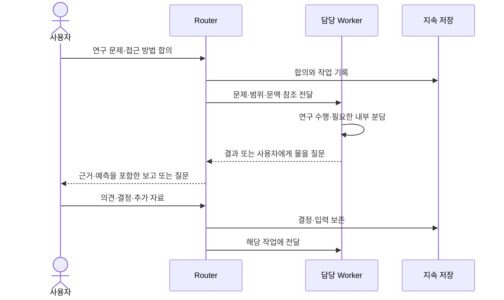

사용자의 응답이 필요한 부분은 대기하되, 합의 범위 안에서 진행 가능한 연구는 계속한다.
여러 Worker의 결과가 충돌하면 관련 결과를 담당 작업으로 전달해 검토하게 하며
Router의 전달 자체를 과학적 검증으로 간주하지 않는다.

### 3.1 Worker 내부의 서브에이전트·팀

두 종류의 분업을 구별한다. Router는 사용자 관점의 작업을 Worker에 배정한다.
Worker는 자기 작업을 풀기 위해 세부 질문을 만들고 서브에이전트·팀을 구성한다.
하위 분업의 세션 수·대화·도구 호출은 Router가 매번 중개할 필요가 없으며,
Worker가 결과·모순·실패를 통합해 작업 수준의 보고로 올린다.

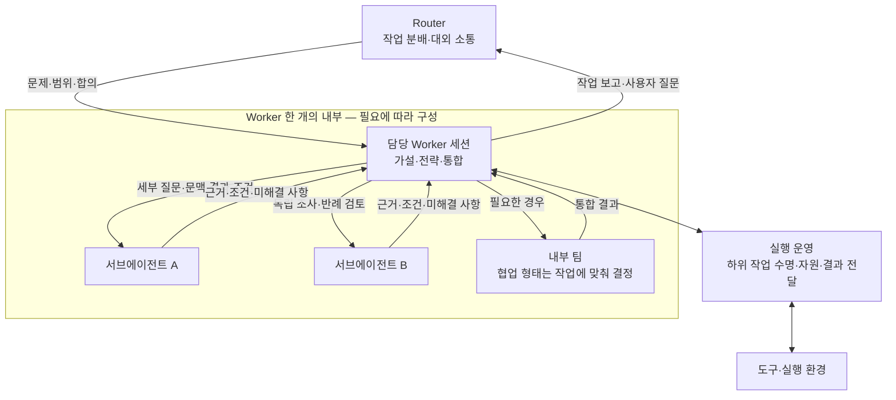

- Worker는 직접 연구해도 되고 필요한 부분만 분담해도 된다. 모든 질문을 분업하지 않는다.
- 하위 임무에는 목적·제약·필요한 문맥·기대 산출물과 참조 ID를 전달한다. 결과에는 원자료·조건·불확실성을 연결한다.
- 도구는 작업에 필요한 범위에서 제공한다. 문맥 격리는 프로세스·파일 권한 격리의 증거가 아니며, 작업별 작업공간과 쓰기 권한은 별도 설계한다.
- 하위 작업은 부모 작업 ID를 기록해 결과가 어디로 돌아갈지 유지한다. 세션 종료와 연구 작업 완료는 구분한다.
- 사용자에게 물을 내용은 Worker → Router → 사용자로 전달한다. 답변은 원래 작업으로 되돌아간다.
- 부모가 대기·취소·재시작될 때 하위 계산의 유지·중단 정책을 명시해야 한다. 구독 한도와 동시 실행 한도는 하위 작업까지 포함한다.

원문의 Worker 내부 구현은 상위 계층에 감춰질 수 있다. 이는 Worker가 고정된 단일 ReAct 세션에
제한되지 않는다는 의미다. 우리 SDK에서 사용할 내부 분업 API·팀 방식·중첩 범위는 검증 후 선택한다.

### 3.2 모델 판단과 프로그램 실행의 경계

Router·Worker는 모델이 판단하는 역할이고, 실행 운영은 그 판단을 실제 실행과 보존으로 연결한다.
아래는 실행 운영 안의 책임 분해이며 새로운 연구 에이전트를 추가하는 구성이 아니다.

| 논리 책임 | 맡는 일 | 모델과의 경계 |
| --- | --- | --- |
| State / Task 관리 | 합의·작업·실행 시도의 유효한 전이, 부모·자식 관계, 대기·완료·취소 관리 | 연구 가설의 타당성을 코드가 판정하지 않음 |
| Session Adapter | 작업 ID와 SDK 스레드·턴 연결, 시작·입력·결과·중단 요청 변환 | Codex 내부 루프 전체를 교체하는 API로 취급하지 않음 |
| 실행·전달 대기열 | 요청 저장 후 실행, 완료 결과 저장 후 전달, 실패한 전달의 재시도 | 기록이 남았다는 사실과 상대 세션이 읽었다는 사실을 구분 |
| 도구 실행 경계 | 작업별 도구·스킬·실행 환경과 요청·결과 연결 | 가능한 도구 선택은 Worker가 판단, 권한·자원 조건은 실행 계층에서 확인 |
| 지속 저장·추적 | 원본·버전·실행 이력·보고와 결과 참조 보존 | 세션 문맥만을 연구의 유일한 원본으로 삼지 않음 |

[프로토타입 아키텍처](https://github.com/deepseek-ai/dsh-superagent-prototype/blob/main/docs/007-architecture.md)의
Runtime은 의존성을 조립하고 시작·종료를 관리하며, Engine은 도메인 상태 변경을 트랜잭션으로 처리한다.
Effects는 요청을 저장한 뒤 커밋 후 실행하는 대기열이고, Sessions와 DshExecutor가 DSH 세션에 연결한다.
이는 우리 실행 운영·SDK 연결·지속 저장을 나누는 기술적 참고다. DSH 전용 훅·프리셋·API의 Codex 호환을 전제하지 않는다.

연구 작업 상태와 실행 요청을 함께 보존한 뒤 외부 실행을 시작하고, 결과는 보존한 뒤 전달한다.
실행 시작·결과 수신·세션 전달·세션이 읽음은 서로 다른 상태다. 통신 장애 후 재전달될 수 있으므로
요청·결과 ID로 중복 반영을 막고, 실행 여부가 불명인 계산은 확인 후 재시도한다.
이 설계만으로 임의의 외부 작업이 정확히 한 번 실행된다고 보장하지 않는다.
Worker는 모델을 포함한 실행 역할이며, 우리 프로그램의 도구 호출과 Codex 내부 도구 호출이
모두 같은 중간 제어를 지원하는 것은 아니다. 후자의 관측·취소 경계도 SDK별로 확인한다.

## 4. 문맥 관리와 연쇄 검색

입력은 현재 작업·목표·합의와 관련 자료의 식별자다. 가까운 시점에 필요한 내용은 직접 제공하고,
긴 원문과 저빈도 이력은 외부에 보관한다. 요약과 연결된 ID를 통해 원본을 단계적으로 조회한다.

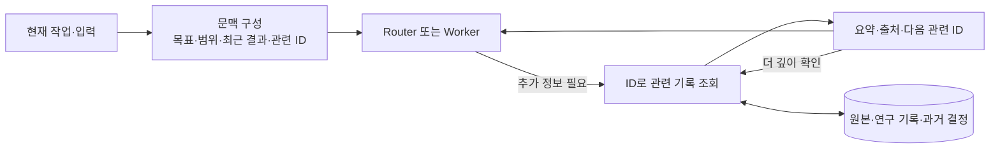

출력은 현재 판단에 필요한 문맥과 추가 조회 경로다. 요약을 원본 검토로 취급하지 않고,
상충·정정된 기록은 버전과 관계를 함께 제공한다. 자료가 없으면 미확인으로 남긴다.
검색 기술·문맥 길이·공유 범위의 세부 규칙은 후속 설계에서 정한다.

## 5. 인간 중심 상호작용과 비동기 실행

사용자는 세션 번호·작업자 전환을 관리하지 않고 하나의 연구 대화로 방향을 정하고 중간에 수정한다.
Router가 그 연속성을 유지하고 Worker의 세부 실행은 백그라운드에 둔다. 원문의 다중 채널은 제외했지만
사람의 응답을 기다리는 시간과 사람의 주의를 줄이는 상호작용 원리는 유지한다.

### 5.1 비동기 작업 시작·완료와 수명

입력은 Worker가 선택한 도구·하위 작업 요청이다. 실행 운영은 요청을 기록하고 작업 ID를 반환한다.
완료·실패 결과를 해당 작업에 전달한다. Thread 구독이나 외부 채널 이벤트 라우팅은 사용하지 않는다.

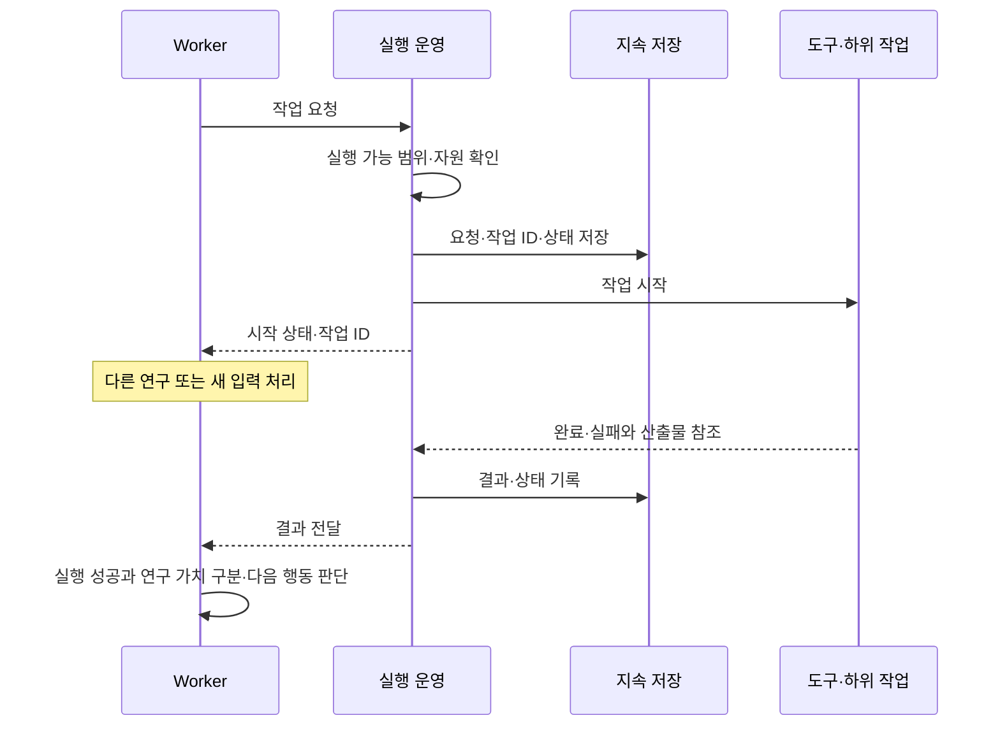

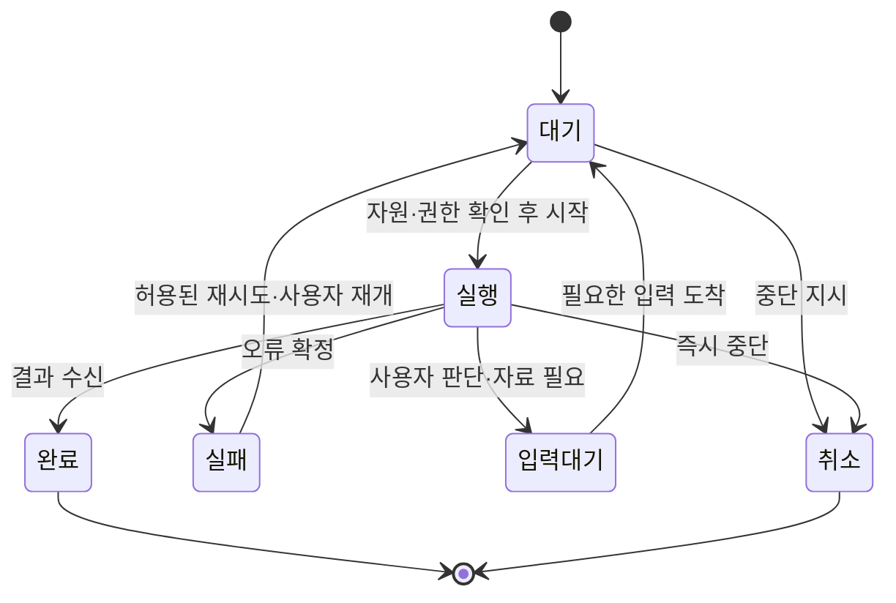

작업과 실행 시도·SDK 세션을 구분한다. 한 작업은 여러 실행 시도에 걸쳐 이어질 수 있다.
일반 정지는 새 작업을 막고 가능한 범위에서 저장·종료하며, 즉시 중단은 진행 중인 계산도 중단한다.
사용량 부족은 일시적 통신 오류와 구분해 정리 후 멈춘다. 회복 후에는 사용자의 재개 지시를 기다린다.
세부 취소·재시도·중복 방지·동시 실행 정책과 SDK 제어 계약은 아직 구현하지 않았다.

### 5.2 작업 중 개입·질문·결정

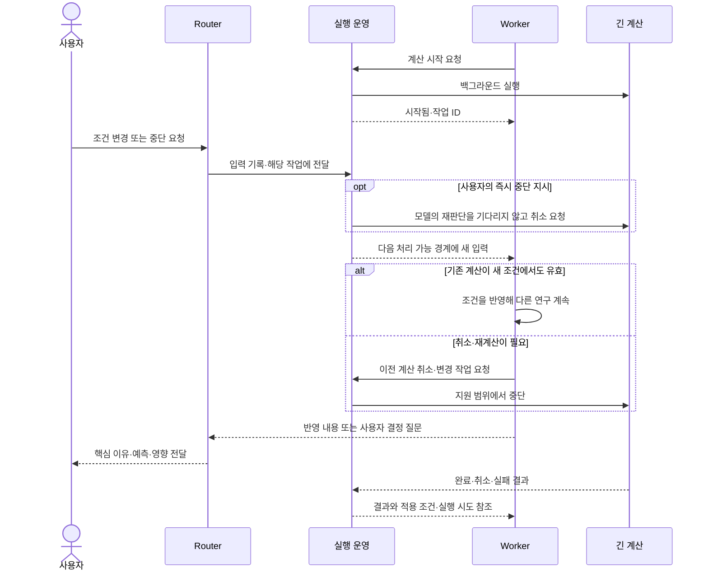

새 입력은 모델의 현재 추론 단계가 끝난 뒤 처리될 수 있다. 비동기 도구 실행과 모델 추론의
중간 개입 가능성은 별개다. Python의 async 호출이나 SDK 스트리밍을 사용했다는 사실만으로
대화 전체의 전이중 동작·원격 작업 취소가 보장되지 않는다. 즉시 중단은 실행 계층의 취소 경로로 연결해야 한다.
취소와 완료가 겹치면 실행 시도·조건 버전을 대조해 오래된 결과를 현재 결론에 섞지 않는다.

보고는 의미 있는 결과·판단이 필요할 때 핵심과 관련 작은 발견을 묶는다. 원리·근거·예측은
사용자가 확인할 수 있게 제공하며 상세 원문·계산은 참조로 펼쳐 읽는다. 일괄 글자 수 제한은 두지 않는다.
사용자가 기록을 시작하면 필요한 질문을 묶고, 답하지 못한 사항은 대기 상태로 남긴다.
기록 공백을 근거로 먼저 상태 확인 연락을 보내지 않는 기존 요구를 유지한다.

## 6. 연산·상태·실행 환경의 분리와 데이터

### 6.1 세 요소의 정의와 두 단계 분리

| 요소 | 의미 | 수명과 보존 대상 |
| --- | --- | --- |
| 연산 Compute | Router·Worker의 다음 추론·도구 요청을 진행시키는 하네스 실행과 모델 호출 | 실행 프로세스는 종료·교체될 수 있음. 모델 서비스와 하네스 호스트도 구분 |
| 상태 State | 세션 이력, 작업·시도·결정·입력 및 결과 전달 이력, 연구 설명·참조 | 프로세스 밖에 보존해 다음 실행이 이어받음 |
| 실행 환경 Environment | 파일·데이터·의존성·도구·계산 자원이 실제 존재하는 곳 | 세션 종료와 독립된 환경 상태·산출물이 있을 수 있음 |

**첫 단계: 연산과 상태 분리.** 루프를 진행하는 프로세스의 생존과 연구의 연속성을 분리한다.
현재 작업·세션 참조·미전달 결과를 지속 저장하고, 새 프로세스가 불러와 이어받는다.
원문의 무상태·탄력적 연산 컨테이너는 이 분리를 끝냈을 때 가능한 배치 방향이다.
Codex SDK가 로컬에 저장하는 이력·상태를 모두 외부화할 수 있는지는 별도 확인이 필요하며,
DB에 작업 ID만 저장했다고 실행체가 무상태가 되는 것은 아니다.

**둘째 단계: 연산과 실행 환경 분리.** Agent Loop가 있는 호스트와 실제 도구 환경을
명령·결과 인터페이스로 연결한다. 환경을 매번 복제하지 않고 필요한 데이터를 읽고 명령을 실행한다.
원문의 경량 daemon은 세션 상태를 소유하지 않는 실행 통로다. 실제 기기의 파일·산출물까지
무상태라는 의미는 아니다. Cloud 환경·별도 서버·개인 기기를 같은 책임 경계 뒤에 둘 수 있다.

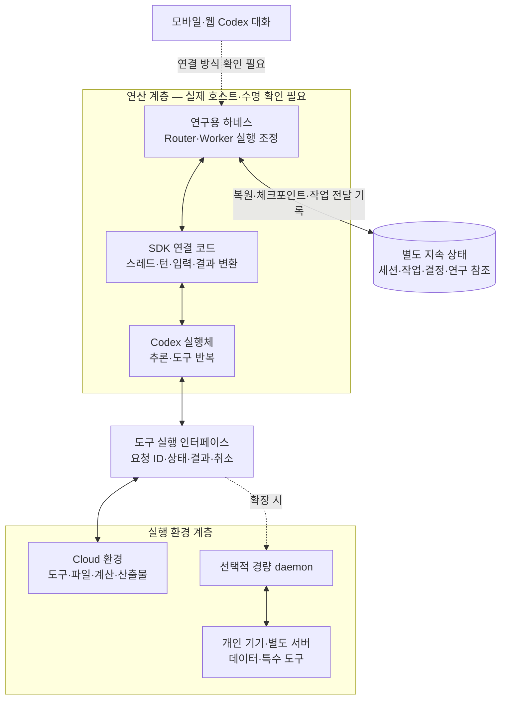

이것은 분리할 책임과 목표 배치를 나타낸다. 우리 프로그램이 관리형 Cloud에서 실제 실행되거나
임의의 원격 환경을 제어하도록 연결됐다는 의미가 아니다. Codex SDK·Cloud·기존 구독 활용은
확정했으며 호스트·인증·프로세스 수명·세션 상태 이동·모바일 연결은 검증 대상이다.
별도 기기·daemon은 원본을 이해하기 위한 확장 경계이며 첫 버전 필수가 아니다.
오프라인 기기가 필요한 작업은 대기하거나 가능한 대안을 검토한다.

### 6.2 보존·복원과 갱신 책임

프로세스가 바뀌면 작업·세션 연결과 미전달 요청을 읽고 실제 계산·산출물의 상태를 조회한다.
완료된 결과는 다시 실행하지 않고 재전달하며, 상태를 확인할 수 없는 외부 작업은 불명으로 기록해
조회·확인 후 재시도한다. 자동으로 모든 작업을 처음부터 반복하지 않는다.
지속 상태와 원본 산출물의 저장 위치·백업·접근 권한은 함께 결정해야 한다.

| 데이터 | 논리적 갱신 책임 | 보존·복구 기준 |
| --- | --- | --- |
| 목표·공동 결정·위임 | 사용자 결정의 Router 기록 | 변경 이유와 범위를 버전으로 보존 |
| 작업·실행 시도·전달 상태 | 실행 운영 | 저장 상태와 실제 실행·산출물을 대조 |
| 설명·가설·예측·연구 결과 | 해당 연구의 담당 Worker | 근거·조건·불확실성·수정 이유 연결 |
| 원본·관측·계산 산출물 | 수집·실행 경로 | 원본과 해석을 구분하고 결과의 출처 유지 |
| SDK 스레드·턴과 작업 연결 | SDK 연결 코드 | 작업 연속성을 세션 하나의 수명과 분리 |
| 감시·오류·복구 이력 | Watchdog 및 실행 운영 | 감지 사실·조치·결과 추적 |

같은 연구 설명을 여러 Worker가 동시에 덮어쓰지 않도록 갱신 소유권을 정한다.
추가 Worker는 근거·개정 제안을 제출하고 담당 작업에서 통합한다. 구체적인 충돌 처리 계약은 미정이다.
개인 자료는 공개 코드 저장소와 분리한다. DB·원본 저장 서비스·백업 위치는 아직 선택하지 않았다.

## 7. Watchdog

입력은 실행 상태·진행 보고·오류·최근 산출물이다. 외부 감시 루프가 인프라 오류와 연구 정체를
구분해 점검하고, 허용 범위의 복구 또는 사용자 보고를 요청한다.

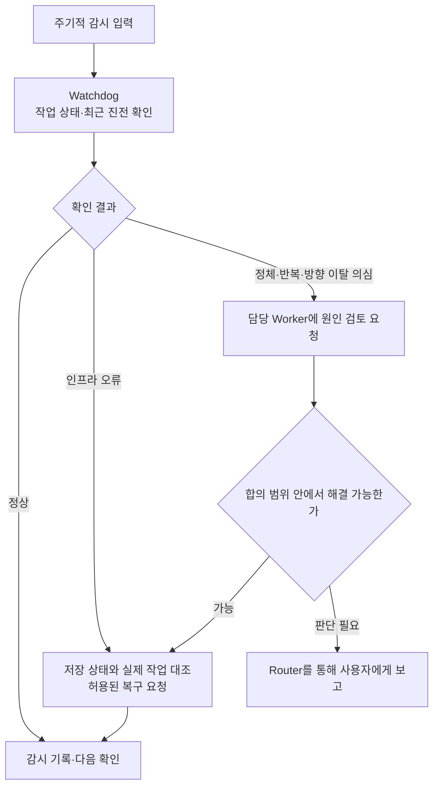

Watchdog은 연구의 과학적 진실을 판정하는 총괄이 아니다. 중심 문제 변경·위임 확대·하네스
수정·배포는 기존 공동 결정 원칙을 따른다. 사용량 회복만으로 연구를 재개하지 않는다.
감시 주기·모델 사용·실행 호스트와 복구 권한은 남은 설계 항목이다.

## 8. 연구 수행과 수련 피드백

연구 다이어그램은 모듈 사이에 어떤 요청·근거·결과·결정이 흐르는지 보여준다.
고정된 과학적 단계나 강제 도구 순서가 아니다. 연구 주제·자료·결과에 따라 경로를 바꾼다.

### 8.1 모듈별 연구 실행·전달 경로

‘가설 검토 → 조사 → 수정’만 나열하지 않고, 같은 아키텍처의 어느 모듈이 무엇을 요청하고
누가 기록·실행·전달하는지 나타낸다. 운영·문맥·저장은 과학적 판단을 하는 별도 연구자가 아니다.
SDK 연결은 실행 운영의 세션 연결 책임에 포함한다.

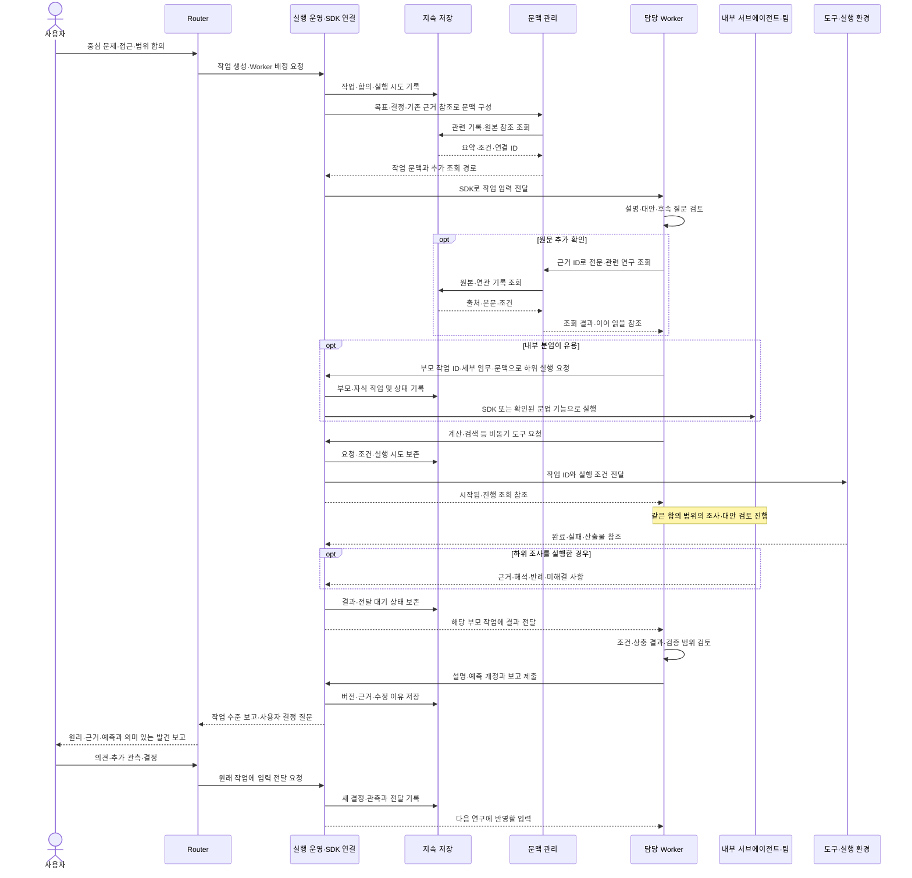

| 전달 경계 | 반드시 구분할 정보 | 그 정보가 필요한 이유 |
| --- | --- | --- |
| Router → 실행 운영 → Worker | 작업 ID, 합의 범위·결정 버전, 문맥 참조, 실행 시도·세션 연결 | 새 연구와 기존 작업의 후속 입력을 구분 |
| Worker → 내부 분업·도구 | 부모 작업 ID, 하위 목적·조건, 권한·자원 범위, 기대 결과 | 결과 귀속·취소 전파·중복 실행 확인 |
| 실행 환경 → 실행 운영 → Worker | 요청·시도 ID, 상태, 조건 버전, 산출물·출처, 오류 | 시작 통지·중간 출력·최종 결과 및 오래된 결과를 구분 |
| Worker → 저장·Router | 설명·가설·예측, 근거 참조, 수정 이유, 남은 불확실성·사용자 질문 | 단순 완료 메시지 대신 판단과 후속 공동 결정을 연결 |

표는 의미상 전달 계약이며 실제 JSON 필드명·메서드·스키마를 확정한 것은 아니다.
담당 Worker는 깊은 검토와 반복 조사로 전략을 바꿀 수 있다. 하위 작업은 근거·반례를 제출하고
Worker가 통합한다. 중심 문제 변경은 Router를 통해 사용자와 정한다.
근거 조회·결과 검증·재현 계산이 필요하면 같은 경로를 반복하며, 인용 수·분업 수를 채우기 위한 루프로 만들지 않는다.

### 8.2 수련·관측의 연구 피드백

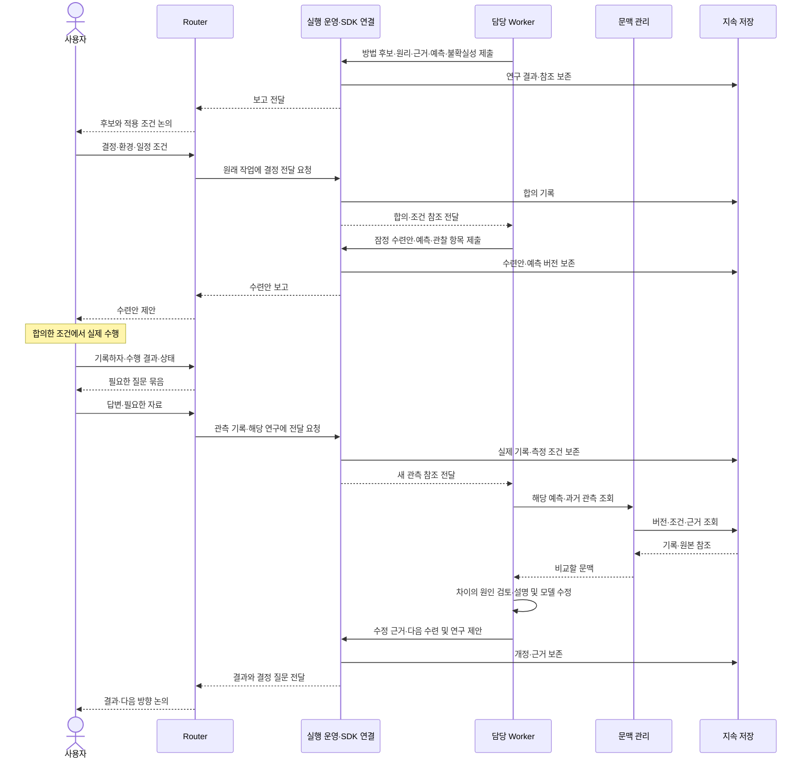

초기 상태를 파악한 뒤 현재 근거로 잠정안을 제안하고 연구·관측으로 개선한다.
영상·추가 측정은 판단 가치가 클 때 요청한다. 시뮬레이션 예측, 실제 효과·안전의 검증,
개인 적용 결정은 구분한다. 이 문서의 저장은 새 개인 실험이나 수련 실행 승인이 아니다.

## 9. 결정·제약·남은 설계

| 결정 | 이유·장단점·재검토 조건 |
| --- | --- |
| Router / Worker 유지 | 대화·조정과 긴 실행을 분리한다. 다중 세션·전달의 사용량 및 운영 부담은 실제 측정이 필요하다. |
| 별도 메인 연구 에이전트 없음 | 사용자가 선택한 구조다. 깊은 연구는 담당 Worker에서 수행하며 별도 총괄을 추가하지 않는다. |
| 채널·필터·Thread 구독 제거 | 단일 Codex 대화와 배정 작업에 집중한다. 외부 사건의 상시 감지·다중 채널 연속성은 현재 제공 범위가 아니다. |
| 비동기 실행·지속 상태 | 긴 계산 중 입력을 받고 중단 후 이어가기 위함이다. 실제 SDK·Cloud에서 지원 경계를 검증해야 한다. |
| 문맥 분리와 연쇄 검색 | 모든 원문을 매번 입력하는 부담을 줄인다. 요약 누락·잘못된 참조·검색 실패를 검증해야 한다. |
| 외부 Watchdog | 실행 주체와 별도로 이상을 감지한다. 추가 사용량과 오탐을 관리하고 자율 변경 권한을 확대하지 않는다. |

남은 아키텍처 작업은 SDK·Cloud 연결과 모듈 배치, 영구 저장 위치, 데이터 갱신·충돌 처리,
입력·작업·중단·재개 계약, Watchdog 운영과 사용량 관리다. 언어·DB·플러그인 목록은 미정이다.
API 필드·함수·테이블·알고리즘은 이 경계를 정한 뒤 상세 기술 설계에서 구체화한다.

수용 검증에서는 사용자 입력 중 장시간 작업 진행, 근거를 따라가는 문맥 조회, Worker 결과와
보고 연결, 새 관측의 연구 반영, 실패·중단·재개 시 중복 방지와 기록 보존을 확인한다.
문서의 Mermaid 구조 확인과 실제 시스템 실행 검증을 구분한다. 현재 구현·배포·실행 검증은 수행하지 않았다.

## 10. 실행체 선택: Codex SDK와 Codex Cloud

결정일: 2026-11-02. 상태: 사용자 선택 확정, 연결·배치 설계 및 종단 간 실행 검증 전.

**선택:** Codex SDK로 Codex를 프로그램에서 제어하는 방식으로 연구 에이전트를 만든다.
Codex Cloud에서 PC 종료 중에도 작업하고 모바일로 접근하며, ChatGPT 계정의 Codex
구독 사용량을 사용하는 것이 목표다. SDK 자체를 별도 유료 모델 API로 취급하지 않는다.
Router / Worker 논리 구조의 책임을 Codex 기능과 우리 프로그램에 배치한다.

### 공식 자료에서 확인한 지원

| 항목 | 확인한 내용과 범위 |
| --- | --- |
| 프로그램 제어 | [SDK 문서](https://learn.chatgpt.com/docs/codex-sdk)는 CLI·IDE·Cloud 사용자의 프로그램 제어를 명시한다. TypeScript 예제는 로컬 Codex 스레드, Python은 로컬 app-server 제어를 설명한다. |
| SDK 인증 | [Python SDK README](https://github.com/openai/codex/blob/main/sdk/python/README.md)는 기존 Codex 인증 재사용과 ChatGPT·device code 로그인을 제공한다. API 키가 필수라는 주장은 맞지 않는다. |
| 구독 사용량 | [인증 문서](https://learn.chatgpt.com/docs/auth)는 ChatGPT 로그인을 구독 접근으로, API 키를 사용량 기반 결제로 구분한다. Cloud는 ChatGPT 로그인이 필요하다. [요금 문서](https://learn.chatgpt.com/docs/pricing)는 로컬 메시지와 Cloud 채팅이 플랜 사용량을 공유한다고 명시한다. |
| Cloud 프로그램 제어 | [CLI 명령 문서](https://learn.chatgpt.com/docs/developer-commands?surface=cli#cli-codex-cloud)의 `codex cloud exec --env ENV_ID QUERY`로 작업을 제출하고 `codex cloud list --env ENV_ID --json`으로 상태 목록을 읽을 수 있다. CLI 인증을 공유하며 Cloud 명령은 Experimental이다. |
| PC 종료·모바일 | [Cloud 환경 문서](https://learn.chatgpt.com/docs/environments/cloud-environments)는 PC가 잠들어도 계속되는 Cloud 작업과 모바일 이용, 환경의 도구·의존성 설치를 설명한다. |

SDK 프로그램을 실행하는 위치, Codex 추론 서비스, Cloud 작업 환경은 서로 다른 경계다.
Cloud 작업 제출 명령이 있다는 사실을 SDK의 `thread.run()`이 자동으로 Cloud 작업을
생성한다는 의미로 바꾸지 않는다. SDK 인증 재사용도 Cloud 작업 내부의 중첩 SDK
프로세스가 호스트 인증을 자동 상속한다는 증거는 아니다.

### 다음 연결 설계와 검증

1. 모바일 Cloud 채팅에서 연구 프로그램을 시작하고 결과·추가 질문을 같은 사용자 흐름에
   연결하는 방식을 정한다. CLI 작업 제출은 확인된 별도 제어 경로다.
2. Cloud 환경 안에서 SDK 프로그램이 사용할 런타임·인증·네트워크 경로를 확인한다.
   공식 인증 방식을 사용하고 API 키 과금으로 자동 대체하지 않는다.
3. SDK의 스레드·턴·결과 이벤트를 연구 상태, 동적 분담, 도구 및 기록에 매핑한다.
   공식 Cloud 채팅과 SDK 스레드의 동일성·자동 동기화를 가정하지 않는다.
4. 중단·재개·사용량 부족, Cloud 작업 수명과 영구 저장을 검증한다.
   Cloud 이용 가능을 무기한 백그라운드 실행 보장으로 확대하지 않는다.

이 결정은 실제 Cloud 작업 실행·배포나 유료 자원 사용을 시작했다는 기록이 아니다.
SDK 언어·정확한 배포 단위는 아직 선택하지 않았다. 문서 확인은 실제 동작 검증과 구분한다.

## 11. 참고 근거와 적용 상태

| 자료 | 확인한 범위 | 우리 문서에서의 사용 |
| --- | --- | --- |
| [설계 글](https://mp.weixin.qq.com/s/zoS7GlReWPhfCjENGxXCdg) §2–6 | 이중 계층·내부 팀, 배치·캐시·지역성·비동기·분리·외부 감시라는 설계와 그 이유 | §1.1·3·4·5·6·7의 설계 근거. 삭제한 다중 채널·구독 기능은 다시 넣지 않음 |
| [공개 구현 가이드](https://github.com/deepseek-ai/dsh-superagent-prototype/blob/main/docs/007-architecture.md) | Runtime·Engine·Effects·Sessions·Executor, 단일 갱신 주체·트랜잭션·전달 기록 | §3.2·5·6·8의 실행과 상태 책임을 설명하는 기술 참고 |
| [프로토타입 README](https://github.com/deepseek-ai/dsh-superagent-prototype/blob/main/README.md) | 연구용 공개본은 내부판·기사의 구현과 같지 않으며 미구현 설계가 있음 | 글의 설계·공개 구현·우리 시스템의 검증을 구분 |
| [Codex SDK](https://learn.chatgpt.com/docs/codex-sdk) | TypeScript의 로컬 스레드 제어, Python의 로컬 app-server JSON-RPC·비동기 SDK | SDK 연결 책임의 근거. 관리형 Cloud 배치·중첩 분업·인간 중심 비동기 상호작용 전체의 보장으로 확대하지 않음 |

원문·프로토타입·SDK 문서는 2026-11-03 확인했다. 우리 시스템의 언어·DB·분업 API·Cloud 배치는 미정이다.
문서 보강은 구현·배포 승인이나 동작 검증의 완료가 아니다.

## 변경 기록

- v0.5: 컴퓨터 시스템 설계 근거, Worker 내부 서브에이전트·팀과 실행 책임, 인간 중심 상호작용, 연산·상태·환경의 두 단계 분리, 모듈별 연구 요청·실행·저장·결과 전달 계약과 다이어그램을 보강했다.
- v0.4: Router / Worker 구조로 갱신. 별도 메인 연구 에이전트 및 불필요한 외부 채널·구독 경로를 제거하고, 전체·모듈별·연구 피드백 다이어그램과 책임·데이터·남은 검증을 정리했다.
- v0.3: Codex SDK·Cloud·기존 구독 활용 방향과 공식 근거를 기록했다.
- v0.2 이전: 과거 논리 초안은 Git 이력으로 보존하며 현행 구조는 이 문서를 따른다.
