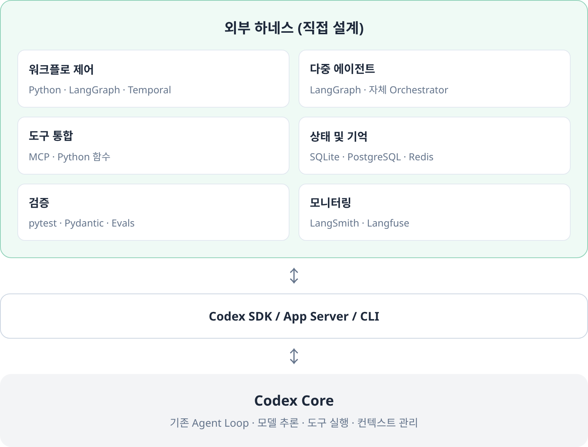

# 하네스 구조

2026-11-05 (Asia/Seoul) · 확정한 하네스 구조를 기준으로 아키텍처 설계를 다시 진행한다.

## 확정 하네스 구조

[첨부 HTML 원본](diagrams/codex_external_harness_architecture.html)

## 사용 구조

여기서 하네스는 위의 외부 하네스, Codex 연결 계층과 Codex Core를 포함한다.
