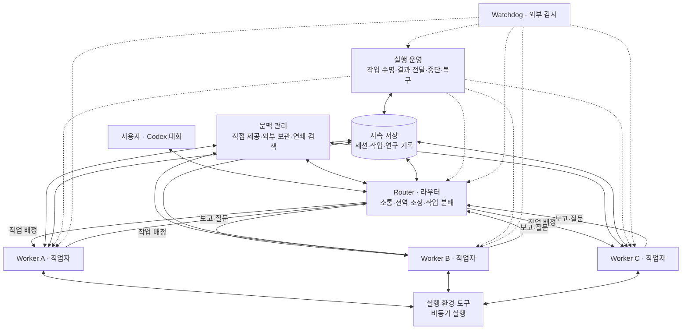
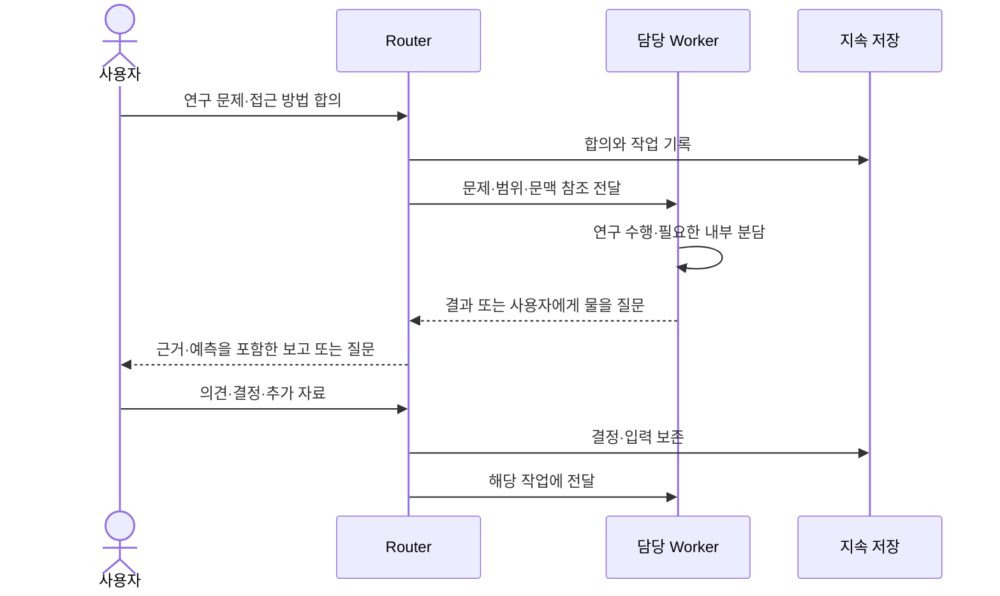
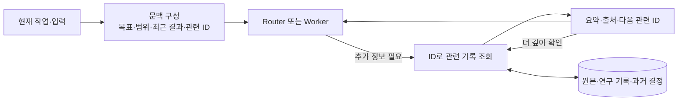
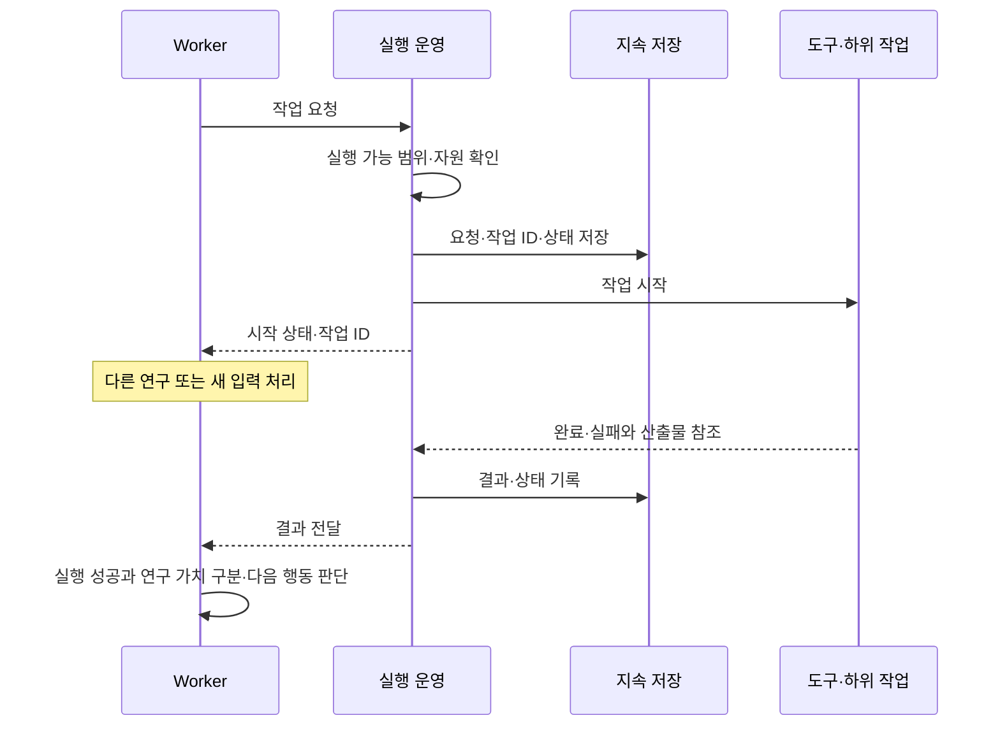
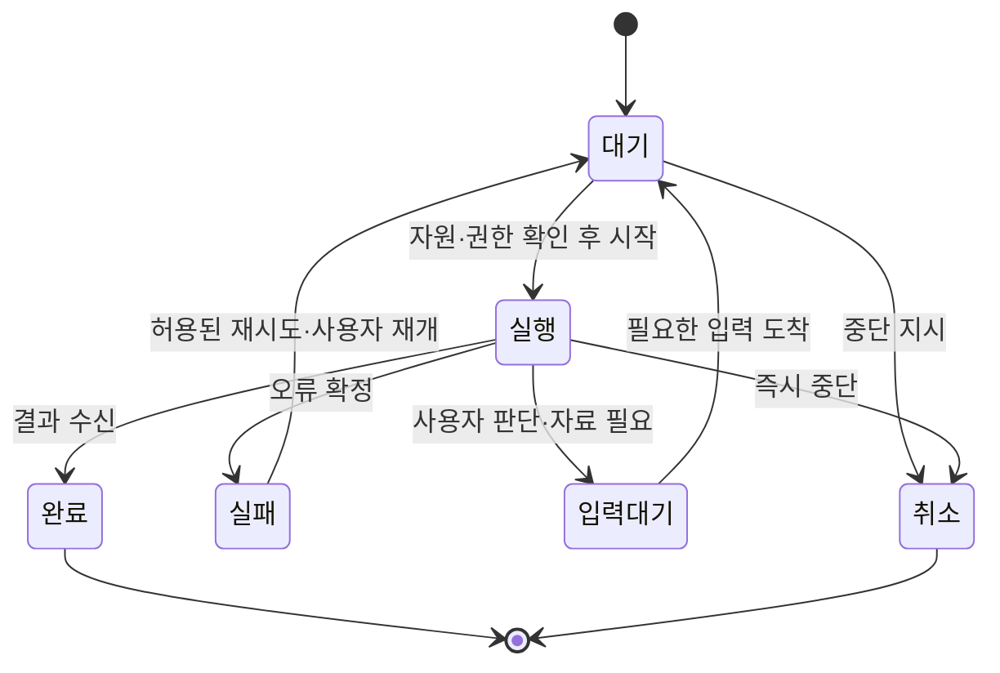
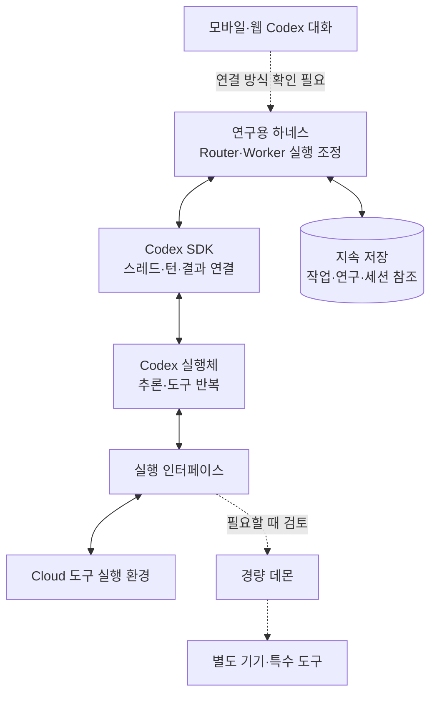
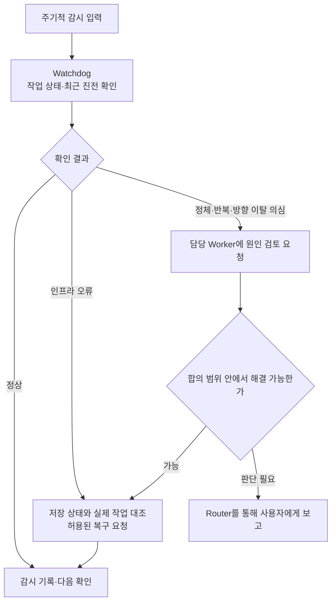
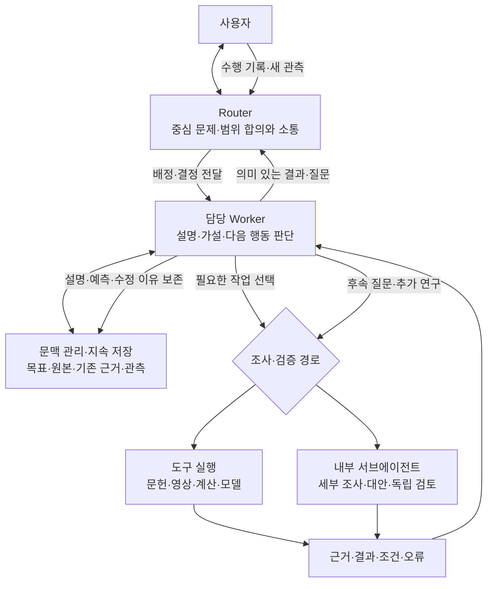
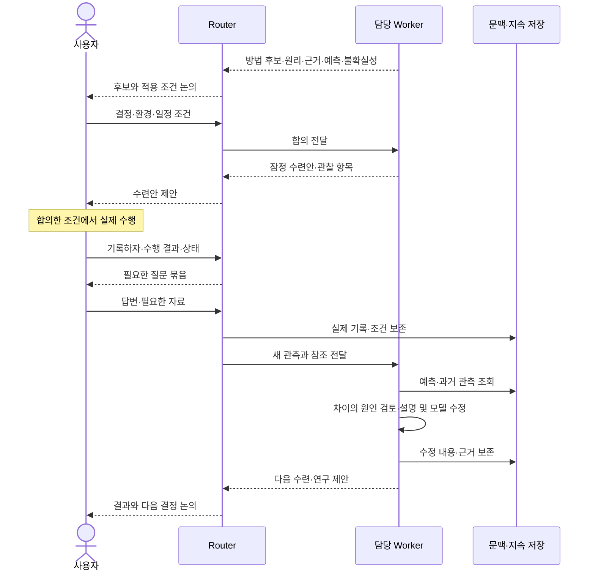

# 연구용 하네스 아키텍처

버전: 0.4 · 기준일: 2026-11-02 (Asia/Seoul)
상태: 합의한 논리 구조를 문서화함. Cloud 연결·배치와 실행 검증은 남아 있음.
근거: [요구사항 v0.20](SPECIFICATION.md), [기능 설계](FUNCTIONAL_DESIGN.md).

## 1. 목적과 범위

Codex SDK로 Codex를 제어하고 Codex Cloud·기존 구독 사용량으로 사용하는 연구용 하네스다.
Router / Worker 이중 계층을 사용한다. 별도의 메인 연구 에이전트를 추가하지 않는다.
연구 판단·설명·검증은 담당 Worker의 작업이며, Router는 사용자 소통·전역 조정·작업 분배를 맡는다.

[DeepSeek Super-agent 설계 글](https://mp.weixin.qq.com/s/zoS7GlReWPhfCjENGxXCdg)의
이중 계층·문맥 관리·비동기 실행·계산 및 상태와 실행 환경의 분리·Watchdog을 기준으로 한다.
다중 채널 연동, 외부 채널 이벤트 수집·필터링, Thread 구독·직통 전달, 외부 사건을 감지한
선행 작업, 채널별 응답 규칙은 제외한다. 사용자 입력과 우리가 시작한 작업의 결과 전달은 유지한다.

그림은 이 합의를 한국어 Mermaid로 표현한 설계이며 원문 그림의 복제나 구현 완료 기록이 아니다.
원문의 긴 배경·중복 설명·실험 소개는 생략했다. 공개 프로토타입은 참고 자료이며
원문 설계 전체가 구현돼 있다는 근거로 취급하지 않는다.

## 2. 전체 아키텍처

실선은 입력·요청·결과 또는 상태 접근 관계, 점선은 감시·운영 관계다.
노드는 논리적 책임이며 반드시 독립 프로세스·서버를 의미하지 않는다.

A·B·C는 표시용이며 고정된 인원·전문 역할이 아니다. 한 중심 연구 문제의 관련 조사는 병렬로 수행할 수 있다.
Router의 전역 조정은 작업 상태·관련 작업·사용자 결정을 연결하는 책임이다.
연구 가설·공법·과학적 해석을 대신 판정하는 역할이 아니다.

## 3. Router / Worker

| 모듈 | 입력 | 처리와 출력 | 책임 경계 |
| --- | --- | --- | --- |
| Router | 사용자 요청·결정, Worker 보고·질문 | 합의 범위를 확인하고 작업을 배정·연결하며 보고·질문을 사용자에게 전달 | 긴 조사·계산과 연구 해석은 Worker에 맡김 |
| Worker | 배정된 문제·범위·관련 문맥·새 관측 | 조사·추론·도구 실행·필요한 내부 분담, 근거와 설명·예측·미해결 사항 제출 | 배정 범위를 유지하며 큰 방향 변경은 Router를 통해 논의 |

Worker는 문맥을 격리하고 필요한 정보를 명시적으로 전달받는다. 복잡한 작업에서는 내부적으로
서브에이전트나 팀을 구성할 수 있다. 고정된 연구 조직·전문 역할·별도 연구 총괄은 추가하지 않는다.

사용자의 응답이 필요한 부분은 대기하되, 합의 범위 안에서 진행 가능한 연구는 계속한다.
여러 Worker의 결과가 충돌하면 관련 결과를 담당 작업으로 전달해 검토하게 하며
Router의 전달 자체를 과학적 검증으로 간주하지 않는다.

## 4. 문맥 관리와 연쇄 검색

입력은 현재 작업·목표·합의와 관련 자료의 식별자다. 가까운 시점에 필요한 내용은 직접 제공하고,
긴 원문과 저빈도 이력은 외부에 보관한다. 요약과 연결된 ID를 통해 원본을 단계적으로 조회한다.

출력은 현재 판단에 필요한 문맥과 추가 조회 경로다. 요약을 원본 검토로 취급하지 않고,
상충·정정된 기록은 버전과 관계를 함께 제공한다. 자료가 없으면 미확인으로 남긴다.
검색 기술·문맥 길이·공유 범위의 세부 규칙은 후속 설계에서 정한다.

## 5. 비동기 실행과 작업 수명

입력은 Worker가 선택한 도구·하위 작업 요청이다. 실행 운영은 요청을 기록하고 작업 ID를 반환한다.
완료·실패 결과를 해당 작업에 전달한다. Thread 구독이나 외부 채널 이벤트 라우팅은 사용하지 않는다.

작업과 실행 시도·SDK 세션을 구분한다. 한 작업은 여러 실행 시도에 걸쳐 이어질 수 있다.
일반 정지는 새 작업을 막고 가능한 범위에서 저장·종료하며, 즉시 중단은 진행 중인 계산도 중단한다.
사용량 부족은 일시적 통신 오류와 구분해 정리 후 멈춘다. 회복 후에는 사용자의 재개 지시를 기다린다.
세부 취소·재시도·중복 방지·동시 실행 정책과 SDK 제어 계약은 아직 구현하지 않았다.

## 6. 계산·상태·실행 환경과 데이터

에이전트 루프를 실행하는 계산, 지속 상태, 실제 도구 실행 환경을 논리적으로 분리한다.
아래 그림은 역할의 분리이며 Cloud에서 실제로 연결한 배포도가 아니다.

Codex SDK·Codex Cloud·기존 구독 사용량 활용은 선택했다. SDK 프로그램의 배치·인증 전달과
공식 Cloud 채팅 및 SDK 스레드의 연결은 검증 전이다. 별도 기기·데몬은 원본의 확장 경계이며
첫 버전 필수 배포가 아니다. 오프라인 기기가 필요한 작업은 기다리거나 가능한 대안을 검토한다.

| 데이터 | 논리적 갱신 책임 | 보존·복구 기준 |
| --- | --- | --- |
| 목표·공동 결정·위임 | 사용자 결정의 Router 기록 | 변경 이유와 범위를 버전으로 보존 |
| 작업·실행 시도·전달 상태 | 실행 운영 | 저장 상태와 실제 실행·산출물을 대조 |
| 설명·가설·예측·연구 결과 | 해당 연구의 담당 Worker | 근거·조건·불확실성·수정 이유 연결 |
| 원본·관측·계산 산출물 | 수집·실행 경로 | 원본과 해석을 구분하고 결과의 출처 유지 |
| SDK 스레드·턴과 작업 연결 | SDK 연결 코드 | 작업 연속성을 세션 하나의 수명과 분리 |
| 감시·오류·복구 이력 | Watchdog 및 실행 운영 | 감지 사실·조치·결과 추적 |

같은 연구 설명을 여러 Worker가 동시에 덮어쓰지 않도록 갱신 소유권을 정한다.
추가 Worker는 근거·개정 제안을 제출하고 담당 작업에서 통합한다. 구체적인 충돌 처리 계약은 미정이다.
개인 자료는 공개 코드 저장소와 분리한다. DB·원본 저장 서비스·백업 위치는 아직 선택하지 않았다.

## 7. Watchdog

입력은 실행 상태·진행 보고·오류·최근 산출물이다. 외부 감시 루프가 인프라 오류와 연구 정체를
구분해 점검하고, 허용 범위의 복구 또는 사용자 보고를 요청한다.

Watchdog은 연구의 과학적 진실을 판정하는 총괄이 아니다. 중심 문제 변경·위임 확대·하네스
수정·배포는 기존 공동 결정 원칙을 따른다. 사용량 회복만으로 연구를 재개하지 않는다.
감시 주기·모델 사용·실행 호스트와 복구 권한은 남은 설계 항목이다.

## 8. 연구 수행과 수련 피드백

연구 다이어그램은 모듈 사이에 어떤 요청·근거·결과·결정이 흐르는지 보여준다.
고정된 과학적 단계나 강제 도구 순서가 아니다. 연구 주제·자료·결과에 따라 경로를 바꾼다.

### 8.1 연구 수행

담당 Worker는 폭넓은 자료와 원문을 검토하고 대안·반례·검증 범위를 비교한다.
서브에이전트 수나 인용 수를 품질의 대리 지표로 삼지 않는다. 상충 결과는 조건과 근거를
추적해 설명을 고치거나 미해결로 남긴다. 원리·근거·예측과 관련된 작은 발견도 보고에 포함한다.
한 중심 문제에 집중하고, 중심 문제를 바꾸려면 Router를 통해 사용자와 논의한다.

### 8.2 수련·관측의 연구 피드백

초기 상태를 파악한 뒤 현재 근거로 잠정안을 제안하고 연구·관측으로 개선한다.
영상·추가 측정은 판단 가치가 클 때 요청한다. 시뮬레이션 예측, 실제 효과·안전의 검증,
개인 적용 결정은 구분한다. 이 문서의 저장은 새 개인 실험이나 수련 실행 승인이 아니다.

## 9. 결정·제약·남은 설계

| 결정 | 이유·장단점·재검토 조건 |
| --- | --- |
| Router / Worker 유지 | 대화·조정과 긴 실행을 분리한다. 다중 세션·전달의 사용량 및 운영 부담은 실제 측정이 필요하다. |
| 별도 메인 연구 에이전트 없음 | 사용자가 선택한 구조다. 깊은 연구는 담당 Worker에서 수행하며 별도 총괄을 추가하지 않는다. |
| 채널·필터·Thread 구독 제거 | 단일 Codex 대화와 배정 작업에 집중한다. 외부 사건의 상시 감지·다중 채널 연속성은 현재 제공 범위가 아니다. |
| 비동기 실행·지속 상태 | 긴 계산 중 입력을 받고 중단 후 이어가기 위함이다. 실제 SDK·Cloud에서 지원 경계를 검증해야 한다. |
| 문맥 분리와 연쇄 검색 | 모든 원문을 매번 입력하는 부담을 줄인다. 요약 누락·잘못된 참조·검색 실패를 검증해야 한다. |
| 외부 Watchdog | 실행 주체와 별도로 이상을 감지한다. 추가 사용량과 오탐을 관리하고 자율 변경 권한을 확대하지 않는다. |

남은 아키텍처 작업은 SDK·Cloud 연결과 모듈 배치, 영구 저장 위치, 데이터 갱신·충돌 처리,
입력·작업·중단·재개 계약, Watchdog 운영과 사용량 관리다. 언어·DB·플러그인 목록은 미정이다.
API 필드·함수·테이블·알고리즘은 이 경계를 정한 뒤 상세 기술 설계에서 구체화한다.

수용 검증에서는 사용자 입력 중 장시간 작업 진행, 근거를 따라가는 문맥 조회, Worker 결과와
보고 연결, 새 관측의 연구 반영, 실패·중단·재개 시 중복 방지와 기록 보존을 확인한다.
문서의 Mermaid 구조 확인과 실제 시스템 실행 검증을 구분한다. 현재 구현·배포·실행 검증은 수행하지 않았다.

## 10. 실행체 선택: Codex SDK와 Codex Cloud

결정일: 2026-11-02. 상태: 사용자 선택 확정, 연결·배치 설계 및 종단 간 실행 검증 전.

**선택:** Codex SDK로 Codex를 프로그램에서 제어하는 방식으로 연구 에이전트를 만든다.
Codex Cloud에서 PC 종료 중에도 작업하고 모바일로 접근하며, ChatGPT 계정의 Codex
구독 사용량을 사용하는 것이 목표다. SDK 자체를 별도 유료 모델 API로 취급하지 않는다.
Router / Worker 논리 구조의 책임을 Codex 기능과 우리 프로그램에 배치한다.

### 공식 자료에서 확인한 지원

| 항목 | 확인한 내용과 범위 |
| --- | --- |
| 프로그램 제어 | [SDK 문서](https://learn.chatgpt.com/docs/codex-sdk)는 CLI·IDE·Cloud 사용자의 프로그램 제어를 명시한다. TypeScript 예제는 로컬 Codex 스레드, Python은 로컬 app-server 제어를 설명한다. |
| SDK 인증 | [Python SDK README](https://github.com/openai/codex/blob/main/sdk/python/README.md)는 기존 Codex 인증 재사용과 ChatGPT·device code 로그인을 제공한다. API 키가 필수라는 주장은 맞지 않는다. |
| 구독 사용량 | [인증 문서](https://learn.chatgpt.com/docs/auth)는 ChatGPT 로그인을 구독 접근으로, API 키를 사용량 기반 결제로 구분한다. Cloud는 ChatGPT 로그인이 필요하다. [요금 문서](https://learn.chatgpt.com/docs/pricing)는 로컬 메시지와 Cloud 채팅이 플랜 사용량을 공유한다고 명시한다. |
| Cloud 프로그램 제어 | [CLI 명령 문서](https://learn.chatgpt.com/docs/developer-commands?surface=cli#cli-codex-cloud)의 `codex cloud exec --env ENV_ID QUERY`로 작업을 제출하고 `codex cloud list --env ENV_ID --json`으로 상태 목록을 읽을 수 있다. CLI 인증을 공유하며 Cloud 명령은 Experimental이다. |
| PC 종료·모바일 | [Cloud 환경 문서](https://learn.chatgpt.com/docs/environments/cloud-environments)는 PC가 잠들어도 계속되는 Cloud 작업과 모바일 이용, 환경의 도구·의존성 설치를 설명한다. |

SDK 프로그램을 실행하는 위치, Codex 추론 서비스, Cloud 작업 환경은 서로 다른 경계다.
Cloud 작업 제출 명령이 있다는 사실을 SDK의 `thread.run()`이 자동으로 Cloud 작업을
생성한다는 의미로 바꾸지 않는다. SDK 인증 재사용도 Cloud 작업 내부의 중첩 SDK
프로세스가 호스트 인증을 자동 상속한다는 증거는 아니다.

### 다음 연결 설계와 검증

1. 모바일 Cloud 채팅에서 연구 프로그램을 시작하고 결과·추가 질문을 같은 사용자 흐름에
   연결하는 방식을 정한다. CLI 작업 제출은 확인된 별도 제어 경로다.
2. Cloud 환경 안에서 SDK 프로그램이 사용할 런타임·인증·네트워크 경로를 확인한다.
   공식 인증 방식을 사용하고 API 키 과금으로 자동 대체하지 않는다.
3. SDK의 스레드·턴·결과 이벤트를 연구 상태, 동적 분담, 도구 및 기록에 매핑한다.
   공식 Cloud 채팅과 SDK 스레드의 동일성·자동 동기화를 가정하지 않는다.
4. 중단·재개·사용량 부족, Cloud 작업 수명과 영구 저장을 검증한다.
   Cloud 이용 가능을 무기한 백그라운드 실행 보장으로 확대하지 않는다.

이 결정은 실제 Cloud 작업 실행·배포나 유료 자원 사용을 시작했다는 기록이 아니다.
SDK 언어·정확한 배포 단위는 아직 선택하지 않았다. 문서 확인은 실제 동작 검증과 구분한다.

## 변경 기록

- v0.4: Router / Worker 구조로 갱신. 별도 메인 연구 에이전트 및 불필요한 외부 채널·구독 경로를 제거하고, 전체·모듈별·연구 피드백 다이어그램과 책임·데이터·남은 검증을 정리했다.
- v0.3: Codex SDK·Cloud·기존 구독 활용 방향과 공식 근거를 기록했다.
- v0.2 이전: 과거 논리 초안은 Git 이력으로 보존하며 현행 구조는 이 문서를 따른다.
