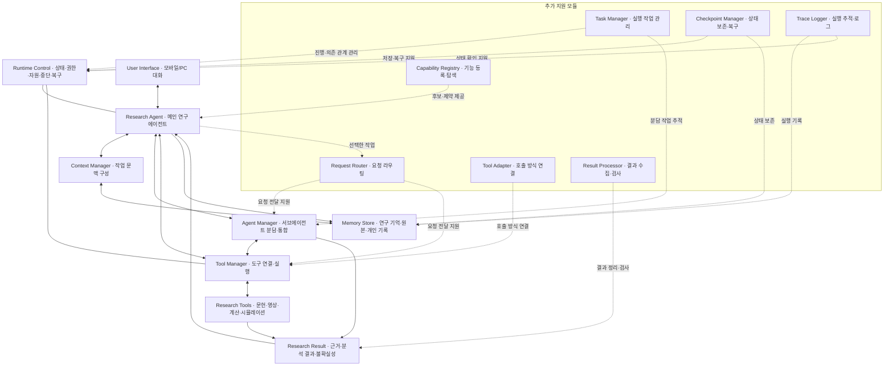

# 수련 연구 에이전트 아키텍처

버전: 0.3 · 기준일: 2026-11-02 (Asia/Seoul)
상태: 아키텍처 설계 진행 중. 논리 구성 초안을 바탕으로 구조·상호작용·데이터·배포·제약과 선택 근거를 구체화한다.
근거: [요구사항 v0.19](SPECIFICATION.md), [기능 설계 v0.1](FUNCTIONAL_DESIGN.md).

## 1. 범위와 확정 수준

처음 제시한 주요 구성과 연결을 유지하고 지원 모듈을 추가하는 구조를 채택한다.
주요 구성요소를 다른 구조로 다시 분해하거나, 지원 모듈 목록으로 대체하지 않는다.
이 문서의 합의는 역할과 논리적 연결에 대한 것이다. 실행 위치·배포 단위·저장 기술·
API·구체적인 플러그인과 호스트 지원 여부까지 확정하거나 검증한 것은 아니다.
물리적 배치와 핵심 실행 가능성이 확인되기 전에는 아키텍처 전체의 검증 완료로 표현하지 않는다.

Codex SDK를 통한 프로그램 제어와 Codex Cloud·기존 구독 사용량 활용을 실행 방향으로
선택했다. SDK 언어, Cloud와의 연결·배치 및 제어 범위는 §10의 근거와 검증 항목에 따라
구체화한다. DeepSeek Harness 등은 기술 참고 대상이며 도입을 확정하지 않는다.
구현·배포·유료 서비스 사용·실제 개인 수련 적용은 이 문서 저장에 포함되지 않는다.

## 2. 전체 구성

실선은 기존 주요 연결, 점선은 추가 지원 관계다. 점선은 실제 호출 순서가 아니다.
각 노드는 논리적 책임이며 반드시 별도 서버·플러그인·AI를 뜻하지 않는다.

## 3. 주요 구성요소의 책임

| 구성요소 | 책임 |
| --- | --- |
| User Interface · 사용자 대화 | 목표·방향·위임의 공동 결정, 질문, 수행 기록, 결과 확인, 정지·재개 지시 |
| Research Agent · 메인 연구 에이전트 | 전체 설명 유지, 연구 질문 생성, 다음 행동 판단, 도구·분담 선택, 결과 통합과 보고 |
| Context Manager · 작업 문맥 구성 | 현재 작업에 필요한 목표·근거·합의·관련 기억·미해결 사항을 찾아 제공 |
| Memory Store · 연구 기억·원본·개인 기록 | 출처·시점·조건을 포함한 원본·관측·가설·실패·결정과 수정 이력의 지속 보존 |
| Agent Manager · 서브에이전트 분담·통합 | 동적 임무·문맥 전달, 중간 소통, 진행 확인, 상충 결과 수집과 통합 지원 |
| Tool Manager · 도구 연결·실행 | 사용 가능한 도구 연결, 실행 요청 처리, 결과·오류 반환 |
| Research Tools · 문헌·영상·계산·시뮬레이션 | 실제 자료 조사·역설계·정량 분석·개인 모델과 공법 검토에 필요한 전문 작업 수행 |
| Research Result · 근거·분석 결과·불확실성 | 메인이 검토할 산출물·출처·조건·불확실성의 연결된 표현. 별도 AI를 전제하지 않음 |
| Runtime Control · 실행 운영 관리 | 실행 진행과 제약 관리, 중단 요청 처리, 상태 보존과 재개 지원 |

개인 모델·수련안·관측 피드백은 위 구성요소를 통해 수행하는 기능이다.
그래프에서 이름이 생략되었다고 기능 설계 F01–F27의 범위를 제거하는 것은 아니다.
평가·개선 기능은 실행 이력과 연구 결과를 활용해 메인이 개선안을 제안하고
채택된 변경을 비교하는 흐름으로 연결하며, 별도의 자율 배포 주체를 전제하지 않는다.

### 제어·판단·상태의 책임 구분

기존 메인 노드 Research Agent는 내부 책임을 다음과 같이 구분한다. Codex는 모델 이름이 아니라
모델을 사용하는 에이전트 실행체다. 선택한 SDK 기반 방향에서도 Codex가 제공하는
추론·도구 실행 루프를 활용한다. 우리 프로그램이 연구 상태·작업과 Codex 호출을 조정하는
책임은 별도로 설계하며, Codex 내부 루프를 교체하는 것으로 해석하지 않는다.

| 이름 | 책임과 경계 |
| --- | --- |
| Agent Loop / Orchestrator | 모델 호출, 선택된 행동의 실행 연결, 결과 전달, 반복·종료·대기의 실행 제어. Orchestrator라는 이름만으로 별도 모델을 추가하지 않음 |
| AI Model | 제공된 문맥으로 가설·해석·다음 행동을 판단. 모델과 실행 프로그램을 구분 |
| State Manager | Runtime Control 안에서 현재 목표·가설 참조·합의·검증 상태·다음 작업 등 연구 상태의 유효한 갱신을 관리 |
| Task Manager | 개별 실행 작업의 대기·실행·실패·취소·완료와 의존 관계를 관리. 연구 상태와 구별 |
| Memory Store | 원본·근거·이력을 지속 보존하고 조회. State Manager의 갱신 규칙과 저장 책임을 구분 |
| Verifier | 계산·데이터·산출물을 명시한 검증 기준에 따라 확인. Result Processor의 형식·누락 검사와 구별하며, Research Tools 및 결과 검토 경로에서 사용 |

Verifier가 과학적 진실이나 개인 적용 안전을 자동 보증하는 것은 아니다.
자동 검사·재현 계산·독립 검토의 범위와 메인의 해석 책임은 후속 상호작용 설계에서 명시한다.
Research Result는 전달 데이터이며 실행 모듈이 아니다. Research Tools는 도구 집합,
Runtime Control은 운영 책임을 묶은 영역이다. 이들을 단일 프로그램과 혼동하지 않는다.
위 표는 책임 명세를 보강한 초안이며 구체적인 프로세스·기술 배치는 아직 미확정이다.

## 4. 추가 지원 모듈

| 모듈 | 지원 책임 | 주요 연결 |
| --- | --- | --- |
| Capability Registry · 기능 등록·탐색 | 도구·스킬·에이전트의 능력·입출력·이용 가능 여부·제약과 후보 제공 | 메인의 선택 |
| Request Router · 요청 라우팅 | 메인이 선택한 작업을 적절한 실행 대상으로 전달 | 메인, 도구 연결·실행, 서브에이전트 |
| Task Manager · 실행 작업 관리 | 작업 식별, 의존 관계, 진행 상태, 병렬 작업과 중복 실행 관리 | 운영 관리, 도구 작업, 분담 작업 |
| Tool Adapter · 호출 방식 연결 | MCP·플러그인·프로그램의 서로 다른 호출 방식 연결 | Tool Manager · 도구 연결·실행 |
| Result Processor · 결과 수집·검사 | 반환 결과·산출물·출처·오류 수집, 누락·형식·실행 완료 확인 | 결과와 메인의 검토 |
| Checkpoint Manager · 상태 보존·복구 | 중간 상태 보존, 재개 시 실제 작업 상태 대조 | 운영 관리, 지속 저장 |
| Trace Logger · 실행 추적·로그 | 요청·실행·결과·실패의 관계 기록 | 상태 확인, 기억, 평가·개선 |

연구 내용의 선택은 메인이 담당한다. 라우터를 별도 AI로 구현하거나 작업 관리자가
연구 우선순위를 대신 정하는 것으로 확정하지 않는다.
형식 검증·실행 성공·연구 결과의 타당성·개인 적용 적합성은 서로 구분한다.
서브에이전트는 근거·해석·조건을 제출하며 전체 설명과 전략의 개정은 메인이 맡는다.

## 5. 대표 연결 흐름

메인이 필요한 작업을 판단한다 → 등록부에서 도구 후보를 확인한다 → 메인이 선택한다
→ 라우터가 전달한다 → 권한·자원 조건과 작업 상태를 확인한다 → 실행 어댑터 또는
서브에이전트 경로로 수행한다 → 결과를 수집·검사한다 → 메인이 해석·통합한다
→ 관련 기억·설명을 갱신하고 다음 조사·질문·보고·보류를 판단한다.

이는 요청 처리의 대표 흐름이지, 모든 연구에 동일한 과학적 사고 단계를 강제하는 규칙이 아니다.
관측 결과는 다음 연구뿐 아니라 개인 모델·잠정 수련안의 검토로 되돌아간다.
사용자 응답을 기다리는 작업과 계속 진행할 수 있는 합의 범위 작업을 구분한다.

## 6. 기본 기능과 추가 구현의 경계

Codex가 이미 제공하는 지원 기능은 우선 활용하고 없는 부분만 구현한다.
같은 책임을 지원한다는 이유로 Codex 내부 구현을 교체할 수 있다고 가정하지 않는다.
플러그인 내부 도구 요청 관리와 Codex 전체 실행 제어는 구별한다.

| 영역 | 상세 설계에서 확인할 사항 |
| --- | --- |
| 메인 루프 | 해당 호스트에서 가능한 실행 지속·추가 사용자 입력·종료 동작 |
| 기능 등록·라우팅 | 네이티브 도구 탐색·호출로 충족되는 부분과 추가 코드의 필요 |
| 서브에이전트 | 생성·소통·결과 수집·취소·구독 사용량의 실제 지원 |
| 작업·중단 관리 | 호스트 전체 제어와 우리가 관리하는 작업 제어의 범위 |
| 기억·문맥 | 지속 저장 위치, 세션 간 검색, 최신 상태와 원본 참조 |
| 자원·권한 | 실제 확인 가능한 사용량, 외부 제공·비용·위임 조건의 집행 위치 |
| 플러그인 배치 | Cloud·모바일 호스트에서 설치·실행할 수 있는 구성과 대안 |

## 7. 남은 아키텍처 결정과 상세 설계의 경계

1. **실행 가능성 확인:** 선택한 Codex SDK와 Codex Cloud의 연결·배치를 구체화한다.
   필수 요구가 충족되지 않으면 근거를 설명하고 대안 전환을 함께 결정한다.
   공식 앱 접근·구독 인증/사용량·네트워크·실행 수명·서브에이전트·저장 지원을 구분한다.
2. **모듈 배치와 기술 선택:** 네이티브 기능·스킬·MCP·프로젝트 코드에 책임을 배치한다.
   필요한 언어·라이브러리·서비스·플러그인 후보를 근거와 함께 비교하고 선택한다.
3. **호출 계약:** 작업 요청·상태·결과·오류·취소·재시도의 API와 데이터 스키마를 정한다.
4. **기억·문맥:** 공개 코드와 비공개 개인 자료의 저장 분리, 식별자·수정 이력·검색·
   문맥 조립·충돌 처리·원본 참조를 설계한다.
5. **실행 제어:** 상태 전이, 의존 관계, 동시 실행, 중복 방지, 시간 제한,
   일반 정지·즉시 중단, 체크포인트와 재개 절차를 구체화한다.
6. **연구 기능 연결:** 검색·원문 검토·영상 분석·계산·개인 모델·관측 피드백에
   필요한 도구와 스킬의 입출력·검증 조건을 정한다.
7. **검증 명세:** 첫 버전 수용 시나리오, 실패·중단·재개·상충 근거 사례,
   비교 기준과 실행 기록을 정한다. 공개 벤치마크 점수를 우리 시스템의 검증으로 대체하지 않는다.

위 목록 중 실행체·책임 배치·저장 및 배포 위치·제어 범위·핵심 품질 조건은 아키텍처 단계에서 결정한다. API 필드·테이블·인덱스·함수·구체적인 알고리즘은 상세 기술 설계에서 정한다. 아직 선택하지 않은 기술·API·저장소를
확정 사항으로 취급하지 않는다. 핵심 제약이 발견되면 이 기준안의 해당 부분을 함께 개정한다.

## 8. 문서와 구현 상태

이 문서는 논리 아키텍처의 합의 기록이다. 실행 검증이나 구현 완료 기록이 아니다.
상세 기술 설계는 후보를 함께 검토한 뒤 합의한 내용을 정리한다.
개인 원본·몸 상태·측정값·계정 비밀은 공개 저장소에 포함하지 않는다.

## 9. 아키텍처 완료 기준과 결정 기록

아키텍처는 구성요소 목록과 그래프만으로 완료되지 않는다. 다음 결과를 이 문서 안에서
보완한다. 항목마다 별도 문서를 늘리지 않는다.

| 산출물 | 현재 상태 | 남은 결정 |
| --- | --- | --- |
| 전체 구조와 구성도 | 논리 초안 있음 | 메인 실행체·분업 구조의 채택 근거와 대안 |
| 구성요소 책임 | 이름과 경계를 보강함 | Codex 기본 기능과 추가 구현의 소유권 |
| 상호작용 | 정상 흐름 개요 있음 | 사용자 입력·위임·실패·중단·재개 시 호출·데이터·제어 흐름 |
| 데이터 아키텍처 | 보존 대상·비공개 원칙 있음 | 저장 위치·원본 기준·갱신 주체·동시 수정·복구 시 일관성 |
| 실행·배포 구조 | SDK·Cloud·구독 활용 방향 선택 | 모바일 세션 연결, SDK 프로그램의 배치·인증, 도구 및 저장 서비스의 배치 |
| 품질 속성 | 요구사항 있음 | 신뢰성·재현성·확장성·사용량·접근 제어를 만족시키는 구조 |
| 중요한 결정 기록 | 후보와 미확정 항목 있음 | 선택·근거·대안·장단점·검증 증거·재검토 조건 |

구체적인 제품·언어·DB라도 구조를 좌우하면 아키텍처 단계에서 검토한다.
Python·SQLite·Codex CLI는 사용자가 전달한 설명의 예시이며 채택된 기술이 아니다.
반복 종료·오류 대응 역시 시스템 차원의 정책은 이 단계에서, 구체적인 분기·예외 코드는
상세 기술 설계에서 정한다. 모든 연구를 고정 단계로 제한하는 것으로 해석하지 않는다.

변경 이력: v0.2 — 아키텍처 설계 진행 상태로 정정하고 기존 그래프를 유지한 채
모듈 이름·책임 경계와 데이터·배포·품질·결정 근거의 완료 기준을 보강했다.
v0.3 — Codex SDK·Cloud·구독 활용 방향과 공식 문서 근거, 실제 연결 검증의 경계를 기록했다.

## 10. 실행체 선택: Codex SDK와 Codex Cloud

결정일: 2026-11-02. 상태: 사용자 선택 확정, 연결·배치 설계 및 종단 간 실행 검증 전.

**선택:** Codex SDK로 Codex를 프로그램에서 제어하는 방식으로 연구 에이전트를 만든다.
Codex Cloud에서 PC 종료 중에도 작업하고 모바일로 접근하며, ChatGPT 계정의 Codex
구독 사용량을 사용하는 것이 목표다. SDK 자체를 별도 유료 모델 API로 취급하지 않는다.
논리 구성도는 유지하며 각 책임을 Codex 기능과 우리 프로그램에 배치한다.

### 공식 자료에서 확인한 지원

| 항목 | 확인한 내용과 범위 |
| --- | --- |
| 프로그램 제어 | [SDK 문서](https://learn.chatgpt.com/docs/codex-sdk)는 CLI·IDE·Cloud 사용자의 프로그램 제어를 명시한다. TypeScript 예제는 로컬 Codex 스레드, Python은 로컬 app-server 제어를 설명한다. |
| SDK 인증 | [Python SDK README](https://github.com/openai/codex/blob/main/sdk/python/README.md)는 기존 Codex 인증 재사용과 ChatGPT·device code 로그인을 제공한다. API 키가 필수라는 주장은 맞지 않는다. |
| 구독 사용량 | [인증 문서](https://learn.chatgpt.com/docs/auth)는 ChatGPT 로그인을 구독 접근으로, API 키를 사용량 기반 결제로 구분한다. Cloud는 ChatGPT 로그인이 필요하다. [요금 문서](https://learn.chatgpt.com/docs/pricing)는 로컬 메시지와 Cloud 채팅이 플랜 사용량을 공유한다고 명시한다. |
| Cloud 프로그램 제어 | [CLI 명령 문서](https://learn.chatgpt.com/docs/developer-commands?surface=cli#cli-codex-cloud)의 `codex cloud exec --env ENV_ID QUERY`로 작업을 제출하고 `codex cloud list --env ENV_ID --json`으로 상태 목록을 읽을 수 있다. CLI 인증을 공유하며 Cloud 명령은 Experimental이다. |
| PC 종료·모바일 | [Cloud 환경 문서](https://learn.chatgpt.com/docs/environments/cloud-environments)는 PC가 잠들어도 계속되는 Cloud 작업과 모바일 이용, 환경의 도구·의존성 설치를 설명한다. |

SDK 프로그램을 실행하는 위치, Codex 추론 서비스, Cloud 작업 환경은 서로 다른 경계다.
Cloud 작업 제출 명령이 있다는 사실을 SDK의 `thread.run()`이 자동으로 Cloud 작업을
생성한다는 의미로 바꾸지 않는다. SDK 인증 재사용도 Cloud 작업 내부의 중첩 SDK
프로세스가 호스트 인증을 자동 상속한다는 증거는 아니다.

### 다음 연결 설계와 검증

1. 모바일 Cloud 채팅에서 연구 프로그램을 시작하고 결과·추가 질문을 같은 사용자 흐름에
   연결하는 방식을 정한다. CLI 작업 제출은 확인된 별도 제어 경로다.
2. Cloud 환경 안에서 SDK 프로그램이 사용할 런타임·인증·네트워크 경로를 확인한다.
   공식 인증 방식을 사용하고 API 키 과금으로 자동 대체하지 않는다.
3. SDK의 스레드·턴·결과 이벤트를 연구 상태, 동적 분담, 도구 및 기록에 매핑한다.
   공식 Cloud 채팅과 SDK 스레드의 동일성·자동 동기화를 가정하지 않는다.
4. 중단·재개·사용량 부족, Cloud 작업 수명과 영구 저장을 검증한다.
   Cloud 이용 가능을 무기한 백그라운드 실행 보장으로 확대하지 않는다.

이 결정은 실제 Cloud 작업 실행·배포나 유료 자원 사용을 시작했다는 기록이 아니다.
SDK 언어·정확한 배포 단위는 아직 선택하지 않았다. 문서 확인은 실제 동작 검증과 구분한다.
