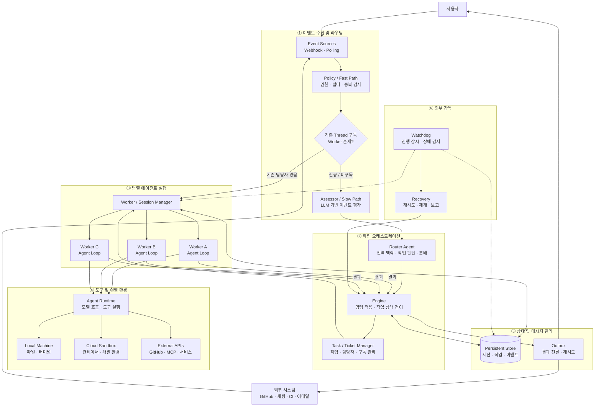
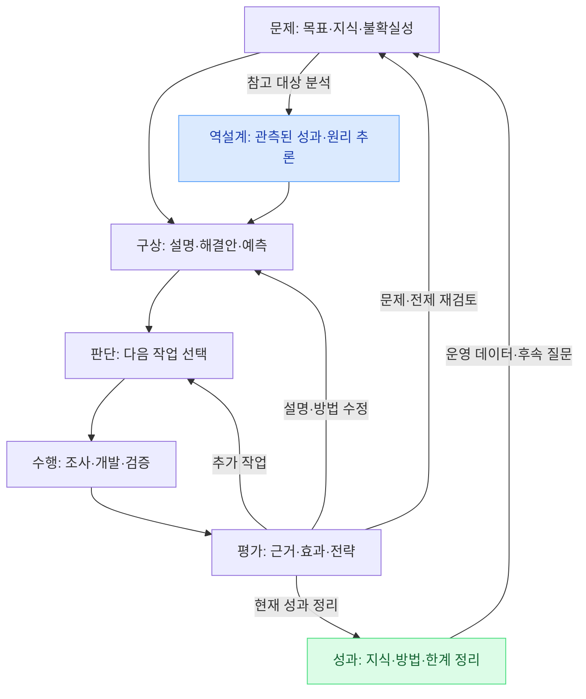
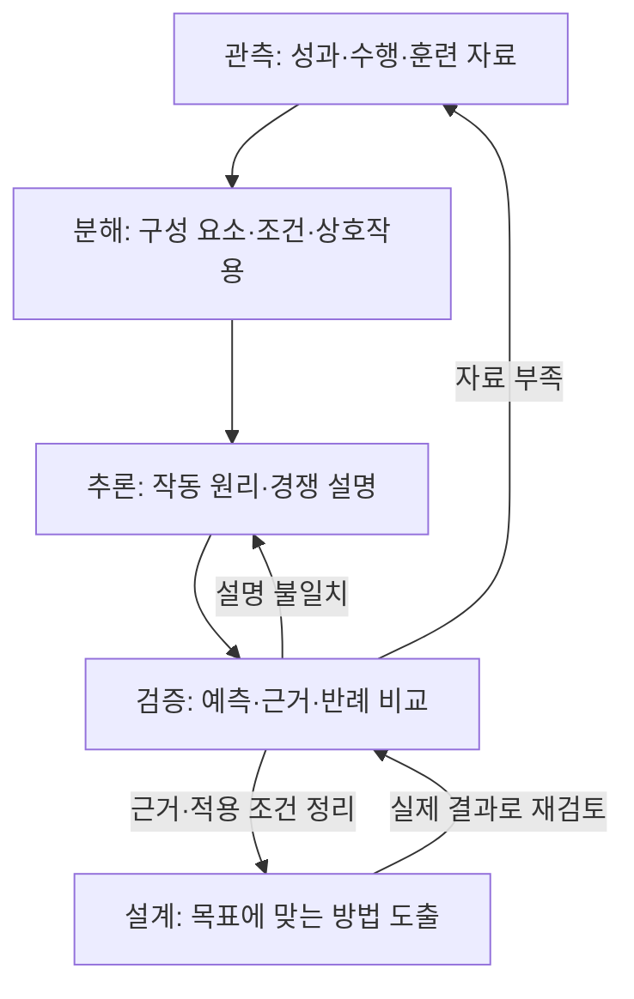
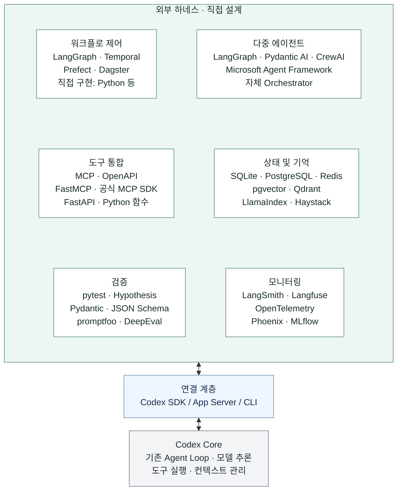
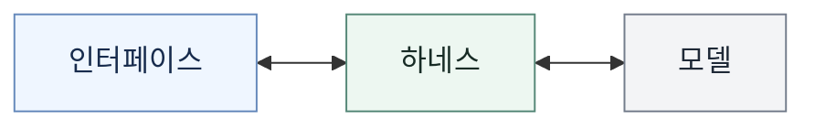

# 시스템 아키텍처

2026-11-08 (Asia/Seoul) · 정한 기술 구현 방향을 바탕으로 시스템 전체 운영 구조와 모듈 경계를 설계한다.

**기술 구현 방향:** 외부 하네스 ↔ Codex SDK / App Server / CLI ↔ Codex Core.

**시스템 운영 구조:** Router–Worker 기반 멀티에이전트 방식으로 모듈화한다.
선택의 기준은 [요구사항의 시스템 전체 운영 구조](SPECIFICATION.md#시스템-전체-운영-구조)다.

**기술 후보:** 각 영역의 제품·라이브러리는 비교할 후보이며, 모두 도입하거나 특정 조합을 확정한 것은 아니다.

설계 참고: DeepSeek Harness 팀,
[Super-agent 设计探索：迈向更自主的 Agent 系统](https://mp.weixin.qq.com/s/zoS7GlReWPhfCjENGxXCdg)
(2026-10-31).

참고 글은 Router가 사람과의 상호작용·작업 간 조율을 맡고, Worker가 분리된 문맥에서
구체적인 작업을 수행하는 논리적 이중 구조를 설명한다. 복잡한 단일 작업에서는
Worker 내부에 서브에이전트나 팀을 둘 수 있다. 글은 아키텍처 탐구와 일부 구현된
프로토타입을 다루며, 제품의 현재 기능을 설명하는 문서와 구분한다.

현재 설계에서는 아래 원본 그래프를 기준으로 Router·Worker의 책임, 작업 분담·전달·통합과
문맥·상태·실행·복구의 모듈 경계를 구체화한다.

### 슈퍼에이전트 원본 그래프

2026-11-08 사용자는 아래 슈퍼에이전트 원본 그래프를 그대로 아키텍처 설계의 기준으로
사용하기로 했다. 사용자가 대화에 제공한 Mermaid의 노드·문구·연결을 수정 없이 보존한다.
이는 설계 기준이며 실제 구현·실행 검증 상태와 구분한다.

## 연구개발 워크플로

요구사항의 과학적 추론·프론티어 연구·지능적인 연구를 통합하고 역설계 경로를 추가한
연구개발 흐름이다. 아래 두 그래프는 대화에서 작성한 워크플로를 그대로 저장한 것이다.
시스템 구조의 각 모듈에 배치하는 방식과 모듈 내부 실행 제어는 후속 설계에서 구체화한다.

### 통합 연구개발 워크플로

역설계는 참고할 성과나 구현이 있을 때 선택하는 연구 경로다. 연구 결과에 따라
추가 작업·설명 수정·문제 재정의로 돌아가며, 모든 연구에 같은 단계 순서를 강제하지 않는다.

### 역설계 내부 워크플로

직접 관측한 사실, 근거로 추론한 설명, 새로 설계한 방법을 구분한다.
선수의 퍼포먼스·훈련뿐 아니라 기존 연구 방법·도구·시스템에도 적용할 수 있다.

## 하네스 구성도

외부 하네스의 여섯 영역에 적힌 기술은 비교 후보이며, 영역 사이의 실행 순서를 뜻하지 않는다.

## 사용 구조

여기서 하네스는 위의 외부 하네스, Codex 연결 계층과 Codex Core를 포함한다.

## 영역별 도구·프레임워크 후보

Python은 프로그래밍 언어, MCP·OpenAPI는 연결·API 규격이다. 프레임워크, SDK, 저장소와 역할을 구분해 비교한다.
아래 링크는 각 프로젝트의 공식 문서·저장소다.

### 워크플로 제어

| 종류 | 후보 | 역할 |
| --- | --- | --- |
| 상태·그래프 실행 | [LangGraph](https://docs.langchain.com/oss/python/langgraph/overview) | 분기·반복·상태 보존과 사용자 개입을 포함하는 실행 흐름 |
| 지속 실행 | [Temporal](https://docs.temporal.io/workflows) | 장시간 작업·대기·실패 후 복구를 관리하는 실행 기반 |
| 작업 흐름 관리 | [Prefect](https://docs.prefect.io/v3/get-started) | Python 작업의 실행·상태·스케줄·실패 처리 |
| 데이터 작업 관리 | [Dagster](https://docs.dagster.io/) | 데이터 자산과 분석 파이프라인의 의존 관계·생성 이력 관리 |
| 직접 구현 | Python 등으로 작성한 제어 코드 | 프로젝트에 필요한 실행 규칙을 직접 구성 |

### 다중 에이전트

| 종류 | 후보 | 역할 |
| --- | --- | --- |
| 그래프 기반 구성 | [LangGraph](https://docs.langchain.com/oss/python/langgraph/overview) | 에이전트 작업과 일반 함수를 연결하는 흐름 구성 |
| 타입 기반 에이전트 SDK | [Pydantic AI](https://ai.pydantic.dev/) | 타입·구조화 결과를 활용하는 에이전트와 하위 에이전트 구성 |
| 팀·작업 흐름 | [CrewAI](https://docs.crewai.com/en/introduction) | 협력하는 에이전트 팀과 상태를 가진 작업 흐름 구성 |
| 에이전트·워크플로 프레임워크 | [Microsoft Agent Framework](https://learn.microsoft.com/en-us/agent-framework/overview/) | 에이전트와 함수를 연결하는 다중 에이전트 실행 구성 |
| 직접 구현 | 자체 Orchestrator | Codex 실행들을 프로젝트에 맞게 배정·조정 |

### 도구 통합

| 종류 | 후보 | 역할 |
| --- | --- | --- |
| 연결 규격 | [MCP](https://modelcontextprotocol.io/), [OpenAPI](https://spec.openapis.org/oas/latest.html) | 각각 모델용 도구 연결과 HTTP API 명세 |
| MCP 프레임워크 | [FastMCP](https://gofastmcp.com/getting-started/welcome) | 함수·데이터를 MCP 도구로 제공하고 서버·클라이언트 구성 |
| 프로토콜 SDK | [공식 MCP SDK](https://github.com/modelcontextprotocol/python-sdk) | MCP 서버·클라이언트와 도구 연결을 직접 구현 |
| API 프레임워크 | [FastAPI](https://fastapi.tiangolo.com/) | 분석·계산 기능을 HTTP API로 제공 |
| 직접 연결 | Python 함수 등 | 같은 실행 환경의 기능을 직접 호출 |

### 상태 및 기억

| 종류 | 후보 | 역할 |
| --- | --- | --- |
| 상태 저장 | [SQLite](https://www.sqlite.org/docs.html), [PostgreSQL](https://www.postgresql.org/docs/), [Redis](https://redis.io/docs/latest/) | 각각 내장 관계형 DB, 서버형 관계형 DB, 메모리 중심 데이터 저장소 |
| 벡터 저장·검색 | [pgvector](https://github.com/pgvector/pgvector), [Qdrant](https://qdrant.tech/documentation/) | 각각 PostgreSQL의 벡터 검색 확장과 벡터 검색 엔진 |
| 자료 연결·검색 프레임워크 | [LlamaIndex](https://developers.llamaindex.ai/python/framework/), [Haystack](https://docs.haystack.deepset.ai/docs/intro) | 문서·자료를 연결하고 검색·문맥 제공 파이프라인 구성 |

저장소와 검색 프레임워크는 서로 다른 역할이다. 저장소를 선택하는 것만으로 에이전트의 장기 기억이 완성되지는 않는다.

### 검증

| 종류 | 후보 | 역할 |
| --- | --- | --- |
| 코드·실행 검사 | [pytest](https://docs.pytest.org/), [Hypothesis](https://hypothesis.readthedocs.io/en/latest/) | 테스트 실행과 다양한 입력·경계 조건에 대한 속성 검사 |
| 데이터 형식 검사 | [Pydantic](https://docs.pydantic.dev/), [JSON Schema](https://json-schema.org/) | 입력·출력의 타입과 구조 검사 |
| 응답·에이전트 평가(Evals) | [promptfoo](https://www.promptfoo.dev/docs/intro/), [DeepEval](https://deepeval.com/docs/getting-started) | 사례별 결과 비교, 응답·에이전트 동작의 평가와 회귀 확인 |

형식 검사, 실행 성공, 연구 결과의 과학적 타당성은 서로 다른 검증 대상이다.

### 모니터링

| 종류 | 후보 | 역할 |
| --- | --- | --- |
| 에이전트 실행 관찰 | [LangSmith](https://docs.langchain.com/langsmith/observability), [Langfuse](https://langfuse.com/docs) | 실행 추적·디버깅·평가 결과 확인 |
| 계측 표준·도구 | [OpenTelemetry](https://opentelemetry.io/docs/what-is-opentelemetry/) | 추적·메트릭·로그의 생성·수집·전달 |
| 추적·평가 도구 | [Phoenix](https://arize.com/docs/phoenix) | 도구·검색·모델 호출 추적과 평가·실험 비교 |
| 추적·실험 관리 | [MLflow](https://mlflow.org/docs/latest/genai/tracing/) | 에이전트 실행 단계 추적과 실험·평가 관리 |

OpenTelemetry는 계측 기반이며 관찰 화면을 제공하는 제품과 함께 사용할 수 있다.

## Codex 연결과 선택 범위

- 연결 계층은 [Codex SDK](https://learn.chatgpt.com/docs/codex-sdk), [app-server](https://learn.chatgpt.com/docs/app-server), [CLI](https://learn.chatgpt.com/docs/cli)다. 언어·워크플로 프레임워크와 다른 선택이다.
- 모델 추론은 기존 Codex 계정의 사용량을 쓰는 실행 경로로 연결한다. 외부 에이전트 프레임워크의 기본 모델 API 연결이 Codex 구독 연동을 뜻하지는 않는다.
- 각 프레임워크와 Codex를 연결하는 방식은 아직 실행 검증하지 않았다. 모델 기반 평가와 임베딩을 사용하는 경우도 해당 모델·인증·비용 경로를 별도로 정한다.
- 이번에는 영역별 후보를 확장했다. 구체적인 채택 조합·배포 환경·서비스 비용은 후속 설계에서 정한다.

## 그래프 편집

그래프는 이 문서의 `mermaid` 코드 블록으로 작성되어 GitHub에서 직접 렌더링된다.
노드·연결·문구는 해당 코드 블록에서 수정한다.
