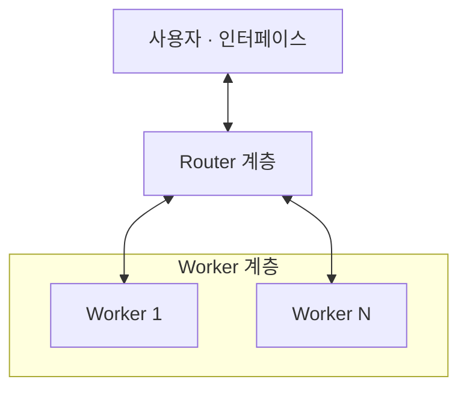
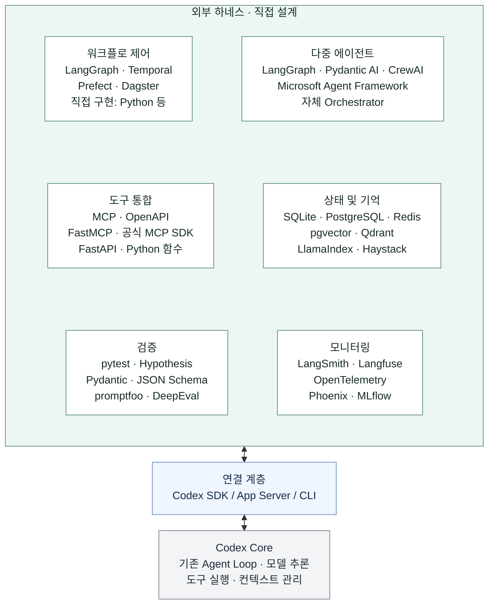
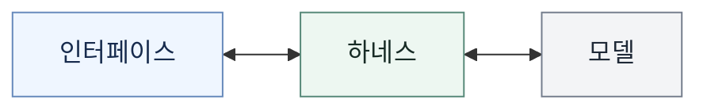
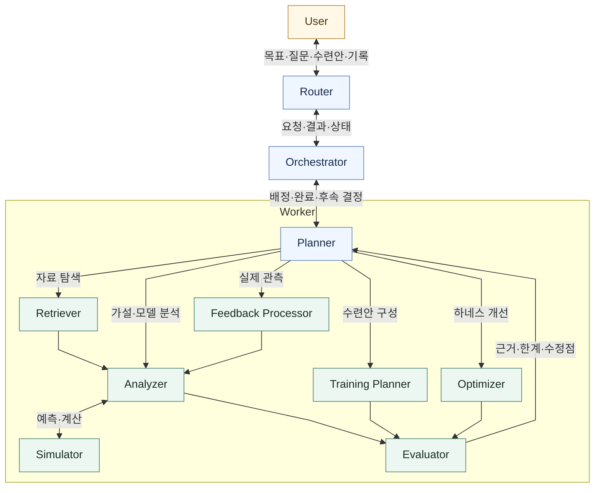
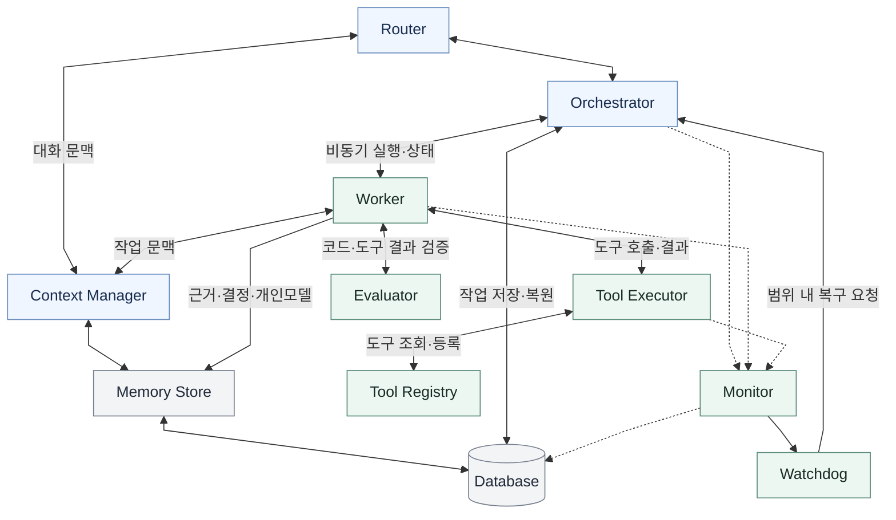

# 시스템 아키텍처

2026-11-06 (Asia/Seoul) · 정한 기술 구현 방향을 바탕으로 시스템 전체 운영 구조와 모듈 경계를 설계한다.

**기술 구현 방향:** 외부 하네스 ↔ Codex SDK / App Server / CLI ↔ Codex Core.

**시스템 운영 구조:** Router–Worker 기반 멀티에이전트 방식으로 모듈화한다.
선택의 기준은 [요구사항의 시스템 전체 운영 구조](SPECIFICATION.md#시스템-전체-운영-구조)다.

**기술 후보:** 각 영역의 제품·라이브러리는 비교할 후보이며, 모두 도입하거나 특정 조합을 확정한 것은 아니다.

## 설계·구현 순서

| 단계 | 설계할 내용 | 현재 상태 |
| --- | --- | --- |
| 1. 모듈 간 전체 워크플로 | 요구사항을 영어 모듈명의 책임·연결·피드백 경로로 구성 | 아래에 설계 초안 작성 |
| 2. 모듈 내부 워크플로 | 각 모듈의 입력·출력·상태, 판단·분기·반복, 완료·실패·중단 처리 | 다음 단계 |
| 3. 기술 구현 | 모듈별 코드·저장 방식·Codex 연결을 구현하고 실제 실행으로 검증 | 내부 설계 이후 |

현재는 모듈 간 연결을 설계한다. 각 기능은 Worker와 공통 실행 기반에 배치하며,
하나의 Worker가 여러 기능 모듈을 사용하거나 필요한 작업을 서브에이전트에 분담할 수 있다.

**전체 워크플로:** [연구·수련·피드백](#연구수련피드백-workflow) · [공통 실행 기반](#runtime-workflow) · [요구사항과 연결 규칙](#요구사항과-연결-규칙)

## 시스템 운영 구조

이 그래프는 선택한 운영 구조의 두 계층을 나타낸다. Worker의 수·전문 역할과
계층 내부의 세부 구성은 모듈화 설계에서 정한다.

설계 참고: DeepSeek Harness 팀,
[Super-agent 设计探索：迈向更自主的 Agent 系统](https://mp.weixin.qq.com/s/zoS7GlReWPhfCjENGxXCdg)
(2026-10-31).

참고 글은 Router가 사람과의 상호작용·작업 간 조율을 맡고, Worker가 분리된 문맥에서
구체적인 작업을 수행하는 논리적 이중 구조를 설명한다. 복잡한 단일 작업에서는
Worker 내부에 서브에이전트나 팀을 둘 수 있다. 글은 아키텍처 탐구와 일부 구현된
프로토타입을 다루며, 제품의 현재 기능을 설명하는 문서와 구분한다.

현재 설계에서는 Router·Worker의 책임, 작업 분담·전달·통합과 문맥·상태·실행·복구의
모듈 경계를 구체화한다. 글의 이벤트 처리, 문맥 관리, 비동기 실행, 계산·상태·환경 분리,
Watchdog은 우리 요구사항에 맞춰 채택 범위를 정할 참고 기법이다.

## 하네스 구성도

외부 하네스의 여섯 영역에 적힌 기술은 비교 후보이며, 영역 사이의 실행 순서를 뜻하지 않는다.

워크플로 제어 영역은 아래의 [모듈 간 전체 워크플로](#모듈-간-전체-워크플로)로 구체화한다.

## 사용 구조

여기서 하네스는 위의 외부 하네스, Codex 연결 계층과 Codex Core를 포함한다.

## 모듈 간 전체 워크플로

두 그래프는 같은 시스템의 연구·수련 흐름과 공통 실행 기반을 나누어 보여준다.
같은 이름은 같은 논리 모듈을 뜻한다. `User`는 시스템 밖에서 목표를 정하고 실제 수련·관측을 수행하는 사용자다.

### 연구·수련·피드백 Workflow

사용자 목표를 연구로 구체화하고, 현재 근거로 수련안을 제안하며, 실제 기록으로
설명·개인모델·다음 수련을 갱신한다. Planner는 필요한 경로를 선택하며 모든 기능을 매번 순서대로 호출하지 않는다.

Planner는 목표의 필요조건·지식 공백을 찾고 연구 방향, 분담, 다음 행동과 보고 시점을 판단한다.
Retriever는 자료를 찾고, Analyzer는 원자료·영상·경쟁 설명을 분석해 수행 원리와 개인모델을 구성한다.
Simulator는 모델의 가정 아래 예측을 계산한다. Evaluator는 근거·반례·불확실성을 검토해 Planner에 돌려준다.
담당 Worker가 결과를 통합하고 Orchestrator를 통해 Router에 전달한다. 연구 중 질문도 같은 경로로 전달한다.

Training Planner는 현재 확보된 근거와 사용자 상태·환경·일정을 바탕으로 잠정 수련안부터 제안한다.
사용자가 합의한 수련안을 수행하고 기록을 보내면 Feedback Processor가 실제 수행과 예측의 차이,
성장·정체를 정리한다. 이를 Analyzer·Evaluator·Planner로 전달해 개인모델, 후속 연구와 수련안을 갱신한다.
Optimizer는 연구·실행 경험에서 하네스 개선안을 만들고 평가받아 사용자에게 제안한다.

### Runtime Workflow

공통 실행 기반은 위의 Worker 기능 모두를 지원한다. 실선은 요청·결과 전달,
점선은 실행 상태 관찰과 기록을 뜻한다. 저장소의 실제 제품과 Watchdog의 독립 배치 여부는 내부 설계에서 정한다.

- **Router → Orchestrator → Worker:** Router는 사용자와 작업 간 조율을 맡는다. Orchestrator는
  Worker·서브에이전트의 배정·실행·대기·실패·완료를 관리한다. 연구 분담과 통합의 판단은 담당 Worker가 수행한다.
- **Context Manager → Memory Store → Database:** 현재 작업에 필요한 정보 선택, 장기 기억의 검색·갱신,
  영속 저장을 각각 담당한다. 원자료와 대용량 파일의 보관 방식은 저장 설계에서 구체화한다.
- **Tool Registry ↔ Tool Executor ↔ Worker:** 도구의 기능·사용 조건을 조회해 호출하고 결과를 반환한다.
  도구가 부족하면 Worker가 기존 도구를 연결하거나 코드를 개발하고 Evaluator로 검증한 뒤 재사용 가능하게 등록한다.
- **Monitor → Watchdog → Orchestrator:** 실행 오류·정체를 관찰하고 복구를 요청한다.
  Orchestrator는 합의한 자원·권한과 중단 상태를 확인해 실행 여부를 결정한다.

### 요구사항과 연결 규칙

| 요구사항 | 모듈 간 처리 |
| --- | --- |
| [목표 지향·과학적·지능적 연구](SPECIFICATION.md#연구-추론-워크플로-설계-참고) | Planner가 목표·질문·전략을 구성하고 Retriever·Analyzer·Simulator를 선택한다. Evaluator의 결과로 문제·가설·다음 행동을 재검토한다. |
| [과학적 역설계](SPECIFICATION.md#선수의-퍼포먼스훈련을-과학적으로-역설계) | Retriever가 자료를 찾고 Analyzer가 확인한 수행과 추정 기전을 구분한다. Evaluator의 검토를 바탕으로 Training Planner가 개인 적용 후보와 이유를 구성한다. |
| [공동 연구와 결정](SPECIFICATION.md#4-함께-결정하고-자율성을-발전시키는-방식) | 질문·추가 비용·새 권한·방향 변경은 Router를 통해 논의한다. 답변이 필요한 작업은 대기하고 합의 범위의 독립 작업은 계속한다. |
| [수련·관측·개인모델](SPECIFICATION.md#6-하루의-수련과-관측) | 기록은 Router → Orchestrator → Worker의 Feedback Processor로 전달한다. 분석·평가 후 개인모델과 다음 수련을 갱신하고 Memory Store에 보존한다. 미입력 기록은 미확인으로 남긴다. |
| [하네스 재귀개선](SPECIFICATION.md#하네스-개선-제안과-재귀개선) | Optimizer의 제안과 Evaluator의 비교 근거를 사용자에게 전달한다. 합의된 변경만 새 작업으로 배정하고, 변경 후 평가를 다음 개선에 반영한다. |
| [사용량 부족·중단·재개](SPECIFICATION.md#8-비용사용량재개) | Orchestrator가 진행 상황·다음 작업을 저장하고 중단을 보고한다. 사용량 회복 후 사용자 재개 지시를 받아 작업·문맥을 복원한다. Watchdog도 이 조건을 따른다. |
| [실제 동작 검증](SPECIFICATION.md#에이전트로서의-실제-동작-검증) | Evaluator는 코드·형식·실행 검증과 연구의 과학적 타당성을 구분한다. 실제 성장과 연구 성과는 관측으로 평가한다. |

Router·Worker·서브에이전트의 모델 실행은 기존 Codex 구독 사용량 경로를 사용한다.
새 비용·권한과 개인 자료의 새로운 외부 서비스 제공은 기존 공동 결정 원칙을 따른다.

### 다음 단계: 모듈 내부 Workflow

각 모듈에 대해 **입력 → 필요한 상태·문맥 → 판단·분기·반복 → 출력·저장 → 완료·실패·중단 처리**를 설계한다.
먼저 Router·Orchestrator·Worker의 전달 관계와 Planner의 의사결정을 구체화하고,
그다음 문맥·기억·도구, 연구·수련·평가, 모니터링·개선 모듈을 연결한다.
기술 구현에서는 이 내부 설계를 Codex 연결, 코드와 저장 구조로 옮겨 실제 흐름을 검증한다.

## 영역별 도구·프레임워크 후보

Python은 프로그래밍 언어, MCP·OpenAPI는 연결·API 규격이다. 프레임워크, SDK, 저장소와 역할을 구분해 비교한다.
아래 링크는 각 프로젝트의 공식 문서·저장소다.

### 워크플로 제어

| 종류 | 후보 | 역할 |
| --- | --- | --- |
| 상태·그래프 실행 | [LangGraph](https://docs.langchain.com/oss/python/langgraph/overview) | 분기·반복·상태 보존과 사용자 개입을 포함하는 실행 흐름 |
| 지속 실행 | [Temporal](https://docs.temporal.io/workflows) | 장시간 작업·대기·실패 후 복구를 관리하는 실행 기반 |
| 작업 흐름 관리 | [Prefect](https://docs.prefect.io/v3/get-started) | Python 작업의 실행·상태·스케줄·실패 처리 |
| 데이터 작업 관리 | [Dagster](https://docs.dagster.io/) | 데이터 자산과 분석 파이프라인의 의존 관계·생성 이력 관리 |
| 직접 구현 | Python 등으로 작성한 제어 코드 | 프로젝트에 필요한 실행 규칙을 직접 구성 |

### 다중 에이전트

| 종류 | 후보 | 역할 |
| --- | --- | --- |
| 그래프 기반 구성 | [LangGraph](https://docs.langchain.com/oss/python/langgraph/overview) | 에이전트 작업과 일반 함수를 연결하는 흐름 구성 |
| 타입 기반 에이전트 SDK | [Pydantic AI](https://ai.pydantic.dev/) | 타입·구조화 결과를 활용하는 에이전트와 하위 에이전트 구성 |
| 팀·작업 흐름 | [CrewAI](https://docs.crewai.com/en/introduction) | 협력하는 에이전트 팀과 상태를 가진 작업 흐름 구성 |
| 에이전트·워크플로 프레임워크 | [Microsoft Agent Framework](https://learn.microsoft.com/en-us/agent-framework/overview/) | 에이전트와 함수를 연결하는 다중 에이전트 실행 구성 |
| 직접 구현 | 자체 Orchestrator | Codex 실행들을 프로젝트에 맞게 배정·조정 |

### 도구 통합

| 종류 | 후보 | 역할 |
| --- | --- | --- |
| 연결 규격 | [MCP](https://modelcontextprotocol.io/), [OpenAPI](https://spec.openapis.org/oas/latest.html) | 각각 모델용 도구 연결과 HTTP API 명세 |
| MCP 프레임워크 | [FastMCP](https://gofastmcp.com/getting-started/welcome) | 함수·데이터를 MCP 도구로 제공하고 서버·클라이언트 구성 |
| 프로토콜 SDK | [공식 MCP SDK](https://github.com/modelcontextprotocol/python-sdk) | MCP 서버·클라이언트와 도구 연결을 직접 구현 |
| API 프레임워크 | [FastAPI](https://fastapi.tiangolo.com/) | 분석·계산 기능을 HTTP API로 제공 |
| 직접 연결 | Python 함수 등 | 같은 실행 환경의 기능을 직접 호출 |

### 상태 및 기억

| 종류 | 후보 | 역할 |
| --- | --- | --- |
| 상태 저장 | [SQLite](https://www.sqlite.org/docs.html), [PostgreSQL](https://www.postgresql.org/docs/), [Redis](https://redis.io/docs/latest/) | 각각 내장 관계형 DB, 서버형 관계형 DB, 메모리 중심 데이터 저장소 |
| 벡터 저장·검색 | [pgvector](https://github.com/pgvector/pgvector), [Qdrant](https://qdrant.tech/documentation/) | 각각 PostgreSQL의 벡터 검색 확장과 벡터 검색 엔진 |
| 자료 연결·검색 프레임워크 | [LlamaIndex](https://developers.llamaindex.ai/python/framework/), [Haystack](https://docs.haystack.deepset.ai/docs/intro) | 문서·자료를 연결하고 검색·문맥 제공 파이프라인 구성 |

저장소와 검색 프레임워크는 서로 다른 역할이다. 저장소를 선택하는 것만으로 에이전트의 장기 기억이 완성되지는 않는다.

### 검증

| 종류 | 후보 | 역할 |
| --- | --- | --- |
| 코드·실행 검사 | [pytest](https://docs.pytest.org/), [Hypothesis](https://hypothesis.readthedocs.io/en/latest/) | 테스트 실행과 다양한 입력·경계 조건에 대한 속성 검사 |
| 데이터 형식 검사 | [Pydantic](https://docs.pydantic.dev/), [JSON Schema](https://json-schema.org/) | 입력·출력의 타입과 구조 검사 |
| 응답·에이전트 평가(Evals) | [promptfoo](https://www.promptfoo.dev/docs/intro/), [DeepEval](https://deepeval.com/docs/getting-started) | 사례별 결과 비교, 응답·에이전트 동작의 평가와 회귀 확인 |

형식 검사, 실행 성공, 연구 결과의 과학적 타당성은 서로 다른 검증 대상이다.

### 모니터링

| 종류 | 후보 | 역할 |
| --- | --- | --- |
| 에이전트 실행 관찰 | [LangSmith](https://docs.langchain.com/langsmith/observability), [Langfuse](https://langfuse.com/docs) | 실행 추적·디버깅·평가 결과 확인 |
| 계측 표준·도구 | [OpenTelemetry](https://opentelemetry.io/docs/what-is-opentelemetry/) | 추적·메트릭·로그의 생성·수집·전달 |
| 추적·평가 도구 | [Phoenix](https://arize.com/docs/phoenix) | 도구·검색·모델 호출 추적과 평가·실험 비교 |
| 추적·실험 관리 | [MLflow](https://mlflow.org/docs/latest/genai/tracing/) | 에이전트 실행 단계 추적과 실험·평가 관리 |

OpenTelemetry는 계측 기반이며 관찰 화면을 제공하는 제품과 함께 사용할 수 있다.

## Codex 연결과 선택 범위

- 연결 계층은 [Codex SDK](https://learn.chatgpt.com/docs/codex-sdk), [app-server](https://learn.chatgpt.com/docs/app-server), [CLI](https://learn.chatgpt.com/docs/cli)다. 언어·워크플로 프레임워크와 다른 선택이다.
- 모델 추론은 기존 Codex 계정의 사용량을 쓰는 실행 경로로 연결한다. 외부 에이전트 프레임워크의 기본 모델 API 연결이 Codex 구독 연동을 뜻하지는 않는다.
- 각 프레임워크와 Codex를 연결하는 방식은 아직 실행 검증하지 않았다. 모델 기반 평가와 임베딩을 사용하는 경우도 해당 모델·인증·비용 경로를 별도로 정한다.
- 이번에는 영역별 후보를 확장했다. 구체적인 채택 조합·배포 환경·서비스 비용은 후속 설계에서 정한다.

## 그래프 편집

그래프는 이 문서의 `mermaid` 코드 블록으로 작성되어 GitHub에서 직접 렌더링된다.
노드·연결·문구는 해당 코드 블록에서 수정한다.
