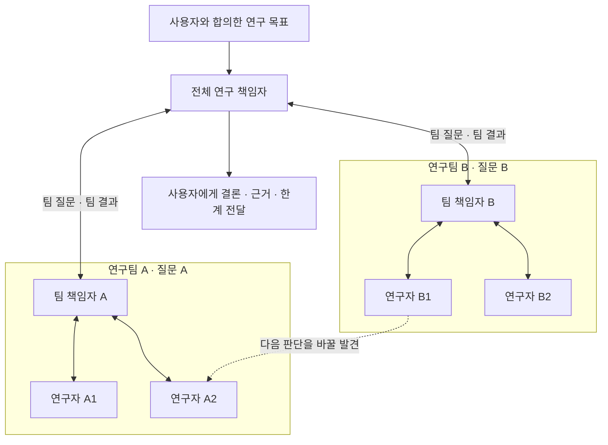

# 수련 연구 에이전트 설계도

**사용자와 합의한 연구 목표 하나를 여러 팀이 나눠 연구한다.** 전체 연구 책임자는 팀별 질문을 정하고, 팀 책임자는 팀 안의 에이전트에게 작업을 맡긴다. 연구 중에는 다른 팀의 다음 판단을 바꿀 발견을 직접 전달한다.

## 기본 구조

책임자와 연구자를 잇는 실선은 **작업 배정과 결과 보고**, 팀 사이 점선은 **연구 도중의 직접 공유**다. 팀 책임자도 직접 연구한다. 그림의 팀·연구자 수는 예시이며, 간단한 질문에서는 전체 책임자가 팀 책임자를 겸할 수 있다.

## 오케스트레이션

| 언제 | 누가 무엇을 결정하는가 |
| --- | --- |
| **목표를 정할 때** | 사용자와 전체 책임자가 연구가 끝나면 어떤 선택을 할 수 있어야 하는지 합의한다. 전체 책임자는 독립적으로 답할 질문마다 팀을 구성하고 담당 범위와 기대 결과를 정한다. |
| **팀이 연구할 때** | 팀 책임자가 질문을 하위 작업으로 나눈다. 연구자는 맡은 문제에 맞춰 조사·추론·계산·실험하고, 확인한 근거와 남은 의문을 팀 책임자에게 돌려준다. |
| **다른 팀에 영향을 주는 발견이 나올 때** | 발견자가 해당 연구자에게 **근거, 바뀐 전제, 다시 볼 질문**을 보낸다. 수신자는 다음 턴에서 접근을 바꾸거나 유지한 이유를 남긴다. 전체 결론에 영향을 주는 발견은 전체 책임자도 받는다. |
| **연구 방향을 바꿀 때** | 팀 안의 추가 조사와 작업 중단은 팀 책임자가 정한다. 팀 사이의 중복·우선순위·자원 재배치는 전체 책임자가 결정한다. 중심 목표가 달라지면 사용자와 다시 합의한다. |
| **결론을 낼 때** | 팀 책임자가 팀별 결론과 한계를 제출한다. 전체 책임자는 결론을 뒤집을 반례가 남았는지 확인하고, 필요하면 원래 주장을 작성하지 않은 연구자에게 검토를 맡긴다. 판단할 근거가 충분하면 결과를 전달하고, 부족하면 필요한 다음 관측을 밝힌다. 수련법의 실제 적용은 사용자가 결정한다. |

**팀 간 공유 예시.** 선수 분석팀은 공개 영상에서 훈련 조건을 확인하고, 적응 원리팀은 어떤 조건에서 훈련 효과가 달라지는지 조사한다고 하자. 적응 원리팀이 실제 부하가 중요한 조건임을 발견하면, 선수 분석팀에 출처와 함께 알린다. 선수 분석팀의 다음 질문은 “같은 동작이 더 보이는가?”에서 “부하를 확인할 기록이 있는가?”로 바뀐다. 부하를 확인할 수 없으면 전체 책임자는 관찰한 동작까지만 보고하고 선수에게 생긴 효과는 미확인으로 둔다.

구현 시 지킬 실행 규칙과 기술 선택

- **실행.** 한 로컬 프로세스의 Python 3.13·`asyncio`가 모든 팀의 작업을 조정한다. 기존 Codex 계정으로 공식 Python SDK `openai-codex==0.171.0`의 `AsyncCodex`를 사용한다. 연구자마다 스레드 하나를 연결하고 겸임 시 재사용한다.
- **순서와 한도.** 초기값은 전체 동시 2턴, 스레드당 1턴이다. 기다리는 작업은 슬롯을 반환하고 같은 우선순위의 팀은 번갈아 실행한다. 목표별 총 턴 예산은 재시도·복구를 포함해 호출 전에 예약한다. 팀을 가로지르는 작업 의존성도 등록·변경 시 순환을 검사한다.
- **전달과 복구.** SQLite 한 트랜잭션에 발견·수신 작업·책임자가 검토할 항목을 기록하고 수신자의 다음 턴에 전달한다. 재시작 시 미확인 메시지를 재전달하되 같은 발견 ID는 한 번만 반영한다. 팀이 중단되면 그 결과를 기다리는 작업만 보류한다. 취소·재배정 전의 응답은 작업 버전으로 식별한다.
- **결론 확정.** 중요 발견의 최신 번호와 미검토 항목을 팀·전체 수준에서 각각 확인한 뒤 결과를 확정한다. 확정 직전 들어온 반례는 먼저 검토하고, 이후의 유효한 반례는 기존 결론에 연결해 재검토한다. 사용량이 소진되면 마지막 확정 결과와 재개 조건을 반환한다.

구현 확인 기준은 **팀 간 발견이 실제 다음 작업을 바꾸는지**, **중단·재전송 후 결과가 빠지거나 중복 반영되지 않는지**, **반례와 결론이 동시에 도착해도 반례가 검토되는지**다. 실제 다중 팀 실행은 구현 후 검증한다. [기술 대안 비교와 상세 인수 기준](https://github.com/Rmayana/frontier-research-harness/blob/46bb315f3a966ba8dc20e149a6dc07efe487bb9c/docs/DESIGN.md#기술-스택-선택과-대안)

[요구사항](SPECIFICATION.md) · [OpenAI 수학 연구 사례](OPENAI_MATH_AGENT_REVERSE_ENGINEERING.md)
