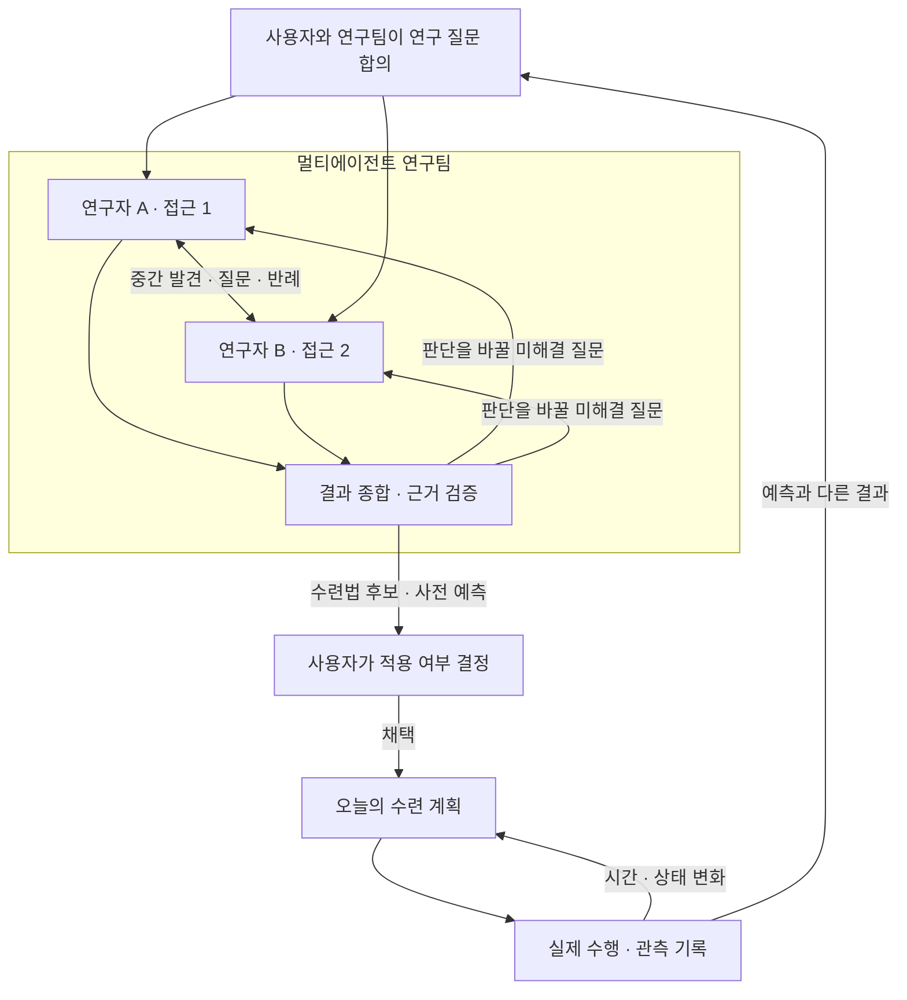
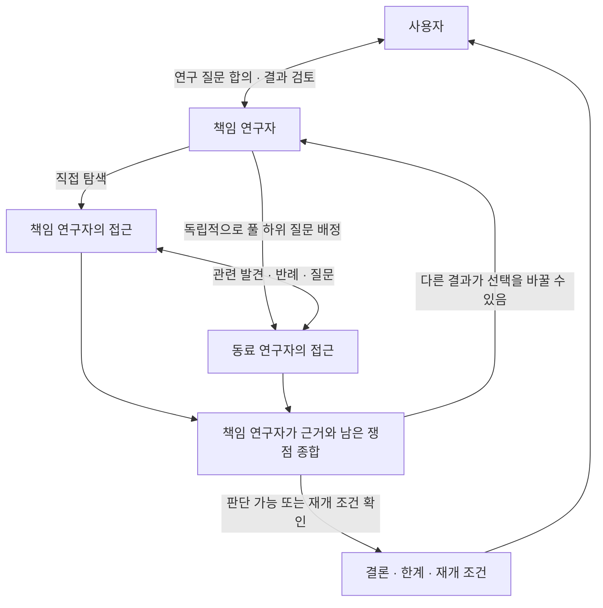

# 수련 연구 에이전트 설계도

**설계의 출발점은 멀티에이전트 연구팀이다.** 사용자와 합의한 하나의 문제를 여러 연구자가 서로 다른 접근으로 탐색한다. 각 연구자는 필요에 따라 조사·추론·계산·실험을 수행한다. 중간 발견이 다른 접근의 전제를 바꾸면 연구 도중에 전달한다.

**구현 결정 · 2026-11-21.** 첫 버전은 Windows 로컬 대화형 CLI에서 사용한다. Python 3.13 하네스가 공식 Codex Python SDK로 연구자별 스레드를 운용하고, 연구 상태와 근거는 SQLite에 보존한다. 아래는 구현 기준이며 인수 시험의 통과 여부는 별도로 기록한다.

## 기본 구조

A와 B는 한 연구에서 갈라질 수 있는 두 접근의 예시다. 연구자 수와 맡는 일은 문제에 따라 달라진다. **결과 종합·근거 검증**은 발견을 대조하고 다음 행동을 정하는 작업을 뜻한다. 아래 오케스트레이션 설계는 이 작업을 맡을 연구자와 재검토 시점을 정한다.

## 어떤 정보가 오가는가

| 경로 | 전달 내용과 결정 |
| --- | --- |
| 사용자 ↔ 연구팀 | 무엇을 알아내면 어떤 수련 선택이 달라지는지 합의한다. 중심 목표를 변경하거나 새 후보를 실제 적용하는 결정은 사용자가 한다. |
| 연구자 ↔ 연구자 | 발견한 사실, 원출처나 계산 결과, 그 발견이 영향을 주는 가정이나 질문을 전달한다. 수신자는 다음 조사·실험을 바꾸거나 기존 접근을 유지할 이유를 남긴다. |
| 연구자 → 종합·검증 → 후속 연구 | 같은 원자료의 재인용, 상충하는 결론, 관측하지 못한 조건을 확인한다. 결론을 가를 비교가 남아 있으면 그 문제를 풀 수 있는 접근에서 조사를 이어간다. |
| 연구팀 → 사용자 → 일일 운영 | 후보의 예상 효과·부담·적용 조건과 판단을 바꿀 관측을 제시한다. 채택하면 예측을 남기고 훈련·영양·휴식 계획에 반영한다. |
| 개인 기록 → 운영 또는 연구 | 가용 시간의 변화는 다음 계획에 곧바로 반영한다. 실제 수행과 예측의 불일치는 원인 재검토로 이어진다. 심층 연구가 진행 중이어도 오늘의 계획은 현재 근거와 여건으로 제공한다. |

**예시.** 베테르비에프의 공개 훈련 영상을 조사하는 A가 반복 동작을 확인했다고 하자. 문헌을 조사하는 B가 효과를 가르는 조건으로 실제 부하를 찾아내면, B는 출처와 조건을 A에게 보낸다. A의 다음 질문은 “같은 동작이 몇 번 더 보이는가?”에서 “부하를 확인할 영상 구간이나 별도 기록이 있는가?”로 바뀐다. 끝내 확인하지 못하면 팀은 관찰된 동작과 그 효과에 대한 가설을 구분해 보고한다.

외부 하네스는 Codex 실행·도구 접근·연구 및 개인 기록의 보존을 지원한다. 실제 하네스의 수정·검증은 사용자와 Codex가 개발 과정에서 맡는다. 범용 연구자는 서로 발견을 직접 공유하고, 책임 연구자는 그 결과에 따라 후속 탐색을 결정한다.

## 1. 오케스트레이션

**연구 질문마다 책임 연구자 한 명을 두고, 나눌 가치가 있는 접근만 동료에게 맡긴다.** 책임 연구자는 직접 연구하면서 전체 질문과 최종 답을 책임진다. 동료들은 맡은 질문 안에서 방법을 고르고 서로 발견을 전달한다. 사용자는 연구 목표와 실제 적용을 결정하고, 하네스는 합의한 동시 실행·사용량 한도와 작업 상태를 관리한다.

### 어떤 순간에 누가 결정하는가

| 순간 | 결정과 실행 |
| --- | --- |
| 연구 시작 | 책임 연구자가 사용자와 **답을 얻으면 무엇을 결정할지** 합의한다. 바로 확인할 질문은 직접 푼다. 다른 설명을 독립적으로 시험하거나, 본문제를 가로막는 하위 문제를 별도로 풀 가치가 있으면 동료에게 배정한다. |
| 작업 배정 | 배정 내용은 **질문, 답이 바꿀 판단, 이미 확인한 근거, 반환할 결과**다. 앞선 결과가 필요한 작업은 대기시키고 독립 작업은 동시에 진행한다. 동료는 새 갈래를 제안할 수 있고 책임 연구자가 중복·의존성·남은 자원을 보고 실행 여부를 정한다. |
| 진행 중 공유 | 발견이 다른 작업의 전제나 다음 행동을 바꾸면 해당 동료에게 원출처·적용 조건·영향을 직접 전달한다. 수신자는 다음 판단에 이를 반영하거나 기존 접근을 유지한 이유를 남긴다. 우선순위나 최종 결론에 영향이 있으면 책임 연구자에게도 알린다. |
| 재배치와 검증 | 전제가 깨지거나, 결정적인 중간 결과가 나오거나, 작업이 막힐 때 책임 연구자가 계획을 갱신한다. 접근이 겹치면 합치고 유망한 하위 문제에 여력을 옮긴다. 결과가 충돌하면 어느 설명이 맞을 때 관측이 달라지는지 정해 원자료 대조·재계산·독립 검토를 맡긴다. |
| 종료 또는 대기 | 근거가 선택을 뒷받침하거나 추가 조사로 선택이 달라질 가능성이 작으면 현재 결론과 한계를 전달한다. 필요한 관측·권한·사용량이 부족하면 영향을 받는 판단과 재개 조건을 남긴다. 중심 목표 변경과 실제 수련법 채택은 사용자에게 돌려준다. |

**실행 상태.** 하네스는 작업별로 대기·진행·완료·보류·취소 상태와 마지막으로 확인한 결과를 보존한다. 동시 실행 한도에 도달하면 독립 작업도 대기한다. 한 작업의 실패는 그 결과에 의존하는 작업에만 전파한다. 재개할 때는 이미 완료된 근거를 재사용하고, 취소되거나 질문이 변경된 작업의 늦은 응답은 책임 연구자가 현재 질문에도 유효한지 확인한 뒤 반영한다.

**설계를 판정할 사례.** 위 훈련 영상 사례에서 B가 강도 조건을 발견하면 A는 결정에 필요한 부하 자료를 찾아야 한다. 책임 연구자는 반환된 근거를 보고 선수의 훈련 효과까지 판단할 수 있는지 정한다. 부하 자료를 끝내 확보하지 못하면 관찰한 동작만 보고하고 효과는 보류한다. 이때 ① B의 발견이 A의 다음 행동을 바꿨는지, ② 근거가 부족한 결론이 최종 답에서 보류됐는지, ③ 재개 시 같은 조사를 반복하지 않는지를 실행 기록에서 확인한다.

범용 연구자가 서로 다른 접근을 취하고 중간 발견을 재사용하는 방식은 [수학 연구 에이전트 역설계](OPENAI_MATH_AGENT_REVERSE_ENGINEERING.md)를 참고했다. 질문마다 책임 연구자가 작업 배정과 종합을 맡는 구조는 우리 시스템의 설계 결정이다.

### 구현 결정과 기술 스택

| 경계 | 채택 기술 | 맡길 책임 |
| --- | --- | --- |
| 대화·연구 제어 | Python 3.13, 표준 라이브러리 `asyncio`·`argparse` | 한 프로세스에서 연구 시작·재개, 오늘 계획, 실제 기록·정정을 처리한다. 책임 연구자는 연구 결정을 제안하고 하네스가 실행 순서·권한·상태 변경을 집행한다. |
| 모델 실행 | 공식 `openai-codex==0.171.0`의 `AsyncCodex`, SDK가 지정한 로컬 Codex 런타임 | 연구자별 스레드, 비동기 턴, 구조화 응답, 동료 메시지, 중단과 재개를 담당한다. 시작 시 계정 유형을 확인하고 기존 ChatGPT 인증을 사용한다. [SDK 공식 가이드](https://learn.chatgpt.com/docs/codex-sdk) · [선정 버전과 배포 출처](https://pypi.org/project/openai-codex/0.171.0/) |
| 행동 계약 | Pydantic 2 모델과 JSON Schema | 턴마다 가능한 행동과 필수 필드를 정의한다. SDK의 `output_schema`로 출력을 받고 하네스가 ID·권한·버전까지 검사한다. [고정 리비전의 Python SDK 계약](https://github.com/openai/codex/blob/583ec348cf9007361d09513c716549c41d4d8128/sdk/python/docs/api-reference.md) · [Pydantic 모델](https://docs.pydantic.dev/latest/concepts/models/) |
| 상태·검색 | 표준 `sqlite3`, 외래 키·트랜잭션·FTS5, 비공개 로컬 파일 | 작업·발견·메시지·예측·실제 기록의 기준 저장소다. 큰 원본은 Git과 동기화 폴더 밖에 두고 DB에는 식별자와 위치를 둔다. [SQLite 인터페이스](https://docs.python.org/3.13/library/sqlite3.html) · [FTS5](https://www.sqlite.org/fts5.html) |
| 시험·관측 | `unittest`, 가짜 모델·도구 어댑터, 로컬 실행 이벤트 | 네트워크 없이 순서·취소·중복·복구를 재현한다. 실제 SDK 시험은 별도로 수행한다. 작업 ID, 소요 시간, 사용량, 상태·오류 유형을 기록하고 본문·원본·인증 정보는 진단 로그에서 제외한다. |

**실행 순서.** 시작 시 `AsyncCodex.account(refresh_token=False)`로 ChatGPT 계정 경로를 확인한다. 연구를 생성하면 책임 연구자용 `thread_start`를 호출하고 연구 ID와 스레드 ID를 연결한다. 책임자가 새 접근을 배정하면 독립 스레드를 시작한다. 스레드마다 활성 턴 하나를 허용하고 프로세스 전체의 동시 턴은 세마포어로 제한한다. 초기 기본값은 책임자 포함 **동시 2턴**이며 대표 작업에서 조정할 운영값이다. 모델은 인증된 계정의 기본 모델로 시작하고 실제 모델·설정과 사용량을 평가 기록에 남긴다. 계정 한도에 도달하면 해당 연구를 보류한다. [인증과 과금 경로](https://learn.chatgpt.com/docs/auth) · [비동기 태스크](https://docs.python.org/3.13/library/asyncio-task.html)

**턴에서 상태 변경까지.** 모델은 작업 배정, 발견 공유, 도구 요청, 결과 반환, 보류 중 하나를 구조화해 제안한다. 하네스는 작업 버전과 권한을 확인하고 요청 ID로 중복을 제거한다. 발견·수신자별 발송 대기 메시지·작업 상태를 한 트랜잭션에 기록한 뒤 수신자의 다음 턴에 전달한다. 공유는 전체 연구가 끝날 때까지 기다리지 않는다. 첫 구현의 전달 경계는 수신자의 턴 사이이며, 이미 생성된 응답에는 입력 버전을 대조한다. 메시지 재전달은 같은 ID로 처리한다. 재시작 시 완료한 작업을 건너뛰고 `thread_resume`로 이어간다. 스레드를 복원할 수 없으면 마지막 확정 기록에서 새 스레드를 연다. 완료 여부가 불명확한 외부 작업은 상태를 확인한 뒤 재시도한다.

**대안을 비교한 이유.** 공식 Python SDK가 App Server를 사용하며 필요한 스레드·턴 계약을 제공한다. 직접 JSON-RPC를 구현하면 인증·이벤트 호환까지 유지해야 한다. TypeScript SDK도 스레드를 지원하지만 이 프로젝트는 연구 계산과 실행기를 Python 한 환경으로 운용할 수 있다. LangGraph의 영속 체크포인트는 다수 워크플로에 유용하다. 첫 버전에서는 연구 기록과 메시지 전달을 같은 SQLite 트랜잭션에서 처리하므로 별도 그래프 실행기의 상태를 추가하지 않는다. 다중 호스트에서 작업 소유권을 넘겨야 할 때 이 결정을 재검토한다. [Codex App Server](https://learn.chatgpt.com/docs/app-server) · [LangGraph 영속 실행](https://docs.langchain.com/oss/python/langgraph/persistence)

## 2. 도구 연결

연구자는 필요한 도구와 그 결과가 바꿀 판단을 제안한다. 하네스의 Python 함수 레지스트리가 `tool_name, arguments, request_id`를 검증하고 실행한다. 반환값은 성공·부분 성공·실패, 근거 ID, 실제 확인한 위치, 오류 또는 재개 조건을 포함한다. 외부 자료와 동료 메시지는 SDK의 `ExternalMessage`로 전달한다. 수신 모델은 이를 낮은 권한의 자료로 취급한다. [SDK의 외부 메시지 계약](https://github.com/openai/codex/blob/583ec348cf9007361d09513c716549c41d4d8128/sdk/python/docs/api-reference.md#externalmessage)

| 첫 구현의 도구 | 실제 연결 방식 | 결과를 사용할 조건 |
| --- | --- | --- |
| 문헌 검색·열람 | Python HTTP 클라이언트로 NCBI E-utilities의 ESearch·EFetch를 호출한다. 이용 가능한 PMC 원문과 사용자가 제공한 공개 원자료도 읽는다. | 검색 결과, 초록, 실제 확인한 원문 구간을 구분하고 PMID·PMCID·DOI로 중복을 추적한다. 사용 제한·일시 실패는 호출 속도 조절과 제한된 재시도로 처리한다. [NCBI 호출 규격](https://www.ncbi.nlm.nih.gov/sites/books/NBK25499/) |
| 영상·측정·계산 | 허용된 로컬 파일을 ID로 열고 ffprobe로 메타데이터, FFmpeg로 지정 시점 프레임을 추출한다. 등록된 계산 함수를 검증된 입력·단위로 호출한다. | 시각·입력·방법·출력 위치를 근거 ID에 연결한다. 모델이 특정 프레임을 분석하려면 해당 입력을 보낼 수 있는 권한과 시각 입력 지원을 확인한다. [ffprobe](https://ffmpeg.org/ffprobe.html) |
| 기록·계획 | 같은 프로세스의 저장소 함수를 호출한다. | 계획·개인 사전 예측·실제 수행·정정을 별도 기록으로 연결한다. 모델 제안만으로 실제 수행이나 수련법 채택을 기록하지 않는다. |

자료·목적·서비스별 전송 결정을 확인한 뒤 필요한 최소 입력만 보낸다. Codex 연구 스레드는 제한된 작업 디렉터리에서 실행하고 제품 전용 설정으로 셸·웹·전역 MCP·추가 에이전트 등 별도 접근 경로를 제한한다. 비공개 저장소 접근은 하네스에만 부여한다. 파일 읽기 전용 설정만으로는 비밀성이나 외부 전송 제한을 보장할 수 없으므로 실제 우회 차단을 합성 자료로 검사한다. 외부 서비스 문서는 연구 자료이며 실행 권한을 부여할 수 없다.

## 3. 컨텍스트·기억·성능

- **컨텍스트 구성.** 책임자는 사용자와 합의한 목표·결정 기준, 접근별 최신 발견·충돌·미해결 질문을 받는다. 동료는 자기 질문과 이를 바꿀 근거만 받는다. 두 역할 모두 이전 해석과 원자료를 구별할 수 있도록 원본 위치를 함께 받는다.
- **검색과 압축.** 먼저 연구·작업 ID와 의존 관계로 후보를 좁히고, FTS5로 관련 자료를 검색한다. 오래된 대화는 확인 사실·반례·미해결 조건·근거 ID로 요약한다. 문맥이 부족하면 중복 문장부터 줄이고, 결론을 가르는 반례와 출처는 유지한다. 한국어·영어 혼합 검색은 대표 질문과 기대 원자료 쌍으로 평가한다.
- **기억 갱신.** 사실이 정정되면 새 버전과 의존 결론을 연결한다. 다음 날에는 채택한 후보, 원래 예측, 실제 수행, 유효한 제약을 먼저 조회한다. 원래 예측을 보존해야 사후 관측과 비교할 수 있다.
- **성능 판정.** 같은 모델·자료·예산의 단일 연구자, 독립 병렬 연구자, 발견을 공유하는 연구팀을 비교한다. 출처 정확성, 반례를 놓친 횟수, 공유 후 실제로 달라진 행동, 첫 유용한 결과까지의 시간과 총사용량을 각각 기록한다. 연구자 수와 문맥량을 늘리는 결정에는 이 결과를 사용한다.

## 4. 구현 인수 기준과 확인 상태

| 시험 | 통과 조건 |
| --- | --- |
| 계정·모델 연결 | 고정 SDK에서 ChatGPT 인증을 확인하고 합성 질문으로 두 연구자 스레드가 각각 응답한다. 턴 사용량과 계정 제한을 구분하며 한도 오류가 API 키 결제로 전환되지 않는다. |
| 협업·복구 | B의 발견이 A의 다음 질문을 바꾼다. 발견 커밋 후 전달 전에 강제 종료해도 재시작 시 누락·중복 반영 없이 복구된다. 자료 접근 실패는 의존하는 판단만 보류시킨다. |
| 권한·출처 | 승인하지 않은 개인 파일과 외부 서비스 경로는 내장 도구를 통해서도 접근할 수 없다. 재인용 자료와 읽지 못한 원문은 독립 검토로 집계하지 않는다. |
| 실제 사용 흐름 | 기록 없는 첫날 계획을 받고 일부만 수행한 뒤 시간을 바꿔 다음 날 다시 시작한다. 실제 수행과 수정된 일정이 반영되고, 원래 계획과 예측은 조회 가능하다. |

2026-11-21 Windows 호스트에서 Python 3.13.2, SQLite 3.45.3 및 인메모리 FTS5 삽입·검색을 확인했다. 설치된 Codex CLI는 `0.171.0-alpha.13`이다. 제한 환경의 App Server 초기화는 응답 대기에서 시간 초과했고, 일반 호스트에서는 stdio `initialize`와 `account/read`가 성공해 ChatGPT 계정 유형을 확인했다. 이 점검은 모델 호출을 수행하지 않았다. 선택한 **안정 SDK 0.171.0**은 조회한 Python 환경에 설치돼 있지 않아, SDK에 포함되는 런타임의 모델 왕복·동시 스레드·권한 격리·실제 사용량은 위 인수 시험에서 확인한다. 응답시간 목표와 개인 원본 보관·삭제 기간은 대표 작업 측정 및 사용자 결정 사항이다.

[요구사항](SPECIFICATION.md) · [OpenAI 수학 연구 에이전트 역설계](OPENAI_MATH_AGENT_REVERSE_ENGINEERING.md) · [이전 구현 설계 초안](https://github.com/Rmayana/frontier-research-harness/blob/90cce6414f6d0f13a7129fab0a4352441892f752/docs/DESIGN.md)
