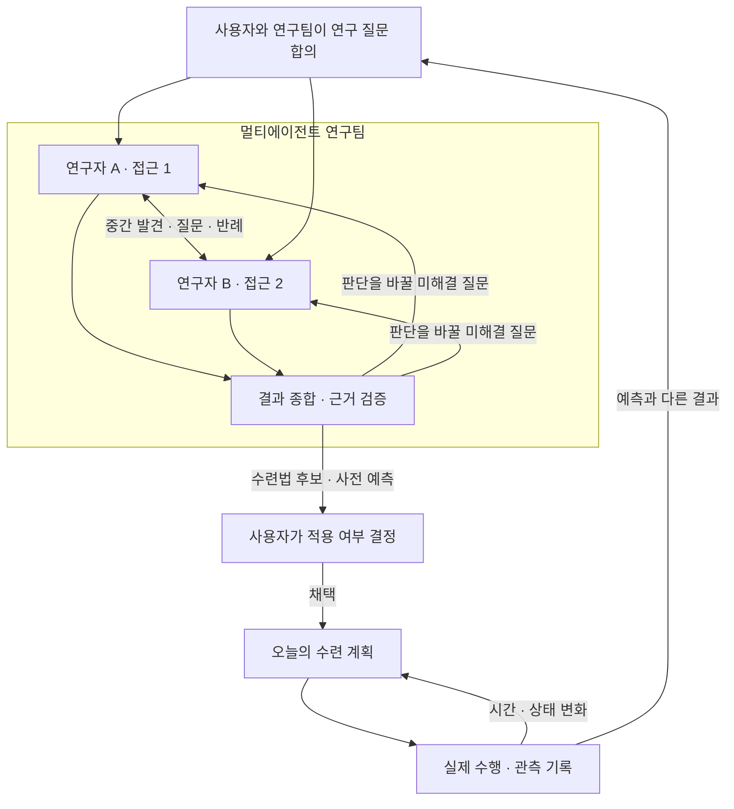

# 수련 연구 에이전트 설계도

**설계의 출발점은 멀티에이전트 연구팀이다.** 사용자와 합의한 하나의 문제를 여러 연구자가 서로 다른 접근으로 탐색한다. 각 연구자는 필요에 따라 조사·추론·계산·실험을 수행한다. 중간 발견이 다른 접근의 전제를 바꾸면 연구 도중에 전달한다.

## 기본 구조

A와 B는 한 연구에서 갈라질 수 있는 두 접근의 예시다. 연구자 수와 맡는 일은 문제에 따라 달라진다. **결과 종합·근거 검증**은 발견을 대조하고 다음 행동을 정하는 작업을 뜻한다. 담당 에이전트의 배치와 통신 구현은 후속 설계에서 정한다.

## 어떤 정보가 오가는가

| 경로 | 전달 내용과 결정 |
| --- | --- |
| 사용자 ↔ 연구팀 | 무엇을 알아내면 어떤 수련 선택이 달라지는지 합의한다. 중심 목표를 변경하거나 새 후보를 실제 적용하는 결정은 사용자가 한다. |
| 연구자 ↔ 연구자 | 발견한 사실, 원출처나 계산 결과, 그 발견이 영향을 주는 가정이나 질문을 전달한다. 수신자는 다음 조사·실험을 바꾸거나 기존 접근을 유지할 이유를 남긴다. |
| 연구자 → 종합·검증 → 후속 연구 | 같은 원자료의 재인용, 상충하는 결론, 관측하지 못한 조건을 확인한다. 결론을 가를 비교가 남아 있으면 그 문제를 풀 수 있는 접근에서 조사를 이어간다. |
| 연구팀 → 사용자 → 일일 운영 | 후보의 예상 효과·부담·적용 조건과 판단을 바꿀 관측을 제시한다. 채택하면 예측을 남기고 훈련·영양·휴식 계획에 반영한다. |
| 개인 기록 → 운영 또는 연구 | 가용 시간의 변화는 다음 계획에 곧바로 반영한다. 실제 수행과 예측의 불일치는 원인 재검토로 이어진다. 심층 연구가 진행 중이어도 오늘의 계획은 현재 근거와 여건으로 제공한다. |

**예시.** 베테르비에프의 공개 훈련 영상을 조사하는 A가 반복 동작을 확인했다고 하자. 문헌을 조사하는 B가 효과를 가르는 조건으로 실제 부하를 찾아내면, B는 출처와 조건을 A에게 보낸다. A의 다음 질문은 “같은 동작이 몇 번 더 보이는가?”에서 “부하를 확인할 영상 구간이나 별도 기록이 있는가?”로 바뀐다. 끝내 확인하지 못하면 팀은 관찰된 동작과 그 효과에 대한 가설을 구분해 보고한다.

외부 하네스는 Codex 실행·도구 접근·연구 및 개인 기록의 보존을 지원한다. 실제 하네스의 수정·검증은 사용자와 Codex가 개발 과정에서 맡는다. 이 도면의 설계 제안은 **범용 연구자 간 직접 공유와 필요에 따른 후속 탐색**이다.

[요구사항](SPECIFICATION.md) · [OpenAI 수학 연구 에이전트 역설계](OPENAI_MATH_AGENT_REVERSE_ENGINEERING.md) · [이전 구현 설계 초안](https://github.com/Rmayana/frontier-research-harness/blob/90cce6414f6d0f13a7129fab0a4352441892f752/docs/DESIGN.md)
