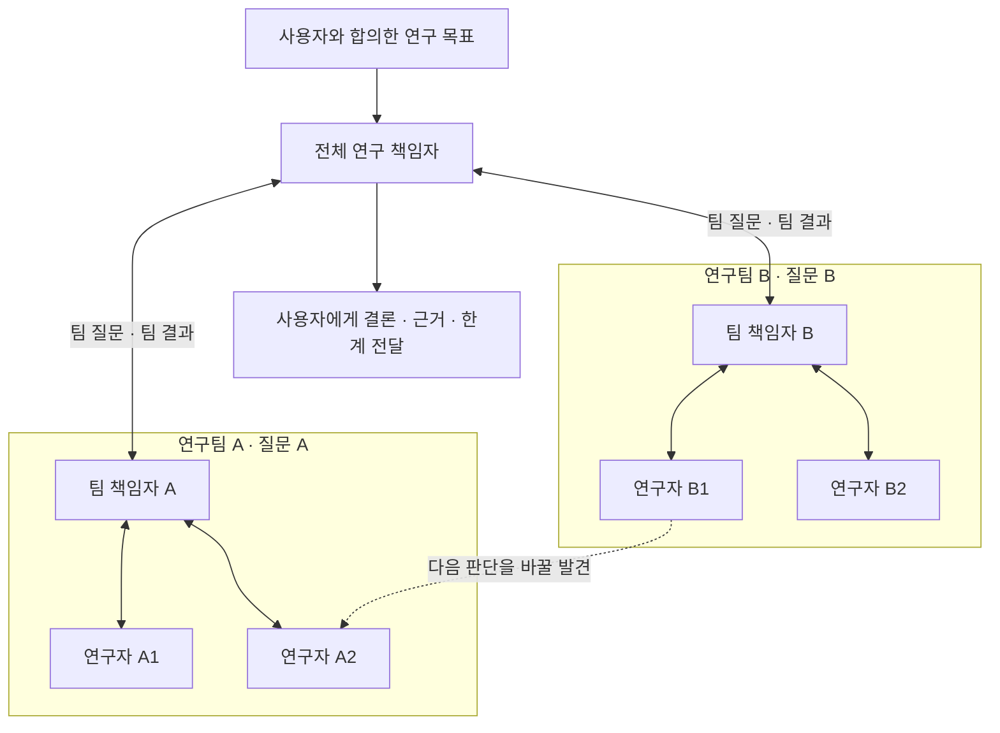

# 수련 연구 에이전트 설계도

**사용자와 합의한 연구 목표 하나를 여러 팀이 나눠 연구한다.** 전체 연구 책임자는 팀별 질문을 정하고, 팀 책임자는 팀 안의 에이전트에게 작업을 맡긴다. 연구 중에는 다른 팀의 다음 판단을 바꿀 발견을 직접 전달한다.

## 기본 구조



책임자와 연구자를 잇는 실선은 **작업 배정과 결과 보고**, 팀 사이 점선은 **연구 도중의 직접 공유**다. 팀 책임자도 직접 연구한다. 그림의 팀·연구자 수는 예시이며, 간단한 질문에서는 전체 책임자가 팀 책임자를 겸할 수 있다.

## 오케스트레이션

**계층형 매니저 패턴을 사용한다.** 전체 책임자가 사용자와의 대화와 목표의 최종 답을 소유한다. 팀 책임자는 위임받은 질문을 풀고 결과를 돌려준다. 팀 사이에는 발견을 담은 메시지만 직접 전달한다. 메시지를 받아도 대화 주도권이나 작업 소유권은 바뀌지 않는다. 담당자를 바꿔야 하면 권한 있는 책임자가 명시적으로 작업을 재배정한다. 따라서 첫 구현에는 대화 제어권을 넘기는 핸드오프를 두지 않는다. 이 결정은 패턴에 관한 것이며 실행에는 기존 Codex Python SDK를 사용한다. [매니저와 핸드오프의 차이](https://openai.github.io/openai-agents-python/multi_agent/)

### 여섯 가지 결정

| 영역 | LLM이 판단하는 일 | 코드가 집행하는 일 |
| --- | --- | --- |
| **작업 분해** | 전체 책임자는 서로 다른 답이 전체 결정을 바꿀 질문을 팀 단위로 나눈다. 팀 책임자는 자기 질문을 관측·비교·검증 작업으로 나눈다. 직접 풀 수 있으면 그대로 수행한다. | 부모 범위, 필수 입력, 의존 작업의 존재와 순환을 검사한다. 같은 요청의 중복 생성을 막는다. 의미상 겹치는 질문은 책임자가 병합하거나 독립 검산 목적을 명시한다. |
| **작업 할당** | 전체 책임자는 팀 질문과 팀 책임자, 팀 간 우선순위·재배치를 정한다. 팀 책임자는 팀 내부 담당자·작업 범위·완료 기준을 정한다. | 팀·연구자·작업 ID를 발급하고 현재 소유자와 버전을 저장한다. 동료는 새 접근을 제안할 수 있고, 실행 배정은 책임자의 권한으로 처리한다. |
| **실행 제어** | 연구자는 다음 행동을 제안하고 책임자는 추가 조사·독립 검토·중단의 연구상 가치를 판단한다. | 준비된 작업을 큐에서 꺼내 목표별 예산을 예약하고 턴을 실행한다. 초기값은 전체 동시 2턴, 스레드당 1턴이다. 같은 우선순위에서는 팀별 순환, 팀 안에서는 대기 순서로 선택한다. |
| **상태 관리** | 연구자는 새 근거, 영향받는 작업, 미해결 조건, 판단이 바뀐 이유를 반환한다. | SQLite가 상태의 기준이다. 코드만 전이·예산·버전·메시지 확인을 기록한다. 다른 팀에서 온 발견은 수신자의 다음 턴에 전달하고, 목표 수준의 반례는 전체 책임자의 검토 목록에도 등록한다. |
| **오류 처리** | 근거 부족이나 서로 모순된 결과를 만나면 대체 조사, 판별 관측, 결론 보류 중 하나를 제안한다. | 형식·권한·버전 오류, 연결 실패, 한도 소진을 구분한다. 복구 가능한 작업만 예산 안에서 재시도하고, 막힌 작업에 의존하는 범위만 보류한다. |
| **결과 통합** | 팀 책임자는 원자료 중복·반례·조건을 대조해 팀 결과를 낸다. 전체 책임자는 팀 간 불일치를 검토하고 전체 결론을 낸다. 결론을 바꿀 충돌은 원작성자와 다른 연구자에게 검토를 맡긴다. | 적용할 결과의 버전과 미검토 발견을 확인한 뒤 확정한다. 사용자만 중심 목표 변경과 수련법의 실제 채택을 결정한다. |

**한 작업이 움직이는 예.** 전체 책임자는 선수 분석팀에 “공개 자료에서 실제 수행 조건을 어디까지 확인할 수 있는가?”를, 적응 원리팀에 “효과를 가를 조건은 무엇인가?”를 맡긴다. 적응 원리팀이 부하에 따라 예측이 달라진다는 근거를 찾으면 선수 분석팀의 해당 작업으로 보낸다. 선수 분석팀 연구자는 다음 턴에 부하 기록을 조사한다. 기록을 찾지 못하면 팀 결과에 그 한계를 남기고, 전체 책임자는 관찰된 동작과 개인 효과 가설을 구분해 보고한다.

### 구현 계약

<details>
<summary>1. 모델 출력, 명령 권한과 저장 레코드</summary>

**한 턴의 입출력.** 코드는 목표·팀·작업 ID, 현재 역할과 작업 버전, 남은 예산, 처리할 발견 ID를 제공한다. SDK의 `output_schema`로 `kind`, `payload`, `reviewed`를 받는다. `reviewed`는 검토한 발견이 없는 턴에는 빈 배열이다. 모델은 허용된 종류의 명령 한 개와 payload를 구조화해 반환한다. 여러 팀·작업을 한 번에 배정하는 명령은 항목 배열을 받으며 전부 유효할 때 한 번에 저장한다. 실행기는 모델 출력 밖에서 발신자·요청 ID·대상 버전을 결정한다. 요청 ID는 턴 시도와 연결해 재전송 때 재사용한다.

| 명령 | 제안 권한 | 필수 payload와 효과 |
| --- | --- | --- |
| `create_teams` | 전체 책임자 | 팀별 질문·담당 범위·반환 기준·우선순위·팀 책임자 지정(기존 연구자 또는 새 연구자). 팀과 팀 책임자의 작업을 함께 생성한다. 겸임 시 같은 스레드를 쓴다. |
| `assign_tasks` | 팀 책임자 | 항목별 질문·담당 연구자·기존 근거·완료 기준·의존 작업 ID. 팀 안에 작업을 생성한다. 독립 검토에는 검증할 주장과 판정 조건을 넣는다. |
| `reassign` / `cancel` | 팀 안은 팀 책임자, 팀 간 이동·팀 종료는 전체 책임자 | 대상 ID·이유, 재배정이면 새 소유자·우선순위. 코드가 대상 버전을 올리고 이전 소유자의 늦은 출력을 걸러낸다. |
| `share` | 모든 연구자 | 대상 작업, 발견·원출처 참조·적용 조건, 영향을 받는 범위(작업/팀/목표). 코드는 같은 목표에 속한 대상만 허용한다. 영향받는 책임자에게도 한 번씩 전달한다. 동료가 새 작업을 제안할 때도 이 경로를 쓴다. |
| `wait` | 모든 연구자 | 기다릴 작업·자료·사용자 결정과 재개 조건. 코드는 조건 해소 이벤트를 받을 때만 다시 예약한다. |
| `submit` | 자기 작업의 담당자, 팀 결과는 팀 책임자, 최종 답은 전체 책임자 | 결론·근거 참조·반례·한계·후속 조건·검토한 중요 발견 번호와 남은 하위 작업의 처리 방침. 코드가 검증 후 상위 책임자를 깨우거나 사용자에게 반환한다. |

대기 메시지를 받은 턴에서는 `reviewed`에 발견 ID와 처리 결과(반영·기각 이유·추가 검토 작업)를 첨부한다. 메시지는 연구 자료 권한으로 전달한다. 모델이 메시지 본문에서 다른 역할의 명령을 작성해도 수신자의 실행 권한은 그대로다.

**최소 저장 단위.** 목표(전체 책임자·예산·결과 버전), 팀(목표·책임자·질문), 작업(부모·팀·소유자·상태·버전·우선순위·재개 조건), 의존 관계, 연구자와 Codex 스레드의 연결, 턴 시도(요청 ID·예약·실행 결과), 발견과 수신함(발견 ID·수신 작업·처리 상태), 버전별 결과를 둔다. 요청 ID와 수신 대상별 발견 ID에 유일성 제약을 둔다. 같은 요청의 재전송에는 저장된 결과를 반환하고 내용이 달라지면 충돌로 처리한다.

</details>

<details>
<summary>2. 실행 루프, 상태 전이와 장애 복구</summary>

Python 3.13의 단일 `asyncio` 프로세스가 큐를 관리하고, 공식 `openai-codex==0.171.0`의 `AsyncCodex`가 기존 Codex 계정에서 연구자별 스레드를 실행한다. SQLite 트랜잭션 밖에서만 모델 응답을 기다린다. [기술 선택과 비교했던 대안](https://github.com/Rmayana/frontier-research-harness/blob/46bb315f3a966ba8dc20e149a6dc07efe487bb9c/docs/DESIGN.md#기술-스택-선택과-대안)

1. **시작.** 사용자와 합의한 목표·총 턴 상한과 전체 책임자의 첫 작업을 생성한다. 책임자 자신이 가장 먼저 실행되며 이후 작업은 그 판단에 따라 생긴다.
2. **예약.** 실행 가능한 작업의 상태·버전·목표 예산을 확인한다. 한 트랜잭션에서 작업을 실행 중으로 바꾸고 시도 ID와 1턴 예약을 기록한다. 재시도도 예산에 포함한다.
3. **실행.** 해당 스레드를 시작 또는 재개한다. 미처리 발견은 SDK의 `ExternalMessage`로 전달한다. 수신자가 이미 실행 중이면 다음 턴까지 저장한다.
4. **커밋.** 명령 스키마·발신 권한·선행 조건·대상 버전을 검증한다. 명령 효과, 처리한 발견, 발송 대기 메시지와 다음 작업 상태를 한 번에 저장한다. 커밋 뒤 슬롯을 반납하고 준비된 작업을 다시 선택한다.
5. **마감.** 팀이 끝나면 전체 책임자가 그 결과를 받는다. 목표를 마칠 때는 남은 작업을 완료·보류·취소 중 하나로 정리한다. 각 수준에서 검토한 중요 발견 번호와 현재 번호를 같은 트랜잭션에서 비교한다. 먼저 도착한 미검토 반례는 다시 종합하고, 확정 후 도착한 유효한 반례는 이전 결론을 참조해 재검토한다.

| 작업 전이 | 코드가 확인할 조건 |
| --- | --- |
| 생성 → 준비 / 대기 | 선행 결과가 있으면 준비, 아직 필요하면 대기. 의존 관계 추가 때마다 순환 검사. |
| 준비 → 실행 중 | 슬롯·예산 예약 성공. 연구자 한 명에게 활성 턴 하나만 허용. |
| 실행 중 → 준비 / 대기 | 계속할 행동이 있으면 준비. 특정 입력이나 자식 결과가 필요하면 대기하고 슬롯 반환. |
| 대기 → 준비 | 명시한 재개 조건 충족, 또는 새 반례가 기존 질문 자체를 바꿔 담당자가 재판단해야 함. |
| 실행 중 → 완료 | 유효한 `submit`을 커밋. 취소·재배정 요청이 먼저 커밋됐으면 버전 충돌로 이전 응답을 폐기. |
| 미완료 → 보류 / 취소 | 한도·자료·권한 문제는 보류 사유와 재개 조건을 저장. 명시적 취소는 기록 후 실행 중 턴을 중단. 보류는 조건 충족 시 준비 또는 대기로 복귀. |

**장애별 처리.** 형식 오류는 연구 결과에 반영하지 않고 오류 설명과 함께 한 번 수정 기회를 준다. 반복되면 보류한다. 권한 위반·오래된 버전은 실행하지 않고 현재 소유자에게 알린다. 전송 전 실패가 확인된 연결 오류는 예산 안에서 한 번 재시도한다. 모델이 요청을 받았는지 불명확하면 시도 ID·스레드의 실행 상태를 먼저 대조하고, 확인할 수 없으면 보류한다. 프로세스 재시작 시 미확인 시도를 이 규칙으로 복구한다. 이미 저장한 발견은 재전달할 수 있고, 동일 발견의 상태 변경은 한 번만 커밋한다. 한도 소진 시 추가 모델 호출 없이 마지막 확정 결과와 미해결 작업을 반환한다.

</details>

### 구현 순서와 완료 기준

| 순서 | 구현 경계 | 통과해야 할 시험 |
| --- | --- | --- |
| 1 | 명령 검증과 SQLite 상태 전이 | 겸임한 책임자가 같은 스레드로 단순 목표를 종료한다. 동료의 팀 생성·최종 답 확정 시도와 순환 의존은 상태 변경 없이 거절된다. |
| 2 | 스케줄러와 Codex 실행 어댑터 | 3개 팀에서 전체 동시 2턴·스레드당 1턴을 지킨다. 대기하는 책임자가 슬롯을 반환하고 한도 소진 시 부분 결과를 반환한다. |
| 3 | 팀 간 메시지와 복구 | A팀의 발견이 B팀의 다음 행동을 바꾼다. 저장 직후와 전달 직후 각각 중단해도 누락이나 중복 반영이 없다. 취소된 팀의 응답은 독립 팀의 진행을 막지 않는다. |
| 4 | 결과 통합과 마감 경쟁 | 반례가 결론보다 먼저 저장되면 재검토 후 확정한다. 반대 순서면 이전 결론과 연결된 재검토가 남는다. 결정적인 근거가 빠지면 해당 주장은 보류한다. |

가짜 실행 어댑터로 순서·권한·장애를 재현한 뒤 실제 SDK에서 두 팀의 배정 → 발견 전달 → 통합을 검증한다. 위 표는 설계의 인수 조건이다.

## 실험 도구와 시뮬레이션

연구팀은 먼저 비교할 두 설명이나 조건, 두 예측이 갈리는 관측값, 실제로 얻을 수 있는 입력을 정한다. 예컨대 “훈련량이 같아도 배치가 평가일 수행에 영향을 주는가?”라면 두 일정을 계산한 뒤 같은 평가 과제의 실제 기록으로 예측을 확인한다. 영상에서 관찰한 움직임, 모델이 추정한 힘, 직접 측정한 힘은 결과에 구분해서 기록한다.

### 실행 가능한 도구

| 연구 질문 | 호출과 입력 | 결과와 해석 |
| --- | --- | --- |
| 같은 총부하를 다르게 배치하면 평가일 예측이 달라지는가? | [compare_schedules](../tools/simulate.py)에 같은 길이의 일별 부하 두 개, 체력·피로 각각의 시간상수(일)와 반응 계수를 전달한다. 휴식일 부하는 0이다. | 두 일정의 총부하, 일별 모형 점수와 마지막 날 B−A를 반환한다. 두 누적 상태는 0에서 시작하며 점수는 당일 부하 반영 직후 값이다. 평가가 다음 날이면 마지막에 부하 0인 평가일을 두 일정 모두에 추가한다. 개인 기록으로 계수를 추정하고 이후 기간에서 단순 기준 예측과 비교해야 개인화 성능을 판단할 수 있다. |
| 내 측정 오차에서 의미 있는 차이를 검출할 수 있는가? | [paired_design_power](../tools/simulate.py)에 검출하려는 차이, **쌍별 차이의 표준편차**, 비교 쌍 수, 선택적으로 유의수준을 전달한다. 차이와 표준편차의 단위는 같다. | 양측 정규 검정의 검정력과 신뢰구간 예상 반폭을 계산한다. 쌍별 차이가 독립·정규이고 그 표준편차를 안다고 가정한다. 이전 훈련의 효과가 남거나 연속 관측이 상관되면 이 계산을 그대로 적용할 수 없다. |
| 같은 동작에서 자세나 외부 부하가 바뀌면 요구되는 관절 모멘트가 어떻게 달라지는가? | [OpenSim 역동역학](../tools/inverse_dynamics.py)에 체격에 맞춘 `.osim`, 모델의 자유 좌표 이름을 열로 갖는 동작 파일, 필요 시 동기화한 외력 XML과 그 참조 데이터를 전달한다. 두 조건을 각각 실행한다. OpenSim Python 바인딩이 필요하다. | 시간별 일반화 힘을 JSON으로 저장한다. 회전 좌표는 N·m, 병진 좌표는 N이다. 접지 동작에서는 지면반력과 작용점이 중요하다. 외력을 생략한 결과를 실제 접지 상태의 관절 부하로 해석할 수 없다. 출력은 개별 근육이나 힘줄의 힘을 제공하지 않는다. |

저장소 루트에서 실행하는 예시다. 아래 수치는 합성 입력이다. 첫 두 명령은 Python 표준 라이브러리만 사용한다. 마지막 명령의 파일명은 사용자가 준비할 실제 자료의 자리표시자다.

```powershell
'{"schedule_a":[1,0,0],"schedule_b":[0,0,1],"fitness_days":8,"fatigue_days":2,"fitness_gain":1,"fatigue_gain":2}' | python tools/simulate.py compare_schedules
'{"effect":0.5,"sd_difference":1,"pairs":8}' | python tools/simulate.py paired_design_power
python tools/inverse_dynamics.py subject.osim squat.mot --external-loads ground_reaction.xml --output squat-forces.json
```

첫 예제의 평가일 B−A는 약 −1.043 모형 단위다. 둘째 예제의 검정력은 약 0.293이다. OpenSim 4.6에서는 중력에 대항해 정지한 1 kg과 2 kg 슬라이더의 11개 프레임에서 각각 9.81 N과 19.62 N을 확인했다. 이 검산의 범위는 엔진 호출과 출력 단위다. 개인 동작에 사용할 때는 좌표 전처리·필터, 외력 방향·시간 정렬, 모델 적합성을 별도로 확인한다.

### 다음에 연결할 실험

| 실험 | 도구 후보 | 먼저 확보할 것 |
| --- | --- | --- |
| 같은 동작 궤적을 설명하는 근육 동원 전략이 여러 개인가? | [OpenSim Moco](https://opensim-org.github.io/opensim-moco-site/)로 목적함수를 바꿔 비교 | 근골격 모델, 검증된 동작·외력, 가능하면 예측과 대조할 근전도 |
| 힘줄의 강성과 형상을 다르게 가정하면 동일 하중의 국소 변형률이 얼마나 달라지는가? | [FEBio](https://febio.org/) 유한요소 해석 | 형상·재료계수의 근거, 하중과 경계조건. 개인 자료가 없으면 가정 범위에 대한 민감도로 보고 |
| 심박과 1회 박출량의 서로 다른 조합이 같은 분당 심박출량을 설명하는가? | [CircAdapt](https://framework.circadapt.org/) 심혈관 모델 | 심박, 독립적으로 측정한 유량 또는 박출량. 로컬 엔진에서 주기·목표 유량 변경을 시험했고 브랜치 전용 호출 도구는 후속 작업 |
| 감각 지연이 커질 때 목표점 도달 오차와 보정 시간이 어떻게 변하는가? | [MyoSuite](https://myosuite.readthedocs.io/en/latest/) 도달 과제에 관측 지연을 추가 | 표적 추적 기록, 시간 동기화, 기준 제어기. 모델 제어 결과와 사람의 학습 속도는 별도로 검증 |

현재 진입점은 CLI와 Python 함수다. 향후 팀 실행기는 실험 ID에 도구명, 버전, 입력과 단위, 조건별 출력, 실제 기록과의 차이를 연결한다. 민감도 확인은 같은 도구에 여러 가정값을 넣어 결론의 방향이 뒤집히는지부터 본다.

[요구사항](SPECIFICATION.md) · [OpenAI 수학 연구 사례](OPENAI_MATH_AGENT_REVERSE_ENGINEERING.md)
