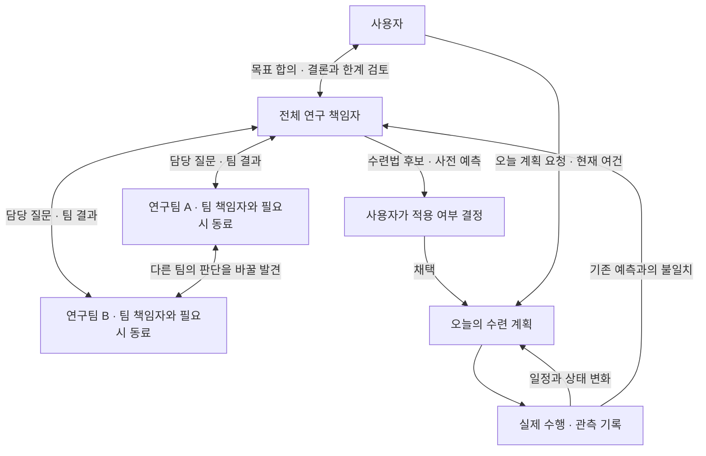
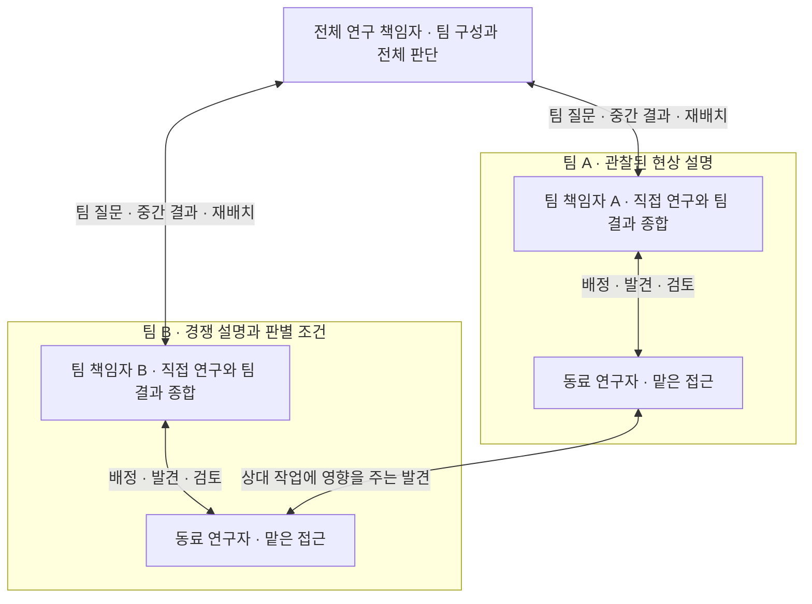

# 수련 연구 에이전트 설계도

**한 연구 목표를 여러 관점의 팀이 함께 탐색한다.** 전체 연구 책임자는 사용자와 목표를 정하고, 독립적으로 답할 가치가 있는 질문에 팀을 배정한다. 각 팀의 책임자는 직접 연구하며 필요한 접근을 동료 연구자에게 맡긴다. 간단한 질문은 한 팀으로 끝낼 수 있다.

## 기본 구조

팀의 수와 경계는 연구 질문에 따라 정한다. 전체 연구 책임자는 한 팀의 책임자를 겸할 수 있다. 중심 목표 변경이나 실제 수련법 적용은 사용자가 결정한다. 심층 연구가 진행 중에도 현재 근거로 오늘의 수련을 운영한다. 하네스 자체의 개선은 사용자와 Codex가 개발 과정에서 담당한다.

## 1. 오케스트레이션

### 누가 무엇을 결정하는가

| 주체 | 결정과 인계 |
| --- | --- |
| 사용자와 전체 연구 책임자 | 어떤 판단을 위해 연구하는지 합의한다. 전체 책임자는 목표·남은 자원·팀별 담당 질문을 관리하고, 팀 간 우선순위를 바꾸며, 상충 근거와 한계를 포함해 최종 결과를 사용자에게 반환한다. |
| 전체 연구 책임자 → 팀 책임자 | 담당 질문, 답이 바꿀 판단, 이미 확인한 근거, 다른 팀과의 경계, 반환할 결과를 배정한다. 기존 팀의 후속 조사로 충분하면 그 팀에 배정한다. 독립 검산 때문에 범위가 겹치면 검산할 주장과 판정 조건을 기록한다. |
| 팀 책임자 ↔ 동료 연구자 | 팀 책임자가 직접 탐색하고, 팀 질문 안에서 하위 작업을 배정·통합·중단한다. 동료는 조사·추론·실험 방법을 선택하고 새 접근을 제안한다. 다른 팀의 범위나 연구 전체의 자원을 바꿔야 하면 전체 책임자에게 재배치를 제안한다. |
| 팀 ↔ 팀 | 발견이 상대의 전제나 다음 행동을 바꾸면 발견자와 대상 작업을 직접 연결한다. 발신자는 원출처·조건·영향을 남긴다. 수신자는 반영한 행동 또는 기존 접근을 유지한 이유를 기록한다. 전체 결론에 영향이 있으면 같은 발견 ID를 전체 책임자의 검토 목록에 등록한다. |
| 팀 책임자 → 전체 연구 책임자 | 팀 결과에는 확인 사실, 미확인 조건, 반례, 근거 ID, 영향받는 질문을 담는다. 전체 책임자는 같은 원자료를 재인용한 결과를 묶고, 결정적 충돌은 주장을 작성하지 않은 연구자에게 확인시킨다. 판별 자료나 예산이 부족하면 해당 판단을 보류한다. |

**예시.** 베테르비에프의 공개 훈련을 조사할 때 선수 분석팀은 실제로 확인되는 수행 조건을, 적응 원리팀은 효과를 구별할 조건을 담당할 수 있다. 적응 원리팀이 부하에 따라 기대 효과가 달라진다는 근거를 찾으면 선수 분석팀에 출처와 조건을 보낸다. 선수 분석팀은 부하를 식별할 자료를 찾고, 전체 책임자는 그 조건의 확인 여부를 최종 판단에 반영한다. 팀 이름과 발견은 가상 예시다.

그룹별 접근과 중간 발견의 재사용은 [OpenAI 수학 연구 사례](OPENAI_MATH_AGENT_REVERSE_ENGINEERING.md)를 참고했다. 전체·팀 책임자의 권한과 겸임 규칙은 이 프로젝트의 설계 결정이다.

### 기술 스택 선택과 대안

첫 구현은 사용자 한 명, 로컬 호스트 하나, 기존 Codex 계정, 연구 전체 동시 2턴을 기준으로 한다. 팀은 목표에 속한 질문과 책임의 단위이므로 팀마다 프로세스나 DB를 띄울 필요가 없다.

| 경계와 선택 | 이 연구 시스템에서 선택한 이유 | 대안과 전환 조건 |
| --- | --- | --- |
| **실행 제어 · Python 3.13 + 표준 asyncio** | 스레드 응답·동료 메시지 대기가 많은 작업이다. 하네스 한 개가 준비된 작업을 스케줄하면 같은 슬롯·예산을 모든 팀이 공유한다. Python에서 연구 계산과 연계하기도 쉽다. | **LangGraph**는 분기·재개를 그래프와 체크포인트로 표현한다. 독립 워크플로가 늘어 재개 규칙을 반복 구현하게 되면 검토한다. 도입 시 체크포인트와 연구 기록 중 어느 쪽이 작업 완료를 확정하는지 정해야 한다. [Python asyncio](https://docs.python.org/3.13/library/asyncio-task.html) · [LangGraph 영속 실행](https://docs.langchain.com/oss/python/langgraph/persistence) |
| **모델 실행 · 공식 Codex Python SDK 0.171.0의 AsyncCodex** | 기존 ChatGPT 인증 경로를 사용하고 연구자별 스레드 시작·재개, 비동기 실행, 중단, 외부 메시지 전달을 한 언어에서 처리한다. SDK 버전을 고정해 재현할 수 있게 한다. | **TypeScript SDK**는 주 실행 환경이 Node.js가 될 때 적합하다. **App Server JSON-RPC 직접 연결**은 SDK가 노출하지 않는 승인·이벤트를 제어해야 할 때 유리하나 프로토콜 호환과 재연결을 직접 관리한다. [Python·TypeScript SDK](https://learn.chatgpt.com/docs/codex-sdk) · [고정 버전의 계약](https://github.com/openai/codex/blob/583ec348cf9007361d09513c716549c41d4d8128/sdk/python/docs/api-reference.md) · [App Server](https://learn.chatgpt.com/docs/app-server) |
| **실행 상태 · SQLite + Python sqlite3** | 팀 결과, 중요 발견, 전달 대기를 한 트랜잭션에 기록해야 중간 종료 후 복구할 수 있다. 단일 호스트에서 별도 DB 서비스 없이 이를 충족한다. | **PostgreSQL**은 여러 호스트가 같은 작업을 인수하거나 동시 쓰기 경합이 병목으로 측정될 때 검토한다. 서버 운영·접속 관리 비용이 추가된다. [SQLite 적용 조건](https://www.sqlite.org/whentouse.html) · [PostgreSQL 동시성](https://www.postgresql.org/docs/current/mvcc-intro.html) |

### 실행 규약

1. **식별과 배정.** 목표 아래 팀, 팀 아래 작업을 기록하고 연구자의 스레드와 맡은 역할을 연결한다. 전체 책임자가 팀 책임자를 겸하면 같은 스레드를 사용한다. 팀 ID가 다른 작업 간 의존도 등록·변경할 때 순환 여부를 검사한다. 범위를 합치거나 작업을 재배정하면 소유 팀과 작업 버전을 함께 갱신한다.
2. **동시 실행과 예산.** 모든 역할과 팀을 합쳐 활성 모델 턴은 기본 2개, 스레드당 1개다. 실행 가능한 작업은 전체 책임자가 정한 우선순위로, 같은 우선순위에서는 대기 팀을 번갈아 선택한다. 팀 결과나 동료를 기다리는 책임자는 슬롯을 반환한다. 재시도·복구 호출까지 포함한 목표별 총 턴 상한에서 호출 전 1턴을 원자적으로 예약한다. 새 근거·가정·판별법 없이 반복되는 요청은 이전 결과를 재사용하거나 보류한다.
3. **전달.** 하네스는 연구·팀·작업 ID, 요청 ID, 작업 버전을 검사한다. 발견과 수신 작업별 대기 메시지, 영향받는 팀 책임자 및 목표 수준의 검토 항목을 같은 트랜잭션에 기록한다. 겸임·복수 경로로 같은 연구자에게 도달한 발견은 ID로 합친다. 수신자의 다음 턴에 SDK의 `ExternalMessage`로 전달한다. 직접 공유에 매번 상급자의 승인을 요구하지 않는다.
4. **실패·취소·재개.** 작업 상태는 대기·진행·완료·보류·취소로 기록한다. 실패의 영향은 해당 결과에 의존하는 작업을 따라 추적한다. 팀 취소 시 그 팀의 미완료 작업을 취소하고 결과를 기다리던 팀에 알린다. 독립 팀은 계속 연구한다. 취소를 기록한 뒤 활성 턴을 중단한다. 재시작 시 스레드와 확정 상태를 복구하고 미확인 메시지를 재전달한다. 동일 메시지의 상태 변경은 한 번만 적용한다. 늦은 결과에는 작업 버전 검사를 적용한다.
5. **팀 결과와 최종 결론.** 팀 책임자는 팀 수준의 중요 발견을 확인하고 결과를 제출한다. 팀 결과 제출로 다른 팀의 실행이 끝나지는 않는다. 전체 책임자는 목표 수준의 중요 발견 번호와 남은 팀·작업의 완료·보류·취소 내역을 확인해 결론을 제출한다. 하네스는 각 수준에서 번호와 미검토 발견을 확인하는 트랜잭션으로 결과를 확정한다. 유효한 반례가 먼저 저장되면 해당 수준에서 다시 종합한다. 결론 뒤 도착한 반례는 기존 결론에 연결된 재검토 건으로 남긴다. 한도 소진 시 마지막 확정 결과와 재개 조건을 사용자에게 전달한다.

### 최종 검토에서 비교한 설계

| 공개 사례에서 관찰한 동작 | 우리 문제에서의 해석과 결정 |
| --- | --- |
| Anthropic Research는 책임자가 동료에게 목표·산출물·작업 경계를 주고 질문의 복잡도에 맞게 탐색량을 조절한다. [개발팀 보고](https://www.anthropic.com/research/multi-agent-research-system) | 범위가 겹치면 병렬화한 만큼 같은 검색을 반복할 수 있다. 배정 시 담당 범위를 확인하고, 의도적인 독립 검토는 별도 목적으로 표시한다. 동시 실행 수와 누적 실행 한도를 따로 관리한다. |
| OpenAI 연구팀은 오일러 결과를 본 뒤 연구 자원을 옮겼고, 그룹별 통찰을 후속 프롬프트로 전달했다. [나비에–스토크스 연구 보고](https://openai.com/index/navier-stokes-solution/#how-we-found-the-proof) | 중요한 발견은 진행 중인 다른 접근과 최종 판단 양쪽에 도달해야 한다. 팀 간 발견을 직접 공유하고 전체 연구 책임자는 이미 도착한 중요 반례를 검토한 뒤 결론을 확정한다. 종료 시점의 번호 검사는 우리 시스템의 동시성 설계다. |
| ETH의 ProofCouncil은 풀이를 따라온 검토자가 수락하면 새 검토자에게 다시 확인시킨다. 10번 문제에서는 기존 검토자가 일곱 차례 수락한 중간 풀이를 새 검토자가 모두 거절했다. [논문 §2 및 문제별 분석](https://arxiv.org/html/2607.09474v1) | 같은 논증을 반복해 보면 누락된 전제까지 공유할 수 있다. 개인 적용 판단을 바꿀 반례나 충돌이 있을 때 독립 검토를 배정한다. 연구자 간 합의만으로 개인 효과를 확정할 수 없으므로 판별 관측이 없으면 보류한다. |
| LangGraph는 체크포인트를 통해 실행 상태를 보존하고 다시 이어간다. [영속 실행 문서](https://docs.langchain.com/oss/python/langgraph/persistence) | 복구에서 중요한 것은 어떤 작업이 이미 반영됐는지 식별하는 일이다. 현재 단일 호스트에서는 SQLite의 작업 버전·메시지 ID·트랜잭션으로 이를 구현하고, 전송 직전과 직후의 중단을 시험한다. |

**오케스트레이션 인수 기준**

| 실행 상황 | 통과 조건 |
| --- | --- |
| 다른 팀의 동료 B가 연구자 A에게 목표 결론을 바꿀 반례를 전달한다. | A가 다음 턴에 반영하거나 유지 이유를 남기고 전체 연구 책임자도 같은 발견 ID를 검토한다. |
| 동시 실행 한도에 도달하고 책임자가 동료를 기다린다. | 대기하는 책임자가 슬롯을 점유하지 않고, 실행 가능한 동료 작업이 진행된다. |
| 메시지 저장 직후 중단하거나 취소된 작업의 결과가 늦게 도착한다. | 재개 후 메시지가 누락되지 않고 같은 발견이 중복 반영되지 않는다. 취소된 응답은 현재 결론을 덮어쓰지 않는다. |
| 전체 연구 책임자가 결론을 제출하는 순간 중요한 반례가 저장된다. | 반례가 먼저 커밋되면 종합을 다시 요청하고, 결론이 먼저 커밋되면 기존 결론과 연결된 재검토 건이 남는다. |
| 책임자와 동료가 발견 없이 작업 배정과 응답을 반복한다. | 합의한 총 턴 수를 넘는 호출은 시작되지 않고 마지막 확인 결과·미해결 질문이 반환된다. |
| 서로 다른 두 자료가 같은 원자료에 기대며 개인 적용 결론이 갈린다. | 작성에 참여하지 않은 연구자가 원자료를 대조한다. 판별할 자료나 검토 예산이 없으면 해당 결론을 보류한다. |
| 메시지가 전달됐지만 처리 확인 전에 프로세스가 종료된다. | 재전송돼도 같은 메시지 ID로 인한 작업 상태 변경은 한 번만 커밋된다. |
| 기존 계정에서 두 연구자를 실행하다 사용량 한도에 도달한다. | 정상일 때 각 스레드가 응답하고, 한도에 도달하면 대기 상태와 재개 지점을 보존한다. |
| 단순 질문에서 전체 연구 책임자가 팀 책임자를 겸한다. | 한 팀·한 연구자 스레드로 종료하며 겸임 보고가 새 턴이나 자기 대기 작업을 만들지 않는다. |
| 세 팀의 실행 가능한 작업이 한꺼번에 대기한다. | 모든 팀과 책임자를 합한 활성 턴이 2개 이내이며 동일 우선순위의 대기 팀도 차례로 실행된다. |
| 팀 하나를 중단하는 동안 다른 팀이 그 결과를 기다린다. | 해당 의존 작업만 보류해 재배정하거나 부분 결과를 반환하고, 독립 팀은 진행한다. |

**설계 판정.** 첫 구현의 오케스트레이션 설계를 완료했다. 동시 2턴은 초기 운영값이다. 한 팀·여러 팀의 독립 병렬·여러 팀의 중간 공유를 같은 모델·자료·총 턴 한도에서 반복해 근거 오류, 반례 반영 여부, 소요 시간과 실제 사용량을 비교한다. 같은 턴 수라도 토큰 비용은 달라질 수 있으므로 사용량을 함께 보고한다.

**검증 상태.** Windows 호스트에서 로컬 App Server 초기화와 ChatGPT 계정 유형 조회까지 확인했다. 위 인수 기준은 선정한 SDK로 구현한 뒤 실행할 시험이다.

[요구사항](SPECIFICATION.md) · [OpenAI 수학 연구 에이전트 역설계](OPENAI_MATH_AGENT_REVERSE_ENGINEERING.md) · [이전 구현 설계 초안](https://github.com/Rmayana/frontier-research-harness/blob/90cce6414f6d0f13a7129fab0a4352441892f752/docs/DESIGN.md)
