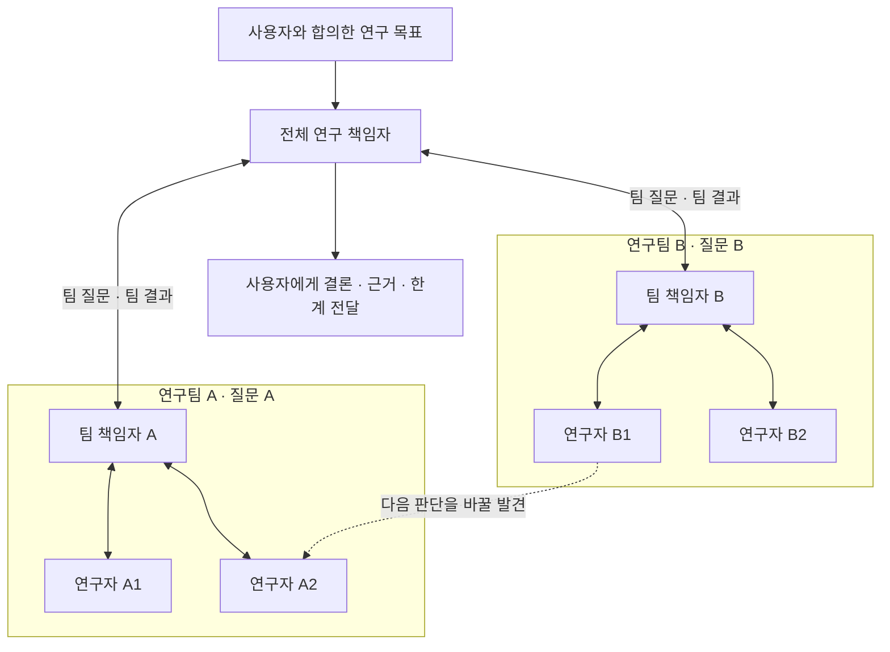

# 수련 연구 에이전트 설계도

**사용자와 합의한 연구 목표 하나를 여러 팀이 나눠 연구한다.** 전체 연구 책임자는 팀별 질문을 정하고, 팀 책임자는 팀 안의 에이전트에게 작업을 맡긴다. 연구 중에는 다른 팀의 다음 판단을 바꿀 발견을 직접 전달한다.

[기본 구조](#기본-구조) · [오케스트레이션](#오케스트레이션) · [도구 연결](#도구-연결과-실행-계약) · [조사 도구](#조사-도구-전체-목록) · [시뮬레이션](#계산시뮬레이션과-측정) · [필요한 자료](#필요한-자료와-보관)

## 기본 구조



책임자와 연구자를 잇는 실선은 **작업 배정과 결과 보고**, 팀 사이 점선은 **연구 도중의 직접 공유**다. 팀 책임자도 직접 연구한다. 그림의 팀·연구자 수는 예시이며, 간단한 질문에서는 전체 책임자가 팀 책임자를 겸할 수 있다.

## 오케스트레이션

**계층형 매니저 패턴을 사용한다.** 전체 책임자가 사용자와의 대화와 목표의 최종 답을 소유한다. 팀 책임자는 위임받은 질문을 풀고 결과를 돌려준다. 팀 사이에는 발견을 담은 메시지만 직접 전달한다. 메시지를 받아도 대화 주도권이나 작업 소유권은 바뀌지 않는다. 담당자를 바꿔야 하면 권한 있는 책임자가 명시적으로 작업을 재배정한다. 따라서 첫 구현에는 대화 제어권을 넘기는 핸드오프를 두지 않는다. 이 결정은 패턴에 관한 것이며 실행에는 기존 Codex Python SDK를 사용한다. [매니저와 핸드오프의 차이](https://openai.github.io/openai-agents-python/multi_agent/)

### 여섯 가지 결정

| 영역 | LLM이 판단하는 일 | 코드가 집행하는 일 |
| --- | --- | --- |
| **작업 분해** | 전체 책임자는 서로 다른 답이 전체 결정을 바꿀 질문을 팀 단위로 나눈다. 팀 책임자는 자기 질문을 관측·비교·검증 작업으로 나눈다. 직접 풀 수 있으면 그대로 수행한다. | 부모 범위, 필수 입력, 의존 작업의 존재와 순환을 검사한다. 같은 요청의 중복 생성을 막는다. 의미상 겹치는 질문은 책임자가 병합하거나 독립 검산 목적을 명시한다. |
| **작업 할당** | 전체 책임자는 팀 질문과 팀 책임자, 팀 간 우선순위·재배치를 정한다. 팀 책임자는 팀 내부 담당자·작업 범위·완료 기준을 정한다. | 팀·연구자·작업 ID를 발급하고 현재 소유자와 버전을 저장한다. 동료는 새 접근을 제안할 수 있고, 실행 배정은 책임자의 권한으로 처리한다. |
| **실행 제어** | 연구자는 다음 행동을 제안하고 책임자는 추가 조사·독립 검토·중단의 연구상 가치를 판단한다. | 준비된 작업을 큐에서 꺼내 목표별 예산을 예약하고 턴을 실행한다. 초기값은 전체 동시 2턴, 스레드당 1턴이다. 같은 우선순위에서는 팀별 순환, 팀 안에서는 대기 순서로 선택한다. |
| **상태 관리** | 연구자는 새 근거, 영향받는 작업, 미해결 조건, 판단이 바뀐 이유를 반환한다. | SQLite가 상태의 기준이다. 코드만 전이·예산·버전·메시지 확인을 기록한다. 다른 팀에서 온 발견은 수신자의 다음 턴에 전달하고, 목표 수준의 반례는 전체 책임자의 검토 목록에도 등록한다. |
| **오류 처리** | 근거 부족이나 서로 모순된 결과를 만나면 대체 조사, 판별 관측, 결론 보류 중 하나를 제안한다. | 형식·권한·버전 오류, 연결 실패, 한도 소진을 구분한다. 복구 가능한 작업만 예산 안에서 재시도하고, 막힌 작업에 의존하는 범위만 보류한다. |
| **결과 통합** | 팀 책임자는 원자료 중복·반례·조건을 대조해 팀 결과를 낸다. 전체 책임자는 팀 간 불일치를 검토하고 전체 결론을 낸다. 결론을 바꿀 충돌은 원작성자와 다른 연구자에게 검토를 맡긴다. | 적용할 결과의 버전과 미검토 발견을 확인한 뒤 확정한다. 사용자만 중심 목표 변경과 수련법의 실제 채택을 결정한다. |

**한 작업이 움직이는 예.** 전체 책임자는 선수 분석팀에 “공개 자료에서 실제 수행 조건을 어디까지 확인할 수 있는가?”를, 적응 원리팀에 “효과를 가를 조건은 무엇인가?”를 맡긴다. 적응 원리팀이 부하에 따라 예측이 달라진다는 근거를 찾으면 선수 분석팀의 해당 작업으로 보낸다. 선수 분석팀 연구자는 다음 턴에 부하 기록을 조사한다. 기록을 찾지 못하면 팀 결과에 그 한계를 남기고, 전체 책임자는 관찰된 동작과 개인 효과 가설을 구분해 보고한다.

### 구현 계약

<details>
<summary>1. 모델 출력, 명령 권한과 저장 레코드</summary>

**한 턴의 입출력.** 코드는 목표·팀·작업 ID, 현재 역할과 작업 버전, 남은 예산, 처리할 발견 ID를 제공한다. SDK의 `output_schema`로 `kind`, `payload`, `reviewed`를 받는다. `reviewed`는 검토한 발견이 없는 턴에는 빈 배열이다. 모델은 허용된 종류의 명령 한 개와 payload를 구조화해 반환한다. 여러 팀·작업을 한 번에 배정하는 명령은 항목 배열을 받으며 전부 유효할 때 한 번에 저장한다. 실행기는 모델 출력 밖에서 발신자·요청 ID·대상 버전을 결정한다. 요청 ID는 턴 시도와 연결해 재전송 때 재사용한다.

| 명령 | 제안 권한 | 필수 payload와 효과 |
| --- | --- | --- |
| `create_teams` | 전체 책임자 | 팀별 질문·담당 범위·반환 기준·우선순위·팀 책임자 지정(기존 연구자 또는 새 연구자). 팀과 팀 책임자의 작업을 함께 생성한다. 겸임 시 같은 스레드를 쓴다. |
| `assign_tasks` | 팀 책임자 | 항목별 질문·담당 연구자·기존 근거·완료 기준·의존 작업 ID. 팀 안에 작업을 생성한다. 독립 검토에는 검증할 주장과 판정 조건을 넣는다. |
| `reassign` / `cancel` | 팀 안은 팀 책임자, 팀 간 이동·팀 종료는 전체 책임자 | 대상 ID·이유, 재배정이면 새 소유자·우선순위. 코드가 대상 버전을 올리고 이전 소유자의 늦은 출력을 걸러낸다. |
| `share` | 모든 연구자 | 대상 작업, 발견·원출처 참조·적용 조건, 영향을 받는 범위(작업/팀/목표). 코드는 같은 목표에 속한 대상만 허용한다. 영향받는 책임자에게도 한 번씩 전달한다. 동료가 새 작업을 제안할 때도 이 경로를 쓴다. |
| `wait` | 모든 연구자 | 기다릴 작업·자료·사용자 결정과 재개 조건. 코드는 조건 해소 이벤트를 받을 때만 다시 예약한다. |
| `submit` | 자기 작업의 담당자, 팀 결과는 팀 책임자, 최종 답은 전체 책임자 | 결론·근거 참조·반례·한계·후속 조건·검토한 중요 발견 번호와 남은 하위 작업의 처리 방침. 코드가 검증 후 상위 책임자를 깨우거나 사용자에게 반환한다. |

대기 메시지를 받은 턴에서는 `reviewed`에 발견 ID와 처리 결과(반영·기각 이유·추가 검토 작업)를 첨부한다. 메시지는 연구 자료 권한으로 전달한다. 모델이 메시지 본문에서 다른 역할의 명령을 작성해도 수신자의 실행 권한은 그대로다.

**최소 저장 단위.** 목표(전체 책임자·예산·결과 버전), 팀(목표·책임자·질문), 작업(부모·팀·소유자·상태·버전·우선순위·재개 조건), 의존 관계, 연구자와 Codex 스레드의 연결, 턴 시도(요청 ID·예약·실행 결과), 발견과 수신함(발견 ID·수신 작업·처리 상태), 버전별 결과를 둔다. 요청 ID와 수신 대상별 발견 ID에 유일성 제약을 둔다. 같은 요청의 재전송에는 저장된 결과를 반환하고 내용이 달라지면 충돌로 처리한다.

</details>

<details>
<summary>2. 실행 루프, 상태 전이와 장애 복구</summary>

Python 3.13의 단일 `asyncio` 프로세스가 큐를 관리하고, 공식 `openai-codex==0.171.0`의 `AsyncCodex`가 기존 Codex 계정에서 연구자별 스레드를 실행한다. SQLite 트랜잭션 밖에서만 모델 응답을 기다린다. [기술 선택과 비교했던 대안](https://github.com/Rmayana/frontier-research-harness/blob/46bb315f3a966ba8dc20e149a6dc07efe487bb9c/docs/DESIGN.md#기술-스택-선택과-대안)

1. **시작.** 사용자와 합의한 목표·총 턴 상한과 전체 책임자의 첫 작업을 생성한다. 책임자 자신이 가장 먼저 실행되며 이후 작업은 그 판단에 따라 생긴다.
2. **예약.** 실행 가능한 작업의 상태·버전·목표 예산을 확인한다. 한 트랜잭션에서 작업을 실행 중으로 바꾸고 시도 ID와 1턴 예약을 기록한다. 재시도도 예산에 포함한다.
3. **실행.** 해당 스레드를 시작 또는 재개한다. 미처리 발견은 SDK의 `ExternalMessage`로 전달한다. 수신자가 이미 실행 중이면 다음 턴까지 저장한다.
4. **커밋.** 명령 스키마·발신 권한·선행 조건·대상 버전을 검증한다. 명령 효과, 처리한 발견, 발송 대기 메시지와 다음 작업 상태를 한 번에 저장한다. 커밋 뒤 슬롯을 반납하고 준비된 작업을 다시 선택한다.
5. **마감.** 팀이 끝나면 전체 책임자가 그 결과를 받는다. 목표를 마칠 때는 남은 작업을 완료·보류·취소 중 하나로 정리한다. 각 수준에서 검토한 중요 발견 번호와 현재 번호를 같은 트랜잭션에서 비교한다. 먼저 도착한 미검토 반례는 다시 종합하고, 확정 후 도착한 유효한 반례는 이전 결론을 참조해 재검토한다.

| 작업 전이 | 코드가 확인할 조건 |
| --- | --- |
| 생성 → 준비 / 대기 | 선행 결과가 있으면 준비, 아직 필요하면 대기. 의존 관계 추가 때마다 순환 검사. |
| 준비 → 실행 중 | 슬롯·예산 예약 성공. 연구자 한 명에게 활성 턴 하나만 허용. |
| 실행 중 → 준비 / 대기 | 계속할 행동이 있으면 준비. 특정 입력이나 자식 결과가 필요하면 대기하고 슬롯 반환. |
| 대기 → 준비 | 명시한 재개 조건 충족, 또는 새 반례가 기존 질문 자체를 바꿔 담당자가 재판단해야 함. |
| 실행 중 → 완료 | 유효한 `submit`을 커밋. 취소·재배정 요청이 먼저 커밋됐으면 버전 충돌로 이전 응답을 폐기. |
| 미완료 → 보류 / 취소 | 한도·자료·권한 문제는 보류 사유와 재개 조건을 저장. 명시적 취소는 기록 후 실행 중 턴을 중단. 보류는 조건 충족 시 준비 또는 대기로 복귀. |

**장애별 처리.** 형식 오류는 연구 결과에 반영하지 않고 오류 설명과 함께 한 번 수정 기회를 준다. 반복되면 보류한다. 권한 위반·오래된 버전은 실행하지 않고 현재 소유자에게 알린다. 전송 전 실패가 확인된 연결 오류는 예산 안에서 한 번 재시도한다. 모델이 요청을 받았는지 불명확하면 시도 ID·스레드의 실행 상태를 먼저 대조하고, 확인할 수 없으면 보류한다. 프로세스 재시작 시 미확인 시도를 이 규칙으로 복구한다. 이미 저장한 발견은 재전달할 수 있고, 동일 발견의 상태 변경은 한 번만 커밋한다. 한도 소진 시 추가 모델 호출 없이 마지막 확정 결과와 미해결 작업을 반환한다.

</details>

### 구현 순서와 완료 기준

| 순서 | 구현 경계 | 통과해야 할 시험 |
| --- | --- | --- |
| 1 | 명령 검증과 SQLite 상태 전이 | 겸임한 책임자가 같은 스레드로 단순 목표를 종료한다. 동료의 팀 생성·최종 답 확정 시도와 순환 의존은 상태 변경 없이 거절된다. |
| 2 | 스케줄러와 Codex 실행 어댑터 | 3개 팀에서 전체 동시 2턴·스레드당 1턴을 지킨다. 대기하는 책임자가 슬롯을 반환하고 한도 소진 시 부분 결과를 반환한다. |
| 3 | 팀 간 메시지와 복구 | A팀의 발견이 B팀의 다음 행동을 바꾼다. 저장 직후와 전달 직후 각각 중단해도 누락이나 중복 반영이 없다. 취소된 팀의 응답은 독립 팀의 진행을 막지 않는다. |
| 4 | 결과 통합과 마감 경쟁 | 반례가 결론보다 먼저 저장되면 재검토 후 확정한다. 반대 순서면 이전 결론과 연결된 재검토가 남는다. 결정적인 근거가 빠지면 해당 주장은 보류한다. |

가짜 실행 어댑터로 순서·권한·장애를 재현한 뒤 실제 SDK에서 두 팀의 배정 → 발견 전달 → 통합을 검증한다. 위 표는 설계의 인수 조건이다.

## 조사·실험·수련 운영 도구

연구자는 질문에 맞는 자료와 비교 방법을 고른다. 하네스는 같은 자료를 다시 열고, 같은 입력으로 계산을 반복하고, 이후 관측으로 기존 판단을 재검토할 수 있게 한다. 아래 목록은 설계 확정 범위다. 서비스 계정·구독·설치·실제 데이터 접근 상태는 구현 시 각각 확인한다.

### 도구 연결과 실행 계약

연구자는 자기 Codex 턴 안에서 검색·열람·계산을 연속으로 호출한다. 턴 마지막에는 기존 규칙대로 `share`, `wait`, `submit` 등을 포함한 오케스트레이션 명령 중 하나를 반환한다. 도구의 입출력과 연구팀의 명령은 별도 스키마를 쓴다.

```text
연구자별 Codex 실행 세션
  └─ STDIO → 로컬 Python MCP 서버 → 출처별 API·RSS / 로컬 라이브러리·프로그램
                         ├─ SQLite + 비공개 파일 저장소 → 근거·관측·결과 ID
                         └─ 지속 실행이 필요한 실험 → SQLite 작업 큐 → 계산 프로세스
```

**연결 단위.** 모든 연구팀이 같은 MCP 서버 구현과 도구 이름을 쓴다. STDIO 연결은 연구자 실행 세션별로 분리한다. 첫 구현은 연구자별 Codex 클라이언트 프로세스가 전용 STDIO 서버를 시작하는 구성이다. 하네스가 시작 시 연결 식별자를 주입하고, 턴을 예약할 때 그 연결에 연구자·작업 ID·버전·시도 ID를 결합한다. 취소·재배정·턴 종료 시 결합을 해제한다. 서버는 호출마다 현재 결합과 자료 접근권을 조회하고 저장 시 작업 버전을 다시 확인한다. 같은 연구자가 재개되더라도 이전 턴의 미완료 호출이 새 턴의 권한을 쓰지 않도록 호출 시작 시 시도 ID를 고정한다. [Codex MCP 연결](https://developers.openai.com/codex/mcp)

| 연구자가 호출하는 기능 | 하네스가 연결하는 경로 | 반환하는 것 |
| --- | --- | --- |
| `search_papers`, `search_web`, `check_updates` | 출처 선택과 페이지 처리를 지원한다. PubMed·PMC·Europe PMC·OpenAlex·DataCite·Crossref·Exa·YouTube·Zotero는 공식 API, 발행처·J-STAGE·arXiv 등은 제공되는 RSS를 사용한다. Semantic Scholar 개인 추천 피드, SportRxiv 원고 목록, SPORTDiscus 구독 검색, WHO ICTRP 등록 검색은 허용된 접근 경로를 쓴다. 자동 접근을 지원하지 않거나 계정이 없으면 URL·등록번호·내보낸 파일을 받아 열람을 이어간다. | 출처별 후보 ID·조회 범위·다음 페이지·미조회 범위. 신착 조회 위치는 해당 페이지 저장 성공 후 갱신한다. |
| `read_source`, `inspect_video`, `read_measurements` | 공개 원문 API·Trafilatura·Firecrawl·PDF 도구, FFmpeg·ffprobe, pandas와 기기별 판독기를 연결한다. Kinovea 등에서 만든 자료는 원본 ID와 보정 조건을 붙여 가져온다. | 실제 확인한 페이지·문단·프레임·시간·원본 행, 단위, 자료 버전. 큰 파일은 로컬에 두고 요청 구간만 반환한다. |
| `register_experiment`, `run_experiment`, `evaluate_experiment` | 계획·비교 기준을 저장한 뒤 Python 수치 계산이나 등록된 OpenSim/Moco 실행기를 호출한다. | 계획 ID, 결과 ID 또는 진행 중인 작업 ID, 예측 대비 관측 차이와 실패 사유. |
| `record_observation`, `find_records` | SQLite·FTS5 및 비공개 파일 저장소에 접근한다. 기록은 계획·실제 수행·정정의 관계를 보존한다. | 관측 ID·버전·근거 위치. 다른 팀에는 기존 `share` 명령으로 ID를 보내며 수신자가 열 때 접근권을 다시 확인한다. |

**공통 응답.** 입력은 도구별 JSON 스키마로 검사한다. 응답에는 호출 ID, 상태(완료·부분 완료·진행 중·실패), 자료·결과·작업 ID와 확인 범위를 담는다. 오류에는 실패한 출처나 단계, 재시도 가능 여부와 재개 조건을 담는다. 오류와 정상 검색 0건을 구분한다. 원문은 자료로 전달하고, 원문 속 요청에는 파일 제공·명령 실행·권한 변경 권한이 없다. 진단 로그는 호출 ID·출처·상태·소요 시간 위주로 남긴다. [MCP 도구 결과 규격](https://modelcontextprotocol.io/specification/2025-11-25/server/tools)

**예산과 자료 경계.** 모델 턴 예산과 별도로 코드가 호출 수·경과 시간·외부 유료 사용 한도를 집행한다. 병렬 호출은 실행 전에 예산을 예약하고 완료 시 정산한다. 읽기는 제한된 횟수로 재시도하고 공급자가 지정한 재시도 시간을 따른다. 외부 검색어·업로드·파생 자료도 전송 대상에 포함해 개인 자료 사용 결정을 확인한다. 계산 프로세스에는 승인된 입력과 작업용 출력 폴더만 주고 네트워크와 공급자 비밀키 접근을 차단한다. 연구자 세션의 일반 셸·파일·외부 도구 권한도 같은 경계를 적용한다.

**긴 작업과 중복 방지.** `run_experiment`는 계획 버전·입력 버전·실행 설정·반복 번호로 실행을 식별한다. 같은 실행의 등록과 큐 삽입을 하나의 SQLite 트랜잭션으로 처리하고 재요청에는 같은 작업 ID를 돌려준다. 의도한 새 반복은 별도 번호를 쓴다. 관측 기록의 재전송도 같은 제출 ID로 한 번만 반영한다. 작업자는 큐 항목을 원자적으로 선점하고 실행 시도 ID를 남긴다. 현재 시도만 결과를 확정한다. 계산은 DB 트랜잭션 밖에서 실행한다. 완료 시 결과와 완료 이벤트를 함께 저장하고, 스케줄러는 이미 끝난 작업에 대한 `wait`도 즉시 해제한다. 재시작 시 미확정 작업은 기존 실행·산출물을 먼저 대조하고, 실행 여부가 불명확한 유료 요청은 보류한다. 취소된 작업의 늦은 결과는 원 실행 이력에만 연결한다.

**첫 구현의 연결 시험.** 설계에 고정한 `openai-codex==0.171.0`에서 두 연구자 세션을 동시에 실행해 호출 귀속부터 확인한다. A팀이 공개 논문의 표를 읽고 근거 ID를 공유하면 B팀은 같은 표를 열고 해당 수치로 SciPy 계산을 재현해야 한다. 다른 팀의 비공개 자료 ID, 재배정 전에 시작한 쓰기, 원문에 들어 있는 외부 전송 요청은 권한 있는 동작으로 이어지지 않아야 한다. 계산 요청 재전송·완료 직전 재시작·완료 후 도착한 대기를 재현해 동일 실험의 결과 한 건과 대기 해제를 확인한다. 두 출처 중 하나가 제한되면 성공한 결과와 미확인 범위를 함께 반환해야 한다.

### 조사 도구 전체 목록

| 서비스·소프트웨어 | 사용할 때와 남기는 자료 |
| --- | --- |
| [PubMed · NCBI E-utilities](https://www.ncbi.nlm.nih.gov/sites/books/NBK25499/) | 생의학·운동생리 논문 검색. 검색식, PMID, 검색 시각을 기록하고 생성일 `[crdt]`로 뒤늦게 등록된 논문도 찾는다. |
| [PubMed Central · BioC API](https://www.ncbi.nlm.nih.gov/research/bionlp/APIs/BioC-PMC/) | 제공되는 공개 원문의 방법과 결과를 읽고 PMCID, 문단·표 위치를 남긴다. |
| [Europe PMC · 저장 검색·RSS](https://pmc.ncbi.nlm.nih.gov/articles/PMC11426508/) | 공개 원문·보충자료 열람, 질문별 신착 조회, 프리프린트와 정식 출판본의 관계 확인. |
| [OpenAlex](https://help.openalex.org/data/works/citations/) | 참고문헌에서 원 연구를 찾고, 후속 인용에서 재현 연구와 상반된 결과의 후보를 찾는다. 지지 여부는 본문에서 확인한다. |
| [Semantic Scholar Research Feeds](https://webflow.semanticscholar.org/faq/create-research-feeds) | 질문별 핵심 논문으로 추천 피드를 구성해 다른 종목·용어를 사용한 연구를 발견한다. |
| [SportRxiv](https://sportrxiv.org/index.php/server) | 스포츠·운동수행 분야의 새 공개 원고를 찾고 버전과 심사 상태를 기록한다. |
| [SPORTDiscus](https://about.ebsco.com/products/research-databases/sportdiscus) | 접근권이 있을 때 스포츠 전문지·학위논문을 교차 검색하고 추가로 찾은 자료를 남긴다. |
| [학술지 직접 RSS · J-STAGE](https://www.jstage.jst.go.jp/browse/jissjhps) | 핵심 저널과 일본 스포츠과학 저널의 신착을 발행처에서 추적한다. |
| [arXiv 분야별 RSS](https://info.arxiv.org/help/rss.html) | 컴퓨터비전·신호처리 등 해당 질문의 측정·분석 기술을 추적한다. |
| [WHO ICTRP](https://www.who.int/tools/clinical-trials-registry-platform/the-ictrp-search-portal/search-tips) | 연구 등록번호, 모집·완료 상태, 예정 평가 항목을 찾고 결과 논문과 대조한다. |
| [DataCite](https://support.datacite.org/docs/api) | 공개 데이터셋·소프트웨어의 DOI와 버전을 찾아 재분석 입력으로 연결한다. 파일 접근 조건과 단위는 원 저장소에서 확인한다. |
| [Crossref Retraction Watch](https://www.crossref.org/documentation/retrieve-metadata/retraction-watch/) | 근거로 사용한 논문의 철회와 수록된 일부 정정·우려 표명을 확인하고 영향받는 결론을 재검토한다. |
| [Exa Search API](https://exa.ai/docs/reference/search) | 인터뷰·기관 보고서·코치 발언의 원출처 후보를 찾는다. |
| [YouTube Data API v3](https://developers.google.com/youtube/v3/docs/search/list) | 채널·영상 ID·게시일로 원본 후보를 식별한다. 실제 확인한 장면이나 발언에는 타임스탬프를 붙인다. |
| [Trafilatura](https://trafilatura.readthedocs.io/en/latest/) | 웹 본문과 메타데이터를 로컬에서 추출하고 원 URL과 본문 위치를 남긴다. |
| [Firecrawl](https://docs.firecrawl.dev/features/scrape) | 일반 추출로 읽기 어려운 공개 페이지를 열람한다. 읽힌 범위와 실패 범위를 반환한다. |
| [pypdf](https://pypdf.readthedocs.io/en/stable/user/extract-text.html) · [pypdfium2](https://pypdfium2.readthedocs.io/en/stable/python_api.html) | 페이지별 텍스트를 읽고 표·그림·스캔은 렌더링해 직접 확인한다. 근거 위치는 페이지와 표·그림 번호로 남긴다. |
| [FFmpeg · ffprobe](https://ffmpeg.org/documentation.html) | 확보한 영상의 시간축과 프레임 정보를 확인하고 원본의 해당 구간·프레임을 재검토할 수 있게 한다. |
| [Zotero · Web API](https://www.zotero.org/support/dev/web_api/v3/) | 사용자가 접근을 허용한 문헌 컬렉션을 공유한다. 서지 항목을 연구 기록의 출처 ID에 연결한다. |

**신착과 누락 점검.** 질문별로 종목명 검색과 원리·측정 지표 검색을 병행한다. 저장 검색·피드의 마지막 성공 시점부터 새 항목을 확인하고 재조회 때 중복을 제거한다. 발행일·등록일·첫 발견일을 구별한다. DOI·PMID, 프리프린트 버전 관계, 원본 영상 ID와 구간으로 같은 근거를 묶는다. 알려진 핵심 논문이 검색되는지 확인하고, 누락을 발견하면 검색어나 출처를 보강한다. 새 자료가 가설·실험 방법·기존 결론의 신뢰도를 바꿀 때 그 이유를 보고한다. 확인 주기와 유료 접근 범위는 운영 조건이다.

### 계산·시뮬레이션과 측정

| 선택 | 입력 → 결과 | 적용 조건 |
| --- | --- | --- |
| **기본 계산 환경 · Python, pandas, NumPy, SciPy** | 측정 표, 비교 조건, 가설별 식과 계수 → 조건별 예측, 관측과의 차이, 가정을 바꿨을 때 결론이 달라지는 범위 | 표본과 측정 조건에 맞는 방법을 고른다. 예를 들어 총부하가 같은 두 일정에서 회복 속도 가정에 따라 평가일 예측이 언제 갈리는지 계산한다. 개인의 훈련·반복 측정 기록으로 예측을 확인한다. |
| **전문 시뮬레이션 · OpenSim, 필요시 Moco** | 체격에 맞는 근골격 모델, 동작 좌표, 필요한 외력과 작용점 → 시간별 관절 힘·모멘트 추정. Moco는 목표·제약을 둔 동작 예측·최적화에 사용 | 접지 동작의 역동역학에는 동기화된 지면반력이 중요하다. 입력이 부족하면 모델 가정 아래의 민감도 비교까지만 보고한다. 공개 영상만으로 특정 선수의 관절 부하나 조직 특성을 확정하지 않는다. [OpenSim](https://opensimconfluence.atlassian.net/wiki/spaces/OpenSim/pages/53090063/Getting+Started+with+Inverse+Dynamics) · [Moco](https://opensim-org.github.io/opensim-moco-site/) |
| **질문별 측정 도구** | Kinovea는 보정 가능한 영상의 2D 궤적·각도, MediaPipe Pose Landmarker는 신체 랜드마크 추정, OpenCap은 촬영을 통제한 3D 동작 추정, Garmin FIT SDK는 기기에서 내보낸 FIT 기록을 읽는다. | 거리·속도에는 영상의 공간·시간 보정이 필요하다. 가림·시점·기기·표본 간격을 기록하고 직접 측정값과 추정값을 구별한다. 개인 영상의 외부 처리에는 자료·목적·서비스에 대한 사용자 결정이 선행한다. |

**실험 계약.** 실험 전 질문, 경쟁 설명, 입력 자료 버전, 비교 조건, 관측 지표·단위·시점, 판단을 바꿀 결과를 등록한다. 계산은 모델·코드 버전, 계수·초깃값, 난수 사용 시 시드, 실행 결과 또는 오류를 남긴다. 단위·알려진 기준값을 검산하고 가정 범위를 바꿔 결론이 유지되는지 확인한다. 이후 실제 관측과 원래 예측을 비교해 유지·수정·보류 이유를 기록한다. 계산 실행과 사용자의 실제 수련 채택은 별개 결정이다.

### 필요한 자료와 보관

| 자료 | 확보할 내용 | 어떤 판단에 쓰는가 |
| --- | --- | --- |
| 선수 원자료와 문헌 | 선수·코치의 원본 발언, 영상의 구간·촬영 조건, 연구의 대상·훈련 경력·비교군·기간·측정법·결과·불확실성 | 영상에서 본 행동, 당사자가 밝힌 목적, 실험이 지지하는 효과를 구분한다. 골밀도·호르몬 등 직접 측정 자료가 없는 개인 특성은 미확인으로 둔다. |
| 공개 데이터와 모델 자료 | 원 저장소, 버전·이용 조건, 변수 정의·단위, 측정 장비, 전처리, 모델 가정·유효 범위 | 실험 재현, 다른 방법과 비교, 모델 적용 가능성 평가에 쓴다. |
| 개인 기준선과 환경 | 합의한 목표, 수련 경험, 사용할 수 있는 시간·장비, 현재 상태. 필요할 때만 같은 조건의 반복 측정과 평소 변동을 추가한다. | 현 수준에서 의미 있는 변화를 판별하고 실행 가능한 계획을 선택한다. 과거 데이터가 없는 첫날에도 시작한다. |
| 계획·실제 수행·회복 | 날짜별 제안과 채택한 계획, 실제 종목·부하·횟수·시간, 체감 난도와 상태. 영양·수면·휴식·피로·통증은 해당 판단에 필요한 범위에서 받는다. | 계획 대비 실제 노출량과 여건 변화를 확인해 다음 수련을 조정한다. 미기록·미수행·0을 구분한다. |
| 수행 결과와 정정 | 평가 과제, 값·단위·측정 시점·조건·기기, 원본 행이나 영상 구간. 정정은 기존 기록과 연결한 새 버전으로 남긴다. | 이전 예측과 실제 변화를 비교한다. 단위 정정·새 근거가 들어오면 의존한 결론과 계획을 찾아 재평가한다. |

**저장과 접근.** SQLite와 FTS5에 합의 목표·작업, 출처·관측, 가설·예측, 실험·결과, 계획·수행·정정의 식별자와 관계를 보관한다. 파일은 비공개 로컬 저장소에 두고 DB에는 파일 ID·버전·출처 위치를 둔다. 다른 팀은 같은 출처·실험 ID로 허용된 근거를 다시 연다. 개인 원본과 측정값은 공개 GitHub에 올리지 않는다. 새 외부 서비스에 개인 자료를 제공할 때는 대상 자료·목적·서비스를 사용자와 확인한다.

### 구현 후 인수 기준

| 확인할 사례 | 통과 조건 | 요구사항 |
| --- | --- | --- |
| 프리프린트가 정식 출판되고, 뒤늦게 등록된 논문·열리지 않는 영상이 함께 발견됨 | 같은 연구의 버전은 연결하고 새 논문은 포착한다. 읽지 못한 자료와 그로 인해 보류한 판단이 표시된다. | FR-02·07, NFR-01·03 |
| 두 조건의 계산 예측이 가정에 따라 역전됨 | 다른 팀이 동일 입력·버전으로 결과를 재현하고, 결론이 갈리는 조건과 이를 확인할 측정값을 찾을 수 있다. 외력 없는 영상만으로 개인 관절 부하를 단정하지 않는다. | FR-02·03, NFR-01 |
| 첫날 계획 일부만 수행하고 다음 날 측정 단위를 정정함 | 원래 예측·실제 수행·정정본을 모두 열 수 있다. 영향받은 결론과 다음 계획의 변경 이유를 확인한다. | FR-01·04·05·06, NFR-02·04 |
| 개인 영상 분석에 새 외부 서비스가 필요함 | 사용자 결정 전 전송이 발생하지 않으며 로컬에서 확인 가능한 부분은 계속 조사한다. | FR-07, NFR-05, C-03 |

[요구사항](SPECIFICATION.md) · [OpenAI 수학 연구 사례](OPENAI_MATH_AGENT_REVERSE_ENGINEERING.md)
