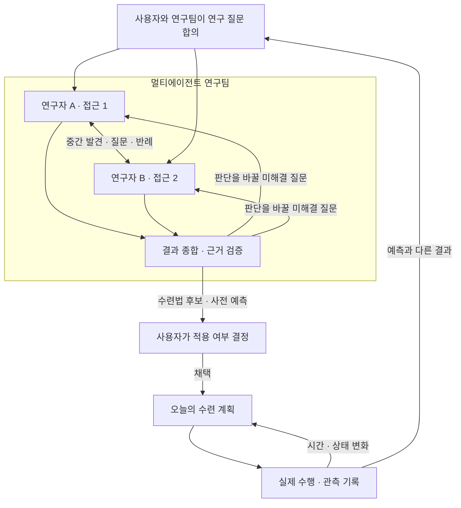
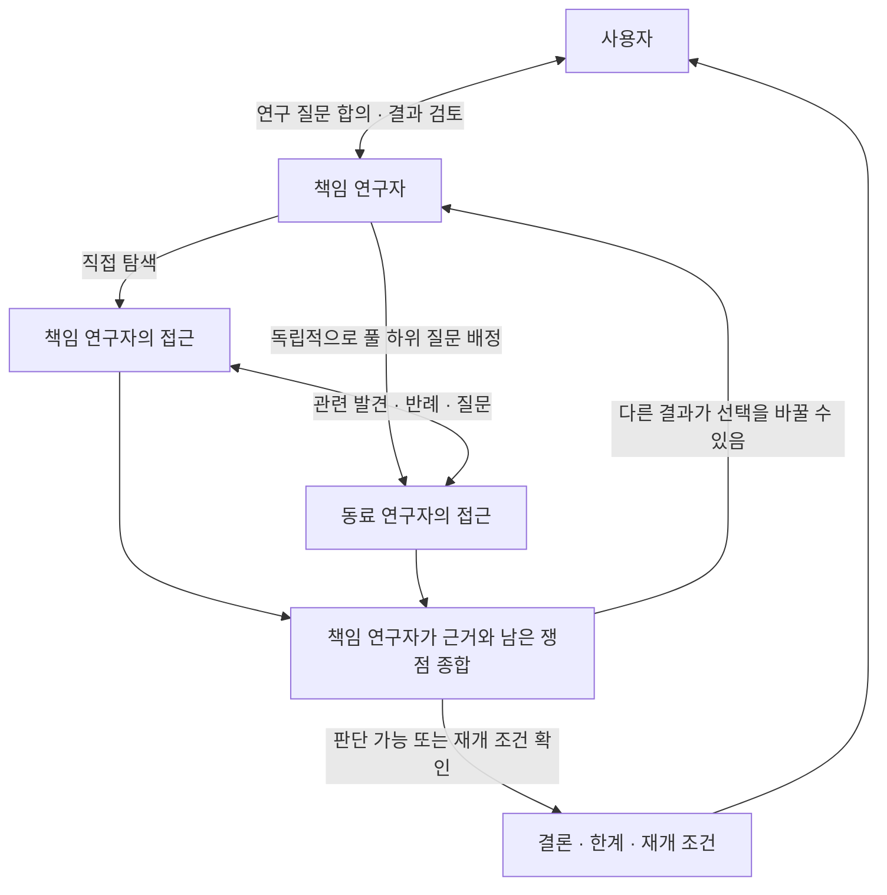

# 수련 연구 에이전트 설계도

**설계의 출발점은 멀티에이전트 연구팀이다.** 사용자와 합의한 하나의 문제를 여러 연구자가 서로 다른 접근으로 탐색한다. 각 연구자는 필요에 따라 조사·추론·계산·실험을 수행한다. 중간 발견이 다른 접근의 전제를 바꾸면 연구 도중에 전달한다.

## 기본 구조

A와 B는 한 연구에서 갈라질 수 있는 두 접근의 예시다. 연구자 수와 맡는 일은 문제에 따라 달라진다. **결과 종합·근거 검증**은 발견을 대조하고 다음 행동을 정하는 작업을 뜻한다. 아래 오케스트레이션 설계안은 이 작업을 맡을 연구자와 재검토 시점을 정한다.

## 어떤 정보가 오가는가

| 경로 | 전달 내용과 결정 |
| --- | --- |
| 사용자 ↔ 연구팀 | 무엇을 알아내면 어떤 수련 선택이 달라지는지 합의한다. 중심 목표를 변경하거나 새 후보를 실제 적용하는 결정은 사용자가 한다. |
| 연구자 ↔ 연구자 | 발견한 사실, 원출처나 계산 결과, 그 발견이 영향을 주는 가정이나 질문을 전달한다. 수신자는 다음 조사·실험을 바꾸거나 기존 접근을 유지할 이유를 남긴다. |
| 연구자 → 종합·검증 → 후속 연구 | 같은 원자료의 재인용, 상충하는 결론, 관측하지 못한 조건을 확인한다. 결론을 가를 비교가 남아 있으면 그 문제를 풀 수 있는 접근에서 조사를 이어간다. |
| 연구팀 → 사용자 → 일일 운영 | 후보의 예상 효과·부담·적용 조건과 판단을 바꿀 관측을 제시한다. 채택하면 예측을 남기고 훈련·영양·휴식 계획에 반영한다. |
| 개인 기록 → 운영 또는 연구 | 가용 시간의 변화는 다음 계획에 곧바로 반영한다. 실제 수행과 예측의 불일치는 원인 재검토로 이어진다. 심층 연구가 진행 중이어도 오늘의 계획은 현재 근거와 여건으로 제공한다. |

**예시.** 베테르비에프의 공개 훈련 영상을 조사하는 A가 반복 동작을 확인했다고 하자. 문헌을 조사하는 B가 효과를 가르는 조건으로 실제 부하를 찾아내면, B는 출처와 조건을 A에게 보낸다. A의 다음 질문은 “같은 동작이 몇 번 더 보이는가?”에서 “부하를 확인할 영상 구간이나 별도 기록이 있는가?”로 바뀐다. 끝내 확인하지 못하면 팀은 관찰된 동작과 그 효과에 대한 가설을 구분해 보고한다.

외부 하네스는 Codex 실행·도구 접근·연구 및 개인 기록의 보존을 지원한다. 실제 하네스의 수정·검증은 사용자와 Codex가 개발 과정에서 맡는다. 이 도면의 설계 제안은 **범용 연구자 간 직접 공유와 필요에 따른 후속 탐색**이다.

## 1. 오케스트레이션

**제안은 연구 질문마다 책임 연구자 한 명을 두고, 나눌 가치가 있는 접근만 동료에게 맡기는 방식이다.** 책임 연구자는 직접 연구하면서 전체 질문과 최종 답을 책임진다. 동료들은 맡은 질문 안에서 방법을 고르고 서로 발견을 전달한다. 사용자는 연구 목표와 실제 적용을 결정하고, 하네스는 합의한 동시 실행·사용량 한도와 작업 상태를 관리한다.

### 어떤 순간에 누가 결정하는가

| 순간 | 결정과 실행 |
| --- | --- |
| 연구 시작 | 책임 연구자가 사용자와 **답을 얻으면 무엇을 결정할지** 합의한다. 바로 확인할 질문은 직접 푼다. 다른 설명을 독립적으로 시험하거나, 본문제를 가로막는 하위 문제를 별도로 풀 가치가 있으면 동료에게 배정한다. |
| 작업 배정 | 배정 내용은 **질문, 답이 바꿀 판단, 이미 확인한 근거, 반환할 결과**다. 앞선 결과가 필요한 작업은 대기시키고 독립 작업은 동시에 진행한다. 동료는 새 갈래를 제안할 수 있고 책임 연구자가 중복·의존성·남은 자원을 보고 실행 여부를 정한다. |
| 진행 중 공유 | 발견이 다른 작업의 전제나 다음 행동을 바꾸면 해당 동료에게 원출처·적용 조건·영향을 직접 전달한다. 수신자는 다음 판단에 이를 반영하거나 기존 접근을 유지한 이유를 남긴다. 우선순위나 최종 결론에 영향이 있으면 책임 연구자에게도 알린다. |
| 재배치와 검증 | 전제가 깨지거나, 결정적인 중간 결과가 나오거나, 작업이 막힐 때 책임 연구자가 계획을 갱신한다. 접근이 겹치면 합치고 유망한 하위 문제에 여력을 옮긴다. 결과가 충돌하면 어느 설명이 맞을 때 관측이 달라지는지 정해 원자료 대조·재계산·독립 검토를 맡긴다. |
| 종료 또는 대기 | 근거가 선택을 뒷받침하거나 추가 조사로 선택이 달라질 가능성이 작으면 현재 결론과 한계를 전달한다. 필요한 관측·권한·사용량이 부족하면 영향을 받는 판단과 재개 조건을 남긴다. 중심 목표 변경과 실제 수련법 채택은 사용자에게 돌려준다. |

**실행 상태.** 하네스는 작업별로 대기·진행·완료·보류·취소 상태와 마지막으로 확인한 결과를 보존한다. 동시 실행 한도에 도달하면 독립 작업도 대기한다. 한 작업의 실패는 그 결과에 의존하는 작업에만 전파한다. 재개할 때는 이미 완료된 근거를 재사용하고, 취소되거나 질문이 변경된 작업의 늦은 응답은 책임 연구자가 현재 질문에도 유효한지 확인한 뒤 반영한다.

**설계를 판정할 사례.** 위 훈련 영상 사례에서 B가 강도 조건을 발견하면 A는 결정에 필요한 부하 자료를 찾아야 한다. 책임 연구자는 반환된 근거를 보고 선수의 훈련 효과까지 판단할 수 있는지 정한다. 부하 자료를 끝내 확보하지 못하면 관찰한 동작만 보고하고 효과는 보류한다. 이때 ① B의 발견이 A의 다음 행동을 바꿨는지, ② 근거가 부족한 결론이 최종 답에서 보류됐는지, ③ 재개 시 같은 조사를 반복하지 않는지를 실행 기록에서 확인한다.

범용 연구자가 서로 다른 접근을 취하고 중간 발견을 재사용하는 방식은 [수학 연구 에이전트 역설계](OPENAI_MATH_AGENT_REVERSE_ENGINEERING.md)를 참고했다. 질문마다 책임 연구자가 작업 배정과 종합을 맡는 구조는 우리 시스템을 위한 설계 제안이다.

[요구사항](SPECIFICATION.md) · [OpenAI 수학 연구 에이전트 역설계](OPENAI_MATH_AGENT_REVERSE_ENGINEERING.md) · [이전 구현 설계 초안](https://github.com/Rmayana/frontier-research-harness/blob/90cce6414f6d0f13a7129fab0a4352441892f752/docs/DESIGN.md)
