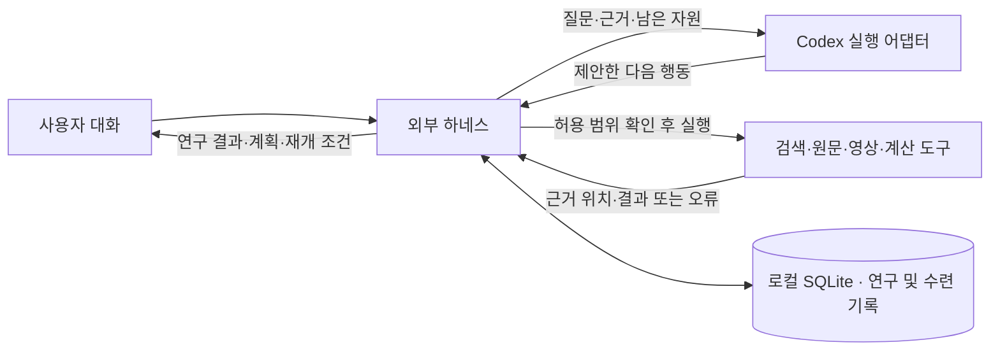

# 수련 연구 에이전트 구현 설계서

설계안 0.2 · 2026-11-20 · 기준 [요구사항 v0.37](SPECIFICATION.md) · 대상 독자: 구현과 검증을 맡은 개발자

## 1. 설계의 중심

사용자가 “이 능력을 어떻게 발전시킬 수 있을까?”라고 연구 문제를 합의하면, 에이전트는 설명을 세우고 문헌·영상·계산·관측으로 시험한다. **중간 발견이 나오면 진행 중인 다른 질문과 다음 행동을 바꾼다.** 그 결과는 개인에게 적용할 수련법 후보, 적용 전의 예측, 오늘 실행할 계획, 이후 예측과 관측의 비교로 이어진다. 신체와 기술의 장기 성장이 판단 기준이며 베테르비에프는 초기 연구 대상이다.

**구현 기준안.** 사용자 한 명의 로컬 환경에서 대화 진입점 하나, 하네스 프로세스 하나, Codex 실행 어댑터 하나, SQLite 파일 하나로 시작한다. 하나의 연구 안에서 여러 접근을 독립된 기록으로 유지한다. 같은 모델 세션이 접근을 번갈아 수행하는 구성과 별도 세션에서 수행하는 구성은 같은 계약을 쓴다. 구성 선택은 §8의 실험으로 결정한다. 이 문서의 기술 선택은 제안이며 실제 연결·비용·성능은 구현 검증 대상이다.

## 2. 수학 연구 사례에서 가져오는 동작

| OpenAI가 공개한 동작 | 이 시스템에 옮기는 설계 | 작동했다는 증거 |
| --- | --- | --- |
| 서로 다른 그룹에 정규성 성립과 붕괴를 포함한 문제 변형을 배정했다. | 같은 관측을 다르게 설명하는 접근을 만들고, 각 접근이 맞을 때와 틀릴 때 달라지는 예측을 적는다. | 가지마다 실제로 다른 질문·판별 조건이 남는다. |
| 더 단순한 오일러 문제의 결과를 얻은 뒤 연구팀이 나비에–스토크스 문제로 자원을 옮겼다. | 본문제의 판단을 좌우하는 하위 문제를 먼저 풀 수 있다. 결과가 나오면 남은 작업의 우선순위와 그 이유를 갱신한다. | 어떤 하위 결과 때문에 무엇을 앞당기거나 중단했는지 복원할 수 있다. |
| Codex로 그룹별 중간 통찰을 종합해 다른 그룹의 후속 프롬프트를 만들었다. | 한 접근의 발견이 다른 접근의 전제를 바꾸면, 발견의 원출처·적용 조건과 달라진 질문을 그 접근의 다음 입력에 넣는다. | 수신 측의 다음 행동이나 결론에 생긴 변화가 기록된다. |
| 발견 뒤 Lean 형식화와 검증을 별도로 수행했다. | 주장을 만든 시도와 검증 기록을 분리한다. 계산은 재실행하고 문헌 주장은 원문과 대조한다. 개인 효과는 적용 전에 남긴 예측과 이후의 개인 관측으로 평가한다. | 검증 결과가 어떤 범위의 주장을 지지하는지 알 수 있다. |

OpenAI는 내부 모델·대규모 연산·연구자의 개입을 함께 사용했다. 공개 자료로 각 요소의 기여도나 내부 스케줄러의 구현을 식별할 수 없다. 아래 실행 규약은 우리 프로젝트의 설계다. 수련 효과에는 수학 증명과 같은 판정기가 없으므로 측정 조건과 대안 설명을 결론에 함께 보존한다. [OpenAI의 연구 과정](https://openai.com/index/navier-stokes-solution/#how-we-found-the-proof) · [공개된 Lean 검증 산출물](https://github.com/openai/NavierStokesAndEuler)

## 3. 구성과 소유권



| 경계 | 구현 책임 |
| --- | --- |
| 대화 진입점 | 연구 시작·재개, 오늘 계획, 수행 기록·정정을 받는다. 이전 합의와 가용 조건을 먼저 읽고 빠진 결정만 사용자에게 묻는다. |
| 하네스 | 상태의 유일한 작성자다. 입력 버전 확인, 권한·사용량 검사, 행동 실행, 결과 저장, 다음 문맥 구성, 중단·재개를 맡는다. 연구 결론은 모델이 제시하고 사용자의 채택 결정은 별도로 받는다. |
| Codex 실행 어댑터 | 기존 계정 사용량을 쓰는 Codex 연결에서 문맥을 전달하고 구조화한 행동 제안을 받는다. 논리 세션 ID와 실행 시도 ID를 구분한다. SDK·App Server·CLI 중 실제 인증·사용량·도구 통제를 만족하는 경로를 §8에서 검증한다. |
| 도구 경계 | 검색은 후보와 식별자를, 열람은 실제 읽은 위치와 내용을, 계산은 입력·단위·방법·결과를 반환한다. 모델 세션의 직접 네트워크·파일 접근도 같은 권한 경계 안에 두어야 한다. |
| 저장소 | 연구와 일일 운영이 같은 근거와 기록 ID를 참조한다. 원본 파일은 비공개 데이터 디렉터리에 보관하고 DB에는 참조를 둔다. 개발 로그에는 개인 본문·원본 경로·인증값을 싣지 않는다. |

## 4. 연구 실행 규약

**시작 입력**은 합의한 질문, 결과로 내릴 결정, 비교 대상, 허용 자료와 자원 범위다. **다음 모델 입력**에는 현재 질문, 이 접근의 가설과 반증 조건, 검토한 근거의 위치, 다른 접근에서 도착한 발견, 최근 실패, 남은 예산을 넣는다. 자료가 많아지면 결정을 좌우하는 근거부터 제공하고 나머지는 ID로 다시 열 수 있게 한다.

| 모델이 제안하는 행동 | 하네스가 확인하고 기록하는 일 |
| --- | --- |
| 접근 생성·수정 | 부모 질문, 경쟁 설명, 판별할 관측, 기대하는 결정 변화를 받는다. 자료 수집을 반복할 때는 새로 해소할 불확실성을 기록한다. |
| 조사·계산 의뢰 | 어떤 결과가 선택을 바꿀지와 도구 입력을 받는다. 실제 열람 범위, 출처 위치, 실패 유형을 기록한다. 문헌의 대상·비교군·측정·기간과 원자료의 중복 여부를 확인할 수 있게 한다. |
| 발견 제출·공유 | 확인 사실, 해석, 출처 ID, 영향받는 접근, 바뀔 전제를 받는다. 수신 측은 다음 판단에서 질문 수정·계속 유지·중단 중 하나와 이유를 남긴다. 공유된 결론을 인용할 때 원출처 연결을 유지한다. |
| 검증 의뢰 | 주장, 원래의 근거, 반례나 재실행 조건을 받는다. 검증 결과를 지지·반박·판정 보류로 저장한다. 도구 출력과 해석이 충돌하면 검증 범위를 좁히거나 주장을 수정한다. |
| 연구 결과 반환 | 현재 선택, 남은 경쟁 설명, 사용자에게 적용할 조건, 판단을 바꿀 다음 관측을 반환한다. 효과를 가를 개인 자료가 없으면 비교 설계와 미확인 상태를 반환한다. |

### 실행 인터페이스

아래는 하네스 내부의 논리 계약이다. 필드 이름은 모델 연결 방식과 관계없이 유지한다.

```text
decide(context) -> Action(kind, research_id, approach_id, read_version, payload)
execute(tool, input, authorized_scope, attempt_id) -> ToolResult(status, evidence_refs, error)
commit(action, result, expected_version, request_id) -> Applied | Duplicate | Conflict
```

예를 들어 적응 원리를 조사하던 접근이 영상 조사에 판별 조건을 전달하는 행동은 다음처럼 표현한다. ID와 자료는 시험용이다.

```json
{
  "kind": "share_finding",
  "research_id": "r1",
  "approach_id": "mechanism",
  "read_version": 4,
  "payload": {
    "finding_id": "f7",
    "evidence_refs": ["e2"],
    "target_approach": "footage",
    "changed_assumption": "동작의 반복 횟수만으로 강도를 식별할 수 있는가",
    "next_question": "촬영 구간의 실제 부하를 확인할 별도 자료가 있는가"
  }
}
```

하네스는 소속 연구와 참조 ID를 검사하고 공유와 수신 대기 상태를 함께 저장한다. 다음 수신 문맥에 원자료 위치를 포함한다. 수신 측이 이미 실행 중이면 결과 커밋 시 읽은 버전을 대조하고, 공유를 확인한 뒤 다음 행동을 정한다. 발신 횟수로 연구 진척도를 계산하지 않는다.

**반복과 종료.** 하네스는 모델 입력 구성 → 행동 제안 검사 → 도구 실행 또는 기록 변경 → 결과 커밋을 반복한다. 합의한 결정을 근거로 설명할 수 있거나, 추가 조사로 선택이 달라질 가능성이 작으면 결과를 반환한다. 사용자 결정·외부 자료·한도가 병목이면 확인한 부분과 재개 조건을 저장한다. 독립된 다른 접근이 살아 있으면 남은 예산 안에서 진행한다. 경로 추가, 결과 공유, 검증의 순서는 연구 문제에 따라 달라진다.

| 연구 상태 | 전이 조건 |
| --- | --- |
| 진행 중 | 새 질문이 합의됐거나, 보류했던 자료·예산·사용자 결정이 확보됐다. |
| 대기 | 실행할 수 있는 의미 있는 행동이 남아 있지 않다. 원인과 재개에 필요한 입력을 기록한다. |
| 결과 전달 | 현재 결론과 근거·한계를 저장했다. 새 근거나 개인 관측이 들어오면 이전 결과를 참조하는 새 개정으로 재검토한다. |

**계산·실험 선택.** 모델은 먼저 경쟁 설명이 서로 다르게 예측하는 결과와 그 차이를 가릴 방법을 제안한다. 계산을 택하면 입력 출처·단위·가정·예상 범위를 기록하고 기준 사례나 극한 조건에서 결과를 점검한다. 개인 비교를 택하면 기존 방법, 바꿀 조건, 관측 기간, 수정·중단 기준을 먼저 남긴다. 시뮬레이션의 예측, 실제 관측, 개인 효과에 대한 해석은 각각 기록한다.

**수련 연구에서의 예.** 베테르비에프의 공개 영상에서 반복 동작이 보였다고 하자. 한 접근은 실제 수행 조건을, 다른 접근은 가능한 적응 원리를 조사한다. 문헌 검토에서 수행 강도가 두 설명을 가르는 조건으로 드러났다면, 두 번째 접근은 근거 위치와 조건을 첫 번째 접근에 전달한다. 첫 번째 접근의 다음 입력은 “같은 동작을 더 찾아라”에서 “부하나 강도를 판별할 독립 자료가 있는가?”로 바뀐다. 판별 자료가 없으면 영상에서 본 동작까지만 확인하고, 사용자에게는 개인 조건에서 판별 가능한 비교와 예측을 제안한다. 이 예시는 가상 실행이다.

## 5. 데이터와 명령 계약

ID는 불변이다. 모든 명령에 요청 ID를 부여하고, 수정 명령은 읽었던 레코드 버전을 함께 보낸다. 모델은 변경을 제안하고 하네스가 유효성을 검사해 저장한다. 저장 구조의 최소 단위는 다음과 같다.

| 기록 | 필수 정보와 관계 |
| --- | --- |
| Research / Approach | 합의한 질문·결정·범위·상태·버전 / 소속 연구 ID·가설·판별 조건·다음 질문·상태 |
| Evidence / Finding | 원자료 식별자·위치·열람 범위·도구 시도 ID / 접근 ID·주장 종류·근거 ID·적용 조건·검증 상태 |
| Handoff / Check | 발견·발신/수신 접근·변경 제안·수신 후 행동 / 대상 주장·검증 방법·근거·결과·한계 |
| Candidate / Prediction | 기존 방법과 차이·예상 이득과 부담·사용자 결정 / 후보 ID·지표·단위·조건·기간·비교값 또는 예상 방향·수정 기준·기록 시점 |
| Plan / Observation | 날짜·가용 조건·훈련·영양·휴식·관련 후보 / 실제 시각·대상·실제값·단위·미기록 여부·정정 대상 ID |
| Attempt / Dependency | 작업 키·요청 ID·상태·입력 버전·결과 또는 오류·가용 사용량 / 근거 레코드와 이에 의존한 결론·계획의 연결 |

| 사용자 명령 | 출력과 실패 처리 |
| --- | --- |
| 연구 시작 또는 재개 | 연구 ID와 현재 결과 또는 대기 조건. 중심 목표가 달라지면 새 범위를 합의한다. |
| 오늘 계획 요청 | 유효한 개인 기록·일정·채택한 방법에서 계획 버전을 만든다. 첫 사용에는 필요한 상태·시간·환경·경험만 묻고 확보한 범위에서 계획을 제공한다. |
| 실제 수행·정정 입력 | 계획과 분리한 관측 ID를 돌려준다. 값 누락은 미확인, 미수행은 명시한 경우에 기록한다. 단위가 모호하면 해당 비교를 보류한다. 정정하면 원본과 정정을 연결하고 의존 결론을 재검토 대상으로 표시한다. |
| 수련법 채택 | 후보 ID와 사용자의 선택을 기록한다. 개인 비교에 쓰일 예측과 조건은 적용 전에 저장한다. 이후 관측이 들어오면 원래 예측과 비교해 계획·설명을 유지하거나 고친다. |

**일관성과 복구.** 요청 ID에는 유일성 제약을 둔다. 같은 요청 재수신에는 기존 결과를 반환하고 같은 ID에 다른 내용이 들어오면 충돌을 반환한다. 성공한 행동의 결과와 의존 관계, 연구 상태 변경은 한 트랜잭션으로 커밋한다. 오래된 버전의 결과는 시도 이력에 보존하고 최신 상태에서 적용 가능성을 다시 판단한다. 도구 호출 전 시도를 기록한다. 중단 후 완료 여부가 불명확한 호출은 원격 작업 ID로 확인하거나 읽기 전용·재실행 가능한 작업만 예산을 확인해 재시도한다. 원래 예측을 관측 뒤에 덮어쓸 수 없게 한다.

## 6. 두 경로가 만나는 지점

연구 결과에는 실제로 검토한 근거, 후보의 장기 이득과 시간·회복 부담, 개인 적용 조건이 있다. **사용자가 채택한 후보와 사전 예측**이 일일 운영으로 넘어가는 접점이다. 장기 연구가 대기 중이어도 그날은 유효한 기존 계획과 현재 여건으로 수련할 수 있다. 다음 날에는 계획량과 실제량을 각각 읽는다. 일정 변화는 다음 계획에 바로 반영한다. 예측을 벗어나는 관측은 측정 조건·수행량·다른 설명을 확인하는 연구 입력이 된다. 하루의 차이만으로 인과 결론을 내리지 않는다.

자연적 수련 범위와 개인 자료 전송 권한을 실행 전에 검사한다. 새 외부 서비스로 개인 자료를 보낼 때에는 대상 자료·목적·서비스를 특정한 사용자 결정을 조회한다. 결제 경로 변경, 독립 유료 평가 서비스 사용, 중심 목표 변경은 사용자 결정 사항이다. 하네스 수정은 사용자와 Codex의 개발 작업이다.

## 7. 장애 시 사용자에게 보이는 결과

| 실패 지점 | 보존할 결과와 다음 행동 |
| --- | --- |
| 원문 접근 실패·영상 일부 누락 | 검색에서 발견한 상태와 실제 확인한 구간을 구분한다. 해당 자료가 필요한 주장만 보류하고 대체 근거를 찾는다. |
| 모델 사용량 소진·취소·연결 단절 | 마지막 커밋과 실행 중 시도를 표시한다. 다음 접속에서 미해결 질문부터 재개하고 이미 확보한 자료를 재사용한다. |
| 새 외부 서비스 전송 권한 없음 | 전달 전에 멈추고 허용된 자료·도구로 가능한 부분을 수행한다. 서비스·자료·목적이 바뀌면 기존 결정을 재사용할 수 없다. |
| 두 접근이 상반된 결론을 제출 | 원자료·측정 조건·가설을 대조하고 구별 가능한 관측을 조사한다. 해결되지 않으면 두 결론의 적용 범위를 제시한다. |

## 8. 구현 순서와 인수 시험

아래 순서는 한 제품을 완성하기 위한 개발 순서다. 첫 사용 버전에는 연구와 일일 운영이 모두 들어간다.

| 순서 | 만들 것 | 통과 기준 |
| --- | --- | --- |
| 1. 실제 실행 경계 | 작은 대화 진입점, Codex 어댑터, 비공개 SQLite, 권한·한도 검사 | 기존 계정 경로로 가상 자료 1건을 왕복하고 재시작 후 읽는다. 실제 실행 경로와 사용량 확인 가능 범위를 기록한다. 비허용 외부 전송은 직접 도구 접근을 포함해 실행 전에 차단된다. C-02·03, NFR-05 |
| 2. 연구 한 건의 전 과정 | 접근 생성, 근거 수집, 발견 전달, 검증, 결과 반환 | 고정된 원문과 영상 구간을 주고 뒤늦게 판별 조건을 공개한다. 새 근거가 다음 요청을 바꾸고 누락된 조건을 최종 주장에 반영한다. 중복 원자료는 한 출처로 추적된다. FR-02·03·07, NFR-01·03 |
| 3. 일상 운영과 재개 | 후보 채택, 사전 예측, 오늘 계획, 실제 수행·정정 | 첫날 → 일부 수행 → 시간 제약이 생긴 다음 날을 실행한다. 이전 실제 수행을 반영하고 미기록을 보존한다. 단위 정정 뒤 관련 판단만 재검토한다. FR-01·04·05·06, NFR-02·04 |
| 4. 복구와 결정권 | 중복 요청, 오래된 응답, 프로세스 중단, 새 서비스 전송을 주입하는 시험 | 관측 중복 0건, 사전 예측 덮어쓰기 0건, 미승인 전송 0건. 불명확한 외부 호출은 확인 상태로 남고 완료한 부분은 복원된다. NFR-02·03·05, C-01~04 |
| 5. 연구 구조 비교 | 동일 모델과 자료로 단일 세션, 독립 세션, 독립 세션+중간 공유를 대조 | 아래 기준으로 공유와 분업의 효과 및 비용을 따로 판정하고, 채택 근거를 남긴다. |

**벤치마크 설계.** 자료를 동결한 사례를 준비한다. 사례에는 (a) 다른 접근의 발견이 핵심 가정을 바꾸는 문제, (b) 단일 원문으로 충분한 문제, (c) 자료가 부족해 결론 보류가 정답인 문제가 포함된다. 사례마다 유효 원출처, 잘못된 추론, 관측 공개 시점, 기대하는 결정 변화를 사전에 기록한다. 동일 모델 버전·도구 권한·자료 공개 순서·총사용량 한도에서 각 구성을 반복 실행한다. 모델 호출량을 직접 확인할 수 없으면 같은 예산이었다는 결론을 보류하고 측정 가능한 호출·경과시간을 함께 보고한다.

실행 로그로 **근거가 도착한 뒤 다음 질문이 실제로 바뀌었는지**, 최종 판단이 그 발견의 적용 한계를 지켰는지, 독립 검증이 오류를 찾았는지 확인한다. 채점자는 구성 이름을 가린 결과와 원자료를 대조한다. 사례별 성공·실패, 첫 유용한 결과까지의 시간, 총사용량을 함께 보고한다. 단일 세션이 놓친 판별을 별도 세션이 반복해 살리고 일상·보류 사례에서 오류를 늘리지 않는 범위에 분업을 채택한다.

**미결정 사항.** 사용자와 정할 것은 지원 기기와 개인 자료 보관·삭제·백업 범위다. 대표 작업 측정으로 정할 것은 응답시간·비용 목표, 독립 세션 사용 조건, 지원할 Codex 연결 방식이다. 실제 개인 자료를 넣기 전 보관 정책을 확인하고, 그 전까지 인수 시험에는 합성 자료를 사용한다.
