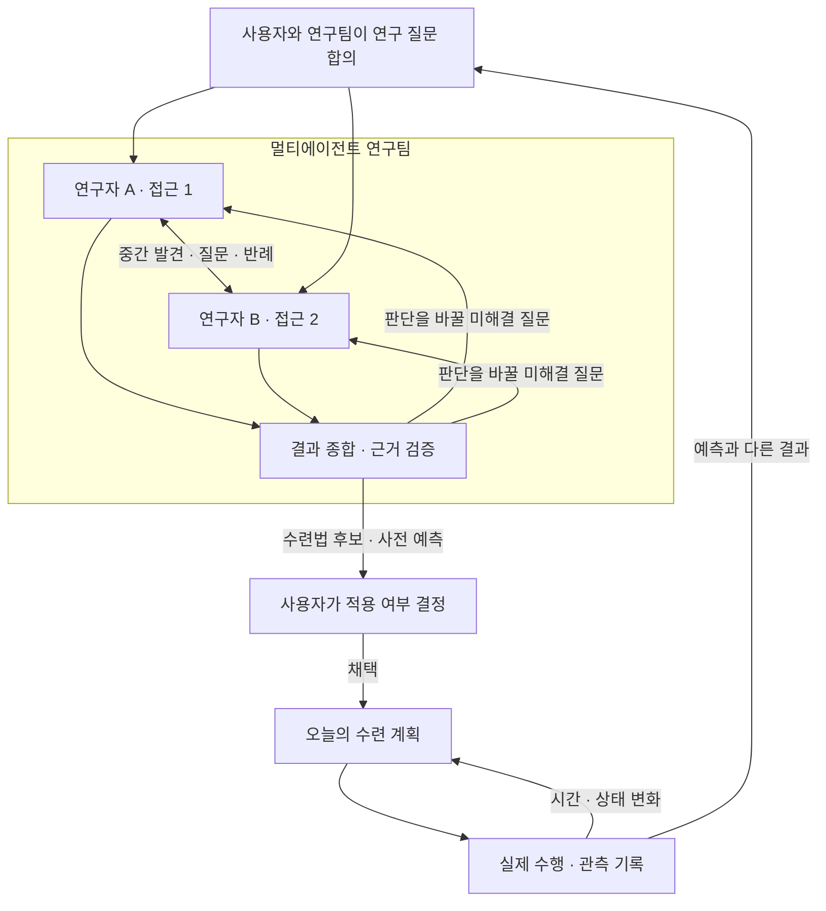
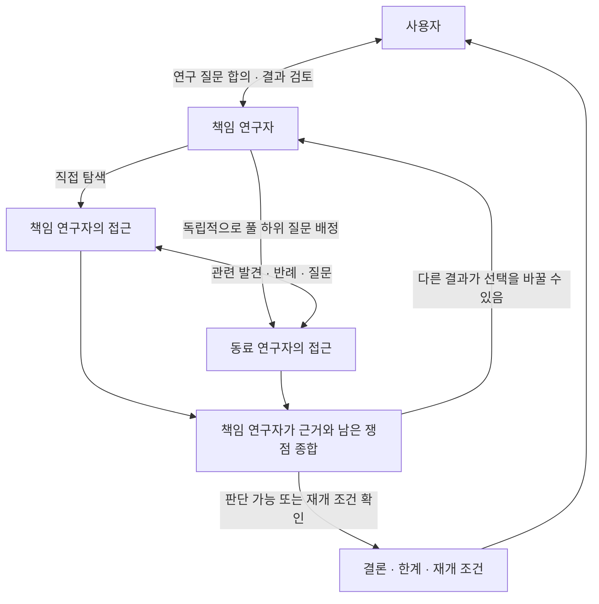

# 수련 연구 에이전트 설계도

**설계의 출발점은 멀티에이전트 연구팀이다.** 사용자와 합의한 하나의 문제를 여러 연구자가 서로 다른 접근으로 탐색한다. 각 연구자는 필요에 따라 조사·추론·계산·실험을 수행한다. 중간 발견이 다른 접근의 전제를 바꾸면 연구 도중에 전달한다.

## 기본 구조

A와 B는 한 연구에서 갈라질 수 있는 두 접근의 예시다. 연구자 수와 맡는 일은 문제에 따라 달라진다. **결과 종합·근거 검증**은 발견을 대조하고 다음 행동을 정하는 작업을 뜻한다. 아래 오케스트레이션 설계안은 이 작업을 맡을 연구자와 재검토 시점을 정한다.

## 어떤 정보가 오가는가

| 경로 | 전달 내용과 결정 |
| --- | --- |
| 사용자 ↔ 연구팀 | 무엇을 알아내면 어떤 수련 선택이 달라지는지 합의한다. 중심 목표를 변경하거나 새 후보를 실제 적용하는 결정은 사용자가 한다. |
| 연구자 ↔ 연구자 | 발견한 사실, 원출처나 계산 결과, 그 발견이 영향을 주는 가정이나 질문을 전달한다. 수신자는 다음 조사·실험을 바꾸거나 기존 접근을 유지할 이유를 남긴다. |
| 연구자 → 종합·검증 → 후속 연구 | 같은 원자료의 재인용, 상충하는 결론, 관측하지 못한 조건을 확인한다. 결론을 가를 비교가 남아 있으면 그 문제를 풀 수 있는 접근에서 조사를 이어간다. |
| 연구팀 → 사용자 → 일일 운영 | 후보의 예상 효과·부담·적용 조건과 판단을 바꿀 관측을 제시한다. 채택하면 예측을 남기고 훈련·영양·휴식 계획에 반영한다. |
| 개인 기록 → 운영 또는 연구 | 가용 시간의 변화는 다음 계획에 곧바로 반영한다. 실제 수행과 예측의 불일치는 원인 재검토로 이어진다. 심층 연구가 진행 중이어도 오늘의 계획은 현재 근거와 여건으로 제공한다. |

**예시.** 베테르비에프의 공개 훈련 영상을 조사하는 A가 반복 동작을 확인했다고 하자. 문헌을 조사하는 B가 효과를 가르는 조건으로 실제 부하를 찾아내면, B는 출처와 조건을 A에게 보낸다. A의 다음 질문은 “같은 동작이 몇 번 더 보이는가?”에서 “부하를 확인할 영상 구간이나 별도 기록이 있는가?”로 바뀐다. 끝내 확인하지 못하면 팀은 관찰된 동작과 그 효과에 대한 가설을 구분해 보고한다.

외부 하네스는 Codex 실행·도구 접근·연구 및 개인 기록의 보존을 지원한다. 실제 하네스의 수정·검증은 사용자와 Codex가 개발 과정에서 맡는다. 이 도면의 설계 제안은 **범용 연구자 간 직접 공유와 필요에 따른 후속 탐색**이다.

## 1. 오케스트레이션

**연구 질문마다 책임 연구자 한 명을 두고, 나눌 가치가 있는 접근만 동료에게 맡긴다.** 책임 연구자는 직접 연구하면서 전체 질문과 최종 답을 책임진다. 동료들은 맡은 질문 안에서 방법을 고르고 서로 발견을 전달한다. 사용자는 연구 목표와 실제 적용을 결정하고, 하네스는 합의한 동시 실행·사용량 한도와 작업 상태를 관리한다.

### 어떤 순간에 누가 결정하는가

| 순간 | 결정과 실행 |
| --- | --- |
| 연구 시작 | 책임 연구자가 사용자와 **답을 얻으면 무엇을 결정할지** 합의한다. 바로 확인할 질문은 직접 푼다. 다른 설명을 독립적으로 시험하거나, 본문제를 가로막는 하위 문제를 별도로 풀 가치가 있으면 동료에게 배정한다. |
| 작업 배정 | 배정 내용은 **질문, 답이 바꿀 판단, 이미 확인한 근거, 반환할 결과**다. 앞선 결과가 필요한 작업은 대기시키고 독립 작업은 동시에 진행한다. 동료는 새 갈래를 제안할 수 있고 책임 연구자가 중복·의존성·남은 자원을 보고 실행 여부를 정한다. |
| 진행 중 공유 | 발견이 다른 작업의 전제나 다음 행동을 바꾸면 해당 동료에게 원출처·적용 조건·영향을 직접 전달한다. 수신자는 다음 판단에 이를 반영하거나 기존 접근을 유지한 이유를 남긴다. 우선순위나 최종 결론에 영향이 있으면 책임 연구자에게도 알린다. |
| 재배치와 검증 | 전제가 깨지거나, 결정적인 중간 결과가 나오거나, 작업이 막힐 때 책임 연구자가 계획을 갱신한다. 접근이 겹치면 합치고 유망한 하위 문제에 여력을 옮긴다. 결과가 충돌하면 어느 설명이 맞을 때 관측이 달라지는지 정해 원자료 대조·재계산·독립 검토를 맡긴다. |
| 종료 또는 대기 | 근거가 선택을 뒷받침하거나 추가 조사로 선택이 달라질 가능성이 작으면 현재 결론과 한계를 전달한다. 필요한 관측·권한·사용량이 부족하면 영향을 받는 판단과 재개 조건을 남긴다. 중심 목표 변경과 실제 수련법 채택은 사용자에게 돌려준다. |

**실행 상태.** 하네스는 작업별로 대기·진행·완료·보류·취소 상태와 마지막으로 확인한 결과를 보존한다. 동시 실행 한도에 도달하면 독립 작업도 대기한다. 한 작업의 실패는 그 결과에 의존하는 작업에만 전파한다. 재개할 때는 이미 완료된 근거를 재사용하고, 취소되거나 질문이 변경된 작업의 늦은 응답은 책임 연구자가 현재 질문에도 유효한지 확인한 뒤 반영한다.

**설계를 판정할 사례.** 위 훈련 영상 사례에서 B가 강도 조건을 발견하면 A는 결정에 필요한 부하 자료를 찾아야 한다. 책임 연구자는 반환된 근거를 보고 선수의 훈련 효과까지 판단할 수 있는지 정한다. 부하 자료를 끝내 확보하지 못하면 관찰한 동작만 보고하고 효과는 보류한다. 이때 ① B의 발견이 A의 다음 행동을 바꿨는지, ② 근거가 부족한 결론이 최종 답에서 보류됐는지, ③ 재개 시 같은 조사를 반복하지 않는지를 실행 기록에서 확인한다.

범용 연구자가 서로 다른 접근을 취하고 중간 발견을 재사용하는 방식은 [수학 연구 에이전트 역설계](OPENAI_MATH_AGENT_REVERSE_ENGINEERING.md)를 참고했다. 질문마다 책임 연구자가 작업 배정과 종합을 맡는 구조는 우리 시스템의 설계 결정이다.

### 오케스트레이션 구현 결정 · 2026-11-21

| 책임 | 구현 선택 | 선택 이유 |
| --- | --- | --- |
| 작업 분기·재배치·종료 | Python 3.13, 단일 하네스 프로세스, 표준 `asyncio` | 연구 질문에 따라 바뀌는 작업을 큐에 넣고 독립 작업만 동시에 실행한다. 작업 상태와 메시지 전달을 같은 트랜잭션으로 관리한다. [Python 비동기 태스크](https://docs.python.org/3.13/library/asyncio-task.html) |
| 연구자 실행 | 공식 Codex Python SDK `openai-codex==0.171.0`의 `AsyncCodex` | 책임자와 동료에게 각각 스레드를 할당한다. SDK가 로컬 App Server를 통해 스레드 시작·재개, 구조화된 턴 출력, 취소를 지원하므로 별도 JSON-RPC 클라이언트가 필요하지 않다. [SDK 가이드](https://learn.chatgpt.com/docs/codex-sdk) · [선정 버전의 SDK 계약](https://github.com/openai/codex/blob/583ec348cf9007361d09513c716549c41d4d8128/sdk/python/docs/api-reference.md) |
| 작업·메시지 복구 | SQLite와 Python `sqlite3` | 작업 버전, 처리한 요청 ID, 수신자별 발송 대기 메시지, 마지막 확정 결과를 보존한다. 이 결정은 오케스트레이터의 실행 상태에 적용한다. [SQLite 트랜잭션](https://docs.python.org/3.13/library/sqlite3.html#transaction-control) |

**실행 규약**

1. **시작과 배정.** ChatGPT 계정 인증을 확인하고 연구 질문에 책임자 스레드를 연결한다. 책임자는 자기 접근을 진행하면서 독립 질문을 동료에게 배정할 수 있다. 하네스는 새 작업의 연구 ID·부모 작업·선행 조건을 확인하고, 다른 작업의 완료를 기다리는 순환 의존은 등록 단계에서 돌려보낸다.
2. **동시 실행.** 스레드마다 활성 턴 하나를 허용한다. 초기 기본값은 책임자 포함 동시 2턴이며, 작업 수는 질문에 따라 달라진다. 자료나 동료 응답을 기다리는 작업은 슬롯을 반환한다. 한 작업의 예외 때문에 독립 작업까지 취소되지 않도록 실패 처리를 작업 단위로 둔다.
3. **동료 전달.** 발신자가 발견과 대상 작업을 지정하면 하네스는 요청 ID와 작업 버전을 검사한 뒤 발견과 발송 대기 메시지를 함께 커밋한다. 수신자가 실행 중이면 다음 턴 시작 시 전달하고, 유휴 상태에서 판단이 필요하면 실행 큐에 넣는다. SDK의 `ExternalMessage`를 사용해 출처를 보존한다. 전달에는 책임자의 별도 승인이 필요하지 않다.
4. **취소와 재개.** 취소 요청은 작업 상태에 먼저 기록하고 진행 중인 턴에 중단을 요청한다. 오래된 버전의 응답은 현재 결론에 자동 적용하지 않는다. 재시작 시 스레드를 재개하고 마지막 확정 상태와 대기 메시지를 복원한다. 전달 확인 전에 연결이 끊겨 다시 보내더라도 동일 메시지 ID에 따른 상태 변경은 한 번만 반영한다.
5. **종료.** 책임자는 남은 접근이 현재 결정을 바꿀지 판단한다. 더 필요하면 해당 작업만 재배정한다. 결론을 반환할 때는 남은 각 작업을 후속으로 보류하거나 취소해 맹목적으로 계속 실행되는 작업이 없게 한다. 한도 소진 시에는 마지막 확정 결과와 재개 조건을 반환한다.

**오케스트레이션 인수 기준**

| 실행 상황 | 통과 조건 |
| --- | --- |
| A가 연구하는 중에 B가 중요한 반례를 전달한다. | A가 다음 턴에 반례를 받아 접근을 바꾸거나 기존 접근을 유지한 이유를 남긴다. |
| 동시 실행 한도에 도달하고 책임자가 동료를 기다린다. | 대기하는 책임자가 슬롯을 점유하지 않고, 실행 가능한 동료 작업이 진행된다. |
| 메시지 저장 직후 중단하거나 취소된 작업의 결과가 늦게 도착한다. | 재개 후 메시지가 누락되지 않고 같은 발견이 중복 반영되지 않는다. 취소된 응답은 현재 결론을 덮어쓰지 않는다. |
| 기존 계정에서 두 연구자를 실행하다 사용량 한도에 도달한다. | 정상일 때 각 스레드가 응답하고, 한도에 도달하면 대기 상태와 재개 지점을 보존한다. |

**검증 상태.** Windows 호스트에서 로컬 App Server 초기화와 ChatGPT 계정 유형 조회까지 확인했다. 위 인수 기준은 선정한 SDK로 구현한 뒤 실행할 시험이다.

[요구사항](SPECIFICATION.md) · [OpenAI 수학 연구 에이전트 역설계](OPENAI_MATH_AGENT_REVERSE_ENGINEERING.md) · [이전 구현 설계 초안](https://github.com/Rmayana/frontier-research-harness/blob/90cce6414f6d0f13a7129fab0a4352441892f752/docs/DESIGN.md)
