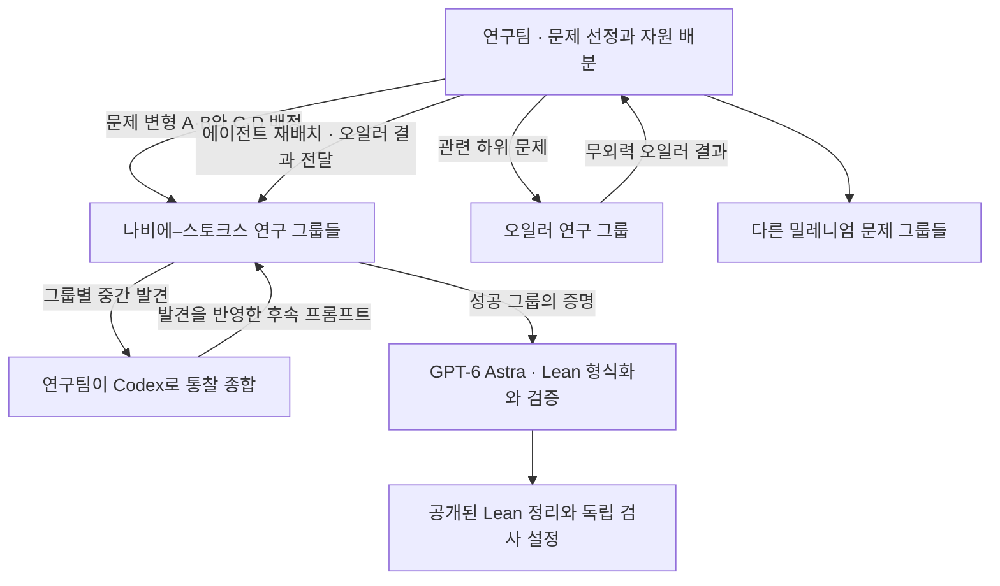
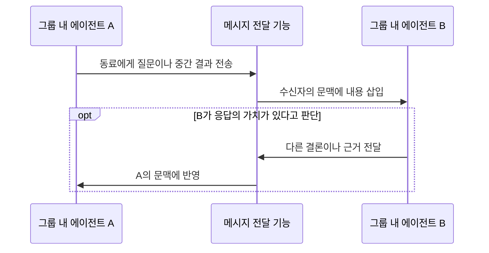

# OpenAI 수학 연구 에이전트 역설계

**복원 대상** 2026년 9월 나비에–스토크스·오일러 연구에 사용된 모델, 에이전트 그룹, 사람의 운영, 증명의 형식 검증. 2026-11-20 기준.

이 시스템에는 두 가지 협업 경로가 있었다. **그룹 안에서는 에이전트들이 작업 도중 서로 통신했다. 그룹 사이에서는 연구팀이 Codex로 선별·종합한 발견을 새 프롬프트로 전달했다.** 오일러 문제가 풀리자 연구팀은 어디에 연산을 쓸지 바꿨다. 증명 발견 후에는 별도 모델이 Lean 형식화를 맡았다. 이 네 가지 동작을 구별해야 당시 시스템의 제어권과 정보 흐름이 보인다. [OpenAI 실행 보고](https://openai.com/index/navier-stokes-solution/#how-we-found-the-proof) · [노엄 브라운 인터뷰, 첫 15분](https://www.dwarkesh.com/p/noam-brown)

**도면 읽는 법.** ‘실행 보고’는 OpenAI가 이 연구에서 수행했다고 밝힌 동작, ‘연구자 설명’은 개발자가 설명한 협업 방식, ‘산출물’은 직접 열어볼 수 있는 코드·논문·검증 설정을 뜻한다. ‘복원’은 이 증거들을 연결한 논리 구조다. 도면의 상자 이름은 설명을 위해 붙였으며 공개된 내부 서비스명은 본문에 따로 명시했다.

## 1. 시스템 구성도



**입력에서 출력까지.** 처음의 입력은 여러 연구 문제와 그 변형이었다. 실행 중에는 동료의 메시지, 다른 문제의 성과, 갱신된 그룹 프롬프트가 추가 입력이 됐다. 나비에–스토크스의 최종 산출물은 매끄러운 외력이 있는 3차원 문제의 붕괴를 구성한 논증과 이를 표현한 형식 증명이다. 관련 오일러 결과는 외력이 없는 경우다. 두 문제 사이에 전달된 정보는 연구 단서였으며, 점성이 있는 경우의 결론은 별도 증명을 필요로 했다. [OpenAI 실행 보고](https://openai.com/index/navier-stokes-solution/#how-we-found-the-proof) · [증명 논문 §1–3](https://cdn.openai.com/pdf/32d9f210-8b73-45e0-91bc-82a30aef8a9a/navier-stokes.pdf) · [검증 저장소](https://github.com/openai/NavierStokesAndEuler/blob/f9e8bc5b38b6e212696e8a30e3e91517af887bbd/README.md)

## 2. 그룹 하나를 확대하면

| 구성 | 입력 → 동작 → 출력 | 복원 수준 |
| --- | --- | --- |
| 연구 모델 | 문제 변형과 현재 문맥을 받아 수학적 접근을 전개한다. 실험 도중 더 훈련된 내부 모델로 갱신했다. 사전학습 뒤 대규모 강화학습을 사용했다는 설명까지 공개됐다. | 실행 보고. 가중치, 보상 설계, 샘플링 설정, 교체 시 세션 이전 방법은 미확인. [OpenAI 실행 보고](https://openai.com/index/navier-stokes-solution/#how-we-found-the-proof) |
| 동료 간 통신 | 발신 에이전트가 작업 도중 상대에게 메시지를 보내는 도구를 호출한다. 수신 측의 문맥에 내용이 들어가므로 질문·응답·수정이 가능하다. | 연구자 설명. 실험 보고는 그룹 내부 통신을 명시한다. 수신자 발견 방식, 전달 순서·보장, 전체 대화 내역은 미확인. [노엄 브라운 인터뷰, 첫 15분](https://www.dwarkesh.com/p/noam-brown) · [OpenAI 실행 보고](https://openai.com/index/navier-stokes-solution/#how-we-found-the-proof) |
| 조사·계산 | 에이전트는 캐시된 인터넷을 읽고 코드를 실행할 수 있었다. 최종 논문에는 선행 연구와 그 연구에서 사용한 방법이 실려 있다. | 실행 보고와 산출물. 어떤 에이전트가 어떤 문헌을 실제로 열었는지, 계산 결과가 어느 결정에 쓰였는지는 공개 자료에서 식별하기 어렵다. [OpenAI 실행 보고](https://openai.com/index/navier-stokes-solution/#how-we-found-the-proof) · [증명 논문 §1–3](https://cdn.openai.com/pdf/32d9f210-8b73-45e0-91bc-82a30aef8a9a/navier-stokes.pdf) |
| 그룹 간 통합 | 그룹별 중간 발견 → Codex를 사용한 종합 → 후속 프롬프트 → 수신 그룹의 연구 계속. 성공 그룹도 이 경로로 안내받았다. | 실행 보고. 선별 기준, 정확한 문구, 배포 주기, 사람의 편집량은 미확인. [OpenAI 실행 보고](https://openai.com/index/navier-stokes-solution/#how-we-found-the-proof) |
| 감독 | 연구팀이 문제 배정·자원 이동·모델 갱신을 수행했다. OpenAI는 실행 중 격리와 모니터링을 적용했다고 밝혔다. | 실행 보고. 작업 큐, 중단·재시작 정책, 보안 인프라와 모니터링 규칙은 미확인. [OpenAI 실행 보고](https://openai.com/index/navier-stokes-solution/#how-we-found-the-proof) |

### 한 메시지의 생애



브라운이 든 관찰 예에서는 두 에이전트의 답이 달랐다. 서로 도출 근거를 물은 뒤 한쪽이 자신의 답을 고치고 동료들에게 수정 사실을 알렸다. 도면은 그 설명에서 복원한 **통신 의미**를 보여준다. 특정 전송 API, 전담 비평자, 다수결, 동기식 대기, 전체 공유 메모리는 이 동작을 설명하는 데 필요하지 않다. 이 일화가 나비에–스토크스 성공 그룹의 어느 증명 단계를 가리키는지는 밝혀지지 않았다. [노엄 브라운 인터뷰, 첫 15분](https://www.dwarkesh.com/p/noam-brown)

## 3. 결정권과 실행 순서

| 시점 또는 사건 | 누가 무엇을 했나 | 뒤의 연구에 달라진 점 |
| --- | --- | --- |
| 9월 1일 연구 시작 | 연구팀이 여러 밀레니엄 문제와 관련 문제를 배정했다. 나비에–스토크스는 해의 전역 정칙성이 성립하는 방향과 이를 깨는 방향을 서로 다른 그룹이 탐색했다. | 처음부터 답의 방향이 다른 탐색이 동시 진행됐다. |
| 오일러 결과 도착 | 약 100개 에이전트가 약 50시간 협업해 무외력 오일러 문제의 결과를 얻었다. 연구팀이 나비에–스토크스의 우선순위를 올렸다. | 다른 문제에서 에이전트를 옮기고 오일러 결과를 입력으로 제공했다. |
| 탐색 진행 중 | 더 훈련된 모델이 준비되자 연구팀이 모델을 갱신했다. 그룹별 발견을 Codex로 종합해 후속 프롬프트를 보냈다. | 후속 시도에는 초기 시도와 다른 모델 또는 새로운 문제 문맥이 쓰였다. 두 변경의 정밀한 상대 시각은 미확인이다. |
| 첫 실행 후 약 88시간 | 9월 5일 성공 그룹이 나비에–스토크스 결과에 도달했다. 성공 그룹의 동시 에이전트 규모는 약 1만이었다. | 수학적 구성을 형식 언어로 옮겨 점검할 수 있게 됐다. |
| 추가 약 17시간 | GPT-6 Astra를 사용해 Lean 형식화와 검증을 수행했다. | 두 문제의 형식 증명과 독립 검사 설정을 공개했다. |

시간은 OpenAI가 보고한 경과다. 오일러의 약 50시간은 전체 연구가 이미 진행 중인 구간에 속한다. 나비에–스토크스 관련 집계는 메시지 270만 건·출력 토큰 약 1,300억 개이고, 전체 시도 합계는 490만 건·약 3,000억 개다. 동시 에이전트 수, 누적 메시지 수, 전체 연구의 경과 시간은 분모가 다르다. [OpenAI 실행 보고](https://openai.com/index/navier-stokes-solution/#how-we-found-the-proof)

## 4. 실제로 어떤 연구를 했나

**연구자가 넣어준 구조.** 사람이 풀 문제와 변형, 비교적 쉬운 관련 문제를 선정했다. 에이전트가 오일러 결과를 내자 사람이 그 의미를 보고 자원을 옮겼다. 공식 설명에서 확인되는 초기 프롬프트의 내용은 문제의 방향과 변형 수준이다. 연구자들은 접근의 다양성도 장려했다. 모든 에이전트에 공통으로 지정한 문헌 검토 순서나 가설 생성 규칙, 성공한 프롬프트 전문은 공개 근거에서 복구할 수 없다. [OpenAI 실행 보고](https://openai.com/index/navier-stokes-solution/#how-we-found-the-proof)

**완성된 해법에서 보이는 추론.** 논문은 특이성을 보이는 유속장을 먼저 구성하고, 방정식에 대입했을 때 남는 항이 허용된 매끄러운 외력이 되도록 문제를 거꾸로 푼다. 첫 소용돌이 구성은 중심부에서 원하는 거동을 보이지만 바깥 유동과 잇는 구간에 발산하는 오차가 남는다. 저자들은 진동하는 유동이 만드는 평균 운동량 전달로 그 오차를 상쇄한 뒤, 남은 오차를 추가로 교정한다. 이 구조는 최종 논문에서 읽을 수 있다. 어느 에이전트가 최초로 제안했는지, 실제 발견도 논문 순서로 진행됐는지는 추적할 기록이 없다. [증명 논문 §1–3](https://cdn.openai.com/pdf/32d9f210-8b73-45e0-91bc-82a30aef8a9a/navier-stokes.pdf)

**선행 문헌의 역할.** 논문 §1.1은 기존의 약한 해, 변형된 방정식에서의 붕괴, 여러 길이 척도에 걸친 증폭, 진동을 이용한 응력 구성 등을 구분해 자신의 구성과 연결한다. 따라서 최종 해법이 기존 수학의 어디에 기대고 어떤 제약을 새로 해결했는지는 조사할 수 있다. 캐시 열람 권한과 논문 인용만으로는 실행 중 읽은 문헌의 수, 모델이 이미 알던 결과, 사람이 제공한 자료를 구분할 수 없다. [증명 논문 §1–3](https://cdn.openai.com/pdf/32d9f210-8b73-45e0-91bc-82a30aef8a9a/navier-stokes.pdf) · [OpenAI 실행 보고](https://openai.com/index/navier-stokes-solution/#how-we-found-the-proof)

## 5. 증명을 어떻게 확인할 수 있나

공개 저장소에서는 탐색 하네스보다 검증 단계가 훨씬 상세하게 복원된다. 아래는 확인한 리비전에서 **다른 사람이 같은 목표 정리를 검사하는 경로**다. 이번 문서 작성에서는 설정과 소스를 열람했다. 전체 Lean 빌드나 증명의 독립 검산을 실행한 기록은 포함하지 않는다. [검증 저장소](https://github.com/openai/NavierStokesAndEuler/blob/f9e8bc5b38b6e212696e8a30e3e91517af887bbd/README.md)

| 검증 경계 | 공개 산출물에서 확인할 수 있는 계약 |
| --- | --- |
| 검사 대상 | 나비에–스토크스 설정은 전체 공간과 주기 공간의 두 붕괴 정리를 지정한다. 오일러 설정은 별도의 해 모듈에서 두 목표 정리를 지정한다. [나비에–스토크스 설정](https://github.com/openai/NavierStokesAndEuler/blob/f9e8bc5b38b6e212696e8a30e3e91517af887bbd/ComparatorChallenges/NavierStokes.json) · [오일러 설정](https://github.com/openai/NavierStokesAndEuler/blob/f9e8bc5b38b6e212696e8a30e3e91517af887bbd/ComparatorChallenges/Euler.json) |
| 허용 조건 | 두 설정 모두 challenge 모듈과 solution 모듈을 나누고 허용 공리로 `propext`, `Quot.sound`, `Classical.choice`를 명시한다. `enable_nanoda`가 켜져 있다. [검사 설정 원문](https://github.com/openai/NavierStokesAndEuler/blob/f9e8bc5b38b6e212696e8a30e3e91517af887bbd/ComparatorChallenges/NavierStokes.json) |
| 독립 실행 | 저장소의 Lean 도구 버전과 의존성을 맞춘 후 캐시를 받고 빌드할 수 있다. 독립 검사에는 추가 실행 파일을 준비하고 문제별 Comparator 설정을 각각 실행한다. 아래는 공개된 명령이다. [빌드 안내](https://github.com/openai/NavierStokesAndEuler/blob/f9e8bc5b38b6e212696e8a30e3e91517af887bbd/README.md) · [독립 검사 안내](https://github.com/openai/NavierStokesAndEuler/blob/f9e8bc5b38b6e212696e8a30e3e91517af887bbd/ComparatorChallenges/README.md) |

```sh
lake exe cache get
lake build
lake exe comparator ComparatorChallenges/NavierStokes.json
lake exe comparator ComparatorChallenges/Euler.json
```

검사 대상은 명시한 형식 명제가 허용 공리 아래에서 성립하는지다. 논문의 자연어 주장과 형식 명제의 대응은 정리의 가정과 결론을 읽어 대조해야 한다. 공개 검증 파일에서 발견 단계의 메시지, 프롬프트 또는 계산 환경을 거꾸로 결정할 수는 없다. [검증 저장소](https://github.com/openai/NavierStokesAndEuler/blob/f9e8bc5b38b6e212696e8a30e3e91517af887bbd/README.md) · [증명 논문 §1–3](https://cdn.openai.com/pdf/32d9f210-8b73-45e0-91bc-82a30aef8a9a/navier-stokes.pdf)

## 6. 어디까지 같은 시스템을 복원할 수 있나

| 설계 질문 | 현재 근거로 내릴 수 있는 판단 | 더 정확한 복원에 필요한 자료 |
| --- | --- | --- |
| 에이전트가 무엇을 입력받았나? | 초기 문제 변형, 동료 메시지, 오일러 결과, 그룹별 통찰을 반영한 후속 프롬프트가 서로 다른 경로로 들어갔다. | 초기·후속 프롬프트 원문, 성공 그룹의 시각별 문맥과 메시지 기록 |
| 중앙 관리자가 매 작업을 정했나? | 연구팀의 자원 재배치와 동료 간 직접 통신이 모두 있었다. 고정 Router–Worker 또는 계층형 조직도를 특정할 근거는 부족하다. | 실제 라우팅 규칙, 그룹 구성 변화, 주소 지정·재시도·종료 규약 |
| 장기 기억이나 문헌 검색기를 어떻게 구현했나? | 캐시 열람과 중간 결과의 재사용은 확인된다. 검색 인덱스, 랭킹, 컨텍스트 압축, 벡터 DB, 전체 파일시스템 공유 방식은 미확인이다. | 도구 명세, 문맥 구성 코드, 실제 호출 기록 |
| 강한 모델과 병렬화 중 무엇이 성과를 냈나? | 브라운은 내부 범용 모델의 능력을 주된 요인으로 보았다. 당시 이 문제를 동일 모델 한 개로 푸는 대조 실험은 수행하지 않았다고 설명했다. | 모델 버전·총연산·도구를 맞춘 단일/다중 및 그룹 간 공유 유무의 반복 비교 |
| 다른 수학 결과에도 같은 하네스를 썼나? | 10월 대규모 공개는 약 4,000개 문제에 대한 별도 평가로 기록됐다. 일부 후속 결과는 이전 결론을 입력으로 썼다. 이 정보로 9월의 약 1만 에이전트 구성을 10월 문제에 일반화할 수 없다. | 각 평가의 실행 설정과 문제별 기록. [10월 공식 저장소의 생성 절차](https://github.com/openai/math/blob/4eaee87548250b2682affda7d05d947c05554bae/README.md#how-the-results-were-produced) |

복원 가능한 것은 **문제 배정 → 그룹 내 탐색과 통신 → 연구자의 자원 재배치 → 그룹 간 발견 전달 → 증명 형식화**로 이어진 한 연구의 구조다. 특히 모델 교체, 누적 연산 증가, 오일러 결과의 전달이 한 실행에서 함께 일어났다. 성공 사례 하나만으로 이 중 어느 변경이 결정적이었는지 정량적으로 분해할 수 없다. [OpenAI 실행 보고](https://openai.com/index/navier-stokes-solution/#how-we-found-the-proof) · [노엄 브라운 인터뷰, 첫 15분](https://www.dwarkesh.com/p/noam-brown)
