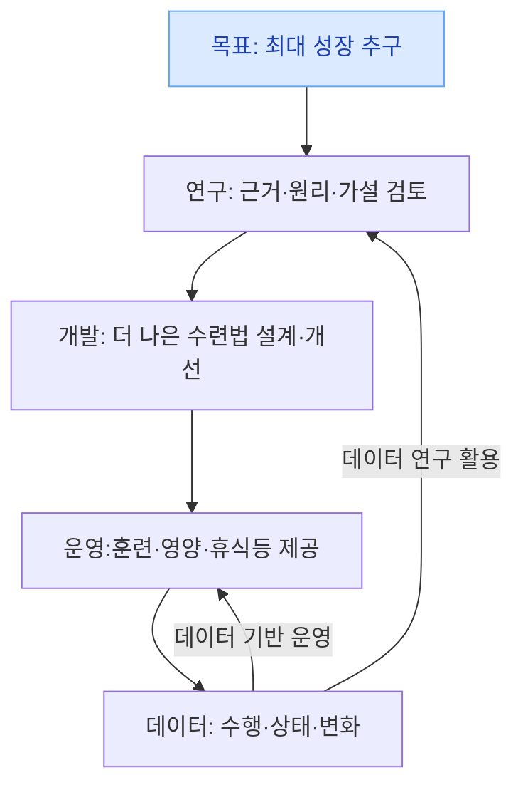
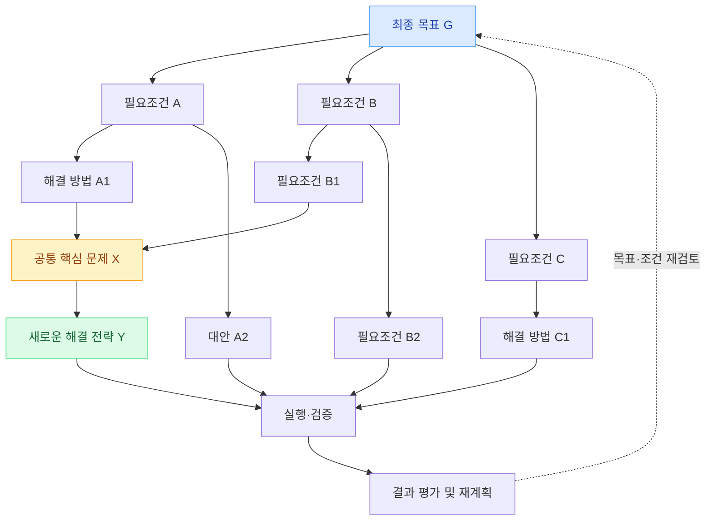
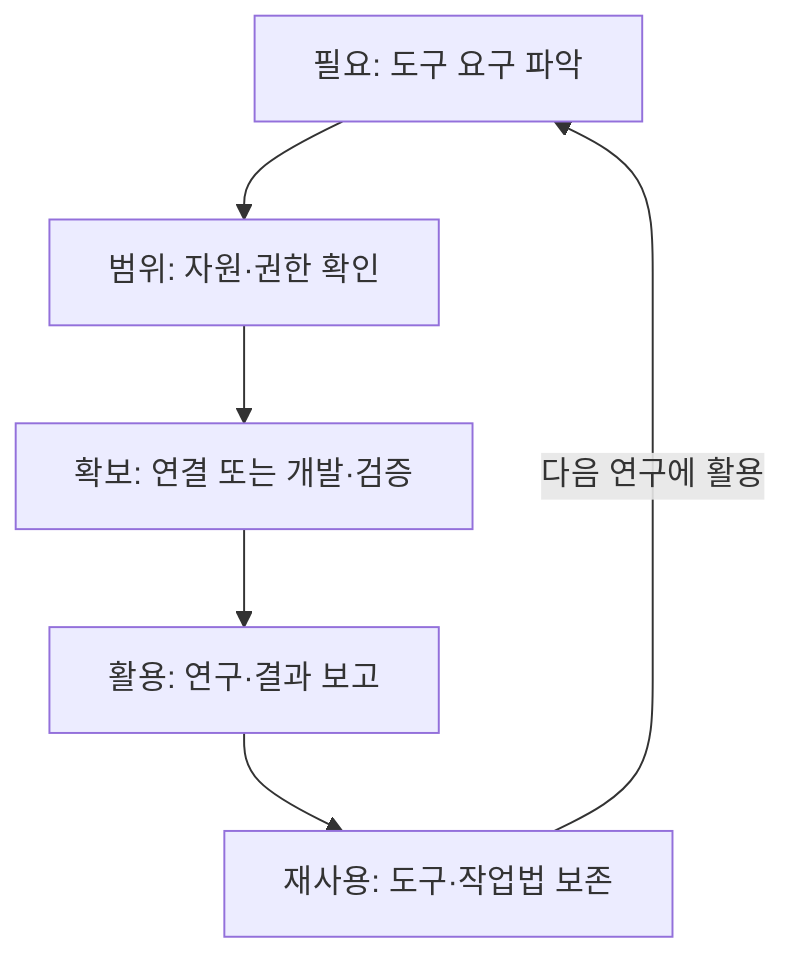
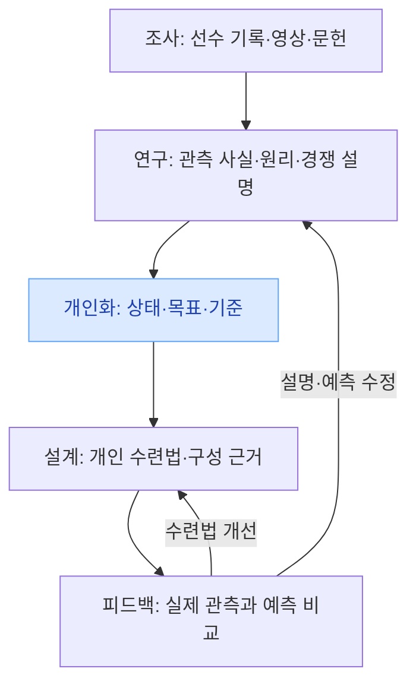
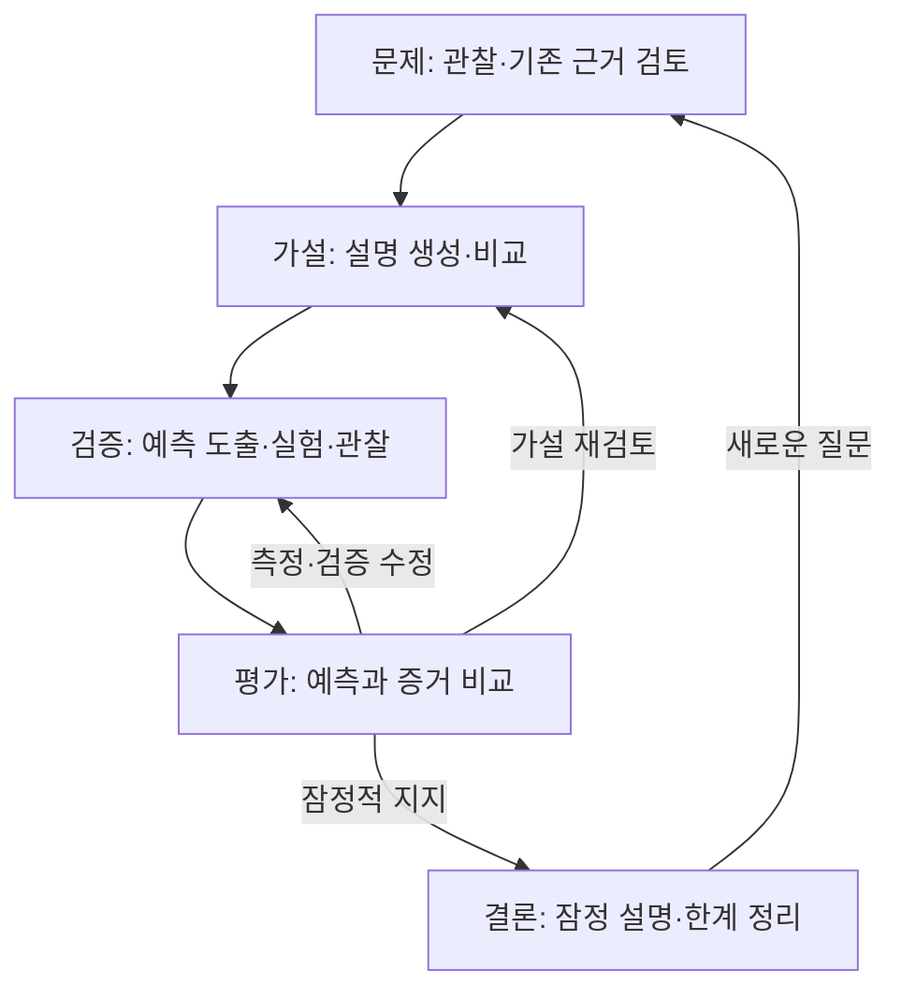
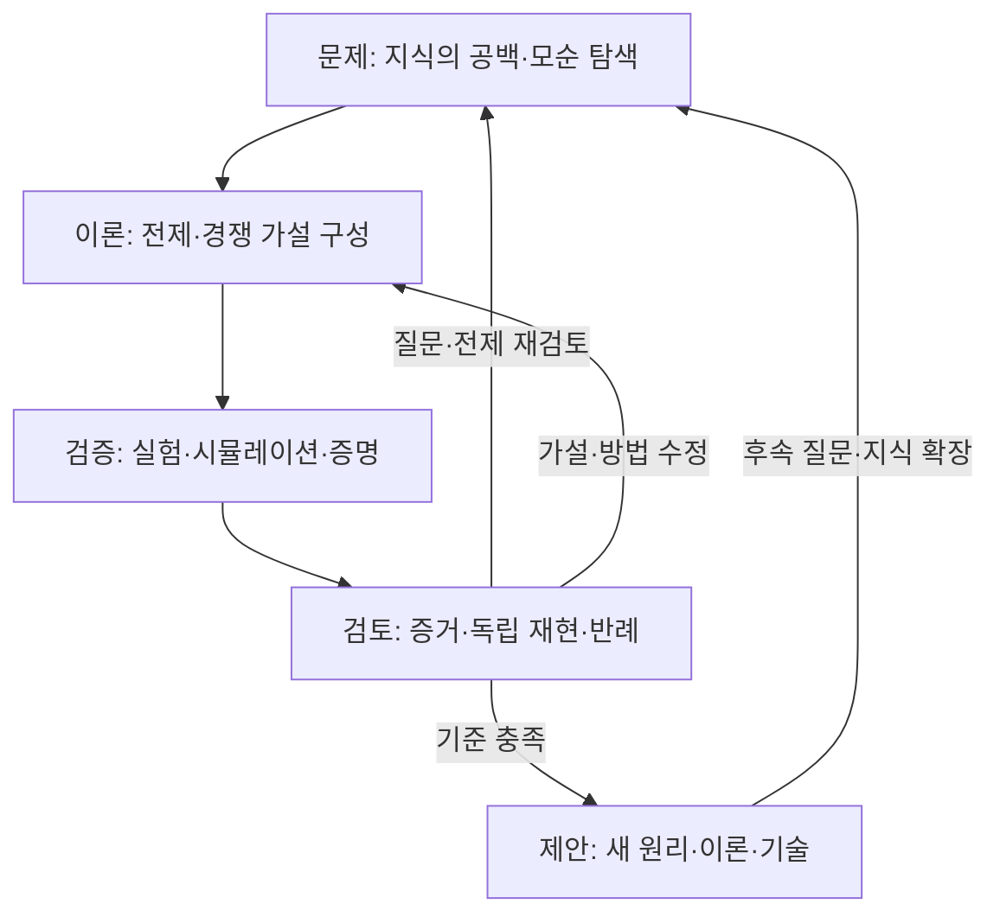
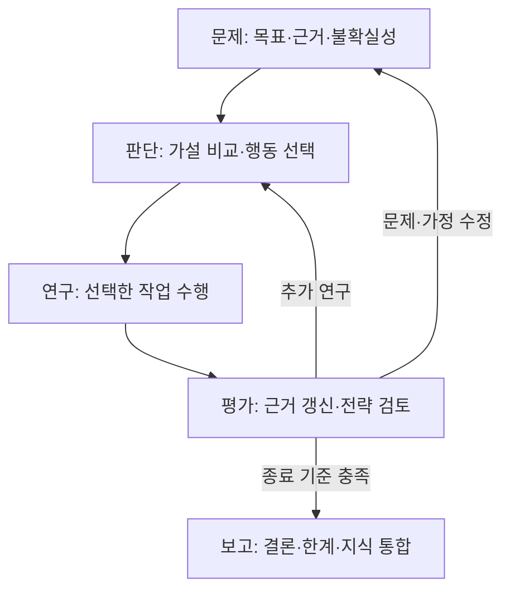
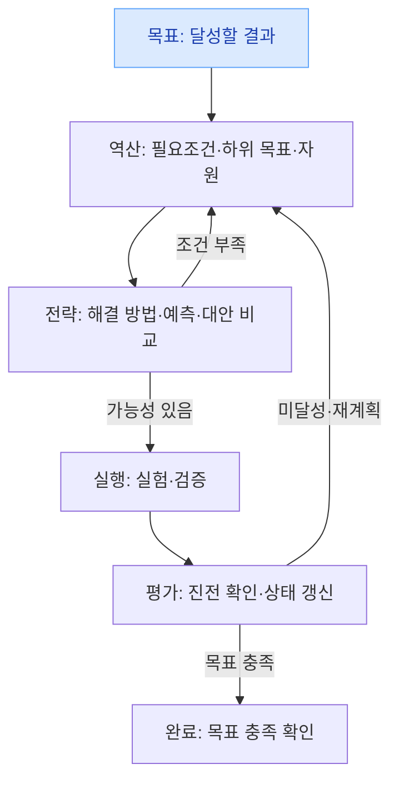
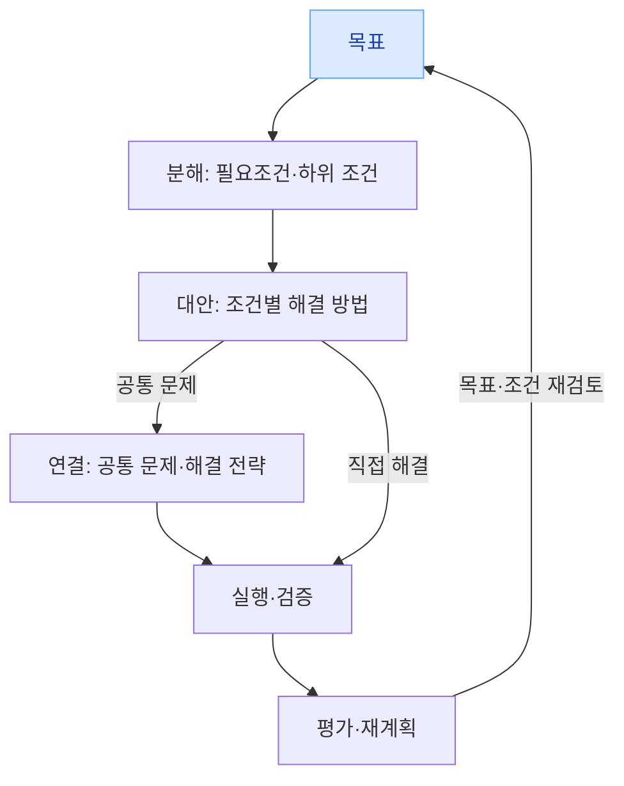
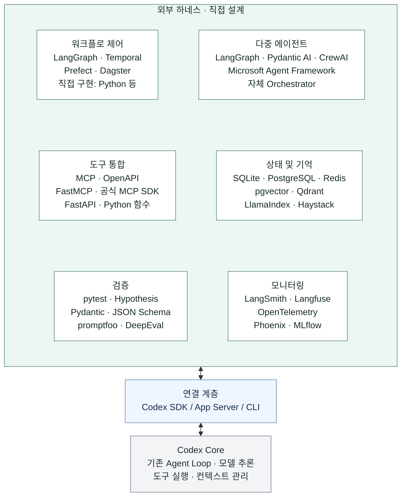

# 수련 연구 에이전트 요구사항

**과학에 기반해 더 뛰어난 수련 방법을 연구하고, 실제 데이터로 개선하며 최대 성장을 추구하는 AI를 만든다.**

버전 **0.30** · 2026-11-12 (Asia/Seoul) · [프로젝트 안내](../README.md)

이 문서는 전체 시스템을 이해하고, 궁금한 점을 질문하고, 다음 아이디어를 함께 발전시키기 위한 기준이다.
먼저 큰 그림과 핵심 설명을 읽고, 필요한 곳에서 **상세 내용 펼치기**를 열면 된다.
펼친 내용도 요구사항의 일부이며, 개발 에이전트는 관련 세부 조건까지 함께 읽는다.

**현재 단계:** 기술 구현 방향을 정하고 시스템 운영 구조·모듈 경계를 설계 중이다.
**확정한 요구**, **설계 참고·후보**, **미정 사항**, **실제 검증 결과**를 구분해서 읽는다.
구조나 도구를 정한 것과 실제로 구현·검증한 것은 별개다.

## 큰 철학: 과학에 기반한 최대 성장

**항상 과학에 기반해 연구하고, 더 나은 수련법을 개발하며, 훈련에서 얻은 데이터와
피드백으로 나의 최대 성장을 추구한다.** 실제 성장과 한계는 관측으로 평가하고,
그 결과를 다음 연구·개발·훈련과 목표에 반영한다.

## 시스템이 하는 일 한눈에 보기

| 하는 일 | 내가 이해할 핵심 | 자세히 보기 |
| --- | --- | --- |
| 연구 | 목표에 필요한 조건을 찾고, 자료·원리·가설을 연결해 무엇을 더 알아낼지 판단한다. | [연구 방식](#3-연구개발할-범위) · [연구 그래프](#연구-워크플로) |
| 역설계·개발 | 선수의 수행과 기존 방법이 작동하는 이유를 연구하고, 내 조건에 맞는 더 나은 방법을 설계한다. | [과학적 역설계](#선수의-퍼포먼스훈련을-과학적으로-역설계) |
| 수련 운영 | 훈련·영양·휴식과 실제 수행 기록을 연결하고, 다음 수련과 연구를 조정한다. | [하루의 사용 모습](#6-하루의-수련과-관측) |
| 개인 이해·기억 | 내 상태와 변화, 연구 근거와 합의를 기억해 다음 판단과 중단 후 재개에 활용한다. | [개인 모델](#5-개인-이해모델과-설명) · [기억과 자료](#6-하루의-수련과-관측) |
| 도구 활용 | 필요한 검색·분석·계산 도구를 선택하고, 합의한 범위에서 연결하거나 개발한다. | [도구 확보](#도구-활용과-연구-우선순위) |
| 재귀개선 | 연구에서 드러난 문제를 바탕으로 하네스 개선을 제안하고, 함께 검토한다. | [하네스 개선](#하네스-개선-제안과-재귀개선) |

### 용어를 쉽게 읽기

| 용어 | 이 문서에서의 뜻 |
| --- | --- |
| 역설계 | 목표나 관측한 결과에서 필요한 조건·해결 방법·가능한 작동 원리를 거슬러 탐구하는 것 |
| 개인 모델 | 내 몸·숙련·환경과 수행 결과의 관계를 설명하고 예측하기 위한 모델 |
| 하네스 | 모델이 도구·문맥·작업 상태를 활용하며 일을 수행하도록 연결하고 관리하는 실행 기반 |
| 문맥·기억 | 문맥은 지금 판단에 제공하는 정보, 기억은 나중에 다시 찾아 쓸 수 있도록 보존하는 정보 |
| 재귀개선 | 연구 경험을 다음 하네스 개선에 활용하는 과정. 현재 요구의 중심은 개선 제안과 공동 검토 |

## 궁금한 내용 찾아가기

- **무엇을 목표로 하나?** [목적](#1-아이디어와-목적) · [현재 목표와 범위](#2-현재-목표와-수련-범위)
- **어떻게 연구하고 함께 결정하나?** [연구](#3-연구개발할-범위) · [공동 결정](#4-함께-결정하고-자율성을-발전시키는-방식)
- **실제로 어떻게 사용하나?** [개인 모델](#5-개인-이해모델과-설명) · [수련과 기록](#6-하루의-수련과-관측) · [첫 버전](#9-첫-버전의-필수-범위)
- **어떤 조건을 지키나?** [개인 적용](#7-개인-적용에-관한-의향과-남은-조건) · [비용·구독·모바일](#8-비용사용량재개)
- **무엇을 더 정해야 하나?** [미정 사항과 논의 질문](#11-다음으로-구체화할-항목)
- **기술 구성이 궁금하다면?** [운영 기능](#10-구현을-위한-기술-참고-요구와-이전-선택) · [사용 구조](#사용-구조) · [하네스 구성도](#하네스-구성도) · [기술 후보](#영역별-도구프레임워크-후보) · [Codex 연결](#codex-연결과-선택-범위)
- **문서를 관리·편집하려면?** [문서 기준](#12-새-출발과-문서-기준) · [그래프 편집](#그래프-편집) · [변경 이력](#변경-이력)

## 1. 아이디어와 목적

실제 수련과 과학적 연구를 연결해 계속 강해지고 한계에 도전하도록 돕는다.
기존 수련 방법의 분석·개선과 새로운 방법의 개발을 함께 다룬다.

목표의 배경과 표현 펼치기

사용자가 실제로 수련하며 계속 강해지고 한계에 도전하도록 돕는 AI다.
미래 배경 선협 소설의 AI처럼, 이 세계의 과학 법칙 안에서 기존 방식을
분석하고 더 뛰어난 수련 방법을 찾아 실제 성장으로 연결하길 원한다.

사용자는 “초인 연구소에서 초인을 만든다고 생각하고 데이터 보면서 계속
수련시키면 돼”라고 설명했다. 이는 개인을 장기적으로 연구하고 수련을
발전시키려는 의도이며, 특정 초인 능력의 실현 가능성이 입증되었다는 뜻은 아니다.

- “10배 이상”은 확정된 배수 조건이 아니다. 다른 방식과 큰 성장 격차를
  만들 만큼 뛰어난 방법을 바라는 표현이다.
- “동료”는 현재 사용자와 시스템을 설계하는 대화 상대를 가리킨 설명이다.
  완성할 AI의 역할은 아래 요구사항으로 정의한다.
- 과학적 세계관은 실제 물리법칙 같은 원리 안에서 연구·개발한다는 뜻이다.
  알려진 방법의 조사·조합·개선과 원리에 기반한 새로운 방법 개발을 포함한다.

## 2. 현재 목표와 수련 범위

**현재 출발점은 베테르비에프의 체격·힘·기술·움직임·지속 능력이다.**
신체 능력과 무공을 함께 연구하며, 더 나은 발전 방향을 찾으면 목표를 함께 갱신한다.
구체적인 수치 목표와 기간은 조사와 개인 상태를 바탕으로 정한다.

목표·신체·무공의 상세 범위 펼치기

### 현재 목표

에이전트가 현재 추구할 목표는 베테르비에프의 체격·힘·기술·움직임·
지속 능력 등을 사용자가 갖추도록 돕는 것이다.

연구에서 더 뛰어난 수행과 장기 발전에 유리한 방향을 찾으면 사용자는
그 방향으로 넘어가길 원한다. 베테르비에프와 닮은 외형·체격은 고정 제약이
아니다. 목표 갱신은 함께 방향을 정하는 원칙에 따라 논의한다.
**구체적인 달성 지표·기준값·기간은 미정이다.**

능력 사이에 이득·손실이 생기는 선택은 상황마다 근거와 영향을 설명받고
사용자와 함께 정한다. 고정된 능력 우선순위·가중치·점수로 대신 결정하지 않는다.

### 신체와 무공

- **신체:** 힘·속도·지구력·회복과 근골·신경·대사 등 구조와 작동의 발전.
- **무공:** 복싱·MMA의 동작·기술·거리·타이밍·상대를 읽는 능력·상황 판단·
  기술을 연결해 쓰는 능력과 숙련.
- 펀치 위력 증가와 불필요한 예비동작 감소는 신체와 기술이 결합해
  만들어내는 수행의 예시다. 이 예시들을 발전 목표의 전체 목록으로 제한하지 않는다.
- 신체와 무공을 연결해 발전시킨다. 몸의 능력과 기술의 요구를 함께 연구한다.
- 새로운 동작·기술 체계의 창안을 필수로 포함할지는 나중에 정한다.

사용자는 과학과 생체전기 제어가 발전하면 ‘기’에 해당하는 능력도 가능할 수
있다는 생각을 제시했다. 장기 탐구 아이디어이며 별도의 기 운용은 현재 범위에서
제외한다. 기와 생체전기의 동일성이나 미래 실현 가능성을 과학적 사실로 확정하지
않는다. 실제 신경·근육의 전기생리 현상을 신체 연구에서 제외한다는 뜻은 아니다.

## 3. 연구·개발할 범위

**목표에서 필요한 조건을 찾고, 중요한 문제를 깊게 연구하며, 실행 결과로 설명과 전략을 고친다.**
여러 분야의 자료와 개인 데이터를 연결하되, 다음 작업은 근거와 상황에 따라 선택한다.

### 연구 워크플로

#### 역설계 기반 연구 워크플로

직접 관측한 사실, 근거로 추론한 설명, 새로 설계한 방법을 구분한다.
선수의 퍼포먼스·훈련뿐 아니라 기존 연구 방법·도구·시스템에도 적용할 수 있다.

### 지능적인 연구

사용자는 뛰어난 인간 연구자처럼 연구하길 원하며, 다음 설명을 지능적인 연구의
요구로 합의했다. 목표를 이루기 위해 무엇을 알아내야 하는지 판단하고, 설명을
만들고 시험하며, 근거에 따라 다음 행동을 바꾸는 능력이다.

- 목표·개인 상태·환경과 현재 지식을 연결해 전체를 이해하고, **아는 것과 모르는 것을 파악한다.**
- 중요한 문제와 발전을 제한할 수 있는 요인을 찾아 **질문을 구체화한다.** 처음 질문이 잘못됐을 가능성도 검토한다.
- 관측을 나열하는 데서 나아가 원인과 작동 원리를 설명하되, **관찰 사실과 가능한 설명을 구분한다.**
- 처음 설명에 고착하지 않고 **경쟁하는 설명·대안·반례를 검토한다.**
- 어떤 결과가 설명이나 선택을 바꿀 수 있는지 따져 **다음 조사·비교·계산·관측 제안을 선택한다.**
- 원리에 따라 수련 방법을 개선하거나 새 후보를 만들고, **예상 이득·적용 조건·실패 가능성을 설명한다.**
- 예측과 관측이 다르면 측정·수행 조건·개인차·설명 자체를 검토하고, 설명·모델·수련을 **수정하거나 유지할 이유를 밝힌다.**
- 추가 연구의 가치, 자료 부족, 보류 필요성과 자원을 판단하고, 필요하면 **도구와 연구 방법도 개선한다.**

**이는 고정된 단계·가설 개수·질문 점수·필수 도구 호출 순서를 요구하는 것이 아니다.**
문헌 수·서브에이전트 수·계산 복잡도만으로 연구의 지능이나 품질을 판단하지 않는다.
좋은 질문의 선택과 근거에 따른 설명·행동의 발전을 평가한다. 매번 새 발견이나
능력 향상을 보장하는 조건은 아니며, 모르는 것은 미확인으로 남긴다.
연구 방향을 함께 정하고, 합의한 범위에서 스스로 수행·보고하는 원칙은 유지한다.

연구·개발 대상의 상세 범위 펼치기

| 범위 | 최신 답변에서 확인한 요구 |
| --- | --- |
| 기존 방법 분석·개선 | 기본적으로 수행한다. 운동·기술 훈련·회복 등 기존 방식을 분석하고 개선한다. |
| 더 뛰어난 수련법 개발 | 기본적으로 수행한다. 과학 원리를 연구해 더 뛰어난 방법을 만든다. |
| 장비·환경·측정 방법 | 비용 여건이 생기면 차근차근 실현한다. |
| 새로운 신체 변화·능력의 가능성 | 기본 역할과 별도로 수행해야 할 연구에 포함한다. |

### 도구 활용과 연구 우선순위

필요한 도구를 선택하고, 합의한 자원·권한 안에서 연결·개발·검증해 재사용한다.

도구 확보 그래프와 세부 조건 펼치기

연구에 필요한 도구가 없으면, 정한 자원·권한 안에서 기존 도구를 찾아 연결하고
계산·분석 코드를 개발·검증한다. 유용한 작업법은 재사용하며 무엇을 했는지
결과를 보고한다. 추가 비용이나 새로운 권한이 필요한 일은 함께 결정한다.
사용자는 이 역할을 이번 요구사항 구체화에서도 유지하기로 했다.

#### 필요한 도구의 확보·개발·재사용

사용자는 도구 자동 선택을 명시적인 기능 요구로 추가했다. AI가 현재 연구 목적과
필요한 작업에 맞는 도구를 선택해 활용해야 한다. 도구 선택·실행은 합의한 자원과
권한 범위 안에서 이루어지며, 자동 선택을 새 비용·권한의 자동 승인으로 해석하지 않는다.
구체적인 도구 탐색·선택·실행 방식은 후속 설계에서 비교한다.

현재 성장 문제 해결과 장기적인 돌파 연구 중 어느 쪽을 우선할지는
고정하지 않는다. 상황에 따라 함께 정한다.

### 깊이 있고 연쇄적으로 이어지는 연구 루프

발견과 실패에서 후속 질문을 만들고, 관련 자료를 폭넓고 깊게 검토하며 사용자와 함께 연구한다.

연구의 깊이·자료 검토·공동 연구 조건 펼치기

- 처음 떠오른 설명이나 짧은 요약에 머물지 않고, **기전·전제·대안 설명·반례·불확실성**과
  결과의 함의를 깊이 검토한다. 보고에는 판단 근거와 중요한 검토 결과를 설명한다.
- 발견과 실패에서 **다음 질문을 스스로 만들어 연쇄적으로 조사한다.** 원인·적용 조건·
  예외·새 가능성으로 이어지는 질문을 발전시키며, 합의 범위 안의 후속 조사를 계속한다.
- 관련 문헌·원자료·영상·방법 자료를 **폭넓고 충분히 검토**하고, 중요한 자료는 내용을
  깊이 확인한다. 인용 관계와 관련 연구를 따라가며 지지 근거와 상충하는 결과도 살핀다.
  검색 결과나 인용 목록만 확보한 것을 원문 검토로 취급하지 않는다.
- 연구에서 얻은 결과는 다음 질문뿐 아니라 전체 설명·공법 후보·개인 모델·수련 제안에
  연결한다. 의미 있는 결과와 그로부터 달라진 판단을 사용자에게 보고한다.

#### 연구의 깊이와 자원 범위

연구의 양과 깊이를 모두 중시하되, 같은 일을 반복하거나 임의의 질문·문헌·에이전트
개수를 채우는 것을 목표로 삼지 않는다. 합의한 중심 문제와 자원 범위를 유지하며,
중심 문제나 큰 방향의 변경은 사용자와 논의한다. 기존 구독·사용량·중단 원칙은 유지한다.
구체적인 분담·호출·병렬 수·실행 시간은 후속 설계와 실제 환경에서 검토한다.

#### 사용자와의 공동 연구

사용자는 AI가 스스로 후속 연구 질문을 많이 만들면서, 사용자에게도 해석·
아이디어·방향을 적극적으로 물어 함께 연구하는 방식을 선택했다. 사용자에게
묻는 질문은 필요한 정보 수집과 결정 확인에 더해 공동 해석과 아이디어 탐색을
포함한다. 사용자가 바로 답하지 못할 때의 연구 지속 원칙은 유지한다.

#### 자료 검토의 폭과 신뢰성

사용자는 AI가 많은 정보를 다룰 수 있다는 장점을 적극적으로 활용해 연구에서
참고하는 자료의 폭과 양을 충분히 확보하길 원한다. 소수 자료만 보고 일찍 결론을
내리는 방식에 머무르지 않고, 관련 분야·원자료·상충 근거까지 조사해 서로 연결하고
비교해야 한다. 검색으로 발견한 자료, 선별한 자료, 내용을 실제로 검토한 자료를
구분한다. 많은 자료를 검토했다는 사실과 근거의 독립성·신뢰성은 별도로 판단한다.
고정 인용 수를 채우는 것으로 이 요구를 대신하지 않으며 기존 구독·자원 범위는 유지한다.

### 하네스 개선 제안과 재귀개선

연구 지침·도구·기억·실행 코드 등에서 개선할 점을 찾고, 근거와 예상 효과를 담아 제안한다. 실제 반영할 변경은 함께 검토한다.

개선 대상·반영·평가 조건 펼치기

사용자는 모델 가중치가 아닌 하네스를 개선 대상으로 삼으며, 실행 코드·플러그인
구조까지 포함해 개선 의견을 제시하는 기능을 원한다. 연구 과정과 결과를 바탕으로
어떤 부분을 바꾸거나 어떤 기능을 추가하면 좋을지 제안한다. 연구 지침·스킬·도구·
기억 관리·분업 방식 등 하네스가 제공하는 연구 지원 방식도 제안 대상으로 다룬다.

AI가 하네스를 스스로 수정·배포하는 기능은 필수 요구가 아니다. 현재 요구의 중심은
개선 필요를 발견하고 변경·추가 의견을 제시하는 것이다. 이를 실제 변경의 포괄적인
승인으로 해석하지 않으며, 반영할 제안은 사용자와 검토한다. 기존에 합의한 범위의
연구 도구 개발·검증 요구는 유지한다.

개선 제안에 관측한 문제·근거, 예상 효과, 불확실성, 비교·검증 방법을 연결하고,
실제 변경 후 결과가 확보되면 다음 제안에 활용하는 동작을 기능 설계에서 구체화한다.
이는 제안·검토·반영·평가가 이어지는 개선이며, 변경만으로 성능 향상을 확정하지 않는다.

### 선수의 퍼포먼스·훈련을 과학적으로 역설계

공개 기록·경기·훈련 영상과 문헌에서 수행의 원리를 연구하고, 사용자에게 맞는 훈련 설계로 연결한다. 관측·추론·새 설계를 구분한다.

역설계 그래프와 분석 원칙 펼치기

사용자는 목표의 구체화부터 AI가 맡길 원한다. 베테르비에프 등의 기록·경기·
훈련 영상을 가능한 한 자세히 분석해 신체와 무공, 퍼포먼스가 나오는 이유를
연구한다. 사용자가 미리 세부 능력이나 수치 목표를 준비할 필요는 없다.
구체적인 목표와 평가 기준은 조사 결과와 사용자 상태를 바탕으로 함께 정한다.

경기·훈련 영상과 관련 문헌은 AI가 필요한 자료를 스스로 찾아 분석하는 것이
기본이다. 사용자는 유튜브·인스타그램 등에 공개 자료가 많으므로 구매가
필요하지 않을 것으로 생각한다. 공개 자료를 우선 활용하고, 사용자가 건넨
자료도 함께 분석한다. 모든 자료에 실제로 접근하거나 내용을 확인할 수
있다는 보장은 아니며, 확인하지 못한 내용은 확인한 근거로 취급하지 않는다.

- 실제 수행이 어떤 신체 능력·동작·협응·감각·판단으로 가능한지 설명하고 원인을 탐구한다.
- 훈련 영상에서 어떤 능력·감각을 훈련하는지, 왜 그 훈련을 하는지 과학적으로 분석한다.
- 역학·신경·운동학습 등 필요한 원리를 연결한다. 이 분야 예시로 연구 범위를 제한하지 않는다.
- 원리와 근거에서 훈련의 구성·세트·반복·빈도 등의 이유와 적합한 설계를 도출한다.
- 사용자의 몸·숙련·환경에 맞춰 적용 가능한 방법을 제안하고, 더 뛰어난 방법도 찾는다.
- 실제 관측을 받아 설명·방법·예측을 검토하고 발전시킨다.

영상에서 확인한 동작·실제 훈련량, 근거를 바탕으로 추정한 기전·훈련 의도,
원리와 모델로 새로 설계한 개인 훈련량을 구분한다. 선수 내부 상태나 영상에
없는 세트·빈도를 확인된 사실로 채우지 않는다. 퍼포먼스의 인과 설명은
가설·대안·근거·검증 범위를 드러내며, 관측만으로 확정했다고 표현하지 않는다.
이 구분은 ‘항상 과학적으로’라는 요구를 충족하기 위한 해석·검증 원칙이다.

#### 과학적 역설계의 피드백 흐름

### 연구 추론 워크플로 (설계 참고)

과학적 추론·프론티어 연구·지능적 연구를 바라보는 세 가지 참고 관점이다.

참고 그래프 3개와 관계 설명 펼치기

이 절의 그래프는 연구 추론의 설계 참고 자료다.
큰그림과 같은 수준으로 핵심 단계와 피드백 경로를 간략히 표시했다.
각 단계는 관련 세부 작업을 묶은 것이며, 판단 기준과 연구 원칙은 본문을 함께 읽는다.
앞서 합의한 적응적 연구 원칙에 따라 모든 연구에 동일한 단계나 도구 호출 순서를
강제하지 않으며, 세 관점의 관계가 특정 통합 아키텍처의 확정을 뜻하지는 않는다.

**그래프 바로가기:** [과학적 추론](#1-연구자의-과학적-추론-과정-scientific-reasoning) · [프론티어 연구](#2-프론티어-연구-추론-과정-frontier-research) · [지능적 연구](#3-지능적-연구-과정-intelligent-research) · [세 워크플로의 관계](#4-세-워크플로의-관계)

#### 1. 연구자의 과학적 추론 과정 (Scientific Reasoning)

**추론 유형:** 귀추(설명 가설 생성) → 연역(관측 예측 도출) → 귀납·통계적 추론(증거 평가) → 비판적 추론(대안·반례 검토). 예측 일치는 가설의 **확증**이 아니라 잠정적 지지다.

#### 2. 프론티어 연구 추론 과정 (Frontier Research)

검증에서는 이론의 논리적·수학적 함의를 도출하고 경쟁 가설을 구별할 방법을 설계한다.

**핵심 루프:** (a) 질문 자체의 재정의, (b) 이론·기본 전제의 재구성, (c) 검증 도구·방법의 혁신. 수학 연구에서는 실험보다 **정의·보조정리·증명·반례·독립 검토**가 검증의 중심일 수 있다.

#### 3. 지능적 연구 과정 (Intelligent Research)

**핵심 루프:** 현재 지식 상태 파악 → 가능한 행동 생성 → 기대 정보가치와 자원 제약 비교 → 행동 실행 → 증거 갱신 → 추론·전략 자체 평가. 반드시 실제 수치로 정보가치를 산정할 필요는 없으며, 정성적 비교도 가능하다.

문헌·데이터 조사, 수학적 추론·모델링, 실험·시뮬레이션 중 필요한 작업을 선택한다.
행동은 기대 정보가치·비용·위험을 비교해 선택하며, 새 증거로 가설의 신뢰도를 갱신한다.
평가에는 추론의 오류·편향과 전략의 적절성, 연구를 계속할지 끝낼지에 대한 판단을 포함한다.

#### 4. 세 워크플로의 관계

| 관점 | 역할 |
| --- | --- |
| **과학적 추론** | 가설을 만들고 예측·증거로 평가하는 기본적인 인식론적 루프. |
| **프론티어 연구** | 기존 지식의 경계에서 문제 정의와 기본 전제까지 바꾸는 탐색 루프. |
| **지능적 연구** | 어느 조사·추론·검증을 다음에 수행할지 선택하고, 전략 자체를 갱신하는 상위 의사결정 루프. |

즉, 지능적 연구 루프가 연구 행동을 선택하고, 선택한 행동에 과학적 추론이 사용되며, 프론티어 문제에서는 문제와 전제의 재구성까지 수행한다. 세 구조는 대체 관계가 아니라 **중첩 가능한 관점**이다.

### 목표 지향 추론 워크플로 (첨부 자료)

목표에서 필요조건과 대안을 도출하고 검증 결과로 재계획하는 참고 그래프다.

첨부 자료의 그래프 2개 펼치기

목표에서 필요한 조건과 해결 방법을 도출하고, 실행 결과로 다시 검토하는 두 그래프다.
첨부한 그래프를 바탕으로 필요조건·대안·검증·재계획의 핵심 흐름을 간략화했다.

#### 목표 달성의 역방향 추론과 검증

전략은 예상 효과·비용·위험·불확실성을 비교해 선택한다. 필요조건이나 예측이 부족하면
실행 전에 다시 검토하고, 실행 후에는 실제 진전과 목표 충족 여부를 구분한다.

#### 목표·필요조건·대안의 연결

## 4. 함께 결정하고 자율성을 발전시키는 방식

- 초기에는 방향과 접근 방법을 함께 정한다.
- 합의한 범위 안의 검색·자료 읽기·계산은 AI가 스스로 수행하고 결과를 알린다.
- 사용자는 결과를 보고 수정·이의·다른 방향을 제안할 수 있다.
- 사용자가 바로 답하지 못해도 합의한 범위 안의 추가 확인·계산·반례 조사는
  계속해도 된다. 이는 새 방향이나 실제 수련 적용까지 포괄적으로 승인한 것은 아니다.
- AI도 “이런 종류의 일은 앞으로 맡아도 되는가”라고 위임 확대를 제안할 수 있다.
  사용자가 동의하면 이후 작업에 반영한다.
- 함께 정한 이유·선호·위임 범위를 기억하고 이후 행동에 반영해야 한다.
  모델 가중치 학습을 필수로 요구하는 것이 아니다.
- 의미 있는 결과가 나왔을 때, 관련된 작은 발견까지 함께 알려준다.

구체적인 위임 분류·회수·변경 방식과 중요한 결과의 판단 사례는 추가로 구체화한다.

## 5. 개인 이해·모델과 설명

사용자는 다음 네 가지를 모두 원한다.

1. 기록과 영상에서 강점·약점·성장·정체의 원인을 분석한다.
2. 여러 수련 방법의 개인별 차이를 근거와 모델로 예측·비교한다.
3. 예측과 실제 결과가 다르면 원인을 조사하고 설명과 모델을 고친다.
4. 장기적으로 근골·신경·대사·회복 등의 연결을 다루는 전신 개인 모델로 발전시킨다.

공법의 원리·근거·예측은 기본적으로 설명해야 한다.
설명과 예측의 깊이·정확도를 실제 자료와 모델의 검증 범위에 맞춰 드러낸다.
이는 정확한 전신 예측이나 인과관계의 확정을 이미 달성했다는 뜻이 아니다.

## 6. 하루의 수련과 관측

**사용 모습: 환경·상태 파악 → 수련안 검토 → 수행·기록 → 다음 수련과 연구에 반영.**

- 필요한 초기 상태를 파악하면 현재 근거로 잠정 수련안을 제안한다.
- “기록하자”고 말하면 필요한 질문을 묶어서 받고, 자유롭게 말한 기록도 활용한다.
- 평소에는 짧은 기록을 받고, 판단에 도움이 클 때 영상·추가 측정을 요청한다.
- 연구·수련 자료와 합의를 보존하고, 중단이나 세션 변경 후에도 찾아 활용한다.
- 기록이 없다고 먼저 상태 확인 연락을 하지는 않는다. 새 외부 서비스에 개인 자료를 보낼 때는 함께 결정한다.

수련·기록·자료 보존·개인정보 조건 펼치기

### 연구가 진행 중일 때의 첫 수련안

사용자는 필요한 초기 상태를 파악한 뒤, 현재 근거로 잠정 수련안을 제안받고
연구·관측 결과에 따라 개선하는 방식을 선택했다. 새로운 공법 연구나 개인
모델이 완성될 때까지 첫 수련안 제안을 기다릴 필요는 없다.
잠정안은 현재 파악한 상태·환경과 근거를 반영하며, 아직 모르는 점과 이후
검토할 사항을 구분한다. 이 선택은 특정 수련법이나 개인 실험의 실행 승인이 아니다.

사용자가 동의한 사용 모습:

1. 고정 일정과 수련 환경을 함께 파악한다.
2. 수련 전 그날의 시간·몸 상태를 반영해 구체적인 수련안을 제안한다.
3. 사용자가 수행 결과·상태·변동 사항을 알려준다.
4. 다음 수련과 연구에 반영한다.

#### 기록 공백과 연구 지속

사용자가 며칠간 수련 기록·몸 상태를 보내지 않아도 먼저 상태 확인을 위해
연락하지 않는다. 사용자가 다시 말을 걸 때 확인한다. 기록 공백을 수련하지
않았다는 사실로 채우지 않는다. 합의한 범위의 연구 지속과 의미 있는 연구
결과 보고는 기존 원칙대로 유지한다.

#### 실시간 피드백의 포함 여부

수련 중 실시간 영상 관찰·즉시 피드백을 첫 버전에 필수로 포함할지는 미정이다.
사용자는 가능 범위·비용·제약을 비교한 뒤 결정하길 원했다.
영상·기록 사후 분석과 실시간 관찰의 요구를 구분해 검토한다.

### 기록 입력 방식

기본은 사용자가 “기록하자”고 하면 AI가 필요한 질문을 묶어서 제시하고,
답변을 수련 기록으로 연결하는 방식이다. 그날의 계획과 이미 알려준 내용을
활용해 필요한 항목을 묻고, 자유롭게 말한 수행·상태 정보도 활용한다.
이미 알려준 내용을 반복해서 묻지 않으며 중요한 모호함은 확인한다.
계획·예시·추정과 실제 수행을 구분하고, 답하지 않은 항목을 임의로 채우지 않는다.

목표는 주어진 환경에서 최대한 좋은 성장 효과를 내는 것이다.
최대한 수련 중심으로 생활하되, 학교·군대처럼 바꿀 수 없는 일정은 지킨다.

### 사용자 설명에 따른 환경

- 현재 헬스장과 복싱장을 이용할 수 있다.
- 복싱장 지도는 사용자 설명상 미트 중심이며, 선수 영상으로 독학한 비중이 크다.
  이 설명을 지도자의 객관적 자격·능력 평가로 확대하지 않는다.
- 군대에서는 주로 헬스장을 이용하고 휴가 때 복싱장에 갈 것으로 예상한다.
  군대 시설·촬영·기록 가능 여부는 실제로 확인한 사실이 아니다.

### 제공 가능한 자료

사용자는 동작 영상, 운동 종목·중량·횟수, 체중·몸 상태, 수면·피로·통증
기록 등을 제공할 수 있을 것 같다고 답했고, 필요한 자료를 질문하길 원했다.
AI는 필요한 자료와 수집 이유를 구체적으로 요청한다.

이는 제공 의향·예상 여건의 확인이다. 실제 자료를 이미 수집했다거나
모든 기록을 매일 제공하기로 했다는 뜻은 아니다.

평소에는 짧은 수행·상태 기록을 중심으로 받는다. 영상과 추가 측정은
판단에 도움이 클 때 요청한다. 일상 기록의 부담과 추가 자료의 판단 가치를
함께 고려하며, 세부 항목·빈도·시간은 필요한 장면에서 구체화한다.

#### 자료 보존과 장기 기억

사용자는 연구 근거·계산·실패·결정과 원본 영상·수련·몸 상태 자료를 우선
모두 보존하고, 공간이 부족해지면 중요한 자료를 선별해 남기길 원한다.
선별 기준, 정리·삭제의 결정 권한과 자료 정정 방식은 추가로 정한다.
현재 저장 용량이나 실제 보존 기능이 검증됐다는 뜻은 아니다.

사용자는 에이전트의 장기 기억을 명시적인 기능 요구로 추가했다. 단순히 자료를
보관하는 데 그치지 않고, 이전 연구·개인 관측·합의와 수정 내용을 필요한 때 찾아
이후 판단에 활용하고, 작업 중단이나 세션 변경 후에도 이어갈 수 있어야 한다.
기억의 저장 위치·검색·문맥 제공·갱신 방식은 후속 설계에서 결정한다.

### 개인 자료의 외부 제공

공개된 선수 자료는 AI가 스스로 조사한다. 사용자의 원본 영상·몸 상태·측정값을
현재 사용하는 AI 이외의 새로운 외부 분석 서비스에 제공할 때는, 보낼 자료·
목적·서비스를 설명한 뒤 함께 결정한다. 사용자는 이 원칙에 동의했다.

## 7. 개인 적용에 관한 의향과 남은 조건

시뮬레이션을 참고하고 실제 관측으로 방법을 발전시키길 원한다.
시뮬레이션의 예측과 실제로 확인한 효과는 구분하며, 구체적인 개인 실험의 범위·평가·중단 조건은 아직 정하지 않았다.

개인 적용 의향과 과학적 판단 원칙 펼치기

### 사용자가 밝힌 의향

- 시뮬레이션을 중요한 판단 근거로 신뢰하고, 자신에게 실제로 적용해
  실험·관측하면서 발전시키길 원한다.
- 피해야 할 결과를 “영구적인 손상”이라고 설명했다.
- 일상은 최대한 수련 중심으로 조정하되 외부의 고정 일정은 바꿀 수 없다.

### 과학적 판단에서 구분할 사항

시뮬레이션은 가정과 검증 범위 안의 예측이다. 실제 효과·안전의 입증과
구분한다. 개인에게 일정 기간 문제가 관찰되지 않았다는 결과는 그 조건과
관찰 기간에서 문제가 확인되지 않았다는 뜻이며, 장기 안전의 확증은 아니다.
이 구분은 대화에서 AI가 설명한 과학적 원칙이다.

구체적인 실험·개입의 허용 범위, 감수할 위험 수준, 불확실한 위험의 처리,
평가·중단·추적 관찰 조건은 아직 합의하지 않았다.
위험 선호에 대한 답변을 모든 개인 실험의 실행 승인으로 확대하지 않는다.
현재 새 개인 실험이나 수련 프로그램을 실행하기로 정한 것은 아니다.

## 8. 비용·사용량·재개

- **기존 Codex 구독 사용량으로 시작한다.** 기본 연구 실행을 별도 유료 모델 API로 대체하지 않는다.
- 추가 비용은 함께 결정한다. 사용량이 부족하면 결과와 다음 작업을 보존해 멈추고, 회복 후 사용자 지시로 재개한다.
- 모바일 사용을 지원해야 하며, ChatGPT 공식 앱을 우선 검토한다. PC가 꺼져 있어도 실행되길 바라지만 구체적 환경·비용은 미정이다.
- 기술 구현 방향은 **외부 하네스 ↔ Codex SDK / App Server / CLI ↔ Codex Core**, 운영 구조는 **Router–Worker**다. 연결 방식과 실제 동작은 검증해야 한다.

구독·모바일·하네스·운영 구조의 상세 조건 펼치기

사용자가 이번 대화에서 재확인한 조건:

- **기존 구독 안에서 시작한다.**
- **추가 유료 서비스·장비는 함께 결정한다.**
- **사용량이 부족하면 결과와 다음 할 일을 정리해 멈춘다.**
- **회복 후에는 사용자의 재개 지시를 기다린다.**

### 구독 사용량으로 실행

사용자는 에이전트가 기존 Codex 구독 사용량을 사용해야 한다고 명시했다.
**기본 연구 실행을 별도 유료 API 과금으로 대체하지 않는다.** 메인과 서브에이전트의
추론이 어느 계정·사용량 한도에 반영되는지 실제 인증·실행 경로에서 확인해야 한다.
구독 연동 후보가 다른 ChatGPT 사용량 체계를 사용한다면 Codex 사용량과의 관계를
확인하고 사용자에게 설명한 뒤 적합성을 판단한다. 추가 도구·서버 등의 비용은
기존 공동 결정 원칙을 따른다.

### 모바일 사용

사용자는 모바일에서도 에이전트를 사용할 수 있어야 한다고 명시했다.
또한 개인 PC가 꺼져 있어도 연구가 계속 돌아갈 수 있으면 좋겠다는 선호를 밝혔다.
이를 구현 후보 비교의 우선 고려 조건으로 삼되, 첫 버전의 필수 여부와 비용·운영의
절충은 아직 정하지 않았다. 서버 구매·임대나 추가 결제의 승인을 뜻하지 않는다.

**모바일 화면은 ChatGPT 공식 앱을 우선 사용한다.** 필요한 기능이 부족하면 별도
화면도 검토한다. 별도 화면을 기본 구현이나 필수 조건으로 정한 것은 아니다.
지원할 기기·플랫폼, 모바일에서 할 작업의 범위와 실제 연구가 실행되는 위치는
추가로 구체화한다. 모바일 접속 지원과 휴대폰 자체에서의 연구 실행은 구분한다.
PC 종료 중 실행에는 대신 사용할 실행 환경이 필요하며, 공식 Cloud나 별도 호스트 등의
지속 실행·도구·구독 연동·비용을 확인한다. 아래의 확정한 하네스 구조를 기준으로 검토한다.
사용량 부족 시 중단하고 사용자 지시로 재개하는 기존 원칙은 유지한다.

### 확정한 하네스 구조

2026-11-05 사용자는 첨부한 **외부 하네스 ↔ Codex SDK / App Server / CLI ↔ Codex Core**
구조를 확정하고, 이전 아키텍처를 지운 뒤 설계를 다시 진행하기로 했다.
사용 구조는 **인터페이스 ↔ 하네스 ↔ 모델**이다.
[하네스 구성도](#하네스-구성도)와 [사용 구조](#사용-구조)를 현재 아키텍처 설계의 기준으로 삼는다.

기존 Codex 구독 사용량, 모바일 사용과 ChatGPT 공식 앱 우선 원칙,
추가 비용의 공동 결정은 유지한다. 구체적인 연결·배치·실행 위치는 후속 설계에서 정한다.
구조의 확정과 실제 구현·실행 검증 완료를 구분한다.

### 시스템 전체 운영 구조

2026-11-06 사용자는 지금까지 정한 사항을 기술 구현 방향으로 구분하고,
현재 아키텍처 설계에서는 **시스템 전체를 어떻게 운영할지** 정한다고 명확히 했다.
**Router–Worker 기반의 멀티에이전트 방식으로 모듈화 설계한다.**

설계 참고는 사용자가 제시한 DeepSeek Harness 팀의
[Super-agent 아키텍처 탐구](https://mp.weixin.qq.com/s/zoS7GlReWPhfCjENGxXCdg)다.
Router와 Worker의 구체적인 책임, 작업 분담·전달·통합, 문맥·상태 관리와
실행·복구 모듈의 경계는 후속 아키텍처 설계에서 구체화한다.
참고 글의 추가 기법과 특정 프레임워크의 채택 여부는 해당 설계에서 정한다.

#### 실행 검증이 필요한 사항

실제 사용량 감지·정리 여유·알림·PC 종료 중 실행 등은 구현 가능성을
검증해야 한다. 요구된 동작과 현재 환경에서 작동이 확인된 기능을 구분한다.

사용자는 자체 실행 루프 프로그램을 만들 경우의 질문이, 그 프로그램을 반드시
Codex Cloud 안에서 실행할 수 있는지에 한정된 것이 아니라고 명확히 했다.
핵심은 개인 PC를 꺼도 모바일에서 사용하면서 Codex 구독 사용량으로 모델을
이용하는 실행·접속·인증 구성이다. 확정한 하네스 구조에서 별도 호스트를 쓰는
경우에도 모델 사용량과 호스트 비용, 공식 앱 연결과 별도 모바일 화면을 구분해 비교한다.

## 9. 첫 버전의 필수 범위

**첫 버전은 연구 결과가 실제 수련 기록과 다음 조정까지 이어져야 한다.**

사용자와 선수 자료를 조사하고 → 첫 연구 문제를 함께 정하고 → 근거 있는 수련안을 제시하고 → 수행 결과로 다음 수련과 연구를 조정한다.
중단 후에도 연구 상태와 합의를 이어갈 수 있어야 한다. 장기 전신 모델 완성이나 특정 선수 수준 도달은 소프트웨어 첫 버전의 완료 조건과 구분한다.

첫 사용 장면·동작 확인표·품질 기준 펼치기

### 처음 사용하는 장면

사용자는 다음 출발 방식에 동의했다.

1. 사용자의 상태·환경과 목표 선수의 신체·무공을 조사한다.
2. 어떤 능력들이 연결되는지, 현재 차이가 무엇인지, 무엇부터 발전시킬 만한지
   전체적인 설명과 잠정 방향을 제안한다.
3. 사용자와 함께 첫 중심 연구 문제를 고른다.
4. 해당 문제를 깊게 연구하며 실제 수련·관측과 연결한다.

알 수 없는 차이는 미확인으로 남긴다. 이후 조사·추론 순서와 전체 설명은
질문과 결과에 따라 바꿀 수 있다.

### 실제로 연결돼야 하는 과정

사용자는 연구 결과 제시에 더해, 실제 수련 기록을 받아 다음 수련과 연구를
조정하는 과정까지 연결된 버전을 선택했다.

최소한 다음 연결을 실제로 확인해야 한다.

| 장면 | 확인할 동작 |
| --- | --- |
| 문제·접근 합의 | 사용자와 연구 방향과 접근 방법을 정한다. |
| 목표의 구체화 | 선수 자료와 사용자 상태에서 필요한 능력·훈련 원리를 연구하고 목표·확인 방법을 함께 정한다. |
| 연구 수행 | 합의 범위 안에서 실제 자료와 필요한 분석·계산을 활용한다. |
| 결과 제시 | 근거·원리·방법 후보·예측과 중요한 불확실성을 설명한다. |
| 수련 연결 | 환경·일정·상태를 반영해 함께 검토할 구체적인 수련안을 제시한다. |
| 수행 결과 반영 | 실제 기록을 받아 예측과 비교하고 다음 수련과 연구를 조정한다. |
| 지속성 | 결과·수정·합의·다음 할 일을 보존해 중단 뒤 이어간다. |

이 표는 합의한 결과를 확인 가능한 장면으로 옮긴 수용 시나리오 초안이다.
시험 자료·비교 기준·허용 오차 등은 미정이다.
장기 전신 모델의 완성, 큰 신체 변화, 베테르비에프 수준 도달은
첫 소프트웨어 버전의 완료와 구분한다.

### 기본 품질 기준

사용자는 다음을 모두 당연히 충족해야 하는 기본 조건으로 보았다.
이를 별도의 취향이나 우선순위를 알아낸 답변으로 해석하지 않는다.

- 일반적인 운동 추천의 반복에 머물지 않고 개인의 목표·상태·환경과 연구 결과를 반영한다.
- 자료 수집·요약에 더해 퍼포먼스의 원리와 더 뛰어난 방법을 실제로 연구한다.
- 설명을 실제 근거와 필요한 계산·관측으로 검토하고 확인한 내용과 추정을 구분한다.
- 개인 데이터가 쌓이면 설명·공법·수련을 검토하고, 개정하거나 유지하는 이유를 설명한다.
- 합의한 범위의 세부 작업과 후속 조사를 AI가 스스로 진행한다.

연구 수행·검토·개정 여부를 평가하며, 모든 조사에서 반드시 새로운 방법을
발견하거나 매번 신체 능력이 향상된다고 보장하는 조건으로 바꾸지 않는다.

## 10. 구현을 위한 기술 참고 요구와 이전 선택

**필요한 운영 능력:** 장기 기억, 작업 문맥 구성, 도구 선택·실행 확인, 진행 관리, 서브에이전트 조정.
이 능력이 실제로 연결되어 작동하는지 검증해야 한다.

운영 기능과 실제 동작 검증 기준 펼치기

### 에이전트 운영 기능의 명시적 포함

사용자는 연구·수련 기능과 함께 다음 에이전트 운영 능력도 기능 설계에 명시적으로
포함하길 원한다. 기존 항목 속에 묶어 두는 것에 그치지 않고 각각의 동작을 구체화한다.

- **장기 기억:** 연구·개인 관측·합의를 보존하고 필요할 때 찾아 활용하며, 잘못되거나
  오래된 내용과 수정 이력을 구분해 관리한다.
- **작업 문맥 구성:** 현재 문제를 풀 때 필요한 목표·관련 근거·과거 결정·작업 상태를
  선택해 참고하고, 문제나 결과가 달라지면 필요한 문맥을 갱신한다.
- **도구 탐색·자동 선택·실행 결과 확인:** 필요한 정보와 작업을 판단하고, 사용 가능한
  도구와 제약을 확인해 선택·실행한다. 실행 성공과 결과의 유용성을 확인하고 부족하거나
  실패하면 대안을 판단한다.
- **작업 진행 관리:** 진행·대기·실패·완료 상태를 파악하고 중복 조사와 누락을 줄인다.
- **서브에이전트 조정:** 임무·필요한 문맥을 전달하고, 중간 질문·발견·중복·실패·상충 결과를
  다루며 메인이 결과를 통합한다.

이는 필요한 능력에 대한 요구다. 각 기능을 독립 모듈로 만들거나 Codex 내부 실행 루프를
교체하기로 정한 것은 아니다. 기본 기능 활용과 추가 구현의 분담은 후속 설계에서 검증한다.
기능별 동작 흐름과 결과에 따른 피드백을 설명하되, 모든 작업에 동일한 순서를 강제하지 않는다.

### 에이전트로서의 실제 동작 검증

지침·스킬·도구·기억이라는 구성요소 목록만으로 원하는 연구 에이전트가 구현됐다고
판단하지 않는다. 목표에 따라 다음 행동을 선택하고, 도구 실행·결과 관찰·후속 질문·
설명 수정이 이어지는지 실제 실행에서 검증해야 한다. 요구한 서브에이전트 분담·통합,
근거 확인·실패 대응·기억과 재개·사용자와의 공동 연구도 해당 환경에서 확인한다.
실행 가능한 에이전트라는 것과 연구의 과학적 품질·성과는 따로 평가한다.
이 검증 항목은 확인할 동작이며 고정된 과학적 사고 순서가 아니다.

확정한 하네스 구조가 요구를 충족하는지는 실제 에이전트 수행으로 평가한다.
평가할 대상은 모델 이름이나 플러그인
파일 구성만이 아니라 실제 모델·지침·도구·기억·실행 환경이 연결된 시스템이다.
벤치마크 선택, 우리 연구 요구에 맞는 확인 과제, 점수·채택 기준과 평가 자원은
함께 구체화한다. 현재는 평가를 실행하거나 해당 구성의 성능을 입증한 상태가 아니다.

구조도나 도구의 선택만으로 실행 루프·서브에이전트·장기 실행 기능이
확보된다고 전제하지 않는다. 구독 사용량·공식 앱·실행 환경의 실제 지원 범위도 함께 확인한다.

### 이전 선택과 검토 기록

아래는 이전 대화의 검토 기록이며 현재 확정한 하네스 구조를 대신하지 않는다.

이전 선택과 검토 맥락 펼치기

- Codex 채팅 중심 사용, 같은 연구 세션을 우선 검토.
- 한 중심 문제에 집중하고 같은 문제의 세부 작업은 병렬 가능.
- 동적 임무 배정과 선택적 스킬 활용, 메인의 통합.
- 전체 설명은 자유 서술과 필요한 구조화의 조합.
- 현재 문제에 필요한 모델부터 검증하며 확장.
- 일반 정지와 즉시 중단 구분, 사용량 회복 여부의 초기 수동 확인.
- 새 구조를 설계한 뒤 기존 모듈을 선별 재사용.

Codex 메인, 뇌 연구 에이전트의 기능과 연구 방식, DeepSeek의 플러그인 구현 기술
참고는 논의한 방향이다. 새 설계에서 필요한 기능·보존 범위·호환 방식과
실제 적용 가능성을 다시 검토하며, 삭제한 이전 설계 문서를 확정 구현으로 승계하지 않는다.

## 11. 다음으로 구체화할 항목

다음 질문은 **미정 사항을 논의하기 위한 출발점**이다. 답을 미리 정한 요구사항은 아니다.

| 생각해볼 질문 | 연결되는 설계 |
| --- | --- |
| 무엇을 관측해야 목표에 가까워졌다고 판단할 수 있을까? | 목표·평가 기준·개인 모델 |
| 첫 버전에서 어떤 연구와 수련 장면을 실제로 확인할까? | 시험 자료·성공 기준 |
| 모바일에서 무엇을 하고, 연구는 어디에서 계속 실행할까? | 인터페이스·실행 환경·비용 |
| 어떤 발견을 하네스 개선으로 연결하고, 개선됐는지 어떻게 확인할까? | 재귀개선·비교·반영 절차 |
| 어떤 일까지 맡기고, 어떤 변화는 함께 결정할까? | 위임·개인 실험·자료 관리 |

분야별 미정 사항 전체 펼치기

### 연구·평가·개선

- 하네스 개선 제안의 제시 시점·형식, 합의한 변경의 시험·반영 절차와 개선 여부 확인 방법.
- Codex와 기능 플러그인 구성의 채택 여부를 판단할 수행 평가·점수 기준과 평가 범위.
- 첫 버전 검증에 쓸 구체적인 시험 장면과 자료.

### 실행 환경·비용·모바일

- 모바일에서 필요한 작업·지원 기기와 연구 실행 위치. 화면은 ChatGPT 공식 앱을
  우선하고 기능이 부족할 때 별도 화면을 검토한다. PC 종료 중 연구 지속을 선호하며,
  확정한 하네스 구조에서 지원할 실행·접속 구성을 검토한다.
  실제 지원 범위와 실행 환경의 비용·기능·운영 절충은 비교 후 정한다.
- 구현 후보별 구독 인증·사용량 차감과 메인·서브에이전트·도구의 실제 지원 범위.

### 수련·개인 모델·실험

- 지능적인 연구에는 대안 설명을 구분할 조사·비교·관측 방법의 제안을 포함한다.
  이전에는 이 역할에 대해 사용자가 아직 잘 모르겠다고 답했으나, 이후 지능적인
  연구의 설명에 동의했다. 구체적인 개인 측정·실험의 범위·부담·실행 조건은
  별도로 함께 정하며 포괄적인 개인 실험 승인으로 취급하지 않는다.
- 실시간 수련 관찰·즉시 피드백의 첫 버전 필수 여부: 가능 범위·비용·제약 비교 후 결정.
- 목표 달성과 개선 여부를 판단할 구체적인 관측·수행 기준: 선수·개인 자료를
  조사하며 AI가 제안하고 함께 구체화한다. 사용자가 개발 전에 수치를 모두 정하는 방식은 아니다.
- 평소 짧은 기록과 필요할 때의 영상·추가 측정이라는 원칙 안에서 구체적인 기록 항목·빈도·시간.
- 개인 실험의 허용 범위와 평가·중단·추적 조건.
- 개인 모델에 우선 요구할 예측과 검증 기준.
- 새로운 동작·기술 체계의 창안을 포함할지 여부: 사용자 요청으로 추후 결정.

### 위임·자료 관리

- 위임 범위·변경·회수와 보고의 구체적인 사례.
- 공간 부족 시 자료 선별·정리 기준과 결정 권한, 기록 정정 방식.

## 12. 새 출발과 문서 기준

현재 요구사항을 기준으로 후속 설계를 진행한다. 과거 문서는 Git 이력에서 확인할 수 있다.

새 출발의 배경과 문서 기준 펼치기

2026-10-30 사용자는 새 요구사항으로 완전히 다시 진행하기 위해 Codex 작업
공간과 GitHub 저장소를 정리하도록 요청했다. 기존 실행 코드·테스트·플러그인·
목표 파일과 이전 설계·조사 문서는 현재 프로젝트에서 제거한다.
과거 110–120kg·전신 정규화 지표 동일 가중 평균 목표와 기존 실행 규칙은
새 시스템의 요구나 실행 기준으로 승계하지 않는다.

현재는 이 요구사항과 정한 기술 구현 방향을 바탕으로,
Router–Worker 기반 시스템 운영 구조와 모듈 경계를 후속 논의에서 설계한다.
기능별 세부안·상세 기술 설계와 구현은 이후 논의를 통해 진행한다.
이 정리는 새로운 연구 실행이나 개인 실험·수련 프로그램의
실제 적용을 뜻하지 않는다.

## 사용 구조

여기서 하네스는 [하네스 구성도](#하네스-구성도)의 외부 하네스, Codex 연결 계층과 Codex Core를 포함한다.

## 하네스 구성도

**기술 참고:** 외부 하네스의 역할과 Codex 연결을 보여준다. 그래프 안의 제품·라이브러리는 비교 후보다.

하네스 구성도 펼치기

외부 하네스의 여섯 영역에 적힌 기술은 비교 후보이며, 영역 사이의 실행 순서를 뜻하지 않는다.

## 영역별 도구·프레임워크 후보

**후보 목록:** 워크플로 제어·다중 에이전트·도구 통합·상태와 기억·검증·모니터링에 쓸 기술을 비교한다.
구체적인 채택 조합은 후속 설계에서 정한다.

영역별 후보와 공식 문서 링크 펼치기

Python은 프로그래밍 언어, MCP·OpenAPI는 연결·API 규격이다. 프레임워크, SDK, 저장소와 역할을 구분해 비교한다.
아래 링크는 각 프로젝트의 공식 문서·저장소다.

### 워크플로 제어

| 종류 | 후보 | 역할 |
| --- | --- | --- |
| 상태·그래프 실행 | [LangGraph](https://docs.langchain.com/oss/python/langgraph/overview) | 분기·반복·상태 보존과 사용자 개입을 포함하는 실행 흐름 |
| 지속 실행 | [Temporal](https://docs.temporal.io/workflows) | 장시간 작업·대기·실패 후 복구를 관리하는 실행 기반 |
| 작업 흐름 관리 | [Prefect](https://docs.prefect.io/v3/get-started) | Python 작업의 실행·상태·스케줄·실패 처리 |
| 데이터 작업 관리 | [Dagster](https://docs.dagster.io/) | 데이터 자산과 분석 파이프라인의 의존 관계·생성 이력 관리 |
| 직접 구현 | Python 등으로 작성한 제어 코드 | 프로젝트에 필요한 실행 규칙을 직접 구성 |

### 다중 에이전트

| 종류 | 후보 | 역할 |
| --- | --- | --- |
| 그래프 기반 구성 | [LangGraph](https://docs.langchain.com/oss/python/langgraph/overview) | 에이전트 작업과 일반 함수를 연결하는 흐름 구성 |
| 타입 기반 에이전트 SDK | [Pydantic AI](https://ai.pydantic.dev/) | 타입·구조화 결과를 활용하는 에이전트와 하위 에이전트 구성 |
| 팀·작업 흐름 | [CrewAI](https://docs.crewai.com/en/introduction) | 협력하는 에이전트 팀과 상태를 가진 작업 흐름 구성 |
| 에이전트·워크플로 프레임워크 | [Microsoft Agent Framework](https://learn.microsoft.com/en-us/agent-framework/overview/) | 에이전트와 함수를 연결하는 다중 에이전트 실행 구성 |
| 직접 구현 | 자체 Orchestrator | Codex 실행들을 프로젝트에 맞게 배정·조정 |

### 도구 통합

| 종류 | 후보 | 역할 |
| --- | --- | --- |
| 연결 규격 | [MCP](https://modelcontextprotocol.io/), [OpenAPI](https://spec.openapis.org/oas/latest.html) | 각각 모델용 도구 연결과 HTTP API 명세 |
| MCP 프레임워크 | [FastMCP](https://gofastmcp.com/getting-started/welcome) | 함수·데이터를 MCP 도구로 제공하고 서버·클라이언트 구성 |
| 프로토콜 SDK | [공식 MCP SDK](https://github.com/modelcontextprotocol/python-sdk) | MCP 서버·클라이언트와 도구 연결을 직접 구현 |
| API 프레임워크 | [FastAPI](https://fastapi.tiangolo.com/) | 분석·계산 기능을 HTTP API로 제공 |
| 직접 연결 | Python 함수 등 | 같은 실행 환경의 기능을 직접 호출 |

### 상태 및 기억

| 종류 | 후보 | 역할 |
| --- | --- | --- |
| 상태 저장 | [SQLite](https://www.sqlite.org/docs.html), [PostgreSQL](https://www.postgresql.org/docs/), [Redis](https://redis.io/docs/latest/) | 각각 내장 관계형 DB, 서버형 관계형 DB, 메모리 중심 데이터 저장소 |
| 벡터 저장·검색 | [pgvector](https://github.com/pgvector/pgvector), [Qdrant](https://qdrant.tech/documentation/) | 각각 PostgreSQL의 벡터 검색 확장과 벡터 검색 엔진 |
| 자료 연결·검색 프레임워크 | [LlamaIndex](https://developers.llamaindex.ai/python/framework/), [Haystack](https://docs.haystack.deepset.ai/docs/intro) | 문서·자료를 연결하고 검색·문맥 제공 파이프라인 구성 |

저장소와 검색 프레임워크는 서로 다른 역할이다. 저장소를 선택하는 것만으로 에이전트의 장기 기억이 완성되지는 않는다.

### 검증

| 종류 | 후보 | 역할 |
| --- | --- | --- |
| 코드·실행 검사 | [pytest](https://docs.pytest.org/), [Hypothesis](https://hypothesis.readthedocs.io/en/latest/) | 테스트 실행과 다양한 입력·경계 조건에 대한 속성 검사 |
| 데이터 형식 검사 | [Pydantic](https://docs.pydantic.dev/), [JSON Schema](https://json-schema.org/) | 입력·출력의 타입과 구조 검사 |
| 응답·에이전트 평가(Evals) | [promptfoo](https://www.promptfoo.dev/docs/intro/), [DeepEval](https://deepeval.com/docs/getting-started) | 사례별 결과 비교, 응답·에이전트 동작의 평가와 회귀 확인 |

형식 검사, 실행 성공, 연구 결과의 과학적 타당성은 서로 다른 검증 대상이다.

### 모니터링

| 종류 | 후보 | 역할 |
| --- | --- | --- |
| 에이전트 실행 관찰 | [LangSmith](https://docs.langchain.com/langsmith/observability), [Langfuse](https://langfuse.com/docs) | 실행 추적·디버깅·평가 결과 확인 |
| 계측 표준·도구 | [OpenTelemetry](https://opentelemetry.io/docs/what-is-opentelemetry/) | 추적·메트릭·로그의 생성·수집·전달 |
| 추적·평가 도구 | [Phoenix](https://arize.com/docs/phoenix) | 도구·검색·모델 호출 추적과 평가·실험 비교 |
| 추적·실험 관리 | [MLflow](https://mlflow.org/docs/latest/genai/tracing/) | 에이전트 실행 단계 추적과 실험·평가 관리 |

OpenTelemetry는 계측 기반이며 관찰 화면을 제공하는 제품과 함께 사용할 수 있다.

## Codex 연결과 선택 범위

- 연결 계층은 [Codex SDK](https://learn.chatgpt.com/docs/codex-sdk), [app-server](https://learn.chatgpt.com/docs/app-server), [CLI](https://learn.chatgpt.com/docs/cli)다. 언어·워크플로 프레임워크와 다른 선택이다.
- 모델 추론은 기존 Codex 계정의 사용량을 쓰는 실행 경로로 연결한다. 외부 에이전트 프레임워크의 기본 모델 API 연결이 Codex 구독 연동을 뜻하지는 않는다.
- 각 프레임워크와 Codex를 연결하는 방식은 아직 실행 검증하지 않았다. 모델 기반 평가와 임베딩을 사용하는 경우도 해당 모델·인증·비용 경로를 별도로 정한다.
- 이번에는 영역별 후보를 확장했다. 구체적인 채택 조합·배포 환경·서비스 비용은 후속 설계에서 정한다.

## 문서 안내

요구사항의 기준과 문서 작성 배경 펼치기

**읽을 때의 구분:** 본문의 합의한 요구, 설계 참고, 이전 선택, 미정 사항과 실제 검증 상태를 구분한다.

이 문서는 ① 아이디어·요구사항 전달과 ② 요구사항 구체화의 결과를 정리한다.
사용자의 최신 답변, 이전 대화에서 나온 선택, 미정 항목을 구분한다.
기능 설계·아키텍처·알고리즘·플러그인 배치는 이 문서에서 확정하지 않는다.
현재 요구의 기준은 이 문서다. 2026-10-30 사용자의 요청으로 기존 구현과
설계·조사 문서를 정리하고, 이 요구사항을 바탕으로 다시 설계하기로 했다.
이전 기능·아키텍처 초안을 확정 설계로 승계하지 않는다. 후속 문서는 필요한
단계에서 논의해 만들며, 질문마다 별도 요약·보관 문서를 늘리지 않는다.

## 그래프 편집

그래프는 이 문서의 `mermaid` 코드 블록으로 작성되어 GitHub에서 직접 렌더링된다.
노드·연결·문구는 해당 코드 블록에서 수정한다.

## 기록

합의와 문서 기록 원칙 펼치기

문서는 대화만으로 자동 갱신되지 않는다. AI가 합의 내용을 검토해 명시적으로
파일을 편집한 시점의 기록이다. 확정된 요구는 이 문서에 반영하며,
현재 단계와 문서 안내는 저장소 README에서 관리한다. 질문마다 새 요약 파일을
만들지 않는다. 문서 저장과 모델 가중치 학습은 별개다.
사용자는 기능 설계에서 기능 이름과 목적뿐 아니라, 필요한 것을 판단하고 행동하며
결과를 확인해 다음 대응을 정하는 구체적인 동작을 설명하는 방식에 동의했다.
이는 설명의 구체성에 관한 원칙이며 모든 연구를 동일한 고정 순서로 실행한다는 뜻은 아니다.

## 변경 이력

**0.30 — 읽기 흐름 개선.** 큰 철학과 기능 안내를 앞에 두고, 연구 워크플로를 연구 설명에 배치했다.
쉬운 용어 설명·핵심 요약·논의 질문을 추가하고 상세 조건·참고 그래프·기술 후보·과거 기록을 펼쳐 읽도록 정리했다.
기존 요구사항과 11개 Mermaid 그래프는 보존했다.

이전 변경 이력 펼치기 (0.29 → 0.2)

**0.29 — 연구 워크플로와 기술 참고 통합.** 아키텍처 문서의 연구 워크플로부터
문서 끝까지 그래프·설명을 그대로 옮기고, 별도 아키텍처 문서를 삭제했다.
이동 범위 위의 전체 구조·슈퍼에이전트 참고 그래프는 옮기지 않았다.
도구·프레임워크의 후보 상태와 실행 검증 여부는 유지한다.

**0.28 — 워크플로 그래프 간략화.** 사용자가 수정한 첫 큰그림을 기준으로 나머지
7개 그래프의 세부 단계를 묶고 문구를 줄였다. 핵심 판단·피드백 흐름과 본문의 요구사항은 유지한다.

**0.27 — 시스템 운영 구조 선택.** 기술 구현 방향과 시스템 전체 운영 구조를 구분하고,
사용자가 선택한 Router–Worker 멀티에이전트 모듈화와 Super-agent 참고 글을 기록했다.

**0.26 — 기능 설계 문서 정리.** 사용자의 요청으로 별도 기능 설계 문서를 삭제하고,
문서 링크와 현재 단계 안내를 정리했다. 기존 기능 요구사항은 유지한다.

**0.25 — 하네스 구조 확정과 아키텍처 재설계.** 첨부한 외부 하네스·Codex 연결 계층·
Codex Core 구성도를 기준으로 이전 아키텍처를 교체하고 인터페이스·하네스·모델 그래프를 추가했다.
이전 아키텍처를 현재 선택으로 가리키던 표현과 실행 후보 우선순위를 정리했다.

**0.24 — 지정한 문구 정리와 간결한 그래프 추가.** 최신 구조 합의, 연구 루프의 도입부와
첫 서브에이전트 항목, 에이전트 구현의 기술 참고 절을 삭제하고 R&D 제외 문구를 정리했다.
도구 확보·개발·재사용, 과학적 역설계, 과학에 기반한 최대 성장의 그래프 3개와
첨부한 목표 추론 그래프 2개를 추가했다. 기존 추론 그래프 3개는 유지했다.

**0.22 — 가독성·가시성 개선.** 문서 정보·바로가기 목차·소제목·핵심 표현 강조를 추가하고,
미정 항목을 주제별로 묶었다. 과거 선택과 변경 이력은 접어서 볼 수 있도록 정리했다.
요구사항의 내용·합의 상태와 세 Mermaid 그래프는 유지했다.

| 버전 | 변경 내용 |
| --- | --- |
| 0.21 | 과학적 추론·프론티어 연구·지능적 연구의 Mermaid 그래프와 해설·상호 관계를 설계 참고로 추가했다. 방향·분기·피드백 루프를 보존하며 고정 실행 순서나 통합 아키텍처의 확정으로 해석하지 않는다. |
| 0.20 | Router / Worker를 유지하고 별도 메인 연구 에이전트와 불필요한 외부 채널·구독 경로를 제외한다는 최신 합의를 기록했다. 연구 책임의 용어를 현행 구조에 맞춰 해석하도록 명시했다. |
| 0.19 | Codex SDK를 통한 프로그램 제어, Codex Cloud 및 기존 구독 사용량 활용을 구현 방향으로 선택했다. 연결·배치의 세부 방식과 종단 간 실행 검증은 아키텍처에서 구체화한다. |
| 0.18 | 자체 실행 프로그램의 핵심 운영 조건을 PC 종료 중 모바일 이용과 Codex 구독 사용량 연결로 명확히 했다. Codex에 기능 플러그인을 추가한 구성이 충분한지는 실제 에이전트 수행 평가로 판단하고, 결과가 충분하면 채택한다는 원칙을 추가했다. |
| 0.17 | 사용자의 요청으로 기능 설계 기준안을 별도 역할의 한 문서로 정리하고 연결했다. 요구 내용은 유지하며 현재 단계와 아키텍처 설계로의 인계를 반영했다. |
| 0.16 | 장기 기억·작업 문맥 구성·도구 탐색과 자동 선택 및 결과 확인·작업 진행 관리· 서브에이전트 조정을 기능 설계에 명시적으로 포함하도록 요구를 보강했다. |
| 0.15 | 재귀개선의 대상을 실행 코드·플러그인 구조를 포함한 하네스로 구체화했다. 연구 경험과 결과에 따른 변경·기능 추가 제안이 핵심이며, 자동 자기 수정·배포는 필수 요구가 아님을 명시했다. 실제 반영할 제안은 함께 검토한다. |
| 0.14 | AI의 정보 처리 장점을 활용한 폭넓고 충분한 자료 검토 요구를 보강했다. 재귀개선을 추가 요구로 기록하되 대상과 자율 반영 범위는 확인 중으로 남겼다. 기능 설계에서 판단·행동·결과 확인·다음 대응을 구체적으로 설명하는 원칙을 기록했다. |
| 0.13 | Codex Cloud와 플러그인, PC 종료 상태에서도 모바일로 사용하는 대안, PC를 켜 둔 원격 사용 순으로 구현 후보의 우선순위를 명시했다. 장기 기억과 도구 자동 선택을 명시적인 기능 요구로 추가했다. |
| 0.12 | 실제 연구 성과를 낸 에이전트와 유용한 에이전트 구현을 폭넓게 기술적으로 참고한다는 요구를 추가했다. DeepSeek 참고 범위를 플러그인 구현 기술로 명확히 하고, 구성요소 목록이나 설치만으로 연구 에이전트 구현을 확정하지 않는 검증 기준을 반영했다. |
| 0.11 | 모바일 화면은 ChatGPT 공식 앱을 우선 사용하고, 필요한 기능이 부족하면 별도 화면을 검토한다는 선택을 반영했다. |
| 0.10 | 개인 PC가 꺼져 있어도 연구를 계속할 수 있으면 좋겠다는 선호를 반영했다. 첫 버전 필수 여부·실행 환경·추가 비용은 미정으로 유지한다. |
| 0.9 | Codex 구독 사용량으로 연구 에이전트를 실행하고 모바일에서 사용할 수 있어야 한다는 필수 제약을 명시했다. 모바일 작업 범위와 실행 위치는 확인 중이다. |
| 0.8 | AI 스스로의 후속 연구 질문과 사용자에게 해석·아이디어·방향을 적극적으로 묻는 공동 연구를 모두 원한다는 선택을 반영했다. |
| 0.7 | 서브에이전트의 적극적 활용, 깊은 검토, 연쇄적인 후속 질문과 충분한 참고자료 검토를 연구 루프의 요구로 추가했다. 사용자에게 질문하는 비중은 확인 중이다. |
| 0.6 | 평소에는 짧은 수행·상태 기록을 받고, 영상·추가 측정은 판단에 도움이 클 때 요청하는 자료 수집 원칙을 합의했다. |
| 0.5 | 필요한 초기 상태 파악 후 현재 근거로 잠정 수련안을 제안하고, 연구·관측 결과로 개선하는 시작 방식을 합의했다. |
| 0.4 | 새 요구사항을 기준으로 프로젝트를 정리하고 다시 시작한다는 요청을 반영했다. 요구사항 본문은 유지하고 삭제할 설계·조사·기존 실행 파일의 참조를 정리했다. |
| 0.3 | 요구사항을 현재 개발 기준으로 합의하고, 뛰어난 인간 연구자처럼 수행하는 지능적인 연구의 판단·설명·대안 검토·후속 조사 선택·개정 요구를 반영했다. |
| 0.2 | 최신 ② 단계 답변으로 재정리, 역할·목표·공법 범위·개인 모델· 점진적 위임·환경·보고·첫 버전의 수련 피드백 연결을 반영하고 기술 선택과 분리. |

