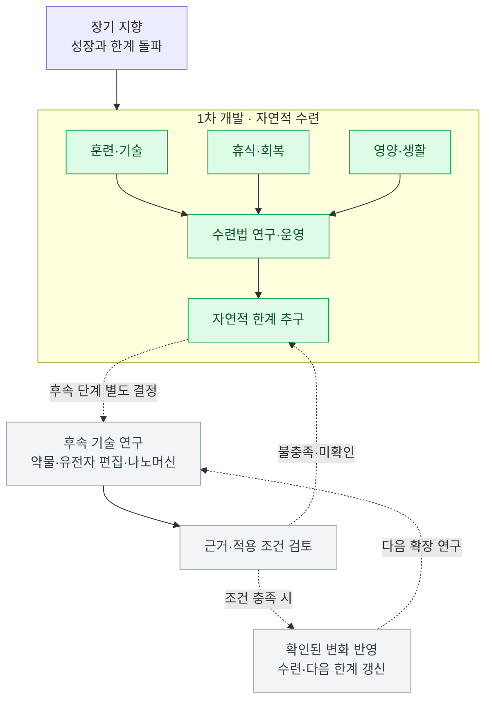
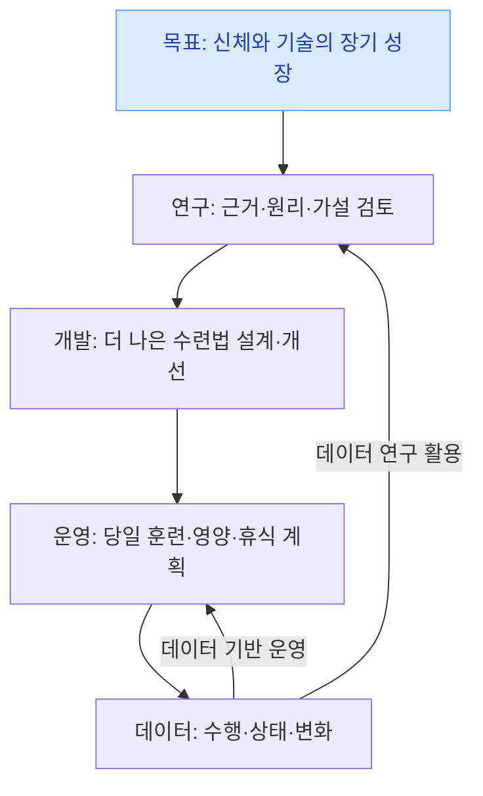
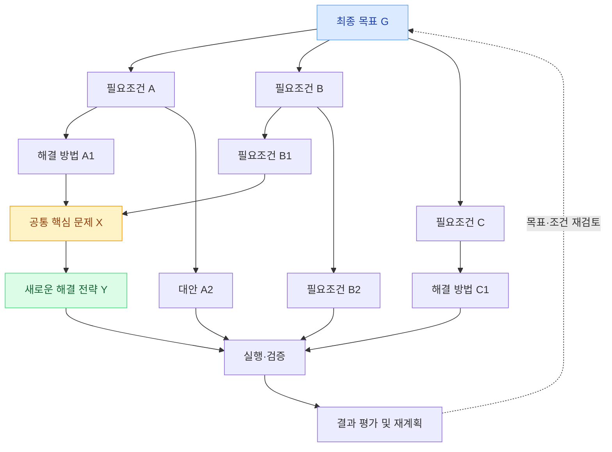
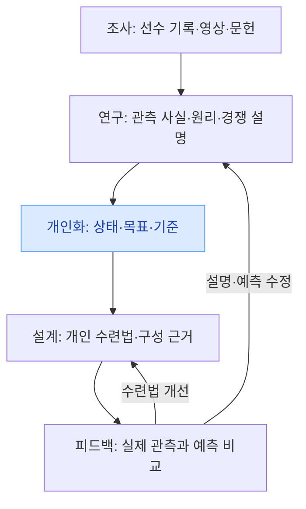
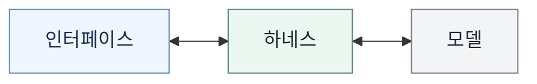
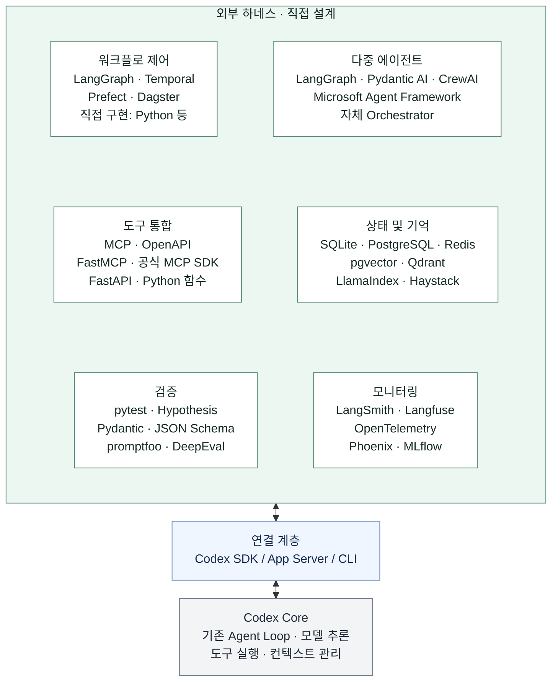

# 자연적 수련 연구 에이전트 요구사항

**목표는 과학기술을 바탕으로 신체 능력과 기술·숙련을 함께 발전시키고, 계속 한계를 넘으며 장기적으로 가능한 한 빠르게 강해지는 것이다.**
에이전트는 강함에 기여하는 요인과 그 상호작용을 찾고, 뛰어난 수행이 가능한 원리와 그 능력을 획득하고 강화하는 원리를 연구한다.

첫 버전부터 사용자는 연구를 요청하고 자신의 상태와 일정에 맞는 당일 훈련·영양·휴식 계획을 받아 사용할 수 있다. 이후 실제 수행과 반응을 바탕으로 다음 계획과 연구를 이어간다.

버전 **0.37** · 2026-11-20 (Asia/Seoul) · [프로젝트 안내](../README.md)

**읽는 순서:** 그래프로 전체 흐름을 보고, 필요한 **상세 요구사항**을 펼친다. 접힌 내용도 요구사항의 일부다.
현재는 시스템 운영 구조와 모듈 경계를 설계 중이며, **확정 요구 · 설계 참고 · 기술 후보 · 미정 · 실제 검증**을 구분한다.

[목표·범위](#1-목표와-1차-범위) · [기능](#기능-요구사항) · [품질](#비기능-요구사항) · [제약](#제약-조건) · [미정 사항](#아직-결정할-운영-조건) · [연구](#3-연구-워크플로) · [개인 모델](#4-선수-분석과-개인-모델) · [하루 수련](#5-하루-수련과-기록) · [하네스 개선](#6-하네스-개선) · [기술 구조](#7-기술-구조와-구현-요구) · [완료 기준](#8-첫-버전-검증)

## 1. 목표와 1차 범위

### 내가 원하는 목표와 에이전트의 역할

1. **베테르비에프를 첫 레퍼런스로 삼는다.** 몸, 훈련 영상, 경기 영상 등 구할 수 있는 자료를 폭넓게 분석한다. 먼저 골격 구조와 골밀도, 근육량과 근육의 특징, 근육이 어디에 어떻게 붙어 있는지, 폐활량, 혈액순환, 호르몬 수치, 힘줄·인대·관절, 신경계·감각계 등을 살핀다. 이 항목들을 출발점으로 삼아, 수행과 성장에 영향을 줄 수 있는 다른 신체 요인과 요인 간 상호작용도 찾아 연구한다. 어떤 항목에 선수 본인의 측정 자료가 있는지 밝히고, 자료가 없는 항목은 미확인으로 둔다.
2. **신체에서 수행과 기술로 이어지는 원리를 찾는다.** 그 신체적 특성에서 스트렝스·파워·지구력이 어떻게 나오는지 연구한다. 기술은 반발력, 무게중심 이동, 무브먼트, 임팩트 등을 경기·훈련 영상과 연결해 분석한다.
3. **그 수준에 어떻게 도달했는지 역설계한다.** “왜 이런 훈련을 하는가? 어떤 능력이 어떻게 발달하는가?”를 조사한다. 그 원리에서 출발해 내가 그 수준에 도달하기 위한 훈련·영양·휴식을 하나의 수련법으로 개발한다.
4. **인간의 한계를 연구하고 계속 넘어선다.** 그다음에는 인간의 한계가 어디인지, 거기에 어떻게 도달할 수 있는지, 가장 효율적인 방법이 무엇인지 연구한다. 한계에 도달하면 어떻게 넘어설 수 있을지 다시 연구한다. 장기적으로는 유전자 편집이나 나노머신 같은 과학기술로 한계를 넘어설 가능성까지 탐구하며 계속 강해지는 것이 목표다.

**에이전트의 역할은 연구와 운영이다.** 나는 에이전트와 대화하면서 연구·개발 목표를 제시하고 함께 구체화한다. 연구 단계에서 에이전트는 조사·추론·실험을 통해 목표에 맞는 수련법을 개발한다. 운영 단계에서는 내가 그 수련법을 실행하고, 에이전트와 함께 실제 수행·상태·변화 데이터를 바탕으로 다음 수련을 조정한다.

**지금 개발하는 범위는 자연적 수련 에이전트다.** 약물·유전자 편집·나노머신은 장기 로드맵이며 1차 연구·개발·운영 및 완료 기준에 포함하지 않는다.

장기 목표 · 자연적 방법과 한계의 뜻

사용자의 최종 지향은 **선협의 수련처럼 계속 강해지고 한계를 넘어, 비유가 아닌 실제 신선이 되는 것**이다.
이는 사용자 목표의 기록이며, 신선의 실재나 도달 방법은 현재 과학으로 입증되어 있지 않다. 에이전트는 실현 가능성이나 도달을 보장하지 않는다.

1차 에이전트는 현재 과학으로 자연적으로 도달 가능한 인간의 한계에 도달하는 것을 목표로 수련을 지원한다.
장기 목표와 첫 소프트웨어 버전의 완료를 구분한다. 새로운 신체 변화·능력에 관한 연구도 1차에서는 자연적 방법의 범위에서 다룬다.

- **자연적 수련:** 우선 훈련·운동학습·영양·수면·회복·환경 개선을 중심으로 한다. 능력 향상을 위한 약물·유전자편집 등의 개입은 다음 단계의 별도 검토 대상으로 둔다. 보충제 등 경계 사례와 필요한 치료의 취급은 개별적으로 정한다.
- **인간의 한계와 개인의 한계를 구분한다.** 선수 기록은 비교 자료이며, 사용자의 도달 가능성이나 인류의 절대 한계를 그대로 뜻하지 않는다.
- 짧은 정체만으로 한계 도달을 선언하지 않는다. 측정 오차·훈련 이행·회복·부상·환경·방법의 적합성과 대안을 검토한다.
- 한계는 현재 근거와 조건 아래의 잠정 판단이다. 능력별 측정 방법·평가 기간·정체 판단 기준은 조사와 개인 상태에 따라 함께 정한다.
- 자연적 한계에 가까워졌다는 판단만으로 다음 개입을 실행하지 않는다. 기술의 근거와 개인 적용 조건은 별도로 검토한다.

후속 기술 단계에서는 목표 능력·원리·근거 단계·관찰된 효과·위험·불확실성·적용 조건을 비교한다.
이론·시뮬레이션·세포·동물·사람 대상 결과와 승인된 임상 용도를 구분한다.
개인 적용에는 법적 조건과 전문가의 의학적 평가·감독이 필요하며, 에이전트가 처방·시술을 자율 실행하는 기능은 포함하지 않는다.
이 내용은 장기 방향이며 1차 에이전트에 미래 기술의 조사나 적용 기능을 요구하지 않는다.

신체·무공·목표 설정의 상세 요구사항

**신체 능력과 무공을 함께 발전시킨다.** 최신이라는 이유만으로 방법을 채택하지 않고, 근거의 질과 개인에게 실제로 나타난 효과로 평가한다.

| 범위 | 연구·운영할 내용 |
| --- | --- |
| 신체 | 힘·속도·지구력·회복, 근골·신경·대사 등 구조와 기능 |
| 무공 | 복싱·MMA의 동작·기술·거리·타이밍·상대 읽기·상황 판단·기술 연결과 숙련 |
| 수련 체계 | 훈련 구성과 부하, 운동학습, 영양·수면·휴식, 일정과 환경 |
| 측정·도구 | 기록·영상·계산·시뮬레이션, 필요한 장비와 측정 방법 |

베테르비에프의 체격·힘·기술·움직임·지속 능력은 기존에 정한 **초기 비교·분석 대상**으로 활용한다.
그 선수의 외형이나 수준을 최종 목표로 고정하지 않는다. 더 나은 발전 방향이 확인되면 함께 목표를 갱신한다.

세부 능력과 수치 목표는 에이전트가 선수 자료와 사용자 상태를 조사해 제안한다.
능력 간 이득·손실은 설명하고 함께 결정하며, 임의의 고정 가중치나 종합 점수로 대신 결정하지 않는다.
새로운 동작·기술 체계의 창안을 필수로 포함할지는 미정이다.

신체와 기술은 각각 성장의 대상이다. 한쪽의 단기 향상과 장기 성장 가능성이 충돌하면 장기 성장을 우선한다. 어떤 방법이 장기적으로 유리하다는 판단에는 그 근거와 다시 검토할 조건을 붙인다.

| 구분 | 요구사항 | 목표와의 연결 |
| --- | --- | --- |
| 최상위 목표 | 사용자의 성장과 한계 도전이라는 목표를 연구 방향·우선순위·성과 평가의 기준으로 삼는다. | 수행하는 연구와 개선이 어떤 능력·제약·수련 문제에 기여하는지 설명한다. |
| 핵심 능력: 정보처리 | 많은 지식을 폭넓고 깊게 읽고 이해한다. 관련 분야의 문헌·원자료·영상·개인 데이터를 비교·연결·축적하고 필요한 판단에 활용한다. | 소수 자료의 요약에 머물지 않고, 목표에 필요한 지식과 상충 근거·공백을 찾아낸다. |
| 핵심 능력: 추론 | 확보한 지식과 관측을 연결해 새로운 설명·가설·예측·해결 전략·수련법을 도출하고 검증한다. | 기존 지식을 나열하는 데서 나아가 현재 문제를 해결할 결과를 만든다. |
| 일일 수련 운영 | 상태·일정·환경에 맞는 오늘의 계획을 제시하고 실제 수행 기록으로 다음 계획을 조정한다. | 연구 결과가 개인의 수련 선택과 다음 연구 질문에 이어진다. |

정보처리에서는 실제로 검토한 자료의 범위·깊이와 출처·중복·신뢰성을 함께 다룬다.
수집량·인용 수만으로 읽기·이해·활용 능력을 대신 평가하지 않는다.
추론으로 도출한 새 결과는 기존 지식과의 차이·도출 근거·검증 방법을 설명하고,
새로운 후보와 실제로 효과가 확인된 결과를 구분한다. 모든 연구에서 독창적 발견이나 효과 향상을 보장하는 조건은 아니다.

기능·도구·프레임워크는 위 목표와 능력에 대한 기여로 평가한다.
이 우선순위는 기존의 자연적 수련 범위·비용·자료·권한 조건 안에서 적용하며,
개별 신체 능력에 임의의 고정 가중치나 종합 점수를 부여하는 뜻은 아니다.

## 2. 연구·수련의 전체 흐름

**과학적으로 연구하고 → 더 나은 수련법을 만들고 → 실제 데이터로 계속 개선한다.**

전체 역할과 쉬운 용어

| 역할 | 연결해야 할 결과 |
| --- | --- |
| 목표 구체화 | 필요한 능력·조건, 현재 차이, 첫 연구 문제와 관측 기준 |
| 연구·역설계 | 문헌·원리·선수 수행·개인 데이터를 연결한 설명과 대안 |
| 개발 | 기존 방법의 분석·개선과 새로운 자연적 수련법 후보 |
| 운영 | 상태·환경·일정에 맞는 훈련·영양·휴식과 다음 조정 |
| 개인 모델·기억 | 개인별 예측·검증·수정, 근거·관측·합의의 보존과 재사용 |
| 연구 도구 | 질문에 맞는 조사·계산·측정 방법을 선택하고 얻은 결과의 적용 범위를 확인한다. |

| 용어 | 이 문서에서의 뜻 |
| --- | --- |
| 역설계 | 목표나 관측한 결과에서 필요한 조건·해결 방법·가능한 작동 원리를 거슬러 탐구하는 것 |
| 개인 모델 | 내 몸·숙련·환경과 수행 결과의 관계를 설명하고 예측하기 위한 모델 |
| 하네스 | 모델이 도구·문맥·작업 상태를 활용하며 일을 수행하도록 연결하고 관리하는 실행 기반 |
| 문맥·기억 | 문맥은 지금 판단에 제공하는 정보, 기억은 나중에 다시 찾아 쓸 수 있도록 보존하는 정보 |

최신 방법이라는 이유만으로 채택하지 않는다. 원리·근거의 질과 실제 개인 반응을 검토한다.
장비·환경·측정 방법은 비용 여건에 따라 단계적으로 실현한다.

### 기능 요구사항

아래 표는 첫 버전에서 사용자가 요청하거나 확인할 수 있어야 하는 동작이다. 연구 판단은 §3~4, 일상 사용은 §5에 상세히 설명한다.

| ID | 입력 또는 상황 | 시스템의 동작과 사용자에게 남는 결과 |
| --- | --- | --- |
| FR-01 | 세부 목표·과거 기록 없이 처음 시작한다. | 오늘의 상태·경험·시간·환경 중 판단에 필요한 것만 묻는다. 신체와 기술의 장기 성장을 기준으로 우선 살필 능력과 그 이유를 제시하고, 세부 목표는 사용자와 정한다. |
| FR-02 | 사용자가 연구 질문을 제시하거나 수행 기록에서 정체·불일치가 발견된다. | 현재 병목과 경쟁 설명을 도출한다. 문헌·선수 자료·관측·계산에서 확인한 근거를 연결하고, 무엇을 더 알아내면 선택이 달라지는지 제시한다. 미확인 자료에 의존하는 판단은 보류한다. |
| FR-03 | 기존 방법과 유망한 후보를 비교한다. | 수행 원리와 능력의 발달 원리를 설명한다. 예상 이득·다른 능력에 미칠 영향·기간·시간과 회복 부담을 비교하고, 적용 전에 개인 예측·관측 조건·후보를 수정하거나 포기할 기준을 남긴다. |
| FR-04 | 오늘의 수련을 요청하거나 일정·상태가 바뀐다. | 현재 여건에서 실행할 훈련 내용·분량과 영양·휴식 계획을 제시한다. 여건이 달라지면 영향을 받는 부분과 조정 이유를 보여준다. 더 확인해야 결정할 부분을 구분한다. |
| FR-05 | 수행한 내용·상태·측정값 또는 과거 기록의 정정을 입력한다. | 계획과 실제 수행을 구분해 기록한다. 빠진 값은 미확인으로 두고, 단위나 대상이 모호하면 해당 값에 의존하는 비교를 하기 전에 확인한다. 정정한 기록과 관련된 결론을 다시 검토한다. |
| FR-06 | 다음 날 다시 사용하거나 예측 이후의 관측을 제공한다. | 이전 합의·실제 기록·사전 예측을 찾아 관측과 비교한다. 기존 설명과 수련 계획을 유지·수정·보류한 근거를 제시하고 다음 계획과 연구 질문에 반영한다. |
| FR-07 | 자료 접근 실패, 도구 실패 또는 사용량 한도로 연구 일부를 완료할 수 없다. | 실제로 확인한 결과, 영향을 받는 판단, 남은 질문을 구분한다. 가능한 범위의 결과는 제공하고 후속 조사에 필요한 조건을 알려준다. |

### 비기능 요구사항

| ID | 품질 속성 | 관찰 가능한 판정 기준 |
| --- | --- | --- |
| NFR-01 | 연구 결과의 근거 추적성 | 중요한 판단에서 실제로 검토한 자료·관측 또는 계산까지 거슬러 갈 수 있다. 같은 원자료를 인용한 두 문헌은 독립 근거로 중복 계산하지 않으며, 자료에서 확인한 사실과 추론을 구분한다. |
| NFR-02 | 기록의 무결성과 연속성 | 다음 사용에서도 수정된 기록, 실제 수행, 원래의 예측을 구별할 수 있다. 미기록을 0이나 수행 완료로 해석하지 않고, 새 관측이 들어와도 원래 예측과 비교할 수 있다. |
| NFR-03 | 부분 실패 시 신뢰성 | 도구 호출 시도와 실제 성공을 구분한다. 영상 하나에 접근하지 못해도 검토한 문헌의 결론은 전달하며, 미확인 영상이 있어야 뒷받침되는 결론은 유보한다. |
| NFR-04 | 일상 사용성 | 평소에는 짧은 수행·상태 기록으로 다음 수련을 이어갈 수 있다. 추가 영상·측정이 필요하면 무엇을 판단하는 데 쓰이는지 설명한다. 이전에 제공했고 여전히 유효한 정보는 재사용한다. |
| NFR-05 | 개인 자료 보호 | 새 외부 서비스로 개인 자료가 전달되는 경로에서 대상 자료·목적·서비스에 대한 사용자 결정을 확인할 수 있어야 한다. 외부 분석·실행 추적 도구를 선택할 때도 같은 조건을 적용한다. |

### 제약 조건

| ID | 적용 범위 | 지킬 조건 |
| --- | --- | --- |
| C-01 | 연구·운영 범위 | 첫 버전은 훈련·운동학습·영양·수면·회복·환경 등 자연적 수련을 다룬다. 약물·유전자편집은 후속 로드맵에 둔다. |
| C-02 | 실행·비용 | 외부 하네스에서 Codex를 연결하고 모델 추론에는 기존 계정 사용량을 쓴다. 평가 모델·임베딩·외부 서비스에 비용이 생기는 경로는 별도로 결정한다. 실제 연결 여부와 비용 경로는 검증 대상이다. |
| C-03 | 사용자 결정권 | 개인 수련법의 실제 적용, 중심 목표나 방향 변경, 새 외부 분석 서비스에 대한 개인 자료 제공은 사용자가 결정한다. 개인 원본·몸 상태·측정값·계정 비밀정보는 공개 저장소에 올리지 않는다. |
| C-04 | 개발과 운영의 책임 | 연구 에이전트는 연구와 수련을 지원한다. 하네스 문제를 찾아 진단·수정·검증하는 일은 사용자와 Codex가 개발 과정에서 맡는다. Router–Worker와 개별 프레임워크는 설계 후보다. |

### 아직 결정할 운영 조건

아래 항목은 운영 목표 또는 정책이 필요한 부분이다. 수치와 지원 범위는 미정이며 제품 성능이 검증되었다는 의미를 갖지 않는다.

| 항목 | 결정에 필요한 정보 |
| --- | --- |
| 응답시간·사용량 | 당일 계획은 요청부터 처음 실행 가능한 계획까지 걸린 시간, 심층 연구는 첫 유용한 결과와 완료까지의 시간·사용량을 대표 작업에서 측정한다. 사용자가 기다릴 수 있는 시간과 측정 결과를 바탕으로 목표와 작업별 예산을 정한다. |
| 개인 자료의 생애주기 | 원본 영상·측정 기록·파생 분석별로 저장 위치, 보관 기간, 삭제 요청 시 파생 결과와 백업을 어떻게 처리할지 결정한다. |
| 지원 환경·복구 | 우선 지원할 기기와 접속 방식, 세션 간 기록 보존 범위, 실행 중단 시 허용할 기록 손실과 복구 시간을 정한다. 다음 사용에서 이전 합의와 기록을 활용하는 기능은 FR-06에 따른다. |
| 예측 성능 | 예측 대상과 기간, 비교할 기준 방법, 사용할 수 있는 개인 관측을 정한 뒤 정확도를 평가한다. 모든 신체 능력에 공통으로 적용할 정확도 수치는 정해지지 않았다. |

## 3. 연구 워크플로

**필수:** 목표에서 문제를 찾고, 근거와 결과에 따라 설명·수련법·다음 행동을 바꾼다.
아래 그래프는 연구의 연결과 **설계 참고 관점**이며, 모든 연구에 고정 순서·가설 수·도구 호출을 강제하지 않는다.

현재 성장을 크게 제한하는 요인을 우선 조사한다. 기존 설명이 놓친 요인이나 더 큰 성장 가능성이 보이면 후속 질문을 스스로 발굴하고, 답에 따라 수련 선택이 얼마나 달라질지와 조사 비용을 함께 따져 우선순위를 정한다.

유망한 방법은 사용자의 조건에서 비교할 수 있을 만큼 구체화한다. 현재 방법과 대안을 장기 성장 효과, 향상 속도, 다른 능력에 미칠 영향, 시간과 회복 부담으로 비교한다. 적용 전에 예상 변화, 비교할 조건과 기간, 필요한 관측, 후보를 수정하거나 포기할 결과를 기록한다. 사용자가 실제 적용을 결정한다.

### 역설계 기반 연구 워크플로

지능적인 연구의 상세 요구사항

사용자는 뛰어난 인간 연구자처럼 연구하길 원하며, 다음 설명을 지능적인 연구의
요구로 합의했다. 목표를 이루기 위해 무엇을 알아내야 하는지 판단하고, 설명을
만들고 시험하며, 근거에 따라 다음 행동을 바꾸는 능력이다.

- 목표·개인 상태·환경과 현재 지식을 연결해 전체를 이해하고, **아는 것과 모르는 것을 파악한다.**
- 중요한 문제와 발전을 제한할 수 있는 요인을 찾아 **질문을 구체화한다.** 처음 질문이 잘못됐을 가능성도 검토한다.
- 관측을 나열하는 데서 나아가 원인과 작동 원리를 설명하되, **관찰 사실과 가능한 설명을 구분한다.**
- 처음 설명에 고착하지 않고 **경쟁하는 설명·대안·반례를 검토한다.**
- 어떤 결과가 설명이나 선택을 바꿀 수 있는지 따져 **다음 조사·비교·계산·관측 제안을 선택한다.**
- 원리에 따라 수련 방법을 개선하거나 새 후보를 만들고, **예상 이득·적용 조건·실패 가능성을 설명한다.**
- 예측과 관측이 다르면 측정 조건, 실제 수행 내용, 개인차와 설명 자체를 검토한다. 설명·모델·수련 계획을 유지하거나 수정하거나 판단을 보류한 이유를 밝힌다.
- 추가 조사가 결정을 바꿀 가능성과 필요한 자원을 따져 다음 조사·분석 방법을 선택한다.

**이는 고정된 단계·가설 개수·질문 점수·필수 도구 호출 순서를 요구하는 것이 아니다.**
문헌 수·서브에이전트 수·계산 복잡도만으로 연구의 지능이나 품질을 판단하지 않는다.
좋은 질문의 선택과 근거에 따른 설명·행동의 발전을 평가한다. 매번 새 발견이나
능력 향상을 보장하는 조건은 아니며, 모르는 것은 미확인으로 남긴다.
연구 방향을 함께 정하고, 합의한 범위에서 스스로 수행·보고하는 원칙은 유지한다.

| 범위 | 최신 답변에서 확인한 요구 |
| --- | --- |
| 기존 방법 분석·개선 | 기본적으로 수행한다. 운동·기술 훈련·회복 등 기존 방식을 분석하고 개선한다. |
| 더 뛰어난 수련법 개발 | 기본적으로 수행한다. 과학 원리를 연구해 더 뛰어난 방법을 만든다. |
| 장비·환경·측정 방법 | 비용 여건이 생기면 차근차근 실현한다. |
| 새로운 신체 변화·능력의 가능성 | 기본 역할과 별도로 수행해야 할 연구에 포함한다. |

깊이·자료 검토·연쇄 연구·사용자와의 공동 연구

발견과 실패에서 후속 질문을 만들고, 관련 자료를 폭넓고 깊게 검토하며 사용자와 함께 연구한다.

- 처음 떠오른 설명이나 짧은 요약에 머물지 않고, **기전·전제·대안 설명·반례·불확실성**과
  결과의 함의를 깊이 검토한다. 보고에는 판단 근거와 중요한 검토 결과를 설명한다.
- 발견과 실패에서 **다음 질문을 스스로 만들어 연쇄적으로 조사한다.** 원인·적용 조건·
  예외·새 가능성으로 이어지는 질문을 발전시키며, 합의 범위 안의 후속 조사를 계속한다.
- 관련 문헌·원자료·영상·방법 자료를 **폭넓고 충분히 검토**하고, 중요한 자료는 내용을
  깊이 확인한다. 인용 관계와 관련 연구를 따라가며 지지 근거와 상충하는 결과도 살핀다.
  검색 결과나 인용 목록만 확보한 것을 원문 검토로 취급하지 않는다.
- 연구에서 얻은 결과는 다음 질문뿐 아니라 전체 설명·공법 후보·개인 모델·수련 제안에
  연결한다. 의미 있는 결과와 그로부터 달라진 판단을 사용자에게 보고한다.

#### 연구의 깊이와 자원 범위

연구의 양과 깊이를 모두 중시하되, 같은 일을 반복하거나 임의의 질문·문헌·에이전트
개수를 채우는 것을 목표로 삼지 않는다. 합의한 중심 문제와 자원 범위를 유지하며,
중심 문제나 큰 방향의 변경은 사용자와 논의한다. 사용량 한도에 이르거나 핵심 자료를 확인할 수 없으면, 확인한 근거로 가능한 판단과 다시 조사할 질문을 구분한다.
구체적인 분담·호출·병렬 수·실행 시간은 후속 설계와 실제 환경에서 검토한다.

#### 사용자와의 공동 연구

사용자는 AI가 스스로 후속 연구 질문을 많이 만들면서, 사용자에게도 해석·
아이디어·방향을 적극적으로 물어 함께 연구하는 방식을 선택했다. 사용자에게
묻는 질문은 필요한 정보 수집과 결정 확인에 더해 공동 해석과 아이디어 탐색을
포함한다. 사용자만 알 수 있는 조건이나 목표 간 절충이 결정을 바꿀 때 질문한다. 답을 기다리는 동안에는 합의한 범위에서 독립적으로 진행할 수 있는 조사를 이어간다.

#### 자료 검토의 폭과 신뢰성

사용자는 AI가 많은 정보를 다룰 수 있다는 장점을 적극적으로 활용해 연구에서
참고하는 자료의 폭과 양을 충분히 확보하길 원한다. 소수 자료만 보고 일찍 결론을
내리는 방식에 머무르지 않고, 관련 분야·원자료·상충 근거까지 조사해 서로 연결하고
비교해야 한다. 검색으로 발견한 자료, 선별한 자료, 내용을 실제로 검토한 자료를
구분한다. 많은 자료를 검토했다는 사실과 근거의 독립성·신뢰성은 별도로 판단한다.
고정 인용 수를 채우는 것으로 이 요구를 대신하지 않으며 기존 구독·자원 범위는 유지한다.

## 4. 선수 분석과 개인 모델

**선수의 수행 원리를 찾고, 내 조건에 맞는 방법을 설계한 뒤 실제 반응으로 검증한다.**

선수 영상·훈련 역설계의 상세 요구사항

공개 기록·경기·훈련 영상과 문헌에서 수행의 원리를 연구하고, 사용자에게 맞는 훈련 설계로 연결한다. 관측·추론·새 설계를 구분한다.

사용자는 목표의 구체화부터 AI가 맡길 원한다. 베테르비에프 등의 기록·경기·
훈련 영상을 가능한 한 자세히 분석해 신체와 무공, 퍼포먼스가 나오는 이유를
연구한다. 사용자가 미리 세부 능력이나 수치 목표를 준비할 필요는 없다.
구체적인 목표와 평가 기준은 조사 결과와 사용자 상태를 바탕으로 함께 정한다.

경기·훈련 영상과 관련 문헌은 AI가 필요한 자료를 스스로 찾아 분석하는 것이
기본이다. 사용자는 유튜브·인스타그램 등에 공개 자료가 많으므로 구매가
필요하지 않을 것으로 생각한다. 공개 자료를 우선 활용하고, 사용자가 건넨
자료도 함께 분석한다. 모든 자료에 실제로 접근하거나 내용을 확인할 수
있다는 보장은 아니며, 확인하지 못한 내용은 확인한 근거로 취급하지 않는다.

- 실제 수행이 어떤 신체 능력·동작·협응·감각·판단으로 가능한지 설명하고 원인을 탐구한다.
- 훈련 영상에서 어떤 능력·감각을 훈련하는지, 왜 그 훈련을 하는지 과학적으로 분석한다.
- 역학·신경·운동학습 등 필요한 원리를 연결한다. 이 분야 예시로 연구 범위를 제한하지 않는다.
- 원리와 근거에서 훈련의 구성·세트·반복·빈도 등의 이유와 적합한 설계를 도출한다.
- 사용자의 몸·숙련·환경에 맞춰 적용 가능한 방법을 제안하고, 더 뛰어난 방법도 찾는다.
- 실제 관측을 받아 설명·방법·예측을 검토하고 발전시킨다.

영상에서 확인한 동작·실제 훈련량, 근거를 바탕으로 추정한 기전·훈련 의도,
원리와 모델로 새로 설계한 개인 훈련량을 구분한다. 선수 내부 상태나 영상에
없는 세트·빈도를 확인된 사실로 채우지 않는다. 퍼포먼스의 인과 설명은
가설·대안·근거·검증 범위를 드러내며, 관측만으로 확정했다고 표현하지 않는다.
이 구분은 ‘항상 과학적으로’라는 요구를 충족하기 위한 해석·검증 원칙이다.

개인 모델의 설명·예측·검증 요구사항

사용자는 다음 네 가지를 모두 원한다.

1. 기록과 영상에서 강점·약점·성장·정체의 원인을 분석한다.
2. 여러 수련 방법의 개인별 차이를 근거와 모델로 예측·비교한다.
3. 사전 예측과 실제 관측을 대조한다. 차이가 있으면 원인을 검토하고 설명과 모델을 유지·수정하거나 판단을 보류한 근거를 남긴다.
4. 장기적으로 근골·신경·대사·회복 등의 연결을 다루는 전신 개인 모델로 발전시킨다.

공법의 원리·근거·예측은 기본적으로 설명해야 한다.
설명과 예측의 깊이·정확도를 실제 자료와 모델의 검증 범위에 맞춰 드러낸다.
이는 정확한 전신 예측이나 인과관계의 확정을 이미 달성했다는 뜻이 아니다.

## 5. 하루 수련과 기록

| 사용 장면 | 에이전트가 제공할 결과 |
| --- | --- |
| 처음 사용 | 사용자가 세부 목표를 아직 정하지 않았어도 시작할 수 있다. 오늘 수련을 정하는 데 필요한 현재 상태·경험·가능한 시간과 환경을 확인하고, 확인된 조건에서 실행할 계획과 선택 근거를 제시한다. |
| 오늘의 수련 | 최근 기록과 오늘의 여건에 맞춰 훈련 내용과 분량, 필요한 영양·휴식 계획을 제시한다. 계획이 어떤 신체 능력이나 기술의 장기 성장에 기여하는지 설명한다. 진행 중인 연구에서 결론이 나지 않은 부분은 현재 계획에 쓰인 근거와 구분한다. |
| 수행 후 또는 일정 변경 | 계획과 실제로 수행한 내용, 휴식, 사용자 반응을 구분해 짧게 기록한다. 일정이나 상태가 바뀌면 영향받는 부분을 조정한다. 미기록은 미확인으로 남기고, 미실시로 확인된 활동은 수행량에서 제외한다. |
| 다음 사용 | 이전 합의와 실제 기록을 불러와 오늘 유지하거나 바꿀 내용과 이유를 제시한다. 사용자가 과거 기록을 정정하면 해당 기록에 의존한 추정과 제안도 다시 검토한다. |

### 제공 가능한 자료

사용자는 동작 영상, 운동 종목·중량·횟수, 체중·몸 상태, 수면·피로·통증
기록 등을 제공할 수 있을 것 같다고 답했고, 필요한 자료를 질문하길 원했다.
AI는 필요한 자료와 수집 이유를 구체적으로 요청한다.

이는 제공 의향·예상 여건의 확인이다. 실제 자료를 이미 수집했다거나
모든 기록을 매일 제공하기로 했다는 뜻은 아니다.

평소에는 짧은 수행·상태 기록을 중심으로 받는다. 영상과 추가 측정은
판단에 도움이 클 때 요청한다. 일상 기록의 부담과 추가 자료의 판단 가치를
함께 고려하며, 세부 항목·빈도·시간은 필요한 장면에서 구체화한다.

### 개인 자료의 외부 제공

공개된 선수 자료는 AI가 스스로 조사한다. 사용자의 원본 영상·몸 상태·측정값을
현재 사용하는 AI 이외의 새로운 외부 분석 서비스에 제공할 때는, 보낼 자료·
목적·서비스를 설명한 뒤 함께 결정한다. 사용자는 이 원칙에 동의했다.

## 6. 하네스 개선

연구 에이전트는 연구와 수련 지원을 수행하고, 새 근거와 관측에 따라 과학적 설명·개인 모델·수련 계획을 갱신한다.

사용자와 Codex는 실제 사용 과정과 연구 결과를 살펴 하네스의 문제를 발견한다. 개발 과정에서 원인을 진단하고 지침·도구·기억·실행 코드의 필요한 부분을 수정한 뒤, 문제가 드러난 사례로 변경 효과를 검증한다. 하네스 문제의 탐지·별도 보고·자체 수정은 연구 에이전트의 제품 기능 범위에서 제외한다.

## 7. 기술 구조와 구현 요구

**확정:** 외부 하네스와 Codex를 연결한다.
**설계 후보:** Router–Worker 모듈화. 세부 책임·프레임워크·저장소·배포 조합은 후속 설계에서 정하고, 선택한 구조는 실제 동작으로 검증한다.

### 사용 구조

### 하네스 구성도

**구조는 설계 기준이며, 상자 안의 제품·라이브러리는 비교 후보다.**

영역별 도구·프레임워크 후보와 공식 문서

**후보 목록:** 워크플로 제어·다중 에이전트·도구 통합·상태와 기억·검증·모니터링에 쓸 기술을 비교한다.
구체적인 채택 조합은 후속 설계에서 정한다.

Python은 프로그래밍 언어, MCP·OpenAPI는 연결·API 규격이다. 프레임워크, SDK, 저장소와 역할을 구분해 비교한다.
아래 링크는 각 프로젝트의 공식 문서·저장소다.

### 워크플로 제어

| 종류 | 후보 | 역할 |
| --- | --- | --- |
| 상태·그래프 실행 | [LangGraph](https://docs.langchain.com/oss/python/langgraph/overview) | 분기·반복·상태 보존과 사용자 개입을 포함하는 실행 흐름 |
| 지속 실행 | [Temporal](https://docs.temporal.io/workflows) | 장시간 작업·대기·실패 후 복구를 관리하는 실행 기반 |
| 작업 흐름 관리 | [Prefect](https://docs.prefect.io/v3/get-started) | Python 작업의 실행·상태·스케줄·실패 처리 |
| 데이터 작업 관리 | [Dagster](https://docs.dagster.io/) | 데이터 자산과 분석 파이프라인의 의존 관계·생성 이력 관리 |
| 직접 구현 | Python 등으로 작성한 제어 코드 | 프로젝트에 필요한 실행 규칙을 직접 구성 |

### 다중 에이전트

| 종류 | 후보 | 역할 |
| --- | --- | --- |
| 그래프 기반 구성 | [LangGraph](https://docs.langchain.com/oss/python/langgraph/overview) | 에이전트 작업과 일반 함수를 연결하는 흐름 구성 |
| 타입 기반 에이전트 SDK | [Pydantic AI](https://ai.pydantic.dev/) | 타입·구조화 결과를 활용하는 에이전트와 하위 에이전트 구성 |
| 팀·작업 흐름 | [CrewAI](https://docs.crewai.com/en/introduction) | 협력하는 에이전트 팀과 상태를 가진 작업 흐름 구성 |
| 에이전트·워크플로 프레임워크 | [Microsoft Agent Framework](https://learn.microsoft.com/en-us/agent-framework/overview/) | 에이전트와 함수를 연결하는 다중 에이전트 실행 구성 |
| 직접 구현 | 자체 Orchestrator | Codex 실행들을 프로젝트에 맞게 배정·조정 |

### 도구 통합

| 종류 | 후보 | 역할 |
| --- | --- | --- |
| 연결 규격 | [MCP](https://modelcontextprotocol.io/), [OpenAPI](https://spec.openapis.org/oas/latest.html) | 각각 모델용 도구 연결과 HTTP API 명세 |
| MCP 프레임워크 | [FastMCP](https://gofastmcp.com/getting-started/welcome) | 함수·데이터를 MCP 도구로 제공하고 서버·클라이언트 구성 |
| 프로토콜 SDK | [공식 MCP SDK](https://github.com/modelcontextprotocol/python-sdk) | MCP 서버·클라이언트와 도구 연결을 직접 구현 |
| API 프레임워크 | [FastAPI](https://fastapi.tiangolo.com/) | 분석·계산 기능을 HTTP API로 제공 |
| 직접 연결 | Python 함수 등 | 같은 실행 환경의 기능을 직접 호출 |

### 상태 및 기억

| 종류 | 후보 | 역할 |
| --- | --- | --- |
| 상태 저장 | [SQLite](https://www.sqlite.org/docs.html), [PostgreSQL](https://www.postgresql.org/docs/), [Redis](https://redis.io/docs/latest/) | 각각 내장 관계형 DB, 서버형 관계형 DB, 메모리 중심 데이터 저장소 |
| 벡터 저장·검색 | [pgvector](https://github.com/pgvector/pgvector), [Qdrant](https://qdrant.tech/documentation/) | 각각 PostgreSQL의 벡터 검색 확장과 벡터 검색 엔진 |
| 자료 연결·검색 프레임워크 | [LlamaIndex](https://developers.llamaindex.ai/python/framework/), [Haystack](https://docs.haystack.deepset.ai/docs/intro) | 문서·자료를 연결하고 검색·문맥 제공 파이프라인 구성 |

저장소와 검색 프레임워크는 서로 다른 역할이다. 저장소를 선택하는 것만으로 에이전트의 장기 기억이 완성되지는 않는다.

### 검증

| 종류 | 후보 | 역할 |
| --- | --- | --- |
| 코드·실행 검사 | [pytest](https://docs.pytest.org/), [Hypothesis](https://hypothesis.readthedocs.io/en/latest/) | 테스트 실행과 다양한 입력·경계 조건에 대한 속성 검사 |
| 데이터 형식 검사 | [Pydantic](https://docs.pydantic.dev/), [JSON Schema](https://json-schema.org/) | 입력·출력의 타입과 구조 검사 |
| 응답·에이전트 평가(Evals) | [promptfoo](https://www.promptfoo.dev/docs/intro/), [DeepEval](https://deepeval.com/docs/getting-started) | 사례별 결과 비교, 응답·에이전트 동작의 평가와 회귀 확인 |

형식 검사, 실행 성공, 연구 결과의 과학적 타당성은 서로 다른 검증 대상이다.

### 모니터링

| 종류 | 후보 | 역할 |
| --- | --- | --- |
| 에이전트 실행 관찰 | [LangSmith](https://docs.langchain.com/langsmith/observability), [Langfuse](https://langfuse.com/docs) | 실행 추적·디버깅·평가 결과 확인 |
| 계측 표준·도구 | [OpenTelemetry](https://opentelemetry.io/docs/what-is-opentelemetry/) | 추적·메트릭·로그의 생성·수집·전달 |
| 추적·평가 도구 | [Phoenix](https://arize.com/docs/phoenix) | 도구·검색·모델 호출 추적과 평가·실험 비교 |
| 추적·실험 관리 | [MLflow](https://mlflow.org/docs/latest/genai/tracing/) | 에이전트 실행 단계 추적과 실험·평가 관리 |

OpenTelemetry는 계측 기반이며 관찰 화면을 제공하는 제품과 함께 사용할 수 있다.

Codex 연결·사용량·모델 평가 비용의 구분

- 연결 계층은 [Codex SDK](https://learn.chatgpt.com/docs/codex-sdk), [app-server](https://learn.chatgpt.com/docs/app-server), [CLI](https://learn.chatgpt.com/docs/cli)다. 언어·워크플로 프레임워크와 다른 선택이다.
- 모델 추론은 기존 Codex 계정의 사용량을 쓰는 실행 경로로 연결한다. 외부 에이전트 프레임워크의 기본 모델 API 연결이 Codex 구독 연동을 뜻하지는 않는다.
- 각 프레임워크와 Codex를 연결하는 방식은 아직 실행 검증하지 않았다. 모델 기반 평가와 임베딩을 사용하는 경우도 해당 모델·인증·비용 경로를 별도로 정한다.
- 영역별 기술은 비교 후보다. 구체적인 채택 조합·배포 환경·서비스 비용은 후속 설계에서 정한다.

**필요한 운영 능력:** 장기 기억, 작업 문맥 구성, 도구 선택·실행 확인, 진행 관리, 서브에이전트 조정.
이 능력이 실제로 연결되어 작동하는지 검증해야 한다.

## 8. 첫 버전 검증

첫 버전의 완료는 사용자가 실제 사용 경로에서 아래 과정을 수행할 수 있는지로 판정한다. 장기적인 신체·기술 향상과 개별 방법의 효과는 이후 축적되는 관측으로 평가한다.

| 검증 장면 | 통과 조건 | 대응 요구 |
| --- | --- | --- |
| 첫날 수련 요청 | 세부 수치 목표나 과거 기록이 없는 사용자가 필요한 상태·일정·환경을 알려주면, 그날 실행 가능한 자연적 수련·영양·휴식 계획과 선택 근거를 받는다. | FR-01, FR-04, NFR-04, C-01 |
| 다음 날 다시 사용 | 전날 일부만 수행하고 시간이 줄어든 사례에서, 실제 수행량과 새 시간 제약을 반영한 계획을 받는다. 미기록 상태는 미확인으로 남고 이미 제공한 경험·환경을 다시 입력할 필요가 없다. | FR-04, FR-05, FR-06, NFR-02, NFR-04 |
| 새 방법 연구 | 현재 방법과 새 후보의 원리·근거·부담을 비교한다. 사용자에게 적용하기 전에 예상 변화와 관측 조건, 판단을 바꿀 결과를 확인할 수 있고 적용 여부는 사용자가 선택한다. | FR-02, FR-03, C-03 |
| 예측 불일치 또는 기록 정정 | 원래 예측과 실제 관측을 대조한다. 사용자가 단위를 정정하면 해당 값에 의존한 결론을 재검토하고, 다음 계획을 유지·수정·보류한 이유를 제시한다. | FR-05, FR-06, NFR-02 |
| 중복 근거와 접근 실패 | 같은 원자료를 재인용한 두 문헌과 열리지 않는 영상이 있을 때, 독립 근거 수를 부풀리거나 영상 내용을 확인했다고 쓰지 않는다. 확인한 근거와 영상이 필요해 보류한 판단을 구별할 수 있다. | FR-02, FR-07, NFR-01, NFR-03 |
| 외부 서비스가 개인 영상을 요구 | 가상 개인 자료로 외부 제공 경로를 점검한다. 사용자 결정 전 전송이 없고, 결정할 때 대상 자료·목적·서비스를 알 수 있다. 공개 저장소에 개인 원본이나 비밀정보가 포함되지 않는다. | NFR-05, C-03 |
| 구독 연결과 사용량 소진 | 실제 사용 경로에서 모델 인증·사용량 경로를 확인한다. 한도에 도달한 조건에서는 미완료 부분이 구분되고 별도로 결정하지 않은 유료 모델로 자동 전환되지 않는다. | FR-07, NFR-03, C-02 |
| 하네스 개선 책임 | 제품 동작과 운영 절차를 대조해 연구 중 과학적 설명을 갱신하는 일과 사용자·Codex가 개발 과정에서 하네스를 수정하는 일의 담당을 확인한다. | C-04 |
