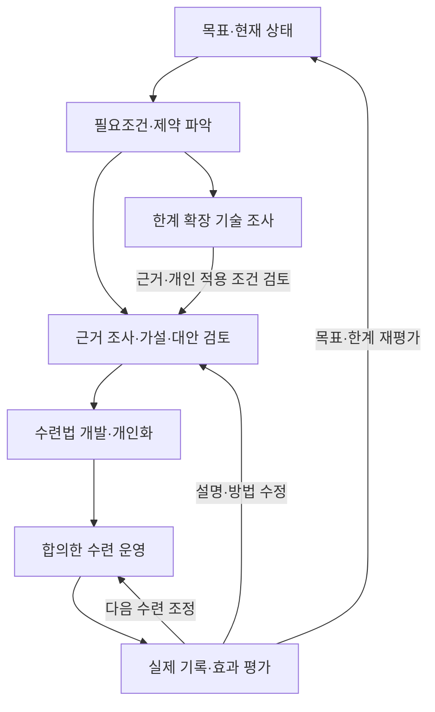

# 수련 연구 에이전트 요구사항

**과학적인 수련으로 자연적으로 도달 가능한 인간의 한계를 추구하고, 새로운 기술로 한계 확장의 가능성을 연구하며, 그 과정을 반복하도록 돕는 에이전트를 만든다.**

버전 **0.31** · 2026-11-12 (Asia/Seoul) · [프로젝트 안내](../README.md)

## 1. 최종 목표와 현재 할 일

사용자의 최종 목표는 **선협의 수련처럼 계속 강해지고 한계를 넘어, 비유가 아닌 실제 신선이 되는 것**이다.
이 문서는 그 지향을 장기 목표로 기록한다. 신선의 실재나 그 상태에 도달하는 방법은 현재 과학으로 입증되어 있지 않으며, 에이전트는 실현 가능성이나 도달을 보장하지 않는다.

**지금 만드는 것은 이 목표를 돕는 연구·수련 에이전트다.** 현재 확인할 수 있는 능력과 변화부터 측정하고, 과학적 근거에 따라 수련법을 개발·운영한다. 장기 목표는 유지하되, 확인한 사실·가설·미확인 가능성을 구분한다.

| 단계 | 목표 | 에이전트가 할 일 |
| --- | --- | --- |
| 1. 자연적 한계 추구 | 현재 과학으로 자연적으로 도달 가능한 인간의 능력 한계에 도달하는 것을 목표로 한다. | 최신 연구와 개인 데이터를 바탕으로 가장 효과적인 수련법을 연구·개발하고, 훈련·영양·수면·회복을 운영·개선한다. |
| 2. 기술을 통한 한계 확장 | 자연적 수련만으로 해결하기 어려운 제약을 넘어설 가능성을 찾는다. | 약물·유전자편집 등 현재 개발 중이거나 미래에 등장할 기술의 원리·효과·한계·위험·적용 조건을 연구한다. |
| 3. 반복 발전 | 확장된 능력을 다시 발전시키고 다음 제약을 탐구한다. | 실제로 확인된 변화에 맞춰 개인 모델과 수련을 갱신하고, 다음 한계와 돌파 후보를 연구한다. |

단계는 장기적인 발전 방향이다. 미래 기술의 조사는 1단계에서도 진행할 수 있지만, **연구 후보가 곧 개인에게 적용 가능한 방법이라는 뜻은 아니다.** 기술의 효과가 확인되지 않거나 적용 조건이 충족되지 않으면 보류하고 현재 가능한 수련을 계속한다.

### 한계를 어떻게 판단하나

- **자연적 수련:** 우선 훈련·운동학습·영양·수면·회복·환경 개선을 중심으로 한다. 능력 향상을 위한 약물·유전자편집 등의 개입은 다음 단계의 별도 검토 대상으로 둔다. 보충제 등 경계 사례와 필요한 치료의 취급은 개별적으로 정한다.
- **인간의 한계와 개인의 한계를 구분한다.** 선수 기록은 비교 자료이며, 사용자의 도달 가능성이나 인류의 절대 한계를 그대로 뜻하지 않는다.
- 짧은 정체만으로 한계 도달을 선언하지 않는다. 측정 오차·훈련 이행·회복·부상·환경·방법의 적합성과 대안을 검토한다.
- 한계는 현재 근거와 조건 아래의 잠정 판단이다. 능력별 측정 방법·평가 기간·정체 판단 기준은 조사와 개인 상태에 따라 함께 정한다.
- 자연적 한계에 가까워졌다는 판단만으로 다음 개입을 실행하지 않는다. 기술의 근거와 개인 적용 조건은 별도로 검토한다.

## 2. 수련 범위와 목표 설정

**신체 능력과 무공을 함께 발전시킨다.** 최신이라는 이유만으로 방법을 채택하지 않고, 근거의 질과 개인에게 실제로 나타난 효과로 평가한다.

| 범위 | 연구·운영할 내용 |
| --- | --- |
| 신체 | 힘·속도·지구력·회복, 근골·신경·대사 등 구조와 기능 |
| 무공 | 복싱·MMA의 동작·기술·거리·타이밍·상대 읽기·상황 판단·기술 연결과 숙련 |
| 수련 체계 | 훈련 구성과 부하, 운동학습, 영양·수면·휴식, 일정과 환경 |
| 측정·도구 | 기록·영상·계산·시뮬레이션, 필요한 장비와 측정 방법 |
| 장기 확장 | 새로운 신체 변화·능력, 약물·유전자편집 등 한계 확장 후보 기술 |

베테르비에프의 체격·힘·기술·움직임·지속 능력은 기존에 정한 **초기 비교·분석 대상**으로 활용한다.
그 선수의 외형이나 수준을 최종 목표로 고정하지 않는다. 더 나은 발전 방향이 확인되면 함께 목표를 갱신한다.

세부 능력과 수치 목표는 에이전트가 선수 자료와 사용자 상태를 조사해 제안한다.
능력 간 이득·손실은 설명하고 함께 결정하며, 임의의 고정 가중치나 종합 점수로 대신 결정하지 않는다.
새로운 동작·기술 체계의 창안을 필수로 포함할지는 미정이다.

‘기’ 같은 개념은 검증 가능한 현상과 가설로 구체화할 수 있을 때 연구한다.
기와 생체전기의 동일성을 전제하지 않으며, 별도의 기 운용은 현재 실행 범위에 포함하지 않는다.
실제 신경·근육의 전기생리 연구는 신체 연구에 포함한다.

## 3. 에이전트의 핵심 역할

| 역할 | 필요한 동작과 결과 |
| --- | --- |
| 목표 구체화 | 원하는 수행에서 필요한 능력·조건을 도출하고, 현재 차이와 우선 연구 문제를 제안한다. |
| 과학적 연구 | 문헌·원자료·영상·개인 기록을 연결해 원인, 대안 설명, 반례와 미확인 사항을 검토한다. |
| 수련법 개발 | 기존 방법을 분석·개선하고 새로운 후보를 설계한다. 원리·예상 효과·적용 조건·평가 방법을 설명한다. |
| 수련 운영 | 상태·환경·일정에 맞는 훈련·영양·회복 계획을 제안하고, 실제 기록으로 다음 계획을 조정한다. |
| 개인 모델 | 강점·약점·성장·정체를 설명하고 방법별 반응을 예측한다. 예측이 틀리면 원인을 조사하고 모델을 고친다. |
| 한계 확장 연구 | 현재 발전을 막는 제약과 새로운 기술을 연결하고, 근거 수준·불확실성·적용 가능성을 갱신한다. |
| 기억과 재개 | 연구·관측·실패·합의·수정 이력과 다음 작업을 보존하고, 필요한 때 찾아 이어간다. |
| 도구와 시스템 개선 | 필요한 도구를 선택·연결·개발·검증한다. 연구 경험을 바탕으로 하네스 개선을 제안한다. |

### 연구와 운영의 연결

이 흐름은 기능 간 연결을 설명한다. 모든 연구에 같은 순서나 도구 호출을 강제하지 않는다.

### 지능적인 연구

- 목표·개인 상태·환경과 현재 지식을 연결하고, 무엇을 알아야 판단이 달라지는지 질문을 만든다.
- 처음 설명에 고착하지 않고 기전·전제·대안·반례를 검토한다. 필요한 경우 문제 정의 자체를 수정한다.
- 관련 분야와 인용 관계를 따라 충분히 조사하며, 상충하는 결과도 비교한다. 발견한 자료·선별한 자료·실제로 읽은 자료를 구분한다.
- 다음 조사·비교·계산·관측은 판단에 주는 가치와 자원 범위를 고려해 선택한다. 중요한 문제는 깊게 파고들고 발견·실패에서 후속 질문을 만든다.
- 관찰 사실, 추론, 새로 설계한 방법을 구분한다. 출처·판단 근거·불확실성과 결과로 달라진 판단을 설명한다.
- 사용자의 해석·아이디어·방향도 물어 공동 연구한다. 의미 있는 결과와 관련된 작은 발견을 함께 보고한다.
- 문헌 수·서브에이전트 수·계산량 대신 질문의 적절성, 근거의 질, 검증과 판단의 개선으로 연구를 평가한다. 매번 새 발견이나 성장을 보장하지 않는다.

### 선수 분석과 개인 모델

공개 기록·경기·훈련 영상을 에이전트가 직접 찾아 분석하고, 역학·신경·운동학습 등의 원리와 연결한다.
선수의 수행을 가능하게 하는 조건에서 거꾸로 수련 방법을 찾는 **역설계**를 수행한다.

영상에서 본 동작·훈련량과 추정한 기전·훈련 의도, 새로 설계한 개인 훈련량을 구분한다.
영상에 없는 세트·빈도·내부 상태를 확인된 사실로 채우지 않는다.
공개 자료를 우선 활용하고, 접근하지 못한 자료는 읽었다고 처리하지 않는다.

개인 모델은 현재 문제에 필요한 설명과 예측부터 검증하고, 장기적으로 근골·신경·대사·회복의 연결을 다루도록 발전시킨다.
시뮬레이션은 가정과 검증 범위 안의 예측이며, 실제 효과나 안전을 입증한 결과로 취급하지 않는다.

## 4. 실제 사용 방식

**초기 상태 파악 → 잠정 수련안 → 수행·기록 → 다음 수련과 연구에 반영.**

1. 고정 일정, 이용 가능한 시설·장비, 숙련과 현재 상태를 파악한다.
2. 목표와 현재 차이를 설명하고 첫 중심 연구 문제를 함께 정한다.
3. 그날의 시간·상태에 맞는 구체적인 수련안을 제안한다. 모든 연구나 전신 모델의 완성을 기다리지 않는다.
4. 사용자가 수행 결과·상태·변동 사항을 알려주면 예측과 비교한다.
5. 다음 수련과 연구를 조정하거나 유지하는 이유를 설명한다.

### 기록과 자료

- 사용자가 “기록하자”고 하면 필요한 질문을 묶어서 묻고, 자유롭게 말한 기록도 활용한다. 이미 알려준 내용은 반복해서 묻지 않는다.
- 평소에는 짧은 수행·상태 기록을 받는다. 영상·추가 측정은 판단에 도움이 클 때 수집 이유와 함께 요청한다.
- 계획·예시·추정과 실제 수행을 구분한다. 답하지 않은 항목이나 기록 공백을 임의로 채우지 않는다.
- 기록이 없다고 먼저 상태 확인 연락을 하지는 않는다. 사용자가 돌아오면 확인하며, 합의한 연구와 결과 보고는 계속할 수 있다.
- 학교·군대 등 바꿀 수 없는 일정과 실제 시설·촬영 여건을 반영한다. 예전에 설명한 환경도 필요할 때 현재 상태를 확인한다.
- 실시간 영상 관찰·즉시 피드백의 첫 버전 포함 여부는 기능·비용·제약을 비교한 뒤 정한다.

연구 근거·계산·실패·결정과 개인 원본·수련 자료는 우선 보존한다.
공간 부족 시 선별 기준과 삭제 권한은 함께 정한다. 잘못되거나 오래된 기록은 수정 이력과 구분해 관리한다.
개인 원본 영상·몸 상태·측정값·계정 비밀정보는 공개 저장소에 올리지 않는다.
새 외부 분석 서비스로 개인 자료를 보낼 때는 자료·목적·서비스를 설명하고 함께 결정한다.

## 5. 공동 결정과 개인 적용

**합의한 범위의 연구는 자율적으로 진행하고, 방향·권한·실제 적용의 변경은 함께 결정한다.**

- 사용자가 바로 답하지 못해도 범위 안의 자료 조사·계산·반례 검토는 계속한다.
- 사용자는 결과에 이의를 제기하거나 방향을 수정할 수 있다. 에이전트도 위임 확대를 제안할 수 있으며, 합의한 이유·선호·범위를 기억한다.
- 현재 성장 문제와 장기 돌파 연구의 비중은 상황에 따라 함께 정한다.
- 필요한 도구는 합의한 자원·권한 안에서 확보·개발·검증해 재사용한다. 새 비용·권한은 별도로 함께 결정한다.

### 약물·유전자편집 등 기술의 취급

장기 연구 범위에 명시적으로 포함한다. 후보별로 **목표 능력, 작동 원리, 근거 단계, 관찰된 효과, 위험·불확실성, 적용 조건**을 정리한다.
이론·시뮬레이션·세포·동물·사람 대상 결과와 임상적으로 승인된 용도를 구분하고, 새 근거로 평가를 갱신한다.

개인 적용은 근거·법적 조건·전문가의 의학적 평가와 감독이 필요한 별도 결정이다.
에이전트가 약물 처방이나 유전자편집 시술을 자율 실행하는 기능은 포함하지 않는다.
위험한 자가실험을 수련 일정으로 자동 전환하지 않는다.

사용자는 실제 관측으로 방법을 발전시키길 원하며 영구적인 손상을 피해야 할 결과로 밝혔다.
구체적인 개입의 허용 범위·감수할 위험·평가·중단·추적 관찰 조건은 아직 정하지 않았다.
일정 기간 문제가 없었다는 사실만으로 장기 안전을 확정하지 않는다.
이 문서의 목표 합의는 특정 수련법·약물·실험의 실행 승인이 아니다.

## 6. 에이전트 운영과 구현 조건

**현재 단계는 요구사항을 바탕으로 시스템 운영 구조와 모듈 경계를 설계하는 단계다.**
구조 선택, 구현 완료, 실제 실행 검증을 구분한다.

### 필수 운영 능력

| 능력 | 확인할 동작 |
| --- | --- |
| 장기 기억 | 이전 근거·관측·합의·수정 내용을 찾아 현재 판단과 중단 후 재개에 사용한다. |
| 작업 문맥 구성 | 현재 문제에 필요한 목표·자료·결정·상태를 선택하고 결과에 따라 갱신한다. |
| 도구 자동 선택 | 필요한 작업과 제약에 맞는 도구를 고르고, 실행 성공과 결과의 유용성을 확인한다. 실패하면 대안을 판단한다. |
| 진행 관리 | 진행·대기·실패·완료를 구분하고 중복·누락을 줄인다. |
| 서브에이전트 조정 | 임무·문맥을 전달하고 질문·중복·실패·상충 결과를 조정해 통합한다. |
| 하네스 개선 제안 | 관측한 문제·근거·예상 효과·비교 방법을 제시하고, 반영 후 결과를 다음 개선에 활용한다. |

**하네스**는 모델이 도구·기억·작업 상태를 활용하도록 연결하고 관리하는 실행 기반이다.
개선 대상에는 지침·스킬·도구·기억·분업·실행 코드·플러그인 구조를 포함한다.
모델 가중치 변경이나 하네스의 자동 자기 수정·배포는 필수 요구가 아니며, 실제 반영할 제안은 함께 검토한다.

### 정해진 구조와 남은 선택

| 구분 | 현재 기준 |
| --- | --- |
| 사용 구조 | 인터페이스 ↔ 하네스 ↔ 모델 |
| 기술 연결 | 외부 하네스 ↔ Codex SDK / App Server / CLI ↔ Codex Core |
| 운영 구조 | Router–Worker 기반 멀티에이전트 모듈화. 별도 메인 연구 에이전트는 두지 않는다. |
| 설계할 내용 | 작업 배정·전달·통합, 문맥·상태 관리, 실행·복구와 모듈 경계 |
| 미확정 기술 | 언어·프레임워크·저장소·배포 환경과 구체적인 연결 조합 |

Router는 작업 배정·조정을, Worker는 맡은 작업 수행을 담당하는 구조로 구체화한다.
워크플로 제어·다중 에이전트·도구 통합·상태와 기억·검증·모니터링을 검토하되,
특정 제품이나 라이브러리 목록을 필수 요구로 삼지 않는다.

### 비용·모바일·중단과 재개

- **기존 Codex 구독 사용량으로 시작한다.** 기본 연구 실행을 별도 유료 모델 API로 대체하지 않는다.
- 메인·서브에이전트의 실제 인증·사용량 차감 경로를 확인한다. 추가 모델 평가·임베딩·도구·서버 비용도 별도로 확인한다.
- 추가 유료 서비스·장비·호스트 비용은 함께 결정한다.
- 사용량이 부족하면 결과와 다음 작업을 보존해 멈추고, 회복 후 사용자 지시로 재개한다.
- 모바일 사용은 필수이며 ChatGPT 공식 앱을 우선 검토한다. 부족할 때 별도 화면을 비교한다.
- 개인 PC가 꺼져 있어도 연구가 계속되길 원한다. 첫 버전 필수 여부, 실행 위치·비용·모바일 작업 범위는 미정이다.
- 공식 앱 연결·구독 연동·장기 실행·사용량 감지·재개는 실제 환경에서 검증한다. 구조나 도구 선택만으로 지원된다고 간주하지 않는다.

## 7. 첫 버전의 완료 기준

**연구 결과가 실제 수련 기록과 다음 조정까지 이어지는 에이전트가 첫 버전이다.**
자연적 한계 도달이나 장기 목표의 달성을 소프트웨어 첫 버전의 완료 조건으로 삼지 않는다.

| 확인 장면 | 통과해야 할 동작 |
| --- | --- |
| 첫 사용 | 사용자 상태·환경과 비교 자료를 조사해 첫 목표·연구 문제·평가 방법을 함께 정한다. |
| 연구 | 실제 자료와 필요한 계산을 사용하고, 근거·가설·대안·불확실성을 설명한다. |
| 수련 제안 | 개인 조건과 연구 결과에 맞는 잠정 수련안을 제시한다. |
| 피드백 | 실제 수행 기록을 받아 예측과 비교하고 다음 수련·연구를 조정하거나 유지하는 이유를 밝힌다. |
| 지속성 | 세션 변경·사용량 중단 뒤 근거·합의·작업 상태를 복원해 이어간다. |
| 에이전트 동작 | 도구 선택·결과 확인·실패 대응·서브에이전트 분담과 통합이 연결되어 작동한다. |
| 사용 환경 | 모바일 접근과 Codex 구독 사용량 경로를 실제 구성에서 확인한다. |
| 판단의 정직성 | 모르는 상태를 임의로 채우지 않고, 연구 후보·예측·실제로 확인된 효과를 구분한다. |

설치된 도구나 지침 목록만으로 완료를 판단하지 않는다.
실행 가능한 시스템인지와 연구의 과학적 품질·개인 성장 효과는 각각 평가한다.
시험 자료·비교 기준·허용 오차와 평가 자원은 후속 설계에서 정한다.

## 8. 다음으로 정할 사항

| 주제 | 구체화할 내용 |
| --- | --- |
| 목표·한계 | 능력별 지표·측정 방법·평가 기간, 자연적 한계와 기술 확장 단계의 판단 기준 |
| 수련·개인 모델 | 첫 연구 문제, 기록 항목·빈도, 우선 예측과 검증 기준, 실시간 피드백, 새 기술 체계 창안 여부 |
| 개인 적용 | 허용 범위·위험·평가·중단·추적 조건과 전문가 검토 방식 |
| 실행 환경 | 모바일 작업·기기, 실행 위치, PC 종료 중 지속 실행, 구독 인증·비용 |
| 위임·자료 | 위임 변경·회수·보고 기준, 보존 공간 부족 시 선별·삭제·정정 권한 |
| 품질·개선 | 첫 버전 시험 과제, 연구 품질 평가, 하네스 개선 제안의 비교·반영 절차 |

확정된 요구는 이 문서 한 곳에 반영하고, 후보·미정·검증 결과를 구분한다.
기능 설계는 이름과 목적뿐 아니라 판단·행동·결과 확인·다음 대응을 설명해야 한다.
삭제한 과거 구현·목표·설계를 현재 기준으로 복원하지 않는다.

**이번 변경:** 최종 지향과 자연적 수련 → 기술을 통한 한계 확장 → 반복 발전을 명시했다.
중복 설명·반복 그래프·긴 기술 후보 목록·과거 대화와 버전별 변경 이력은 정리했다.
기존 내용은 Git 이력에서 확인할 수 있다.
