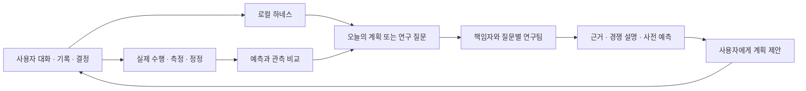

# 수련 연구 에이전트 구현 설계서

**독립 설계안 · 2026-11-22 · 기준 [요구사항 명세 v0.37](SPECIFICATION.md)**

사용자는 자연적 수련으로 신체와 기술을 함께 발전시킨다. 에이전트는 사용자와 연구 질문을 정하고, 자료에서 발전 원리를 찾고, 수련법 후보를 비교한다. 사용자가 선택한 방법은 실제 수행 기록과 연결한다. 시간이 지나면 “당시 무엇을 예상했고 실제로 무엇이 달라졌는가?”에 답할 수 있어야 한다.

**빠르게 보기**　[제품과 사용 흐름](#overview) · [11개 구성 요소](#components) · [컨텍스트 예시](#context)  
**구현할 때**　[경계와 계약](#contracts) · [데이터 모델](#storage) · [실행과 복구](#execution) · [자료·계산 도구](#tools) · [검증과 구현 순서](#delivery)

<a id="overview"></a>
## 1. 사용자가 보는 제품

| 사용자가 하는 말 | 화면에 바로 나오는 것 | 다음 사용을 위해 남는 것 |
| --- | --- | --- |
| “오늘 처음인데, 무엇부터 할까?” | 현재 판단에 빠진 시간·환경·경험·상태만 질문. 답을 받으면 신체와 기술에서 우선 살필 능력, 당일 훈련·영양·휴식 계획과 이유를 제시 | 사용자 답변, 제안한 목표와 계획. 채택은 사용자 선택으로 별도 기록 |
| “이 훈련을 왜 하는지 연구해 줘” | 합의할 질문, 선수 원자료에서 확인한 사실, 경쟁 설명, 새 근거가 바꾼 판단 | 자료의 정확한 위치, 조건부 주장, 미해결 질문, 실험 계획과 사전 예측 |
| “시간이 줄었고 어제 절반만 했어” | 실제 수행량과 새 제약이 영향을 주는 항목, 오늘의 변경안 | 어제 계획·실제 수행·오늘 제안이 각각 남음 |
| “지난번에 바꾼 방법은 효과가 있었어?” | 당시 예측과 비교 가능한 관측, 개선·악화·판단 보류의 이유, 다음 판별 측정 | 원래 예측, 이번 판정, 계획을 갱신한 근거 |

**두 작업이 함께 돌아간다.** 오늘의 계획은 이미 검토한 근거와 현재 상태로 제시하고, 시간이 더 필요한 연구는 계속 진행한다. 새 결과가 오면 기존 계획에 미치는 영향을 설명한다. 초기 레퍼런스는 베테르비에프다. 공개 영상의 동작과 당사자 발언을 구분하고, 측정 자료가 없는 내부 생리 수치는 미확인으로 남긴다. 신체와 기술에 고정 가중치를 부여하지 않는다. 중심 목표 변경·개인 적용·새 서비스에 개인 자료 제공은 사용자가 결정한다.



**이번 설계의 중심 결정.** 앱이 보존할 기본 단위는 *출처가 있는 판단과 그 버전*이다. 모델은 한 번에 다음 행동 하나를 제안하고, Python 하네스가 권한·작업 상태·실제 데이터를 확인한 뒤 집행한다. 다음 호출의 문맥은 저장된 기록에서 재구성한다. 이 방식은 행동마다 추론 호출이 추가되는 비용이 있지만, 어떤 자료를 모델이 보았는지 재현하고 실패한 실행을 같은 지점에서 이어가기 쉽다. 검색 결과 일괄 조회와 같은 독립적인 읽기만 한 행동 안에서 묶는다.

<a id="components"></a>
## 2. 11개 구성 요소와 구현 경계

| 요소 | 선택한 구현 | 성능을 확인할 관측값 |
| --- | --- | --- |
| 모델 | 기존 계정의 Codex CLI를 로컬 자식 프로세스로 실행. 초기 비교 후보는 설정 가능한 `gpt-6.2-astra`. 단순 조회는 medium, 인과 비교·결론 검토는 high | 고정 high 기준선 대비 정답, 사용량, 대기시간. 실제 계정 지원 여부는 첫 통합 시험 |
| 컨텍스트 | Python이 작업별 입력 패킷을 매 행동마다 생성. 목표·새 정정·반례를 먼저 배치하고 긴 출력은 근거 위치로 재열람 | 필수 근거 유지율, 최종 인용 정확도, 중복 열람, 입력 토큰 |
| 메모리 | SQLite의 버전 기록과 관계, FTS5. 한 작업의 진척은 체크포인트, 세션 간 합의·관측·예측은 영구 기록 | 정정본 회상, 과거 시점 조회, 재개 후 중복 실행 |
| 지식 | 주장에 대상·기간·비교군·측정 조건과 출처 버전을 연결. 같은 원 연구의 재인용은 한 근거군으로 집계 | 잘못된 일반화, 중복 근거, 철회 후 남은 유효 주장 |
| 도구 | Python 제공자 어댑터가 공식 API·RSS·로컬 함수·허용된 실행 파일을 호출. 외부 MCP 제공자는 동일 계약에 매핑 | 호출 성공·부분 성공, 근거 좌표, 출처별 지연·비용 |
| 스킬 | 버전 관리한 절차 파일과 결정론적 검사 함수. 최초 세 개는 근거 추출·영상 관찰·개인 전후 비교 | 동일 과제에서 스킬 사용 전후 누락·오판 |
| 지침 | 공통 지침 → 역할 지침 → 작업 계약 → 선택된 스킬. 자료 본문과 사용자 승인 이벤트는 다른 입력 필드 | 지시 충돌, 역할 밖 행동, 실제 채택 오기록 |
| 하네스 | 단일 Python 서비스가 SQLite를 소유. 입력 검증·작업 예약·도구 실행·결과 커밋·재개 담당 | 충돌·중복 쓰기·복구 손실 |
| 오케스트레이션 | 책임자가 질문별 팀을 만들고 담당자가 증거·반례를 공유. 당일 계획은 단일 작업으로도 완료 | 근거 중복, 반례 전달 누락, 첫 유용한 결과까지의 시간 |
| 실행 환경 | Windows 단일 사용자 로컬 서비스와 브라우저 UI. 과학 계산은 별도 제한 프로세스에서 수행 | 계정 인증 경로, 프로세스 취소, 자원·파일 경계 |
| 피드백 | 제출 전 코드 검사, 중요한 의미 충돌은 독립 재검토, 실제 수행 뒤 예측 대조 | 근거 없는 확정, 정정 후 재평가, 보류의 적절성 |

<a id="contracts"></a>
## 3. 프로그램 구조와 사용자 계약

**배포 단위.** Python 3.13 패키지 하나, `frh serve` 하나로 실행한다. FastAPI + Uvicorn 단일 워커가 `127.0.0.1`에 바인딩한다. 정적 HTML·CSS·JavaScript로 대화/오늘, 진행 중 연구, 근거·이력의 세 화면을 제공한다. 진행 상태는 2초 폴링으로 시작한다. SQLite WAL·파일 저장소는 OS 사용자 전용 앱 데이터 경로에 둔다. 공개 저장소·동기화 폴더를 개인 자료의 기본 위치로 사용하지 않는다. 첫 구현부터 당일 운영과 연구 경로를 함께 제공한다.

| 패키지 | 소유 책임과 진입점 |
| --- | --- |
| `web/` | `app.py`, 정적 UI. 로컬 세션 확인, DTO 검증, UTC ↔ 사용자 시간대 변환, 응답 표시 |
| `application/` | `dispatch(command)`, `advance(work_id)`, `review_dependents(ref)`. 요청 중복 처리, 권한, 트랜잭션 |
| `domain/` | Pydantic v2의 이벤트·행동·기록 타입. `validate_claim`, `compare_observations`, `apply_transition`은 순수 함수 |
| `agent/` | `build_packet`, `decide`, `render_reply`. 모델 어댑터·프롬프트·스킬 버전을 분리 |
| `integrations/` | 출처별 어댑터, 미디어 판독, FIT/CSV 입력, 실험 실행. 도메인 DB 직접 쓰기는 application에 요청 |
| `storage/` | `sqlite3`, 번호가 있는 SQL 마이그레이션, 개인 파일 저장·검증·백업. 테스트용 DB도 같은 마이그레이션 사용 |

**HTTP.** 쓰기 요청은 클라이언트 생성 UUID인 `Idempotency-Key`를 필수로 한다. 같은 키·같은 payload는 최초 응답을 돌려주고, 같은 키·다른 payload는 409다. 수정은 `expected_version` 불일치 시 최신 버전 참조와 409를 반환한다. 입력 오류 422, 세션 밖 요청 403, 없는 참조 404, 접속 불가 503. 모델이 제안한 행동에는 사용자 승인 권한이 없다. UI 버튼·대화에서 명시한 승인 내용을 앱이 확인한 뒤 아래 결정 엔드포인트를 호출한다.

| 메서드·경로 | 입력 | 성공 응답·부수 효과 |
| --- | --- | --- |
| POST `/v1/requests` | `{text, intent:auto/daily/research/review, local_date, attachment_ids[]}` | 202 `{work_id,state}`. auto는 책임자가 첫 행동에서 분류. 첫날 자료 부족 시 필요한 질문만 반환 |
| GET `/v1/work/{id}?after=N` | 마지막으로 본 이벤트 번호 | 200 `{state, events[], next_cursor, result_ref?, question?}`. 보류·부분 결과와 이유 포함 |
| POST `/v1/work/{id}/answers` · `/cancel` | 질문 ID와 답변 또는 취소 이유, 작업 버전 | 200. 답변은 해당 대기를 해제, 취소는 남은 일 예약을 중단 |
| POST `/v1/decisions` | `{kind:goal/adopt/export, target_ref, expected_version, choice, scope?}` | 201. export는 자료 버전·목적·서비스·만료를 결합. 새 버전·다른 목적은 새 결정 필요 |
| POST `/v1/observations` · POST `/v1/records/{id}/revisions` | 실제 수행·측정과 시각·단위·조건 또는 수정 사유·기대 버전·새 값 | 201 `{ref, affected_work_ids[]}`. 정정 시 하위 주장을 재검토 대상으로 표시 |
| POST `/v1/files` · GET `/v1/records/{id}?version=N` | 로컬 파일(multipart), 또는 허용된 기록 참조 | 201 파일 ID·해시, 또는 200 기록과 근거 위치. 파일 경로를 클라이언트가 지정하지 않는다 |

**화면 상태.** 대화 화면은 새 요청을 만든 뒤 이벤트 커서를 저장한다. `question` 이벤트에서만 답변 입력을 활성화하고, `plan_proposed`가 오면 채택 버튼에 정확한 계획 버전을 묶는다. 연구 화면은 팀별 질문·완료 조건·현재 장애와 공유 발견을 표시한다. 근거 화면은 주장 → 근거 버전 → 원문 위치로 이동하고, 정정 전후와 영향받은 계획을 나란히 보여준다. JSON 참조 표기는 전 경로에서 `{"id":"r-123","v":2}`를 사용한다.

예를 들어 UI는 `{"text":"오늘은 30분만 가능해","intent":"daily","local_date":"2026-11-22","attachment_ids":[]}`를 보낸다. 결과 카드에는 근거가 있는 이유, 제안한 훈련·분량·영양·휴식, 필요한 확인 사항, **채택·수정** 버튼을 표시한다. 실적 입력은 별도 요청이다. 연구 카드는 핵심 결론, 관측과 추론 구분, 상충 자료, 근거 열기, 다음 질문을 표시한다.

<a id="storage"></a>
## 4. 영구 기록과 정정

모든 근거 참조는 `{id,v}`다. 시간은 UTC ISO 8601, 관측일은 사용자 시간대와 함께 원본 보존, 숫자는 측정 당시 값·단위와 정규화 값을 함께 저장한다. DB에 커밋된 최신 버전은 `MAX(v)`, 과거 판단은 당시 참조한 버전으로 연다. 관측 시점과 시스템에 입력한 시점은 별개다.

| 기록 종류 | `revision.body` 필수 내용 |
| --- | --- |
| goal · decision | 목표 문장·우선순위의 이유·동의 상태 / 결정 종류·대상 버전·선택·범위 |
| source · evidence | 원 URL/DOI/PMID/파일 ID, 원자료군 ID, 판본·공개일·접근 상태 / 출처 버전, 페이지·표·프레임·행, 짧은 관측문, 실제 열람 여부 |
| claim | 주장, 관측/추론, 대상·기간·조건, 지지·반대 근거, 상태 proposed/supported/disputed/needs_review, 미확인점 |
| experiment · prediction | 질문, 후보·비교 기준, 입력 버전·모델·계수·환경, 판정 규칙 / 평가일, 지표·방향 또는 범위, 판정을 바꿀 결과 |
| plan | 목적·날짜·여건·훈련과 분량·영양·휴식, 예상 이익과 부담, 이전 계획과 달라진 점. 별도 사용자 결정으로 채택 |
| observation · review | 계획 참조(선택), 수행 상태 done/partial/skipped/unknown, 측정값·단위·조건·시점 / 예측 참조, 실제 관측 참조, 비교 적합성, 유지·수정·보류와 이유 |

<details>
<summary>SQLite 초기 마이그레이션 DDL</summary>

```sql
PRAGMA foreign_keys = ON;
CREATE TABLE work (
  id TEXT PRIMARY KEY, parent_id TEXT REFERENCES work(id), role TEXT NOT NULL
    CHECK(role IN ('lead','team_lead','peer')), goal_ref TEXT, question TEXT NOT NULL,
  acceptance TEXT NOT NULL, state TEXT NOT NULL CHECK(state IN
    ('ready','running','waiting','blocked','done','cancelled')),
  version INTEGER NOT NULL DEFAULT 1, priority INTEGER NOT NULL DEFAULT 0,
  budget_left INTEGER NOT NULL CHECK(budget_left >= 0),
  lease TEXT, lease_until TEXT, note_json TEXT NOT NULL DEFAULT '{}'
);
CREATE TABLE attempt (
  id TEXT PRIMARY KEY, work_id TEXT NOT NULL REFERENCES work(id), work_version INTEGER NOT NULL,
  status TEXT NOT NULL CHECK(status IN ('reserved','sent','accepted','failed','unknown')),
  model TEXT NOT NULL, effort TEXT NOT NULL, packet_hash TEXT NOT NULL, usage_json TEXT,
  started_at TEXT NOT NULL, ended_at TEXT
);
CREATE TABLE record (
  id TEXT PRIMARY KEY, kind TEXT NOT NULL CHECK(kind IN
    ('goal','source','evidence','claim','experiment','prediction','plan','observation','review','decision')),
  scope TEXT NOT NULL CHECK(scope IN ('public','personal')), owner_work TEXT REFERENCES work(id)
);
CREATE TABLE revision (
  record_id TEXT NOT NULL REFERENCES record(id), v INTEGER NOT NULL CHECK(v>0),
  body TEXT NOT NULL CHECK(json_valid(body)), created_at TEXT NOT NULL, actor TEXT NOT NULL,
  PRIMARY KEY(record_id,v)
);
CREATE TABLE edge (
  src TEXT NOT NULL, sv INTEGER NOT NULL, relation TEXT NOT NULL, dst TEXT NOT NULL, dv INTEGER NOT NULL,
  PRIMARY KEY(src,sv,relation,dst,dv),
  FOREIGN KEY(src,sv) REFERENCES revision(record_id,v), FOREIGN KEY(dst,dv) REFERENCES revision(record_id,v)
);
CREATE INDEX affected ON edge(dst,dv,relation);
CREATE TABLE event (
  seq INTEGER PRIMARY KEY, work_id TEXT NOT NULL REFERENCES work(id), kind TEXT NOT NULL,
  body TEXT NOT NULL CHECK(json_valid(body)), at TEXT NOT NULL
);
CREATE INDEX work_events ON event(work_id,seq);
CREATE TABLE receipt (key TEXT PRIMARY KEY, input_hash TEXT NOT NULL, response TEXT NOT NULL);
CREATE TABLE job (
  id TEXT PRIMARY KEY, request_key TEXT NOT NULL UNIQUE, work_id TEXT NOT NULL REFERENCES work(id),
  kind TEXT NOT NULL, args TEXT NOT NULL, state TEXT NOT NULL CHECK(state IN
    ('queued','running','succeeded','failed','unknown','cancelled')), run_token TEXT, lease_until TEXT,
  result_json TEXT, error_json TEXT
);
CREATE TABLE dependency (
  waiter TEXT NOT NULL REFERENCES work(id), waits_for TEXT NOT NULL REFERENCES work(id),
  PRIMARY KEY(waiter,waits_for), CHECK(waiter<>waits_for)
);
CREATE TABLE artifact (
  id TEXT PRIMARY KEY, sha256 TEXT NOT NULL, scope TEXT NOT NULL, relpath TEXT NOT NULL UNIQUE,
  media_type TEXT NOT NULL, size_bytes INTEGER NOT NULL CHECK(size_bytes>=0)
);
CREATE TABLE acl (
  work_id TEXT NOT NULL REFERENCES work(id), record_id TEXT NOT NULL REFERENCES record(id),
  PRIMARY KEY(work_id,record_id)
);
CREATE TABLE search_doc (
  rowid INTEGER PRIMARY KEY, record_id TEXT NOT NULL, v INTEGER NOT NULL, text TEXT NOT NULL,
  UNIQUE(record_id,v), FOREIGN KEY(record_id,v) REFERENCES revision(record_id,v)
);
CREATE VIRTUAL TABLE words USING fts5(text,tokenize='unicode61');
CREATE VIRTUAL TABLE grams USING fts5(text,tokenize='trigram');
CREATE TABLE feed_cursor (
  provider TEXT NOT NULL, query_key TEXT NOT NULL, cursor TEXT, checked_at TEXT,
  PRIMARY KEY(provider,query_key)
);
CREATE TABLE wait_for (
  work_id TEXT NOT NULL REFERENCES work(id), type TEXT NOT NULL CHECK(type IN
    ('job','user','decision','record')), target_id TEXT NOT NULL,
  PRIMARY KEY(work_id,type,target_id)
);
CREATE INDEX wake_waiter ON wait_for(type,target_id);
CREATE TABLE budget (
  root TEXT PRIMARY KEY REFERENCES work(id), tool_left INTEGER NOT NULL CHECK(tool_left>=0),
  paid_limit_minor INTEGER NOT NULL CHECK(paid_limit_minor>=0),
  paid_reserved_minor INTEGER NOT NULL DEFAULT 0, paid_used_minor INTEGER NOT NULL DEFAULT 0,
  CHECK(paid_reserved_minor>=0 AND paid_used_minor>=0
    AND paid_reserved_minor+paid_used_minor<=paid_limit_minor)
);
```

</details>

**쓰기 알고리즘.** 연결마다 FK를 켠다. 초기화 시 WAL과 busy timeout을 설정한다. `BEGIN IMMEDIATE` 안에서 중복 요청 확인 → 권한·기대 버전 비교 → 다음 revision·연결·색인·event·receipt 삽입 → 커밋 순으로 처리한다. FTS 두 색인의 rowid는 search_doc과 일치시킨다. 새 개인 자료에서 파생한 결과는 personal로 승계한다. ACL은 앱이 허가한 업무 기록에만 부여하고 모델이 보낸 소유자·권한 값을 버린다. 파일은 앱 전용 임시 경로에서 해시·형식·크기를 검사하고 원자적 rename 후 DB 커밋한다. 커밋 전 중단된 미참조 파일은 다음 시작 때 일괄 확인한다.

파일 ID 읽기는 그 파일을 포함한 source/observation의 접근권을 확인한다. 업로드와 동시에 소유자의 personal source를 생성한다. 파일과 기록의 연결은 source.body의 artifact_id로 유지하고 해당 표현식에 인덱스를 만든다. 물리 삭제 시 revision에는 원래 ID와 삭제 사실만 표시하도록 표시용 tombstone을 둔다. 삭제가 필요한 민감 본문·파생 발췌·검색 색인·백업 사본도 사용자 결정 범위에 맞춰 제거하고 삭제 사실과 비식별 참조만 유지한다.

**관계와 정정.** `edge`는 파생 기록 → 의존한 기록 방향이다. 예를 들어 `review@1 → observation@1`, `review@1 → prediction@1`이다. 정정으로 `observation@2`를 쓰면 역방향 인덱스와 방문 집합으로 이전 버전에 의존한 최신 주장·판정·계획을 찾는다. 같은 트랜잭션에 재검토 이벤트를 넣고 중복 없는 재검토 작업을 예약한다. 결과 보기에 미처리 정정 표시가 즉시 나타난다. 원래 예측과 실제 채택 이력은 당시 버전을 유지한다. 연구팀이 같은 논문을 인용하면 evidence 두 건을 남길 수 있어도 독립 근거 수는 원자료군으로 집계한다.

<a id="context"></a>
## 5. 한 연구자의 판단 루프

**입력 패킷을 만드는 코드.** `build_packet(work_id, version, intent)`가 ① 목표와 사용자의 최신 요청 ② 권한·담당 질문·완료 조건 ③ 당시 합의 또는 사전 예측 ④ 최신 정정·미처리 반례 ⑤ 지금 행동에 필요한 자료 ⑥ 남은 예산을 조립한다. 각 근거 조각에 기록 ID·버전·좌표를 붙인다. 담당 배정 때는 범위와 반환 형식, 조사 중에는 마지막 관측과 실패 이유, 최종 판단 때는 주장별 지지·반대 표를 우선한다. 개인 기록은 패킷 작성 전 SQL에서 ACL·유효 버전을 제한한다. 전체 텍스트를 모델에 보낸 뒤 가릴 권한을 판단하지 않는다.

| 읽은 정보의 다음 상태 | 선택·집행 규칙 |
| --- | --- |
| 원문 고정 | 수치·단위·분모·시점·표 각주는 좌표와 함께 원문을 고정한다. 겹친 표를 중간에서 자르면 행·머리글·각주를 다시 연다. |
| 작업 메모 | 새 근거로 끝난 탐색은 ‘무엇을 확인했는지, 원자료 ID, 다음 질문’으로 접는다. 실패한 경로는 이유와 다시 시도할 조건을 보존한다. |
| 외부 참조 | 원문·영상·상세 실행 로그는 파일/DB에 두고 필요한 구간만 연다. 보호할 반례가 입력 한도를 넘으면 미열람 목록·건수를 남기고 해당 주장은 부분 결과로 반환한다. |

초기 패킷은 가변 발췌 6개·각 1,200자, 전체 패킷 UTF-8 48 KiB를 시범 상한으로 둔다. 호출 전 길이를 측정하며 정정·미해결 반례·현재 요청을 우선한다. 긴 요청도 원문 ID를 남기고 결정에 필요한 범위를 나눠 읽는다. 실제 모델 입력 토큰은 사용량 이벤트로 별도 측정한다. 내부 원시 추론을 저장하는 대신 확인한 사실·판단 근거·열린 질문을 저장한다.

**회상과 경험 재사용.** ID가 있으면 정확 조회 → 구조화 필터(사람·지표·기간·단위) → NFC 정규화한 FTS5 BM25 단어 조회 → 결과가 빈 3자 이상 용어는 trigram 조회 순서다. '악력/손아귀힘'과 같은 검토된 지표 별칭은 검색 전에 전개한다. 입력을 FTS 리터럴로 인코딩하고 바인딩한다. 최신값을 묻는 검색은 권한과 최신 revision을 먼저 적용해 정렬·상한을 계산한다. 절차의 성공은 재사용 가능한 스킬 개선 제안이 될 수 있으나 배포 버전 변경은 사용자·Codex의 개발 작업으로 남긴다.

**합성 예시.** “지난번 방법이 효과가 있었어?”에 대한 최종 패킷은 `prediction P@1`, `plan T@2`, `actual O@3`, `측정 시각 불일치`, `미확인 반복 측정`을 포함한다. 단위 정정 전 `O@2`는 수정 이력으로 열 수 있다. 단위가 같아도 측정 조건과 실제 훈련량이 달라졌다면 “관측된 변화”와 “방법에 귀속할 수 있는 효과”를 따로 판정한다.

**스킬 계약.** `skills/<name>/v1.md`에 적용 조건·필수 입력·확인 절차·출력 타입·실패 조건을 두고 동명 검사 함수를 연결한다. dispatcher가 행동과 데이터 타입으로 후보를 제공하고 연구자가 적합한 절차를 선택한다. 결과에는 스킬 버전과 출처 참조가 남는다.

| 초판 스킬 | 검사할 것 | 유효한 결과 |
| --- | --- | --- |
| `extract-study` | 참가자·비교군·관측 기간·지표·원문 표 위치와 독립 근거군 | evidence와 적용 범위. 초록만 열리면 실제 확인 수준 표시 |
| `observe-video` | 영상 ID, 프레임률·구간, 보정 가능 여부, 직접 관찰과 추정 분리 | 타임스탬프가 있는 관찰. 보정 정보 없는 절대 거리 추정은 보류 |
| `compare-personal` | 동일 과제·단위·평가일·수행량·누락과 정정 여부 | 원래 예측·실제값·혼란 요인·판정·다음 확인 조건 |

<a id="execution"></a>
## 6. 모델·팀·작업 실행 계약

**Codex 어댑터.** Python `asyncio.create_subprocess_exec`에 인자 배열을 넘긴다. 전용 빈 작업 디렉터리와 사용자 권한으로 보호한 전용 Codex 프로필/계정 저장소를 사용한다. 앱 UI와 모델 자식 프로세스의 파일 접근을 분리한다. 모델에 자료가 필요하면 하네스가 허용된 발췌나 이미지 프레임만 전달한다. 호출마다 새 임시 Codex 세션을 시작하므로 앱이 보내는 패킷이 명시적인 업무 문맥이다. 첫 구현에서 이 비용을 측정하고 장기 세션 재사용은 같은 인수 시험으로 비교한다.

```text
codex -a never exec --ephemeral --ignore-user-config --skip-git-repo-check
  -s read-only -C <empty-dir> --disable shell_tool --disable unified_exec
  --disable plugins --disable apps -c web_search="disabled"
  -m <configured-model> -c model_reasoning_effort="<effort>"
  --json --output-schema <decision-schema.json> -o <private-result.json> -
```

위는 줄을 나눈 argv 표기다. stdin에는 JSON 입력 패킷, stdout에는 상태·사용량 이벤트, 결과 파일에는 최종 구조화 출력을 받는다. 이벤트 전문을 운영 로그에 남기지 않는다. `--ignore-user-config`가 인증까지 제거하지 않는지와 기존 계정 로그인 경로를 `doctor`에서 실제 확인한다. API 키·공급자 환경변수는 자식에 상속하지 않는다. 실험용 외부 호출은 어댑터에서만 집행한다. Codex 자체 도구의 가용성은 버전에 따라 달라질 수 있으므로 깨끗한 실행 루트·프로필 및 OS 권한으로 개인 파일/DB를 보호하고, 미승인 플러그인·네트워크 도구가 노출되면 모델 워커를 시작하지 않는다. 원격 공개 검색, 개인 자료 로컬 판독, 모델 추론 각각의 송신 범위를 분리한다. [Codex 비대화형 실행 문서](https://developers.openai.com/codex/noninteractive)

**모델 출력.** Pydantic v2 strict 모델의 `extra='forbid'`와 판별 유니온을 사용한다. 출력 스키마 루트는 객체 `{decision: <행동>, note: <짧은 진행 기록>}`이다. note는 `finding_refs[], open_question, resume_when`을 담는다. nullable 필드도 JSON 키는 명시한다. CLI가 받는 JSON Schema는 고정 fixture로 검증하고, 수신 후 Pydantic으로 재검증한다. 모델 출력에서 사용자 신원·실행 시도 ID·작업 버전을 받지 않는다.

| 행동(kind) | payload와 권한 | 성공 시 |
| --- | --- | --- |
| `read` | provider, operation, args, refs. 누구나 작업 범위 내에서 요청 | 로컬 읽기 또는 원격 job. 결과/부분 실패를 다음 패킷에 공급 |
| `write` | kind, body, dependency_refs. 맡은 작업의 evidence/claim/experiment/prediction/plan/review 제안 | 권한·출처·스키마 확인 후 revision 생성. 개인 실제값과 결정은 사용자 입력 또는 검증된 기기 import 경로로만 기록 |
| `delegate` | items의 각 항목에 질문·범위·반환 조건·기존 근거. lead는 팀, team_lead는 동료 작업 생성 | parent와 역할을 서버에서 부여. 단순 질문은 lead가 직접 처리 |
| `share` | target_work, finding_ref, why_it_matters. 같은 목표에 소속된 상대 작업만 허용 | 수신함 event로 한 번 전달. 개인 자료 본문은 읽기 권한을 확인한 뒤 열람 |
| `ask` · `wait` | 질문과 선택에 미치는 영향 또는 대기할 job·작업·관측 ID | ask는 lead를 통해 사용자에게 전달. 해당 작업만 대기하고 독립 팀은 계속 |
| `finish` | outcome=complete/partial, 사용자용 결론, 근거 refs, 미확인점, 후속 조건, 검토한 발견 번호 | 일반 의미 판단은 모델이 하고, 코드가 근거 위치·버전·권한·중요 반례 미처리를 검사한 뒤 상위 작업 또는 사용자에게 반환 |

```json
{"decision":{"kind":"share","target_work":"team-b","finding_ref":{"id":"e-17","v":1},"why_it_matters":"평가 시점이 운동 직후여서 장기 적응 비교에 영향을 준다."},"note":{"finding_refs":[{"id":"e-17","v":1}],"open_question":"후속 평가일 자료가 있는가?","resume_when":null}}
```

**깨우기·승인 구현.** `ask`는 대기 사유와 질문 ID를 저장한다. 팀원의 질문은 lead 수신함으로 올라가고, 사용자 답변은 원 질문 ID로 되돌아간다. 완료 조건을 바꾸는 새 사용자 요청은 작업 버전을 올린다. 위임마다 새 work 행을 만들고 parent 체인에서 루트 목표와 예산을 확인한다. `work.goal_ref`는 합의한 goal의 ID이며 채택 전에는 NULL이 가능하다. 공유에는 이벤트 순번과 발신 근거를 붙이고 동일 제출 키로 재전달 시 중복 반영을 막는다. 대기 조건은 모두 충족 시 재개하되 중요한 반례는 즉시 재평가 이벤트로 깨운다.

**스케줄러.** 초기 실행값은 전체 동시 모델 호출 2, 작업당 동시 1, 기본 일일 요청 8회·연구 요청 40회 모델 호출, 외부 유료 한도 0이다. 요청별 설정으로 바꾸며 팀 생성은 상위 목표의 남은 예산을 나누어 쓴다. 당일 요청 우선, 같은 등급은 오래 기다린 순서, 연속 3개 당일 예약 후 대기 중 연구 1개를 허용한다. 외부 자료 지연 중에는 슬롯을 놓는다. 초기 네트워크 타임아웃 30초, 모델 결정 180초, 계산 job 10분은 설정값이다. 사용량·기기·대기 허용시간을 측정해 조정한다.

```text
BEGIN IMMEDIATE → ready 작업·루트 예산 확인 → lease와 attempt 할당·예약 → COMMIT
모델 호출 전 sent 기록 → DB 트랜잭션 밖에서 실행 → 출력·권한 검사
BEGIN IMMEDIATE → lease·버전·취소·미검토 발견 재확인 → 행동·note·event·receipt 원자 반영 → COMMIT
```

| 상황 | 전이와 복구 규칙 |
| --- | --- |
| 정상 | ready → running → ready / waiting / done. 필수 의존이 막히면 blocked. wait 등록 직전에 대상 상태를 다시 읽어 이미 끝났으면 즉시 ready로 전이한다. 순환 의존은 등록 전에 검사한다. |
| 형식·자료 오류 | 스키마 실패는 같은 작업에서 오류 경로와 함께 한 번 교정 기회를 주고 재발하면 부분 결과. 단위 불명은 해당 비교만 보류. 403은 권한 변경까지 보류, 429는 Retry-After, 공개 읽기 타임아웃은 제한 내 한 번 재시도한다. |
| 프로세스 사망 | lease 만료 뒤 reserved는 재예약 가능, sent 기록 뒤 결과가 없는 모델 시도는 unknown. 임시 결과가 완전하면 같은 attempt로 재검증·커밋하고, 송신 상태를 확정할 수 없으면 작업을 보류해 중복 비용을 막는다. |
| 비동기 계산·사용자 취소 | 요청 키는 실험 계획 버전·입력 해시·실행 설정·명시적 반복 번호의 해시다. DB 유일 키로 submit 재전송을 합친다. 완료 이벤트와 결과 참조는 함께 커밋한다. 취소·재배정은 작업 버전을 올리고 가능한 자식 프로세스를 중단한다. 늦은 결과는 이력에만 연결한다. |
| 합의와 결론 경쟁 | 정정·새 반례의 seq가 검토 번호보다 앞서 있고 결론에 영향이 있으면 재검토한다. 결론 커밋 직후 새 반례가 도착하면 이전 결론을 참조하는 새 review를 연다. 사람이 중심 목표를 다시 정하면 이전 목표의 진행 작업을 재확인한다. |

<a id="tools"></a>
## 7. 조사·실험·운영 연결

**연결 카탈로그.** 도구 이름과 지원 방식을 하나의 manifest에 저장한다. 필드는 `name, operations, access(auto/import/subscription), input_schema, allowed_scope, cost_class, timeout_s`다. 검색 시 출처를 지정할 수 있다. 아래 전체 목록을 보존하고, 실제 사용 가능·인증 필요·가져오기 전용·장애를 UI에서 구분한다.

| 제공자·실행기 | 구체적으로 받는 자료와 경계 |
| --- | --- |
| PubMed + NCBI E-utilities, PubMed Central + BioC, Europe PMC + 저장 검색·RSS | PMID/DOI, 검색식·등록일·전체 페이지, 공개 XML 원문·보충자료와 실제 읽힌 위치 |
| OpenAlex, Semantic Scholar Research Feeds, SportRxiv, SPORTDiscus | 참고·피인용, 질문별 추천, 공개 원고 버전, 기관 스포츠 색인. 자동 조회가 허용되지 않으면 URL·내보낸 자료를 import |
| 학술지 직접 RSS·J-STAGE, arXiv 분야 RSS, WHO ICTRP, DataCite, Crossref Retraction Watch | 신착·등록번호·예정 평가 지표·데이터셋 DOI·철회/일부 정정. 같은 연구의 판본과 후속 데이터를 연결 |
| Exa, YouTube Data API v3, Trafilatura, Firecrawl | 웹·영상 후보 → 채널/원 URL → 공개 본문. 영상 검색 결과와 직접 확인한 장면을 구분. 외부 서비스 사용은 접근권·비용 범위에서 집행 |
| pypdf + pypdfium2, FFmpeg + ffprobe, Zotero Web API | 페이지 텍스트와 렌더링, 구간·프레임, 허용된 서지 컬렉션. 영상·스캔·그래프는 읽은 범위를 표시 |
| pandas·NumPy·SciPy, 필요시 OpenSim/Moco | CSV 정리, 비교·민감도·모델 계산. 관절 역동역학은 개인화 모델·동작 좌표·필요한 외력·동기화가 있을 때 해석. 결과는 단위와 모델 범위 포함 |
| Kinovea, MediaPipe Pose, OpenCap, Garmin FIT SDK | 평면 보정 궤적·랜드마크·통제 촬영 추정·기기 기록. 개인 영상의 외부 분석은 해당 자료 버전·목적·서비스에 대한 사용자 결정 확인 |

**어댑터 API.** `capabilities() → {mode, operations, auth_state}`, `invoke(operation, args, access_context) → ToolResult`. access_context는 하네스가 생성한다. 유료 호출은 root 예산에서 예상 상한을 선예약하고 종료 후 실사용을 정산한다. 통화를 통일할 수 없거나 최대 비용을 알 수 없으면 자동 실행을 보류한다. I/O 중에 SQLite 쓰기 트랜잭션을 유지하지 않는다. 파일·측정은 scope와 허용된 파일 ID를 검사한 뒤 연다. 실패 분류는 invalid_input, permission, unavailable, rate_limited, timeout, quota, unknown_outcome이다. 서로 다른 서비스 요청은 한 공급자 오류가 다른 결과를 취소하지 않도록 개별 결과를 반환한다.

**도구 계약.** `search(query, filters, cursor)` → 후보·provider_cursor, `read(ref, locator)` → 발췌·원자료군·실제 열람 위치, `measure(file_id, range)` → 시점·값·단위·조건, `simulate(plan_ref, inputs, settings)` → 결과 또는 job ID. 공통 응답은 `{status:ok/partial/pending/failed, items, artifact_ids, cursor, error, resume_when}`. 정상 0건은 ok와 빈 items다. 신착 커서는 페이지 저장 성공 뒤 갱신하고 DOI/등록번호·영상 ID·원자료군으로 재수집을 합친다. 발행일과 처음 발견한 날을 구분한다. 동의어·종목명·원리 검색, 후속 인용, 독립 재현·반례 확인을 질문에 맞게 조합한다. 신착이 기존 결론을 바꾸면 영향을 받은 연구를 깨운다.

**실험 경계.** 실행 전 계획 버전·예측·판정 조건을 저장한다. runner는 등록된 계산 함수와 입력 계약으로 시작한다. 새 분석 코드가 필요하면 격리된 별도 프로세스에서 승인된 입력의 읽기·전용 출력·시간 및 메모리 한도를 적용한 뒤 실행하고 환경 정보·난수 시드·입력 해시를 기록한다. 개인 파일·자격증명과 네트워크를 그 프로세스에 상속하지 않는다. 격리 기능을 확인할 수 없는 호스트에서는 등록된 계산만 제공한다. 부호·단위·알려진 기준값을 검산하고 실제 관측을 모델 출력과 구분한다.

**접근과 운영.** 브라우저는 실행 시 발급한 1회 부트스트랩 토큰으로 HttpOnly·SameSite=Strict 세션을 얻는다. 상태 변경은 Origin/Host·CSRF 토큰을 검사한다. 사용자가 올린 파일과 가져온 문구는 자료 권한이다. 개인 자료와 결합한 검색어·발췌·파생 데이터에도 외부 제공 결정을 적용한다. 로그에는 ID·버전·시간·오류 종류만 남긴다. 서비스 키는 OS 자격증명 저장소/프로세스 한정 환경으로 제공한다. 백업은 SQLite online backup과 그 스냅샷이 참조한 파일 목록·해시를 앱 전용 경로에 복사하고 복원 시 대조한다. 개인 원본 삭제는 영향받는 파생본과 백업을 미리 표시하고 사용자 선택을 받은 뒤 처리한다. 보관 기간·복구 시간 목표는 사용자 운영 정책이며 자동 삭제 타이머는 설정 전 꺼 둔다.

<a id="delivery"></a>
## 8. 구현 순서와 완료 판정

**사용자에게 배포되는 첫 버전은 아래 1~6의 통합 결과다.** 세로로 연결된 기능부터 검증하고 기본 시나리오가 통과한 뒤 제공자를 확장한다.

| 순서 | 만드는 산출물 | 다음 단계로 넘어갈 증거 |
| --- | --- | --- |
| 1. 실행 뼈대 | pyproject, `frh serve/doctor/backup/restore`, DB migration 001, 합성 fixture, FakeModel/FakeProvider | 깨끗한 OS 사용자 폴더에서 부팅, 복원 후 파일 해시·FK 일치, CLI 버전·로그인 방식 식별 |
| 2. 당일 사용 | 대화 UI·질문과 답변·사용자 채택·실제 수행·정정 API | 신규 사용자의 첫날부터 다음 날까지 브라우저 통합 시험. 일부 수행·미기록·0이 구별됨 |
| 3. 한 연구팀 | 모델 프로세스와 스키마, 컨텍스트 조립, E-utilities/Europe PMC의 검색·원문 → 근거 → 주장 → 제출 | 공개 자료 한 건을 계정 사용 경로로 읽고 결과 카드의 표·문단을 다시 열 수 있음 |
| 4. 복수 팀·복구 | 위임·공유·반례·job·취소·예산·재개 | 병렬 두 팀에서 정정과 결론 경쟁을 재현. 지연·중단에도 실제 효과가 한 번만 기록됨 |
| 5. 실험과 저장 | 공개 표 또는 합성 CSV, 세 가지 스킬, 사전 예측·SciPy 계산·개인 관측 비교, 파일 보호 | 별도 팀이 같은 입력과 버전으로 지정 허용오차 내 재현. 토큰·전송 게이트·자료 삭제 경로 시험 |
| 6. 도구와 사용성 | §7 카탈로그 어댑터, import/접근 상태, 신착·철회 연결, 운영 지표와 안내 | 자동 연결은 정상·접근 실패를 각각 검증. 계정·기기 의존 경로는 실제 지원 범위 표시. 사용자가 세 화면에서 끝까지 수행 |

**대표 인수 시나리오와 요구사항 대응.** `pytest`는 임시 DB·가짜 시계·가짜 서비스로 상태를 검사한다. Playwright는 사용자 경로를 검사한다. 실서비스 시험은 별도로 기록한다.

| ID | 주어진 입력 → 실행 → 기대 상태 | 요구사항 |
| --- | --- | --- |
| T1 | 기록이 없는 사용자에게 시간·환경을 받아 오늘 계획 생성 → 근거와 분량·영양·휴식이 제시되고 사용자 선택 전 plan은 제안 상태 | FR-01, FR-04, NFR-04, C-01 |
| T2 | 어제 일부 수행, 오늘 시간 단축 → 이전 실제 수행을 조회해 변경 항목과 이유 표시. 확인된 여건을 다시 묻지 않음 | FR-04, FR-05, FR-06, NFR-02 |
| T3 | 새 방법·기존 방법·서로 반대되는 연구 → 조건·예상 이득·부담·사전 예측과 포기 기준, 독립 검토·채택 결정 분리 | FR-02, FR-03, C-03 |
| T4 | 과거 관측의 단위를 정정한 뒤 같은 요청 재송신 → 새 revision 하나, 의존 결론만 재검토, 기존 prediction 버전 유지 | FR-05, FR-06, NFR-02 |
| T5 | 같은 연구의 프리프린트·논문과 접근 불가 영상 → 근거군 하나, 실제 열람 범위와 보류·재개 조건 표시 | FR-02, FR-07, NFR-01, NFR-03 |
| T6 | 개인 영상·외부 분석 요청 → 결정 전 네트워크 모의 서버 수신 0건. 다른 파일·목적·서비스·만료된 승인은 거부 | NFR-05, C-03 |
| T7 | 계정 사용량 소진·미승인 유료 API·중간 장애 → 확인된 부분 반환, 유료 대체 호출 0건, 중복 예약 없음 | FR-07, NFR-03, C-02 |
| T8 | 새 관측이 예측과 불일치 → 이전 모델 판정과 수정 근거 보존. 제품 역할이 하네스 코드·스킬 배포 설정 변경을 시도하면 거부 | FR-06, C-04 |
| T9 | 두 팀이 동시에 예산 마지막 슬롯 요청, 작업 완료 직전 취소·재시작 → 예약 상한 준수, 늦은 결과의 채택 없음, 완료 후 wait 등록도 재개 | FR-07, NFR-02, NFR-03 |
| T10 | 긴 조사에서 정정·반례를 포함한 근거를 축약하고 재개 → 원문 좌표로 복원, 미검토 반례를 처리하거나 부분 결과로 표시 | FR-02, FR-06, NFR-01 |

**성능 평가.** 공개·합성 고정 스냅샷으로 조회/비교/접근 실패/중단 재개 각 6건, 설정별 3회가 첫 비교 세트다. 동일 모델·예산에서 전체 이력 입력과 장면별 패킷을 비교하고, 그 다음에 추론 강도와 스킬 유무를 한 항목씩 바꾼다. 정답뿐 아니라 올바른 근거 버전·최종 DB 상태·판정 보류의 적절성·반복 일관성·토큰·지연 p50/p95·첫 유용한 응답까지의 시간을 기록한다. 인과 주장은 평가자가 설정명을 모르는 상태에서 원자료와 대조한다. 개인정보 유출·원예측 덮어쓰기·중복 유료 집행은 단일 사례라도 릴리스 중단 조건이다.

**운영 목표와 남은 실측.** 호스트·CLI 옵션, 초기 SQL과 합성 계약 검산 범위는 별도로 보고한다. 실제 모델 로그인·구독 사용량 경로, 충분한 장기 개인 관측에서의 예측력, 서비스별 자격·라이선스, 목표 지연·복구시간은 통합 시험과 운영 조건 협의의 대상이다. 개인 예측은 지표별 시간 순서 분할로 최근 관측값을 반복하는 기준선과 비교하고, 표본이 부족하면 오차를 확정하지 않는다. 첫날 사용과 설명·기록의 연속성은 개인 성능 향상이 확인되기 전에도 독립적으로 검증한다.

### 구현 검토 시 가장 먼저 열어볼 예시

합성 입력 ‘어제 측정값의 단위가 잘못됐다’로 `observations → revisions → review_dependents → build_packet → finish`를 통과시킨다. 사용자는 새 값이 반영된 이유를 보고, 개발자는 동일 요청 재전송 뒤 revision 수와 예측 버전이 유지되는지 확인한다. 이 경로 하나에서 사용자 가치, 기억 정정, 지식 의존 관계, 모델 문맥, 멱등성, 수련 계획 재검토가 함께 드러난다.
